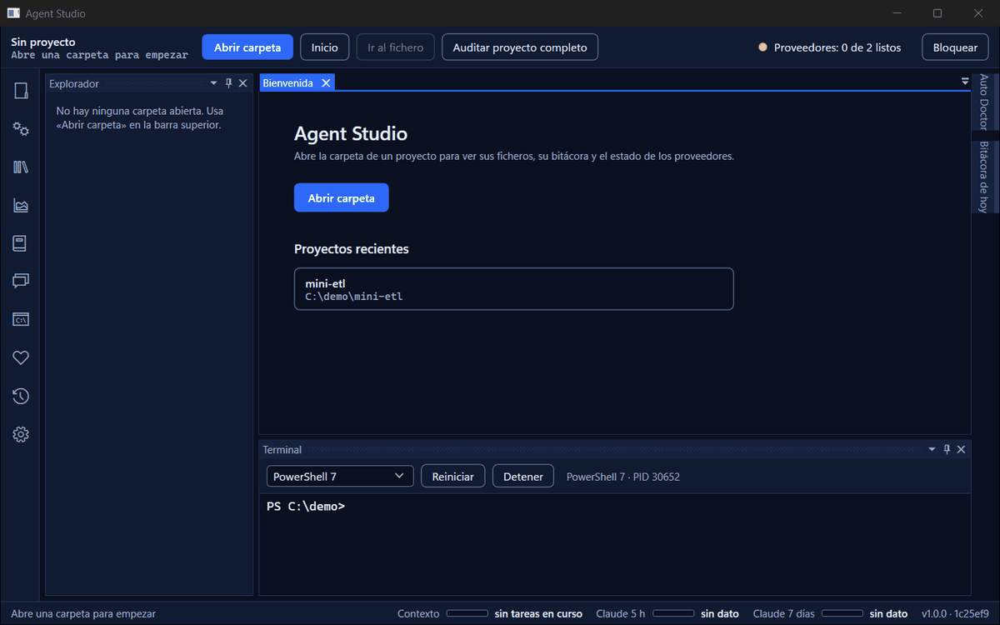
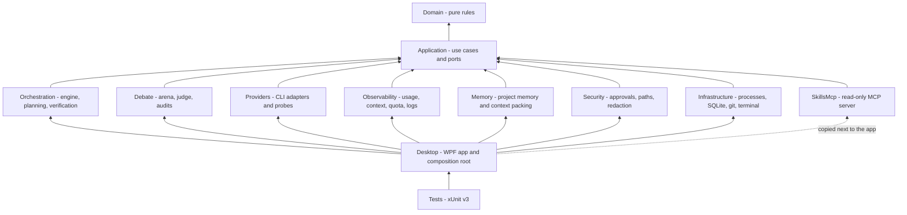
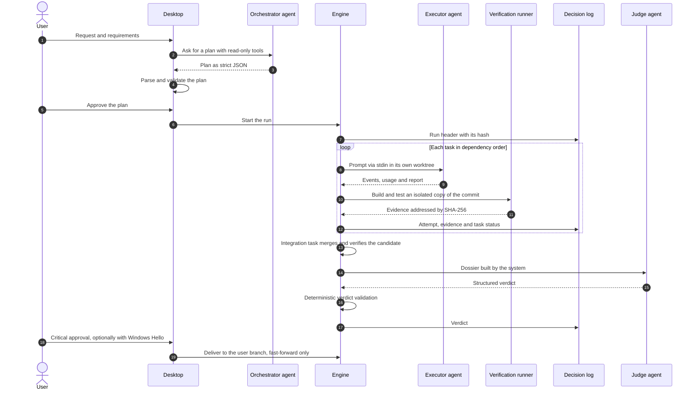

<div align="center">

# Agent Studio

**A Windows desktop IDE that plans work with AI coding agents, lets them debate, and only accepts the result when an independent judge from another vendor confirms it against evidence the system captured itself.**


[](https://github.com/LargoLujan/agent-studio/actions/workflows/ci.yml)
[](LICENSE)


<br>



<sub>Fictional demo project; no AI agents were run for these screenshots. The interface is in Spanish.</sub>

</div>

> **Work in progress.** Agent Studio is under active construction: the orchestration engine, the independent judge, the
> Debate Arena, unattended work and the local semantic index are implemented and tested, while the visual agent builder,
> traceability, remote Git, packaging and several other parts are still unfinished or only designed. See
> [Roadmap and Status](#roadmap-and-status).

AI coding agents are good at producing code and equally good at claiming success. Agent Studio wraps the official
Claude Code and Codex CLIs in a desktop IDE where an orchestrator agent proposes a plan, executor agents work in isolated
Git worktrees, Agent Studio itself builds and tests the result, and a judge from the other vendor issues a structured
verdict that deterministic rules validate before anything reaches your branch. Every decision, piece of evidence and
verdict is stored in an append-only, hash-chained log.

## Table of Contents

- [Overview](#overview)
- [Key Features](#key-features)
- [How It Works](#how-it-works)
- [Tech Stack](#tech-stack)
- [Project Structure](#project-structure)
- [Getting Started](#getting-started)
- [Usage](#usage)
- [Testing](#testing)
- [Documentation](#documentation)
- [Roadmap and Status](#roadmap-and-status)
- [License](#license)
- [Author](#author)

## Overview

Agent Studio is a personal-use IDE for Windows, written in C# on .NET 10 with WPF. It does not call model APIs with its
own keys: it launches the official command-line agents the user has already installed and signed in to, and treats
them as untrusted workers.

The design follows a handful of principles stated in [docs/02-arquitectura.md](docs/02-arquitectura.md):

- **Agents propose, the system verifies.** Builds and tests that count as evidence are run by Agent Studio, not by the
  agent that wrote the code.
- **Nothing is deleted without a trace.** Decisions, evidence, debate contributions and verdicts are append-only.
- **The judge does not depend on the orchestrator.** It receives a dossier that the system builds from its own stores,
  and by default it comes from a different vendor than every agent that produced the work.
- **Every number says where it comes from:** exact, estimated or not available.
- **Pure domain.** Rules for task states, plan validation, verdicts and debates live in a dependency-free domain layer.

By default a project gets this agent team (`DefaultAgentRoster`): Claude Code as **orchestrator** (read-only tools) and
**executor** (file tools confined to its worktree, no shell), and Codex CLI as **judge** in its read-only sandbox.
Debates add two participants (one per vendor) and two more judges.

The user interface and the documentation are written in **Spanish**; code, identifiers and comments are in English.
Multi-language support is planned (Phase 14).

## Key Features

Features listed here are implemented in `src/` and covered by tests in `tests/`. Items still open are listed in
[Roadmap and Status](#roadmap-and-status).

**Orchestration and verification**

- Plans produced by an orchestrator agent as strict JSON, parsed and checked by a deterministic validator (dependency
  cycles, write scopes, integration and review requirements, up to 20 tasks), with one correction round and explicit user
  approval before anything runs.
- Sequential, parallel, conditional and dependent tasks, with task kinds for agent work, tool runs, conditions, human
  approval, integration and review.
- Each writing task runs in its own Git worktree created outside the user's repository; branches are merged by an
  integrator and the candidate is verified before the run branch advances.
- Verification runs `build` and `test` steps from a trusted, per-project verification profile, on an isolated copy of
  the commit under a Windows **Low integrity** token. Test results only count from TRX or JUnit reports.
- Run state is rebuilt by replaying the decision log, so runs can be resumed after a restart without repeating attempts,
  integrations or deliveries.
- Delivery to the user's branch is fast-forward only and requires a single-use critical approval.

**Independent judge, debates and audits**

- Structured verdicts checked by a deterministic `VerdictValidator`; an invalid verdict gets one correction, then the
  decision escalates to a person.
- **Debate Arena** with six modes (free, adversarial, architecture review, implementation audit, orchestrator review and
  tribunal). Round-one proposals are produced in parallel and sealed; rounds, time and tokens are limited and measured
  by the system; the judge reads a blinded dossier.
- **Audit whole project**: verifies the `HEAD` commit in isolation and has a non-producing judge report conformance,
  evidence and open problems.
- **Orchestrator auditor**: deterministic checks over the decision log that raise alerts and can request a replan,
  which blocks delivery until the user decides.
- **Verdict challenges** open a revision debate with a different judge whose verdict replaces the challenged one.

**Observability, memory and skills**

- Usage computed as a projection of the decision log and grouped by provider, vendor, model, session, run, task, agent,
  project or period, with the origin of each figure and CSV and JSON export.
- Context health per step against the model's window, with configurable thresholds (70 / 85 / 95 % by default), and
  real-time bars for context, quota and budget in the status bar, run monitor, tray panel, usage screen, planning view
  and debate room.
- Quota: passive for Claude Code; for Codex an opt-in read of `account/rateLimits/read` from its app-server.
- Project memory that is append-only, anchored to the decision log, searchable with SQLite FTS5 and exported to Markdown;
  a tiered context packer that fails closed; the judge never receives memory.
- A mandatory daily **prompt journal** per project and a deterministic daily summary built from it.
- Skills catalogue read from a local skills index (`catalog.json`): sector folders, tags, activation by scope (agent,
  project, global), context cost and local health checks; a deterministic recommender and an optional assisted one that
  uses a local read-only MCP server.

**Unattended work and the desktop shell**

- Every attempt ends with a classified outcome (usage limit, rate or overload, context exhausted, network, expired
  session, budget, interruption or other), each with its own policy.
- Waits for a usage-limit reset plus a margin when the run was given consent, never switching provider, account or
  model; consented runs resume automatically after an unexpected shutdown.
- A sleep-aware engine clock, context renewal with a system-built hand-off, a notification-area icon with a status
  panel, and a managed exit recorded in each affected run.
- Interface lock (manual or on idle) that keeps work running, unlocked with **Windows Hello**; critical approvals can
  also require Windows Hello.
- IDE basics: docking layout saved per project, file explorer, Monaco editor in WebView2 (tabs, find and replace,
  go-to-file, diff), an xterm.js terminal on ConPTY, a dark theme whose contrast is checked by tests, and structured
  JSON Lines logs with secret redaction.

## How It Works

### Solution layers

Dependencies point inwards ([ADR-0002](docs/adr/0002-capas-y-puertos.md)). `Domain` has no dependencies, every port is
defined in `Application`, modules only implement ports and never reference each other, and `Desktop` is the single
composition root. This is what stops the judge (in `Debate`) from depending on what the orchestrator chooses to show
it.



### Lifecycle of an orchestration run



- **Providers.** Each agent run is a child process of the official CLI (`claude` with stream JSON, `codex exec --json`).
  Prompts always travel through stdin, never as arguments; permission modes are passed explicitly; the process tree is
  killed on cancel through a Job Object; concurrency is limited per provider; and every provider is wrapped by a
  journaling decorator so no prompt runs without a journal entry. Agent Studio never reads the CLIs' credentials.
- **Decision log.** Decisions are stored in SQLite tables whose triggers reject `UPDATE` and `DELETE`, linked in a hash
  chain with an external anchor for the chain head ([ADR-0004](docs/adr/0004-registro-de-decisiones-append-only.md),
  [ADR-0010](docs/adr/0010-estado-derivado-del-registro.md)). Run and debate state is derived from this log.
- **Judge independence.** The judge runs on a vendor different from the orchestrator and every executor
  ([ADR-0014](docs/adr/0014-independencia-del-juez-con-dos-vendors.md)), receives no skills and no memory, and decides
  only from the dossier.
- **Debates.** A debate is its own unit in the decision log with an immutable header
  ([ADR-0026](docs/adr/0026-debate-como-unidad-del-registro.md)). Turns are stateless and rounds are simultaneous and
  sealed ([ADR-0028](docs/adr/0028-turnos-sin-estado-y-rondas-selladas.md)); participants always run read-only. When
  participants come from both vendors, judging uses an explicitly recorded exception, either a cross jury or a judge
  from the vendor that did not produce the work ([ADR-0027](docs/adr/0027-independencia-del-juez-en-debates-con-dos-vendors.md)),
  and a cross jury that disagrees hands the decision to the user.
- **Security model.** The threat model of the orchestration is written down in
  [ADR-0018](docs/adr/0018-modelo-de-amenaza-fase-3.md). Inside it: repository Git configuration and hooks are
  neutralised for internal commands, Git callbacks are allow-listed, links planted in `.git` or in Agent Studio's own
  folders are rejected, and the Claude executor is confined to its worktree with a launch that was measured against a
  specific CLI version. Accepted residual risks include that the Low integrity sandbox blocks writes but not reads or
  network access; stronger isolation is planned for Phase 7.

## Tech Stack

| Area | Technology |
|---|---|
| Language and runtime | C# (latest language version), .NET SDK 10.0.303 pinned in `global.json` |
| Desktop UI | WPF, CommunityToolkit.Mvvm, Dirkster.AvalonDock (docking), Nodify (plan canvas) |
| Editor and terminal | Monaco Editor 0.57.0 and xterm.js 6.0.0 hosted in Microsoft WebView2; ConPTY for the shell |
| Persistence | SQLite through Microsoft.Data.Sqlite with explicit SQL, embedded migrations and FTS5; Markdown exports |
| Agent providers | Claude Code CLI and Codex CLI (tested versions 2.1.290 and 0.160.0 in `SupportedVersions.cs`); Gemini CLI adapter, parked |
| Local MCP server | ModelContextProtocol 2.2.0 (read-only skills recommender) |
| Semantic index | Microsoft.ML.OnnxRuntime and Microsoft.ML.Tokenizers for on-device embeddings (multilingual-e5-small int8, downloaded only with consent) |
| Hosting and logging | Microsoft.Extensions.Hosting, dependency injection, custom JSON Lines file logger |
| Windows integration | Windows SDK projection for Windows Hello, Windows Forms `NotifyIcon` for the tray, Job Objects and integrity labels via P/Invoke |
| Tests | xUnit v3 on Microsoft.Testing.Platform, Microsoft.Extensions.TimeProvider.Testing |
| Build quality | Central package management, nullable reference types, warnings as errors, code style enforced in build |

## Project Structure

```text
agent-studio/
├── AgentStudio.slnx              Solution (.slnx format)
├── global.json                   Pins the .NET SDK and selects Microsoft.Testing.Platform
├── Directory.Build.props         Shared build settings: nullable, warnings as errors, analysers
├── Directory.Packages.props      Central package versions
├── src/
│   ├── AgentStudio.Domain/          Pure rules: task graph, plans, decision log, verdicts, debates, metrics, skills, semantic ranking
│   ├── AgentStudio.Application/     Ports and use cases: providers, execution, orchestration, judging, knowledge, security
│   ├── AgentStudio.Orchestration/   Engine, planner, verification runner, integration and delivery
│   ├── AgentStudio.Debate/          Debate Arena, judge and dossiers, orchestrator and project audits, challenges
│   ├── AgentStudio.Providers/       Claude Code, Codex and Gemini CLI adapters, probes, skill materialiser
│   ├── AgentStudio.Observability/   Usage projection, context health, quota log, file logging
│   ├── AgentStudio.Memory/          Project memory, derivation from the log, context packer, exports, daily summary
│   ├── AgentStudio.Security/        Approval gate, path access policy, secret redaction
│   ├── AgentStudio.Infrastructure/  Processes, Low integrity isolation, ConPTY, git layer, SQLite stores and migrations
│   ├── AgentStudio.SkillsMcp/       Read-only MCP server used by the assisted skills recommender
│   └── AgentStudio.Desktop/         WPF app: shell, editor, terminal, orchestrator, debates, usage, memory, skills, tray, lock
├── tests/
│   └── AgentStudio.Tests/           One xUnit v3 project organised by module, plus integration suites per phase
├── tools/assets/                 Scripts that download Monaco and xterm.js with pinned SHA-512 integrity
├── spikes/                       Throw-away research harnesses, not part of the solution
│   ├── nodify/                      Canvas performance spike behind ADR-0015
│   ├── low-il-verification/         Proof that dotnet build and test run under a Low integrity token
│   └── e5-embeddings/               Tokeniser, size, speed and quality measurements for the semantic index model
└── docs/                         Design documents, ADRs, research, evidence and references (Spanish)
```

Per-project runtime data lives in the user's repository under `.agentstudio/` (see [Configuration](#configuration)).

## Getting Started

### Prerequisites

- **Windows 11.** `AgentStudio.Desktop` and the test project target `net10.0-windows10.0.22000.0` because the Windows
  Hello interop they use is a Windows 11 (build 22000) API ([ADR-0037](docs/adr/0037-windows-hello-y-bloqueo-de-la-interfaz.md)).
- **.NET SDK 10.0.303** or a later feature band of 10.0 (no previews), as pinned in `global.json`.
- **Git for Windows.** The orchestration engine drives `git.exe` and worktrees.
- **Microsoft Edge WebView2 Runtime**, used by the code editor and the terminal.
- **PowerShell 7 (`pwsh`)** and **Windows PowerShell**, plus network access to the npm registry on the first build, to
  download Monaco and xterm.js.
- **Claude Code CLI** and **Codex CLI**, installed and signed in with your own accounts, for any agent feature. The
  default flow needs both, because the judge must come from a different vendor than the agents that produced the work.
  Auto Doctor warns when an installed version has not been tested.
- *Optional:* a local skills index folder containing a `catalog.json`, for the skills catalogue.

### Installation

Clone to a **short path** (see the note in [Testing](#testing)) and build the solution:

```powershell
git clone https://github.com/LargoLujan/agent-studio.git C:\src\agent-studio
cd C:\src\agent-studio
dotnet build AgentStudio.slnx
```

The build must finish with zero warnings, because warnings are treated as errors. The first build of
`AgentStudio.Desktop` runs `tools/assets/fetch-monaco.ps1` and `tools/assets/fetch-xterm.ps1`, which download the
editor and terminal assets from the npm registry and check them against pinned SHA-512 hashes. These assets are never
committed. If the download fails the build still succeeds, but the editor shows that it is unavailable and the terminal
reports an error; run the scripts by hand to fix it:

```powershell
pwsh -NoProfile -File tools/assets/fetch-monaco.ps1
powershell -NoProfile -File tools/assets/fetch-xterm.ps1
```

### Configuration

Nothing has to be configured before the first run. Preferences are changed in the app (**Ajustes**) and saved as JSON
in `%APPDATA%\AgentStudio\settings.json`. The skills index has no field in the interface: to use the skills catalogue,
point `skillsIndexPath` in that file to the folder that holds your `catalog.json` (without it the catalogue reports that
it is not configured and agents run without skills):

```json
{
  "skillsIndexPath": "<path-to-your-skills-index>"
}
```

| Location | What it holds |
|---|---|
| `%APPDATA%\AgentStudio\settings.json` | Recent projects, skills index folder, context thresholds, Codex quota opt-in, close-window behaviour, Windows Hello for critical approvals, idle lock, sleep prevention, window placement |
| `%APPDATA%\AgentStudio\` | Saved layouts and global skill activations |
| `%LOCALAPPDATA%\AgentStudio\` | Worktrees, judge dossiers and skill sessions; `logs\` (JSON Lines, rotated daily and by size, 14-day retention); `usage\quota.jsonl` |
| `<your repo>\.agentstudio\` | `agentstudio.db` (SQLite), `evidence\` (content-addressed), `memory\` (Markdown export), `bitacora\` (daily prompt journal), `tmp\`, `canvas-layout.json`, `verification.json` |

Default settings, from `AppSettings.cs`:

| Setting | Default |
|---|---|
| Context thresholds: warning / compress / critical | 70 / 85 / 95 % of the model's window |
| Read Codex quota from its app-server | Off (opt-in) |
| Closing the window with work running | Ask |
| Windows Hello for critical approvals | On |
| Idle interface lock | Off, 15 minutes when enabled |
| Prevent sleep while work is running | Off |

**Verification profile.** Each project needs a trusted profile in `.agentstudio/verification.json`
([ADR-0016](docs/adr/0016-perfil-de-verificacion.md)). Plans never carry commands; they only name steps of this profile,
and it is frozen per run. For .NET repositories the app proposes a profile with `dotnet build` and
`dotnet test --no-build` writing a TRX report with a strict zero-tests policy, which you review and save.

**Logging.** The file log level defaults to Information and can be changed with the host configuration key
`Logging:File:MinLevel`, for example:

```powershell
$env:Logging__File__MinLevel = 'Debug'
dotnet run --project src/AgentStudio.Desktop
```

### Running

```powershell
dotnet run --project src/AgentStudio.Desktop
```

The **Proveedores** button in the top bar opens Auto Doctor, which shows whether Claude Code, Codex and Gemini CLI are
installed, their versions and whether a session is signed in. These probes only use `--version`, `claude auth status`
and `codex login status`, so they send no prompt and spend no quota. Agent runs, which do spend quota, start only when
you plan, run an approved plan, open a debate, launch an audit or ask for an assisted skill recommendation, or when a
run you gave consent to resumes.

## Usage

Open a folder from the welcome page; it becomes a project and is remembered in the recent list. Screens are reached
from the side bar and the top bar (labels are in Spanish):

| Screen | What it does |
|---|---|
| **Explorador** | File tree of the project; files open in the Monaco editor with tabs, find and replace, and diff against the saved version or another file |
| **Orquestador** | Prepare requirements and the agent team (including each agent's model), ask the orchestrator for a plan, inspect and edit it on the node canvas, approve it, then follow the run in the monitor with per-task context bars, evidence and verdicts |
| **Debates** | Start a debate in one of the six modes, follow the debate room and read the verdict card; challenge a verdict |
| **Auditar proyecto completo** | Audit the `HEAD` commit with isolated verification and an independent judge, and read the conformance report |
| **Consumo** | Usage grouped by provider, model, session, project, period and other dimensions, with the origin of each figure, quota bars and CSV or JSON export |
| **Memoria** | Search and review the project memory, its trust level, and the daily summary built from the prompt journal |
| **Skills** | Browse the skills catalogue by sector, activate skills per scope and ask for recommendations |
| **Ajustes** | Context thresholds, Codex quota opt-in, unattended work, Windows Hello and lock settings |
| **Proveedores** | Compact Auto Doctor panel with one row per provider CLI |
| **Bloquear** | Lock the interface; work keeps running and approvals wait until you unlock with Windows Hello |

Useful shortcuts: `Ctrl+P` go to file, `Ctrl+Shift+D` debates, `Ctrl+Shift+A` audit the whole project, `Ctrl+Alt+L`
lock the interface, `Ctrl+Alt+D` compare with the saved version, `Ctrl+Alt+F` compare with another file.

Closing the window while work is running can keep the app in the notification area, where a panel summarises active
projects, agents, tasks, tokens, context, quota and pending approvals.

## Testing

The solution has a single test project, `tests/AgentStudio.Tests`, organised by module (`Domain`, `Application`,
`Orchestration`, `Debate`, `Providers`, `Observability`, `Memory`, `Security`, `Infrastructure`, `Desktop`,
`SkillsMcp`) plus `Integration/Phase3`, `Phase4`, `Phase5` and `Phase8` suites. A static count of test attributes finds
about 4,490 `[Fact]` and 561 `[Theory]` methods.

```powershell
dotnet test
```

Tests run on Microsoft.Testing.Platform. Do not pass `-nologo` (the repository notes that no test runs with it).
Filters go after `--`:

```powershell
# Skip tests that use real local tools (git, dotnet, WebView2, PowerShell, CLI probes, Low integrity processes)
dotnet test -- --filter-not-trait "Category=LocalTools"

# Run only those tests
dotnet test -- --filter-trait "Category=LocalTools"
```

| Category | What it covers |
|---|---|
| `LocalTools` | Real local tools: git worktrees and delivery, Low integrity verification, the WebView2 editor bridge, CLI probes, the journal hook |
| `ConPty` | The real ConPTY terminal session |
| `Measurement` | Performance measurements of the git layer and usage projection |
| `ProviderLive` | Real runs of Claude Code and Codex that **spend subscription quota** |

The [CI workflow](.github/workflows/ci.yml) builds the solution and runs the suite on Windows for every push to `main`
and every pull request, leaving out these four categories.

Live provider tests are skipped unless you opt in, and some suites need a second variable (`AGENTSTUDIO_E2E=1` for the
Phase 3 end-to-end run, `AGENTSTUDIO_PHASE5_DEMOS=1` for the debate demonstrations):

```powershell
$env:AGENTSTUDIO_PROVIDER_TESTS = '1'
dotnet test -- --filter-trait "Category=ProviderLive"
```

> **Clone to a short path on Windows.** The persistence tests use SQLite through Microsoft.Data.Sqlite, which loads a
> native SQLite library from the test output folder. If the repository sits in a very deep folder, that path can exceed
> the Windows `MAX_PATH` limit and loading the native library fails, which makes many tests fail for reasons unrelated
> to the code. Clone the repository to a short path such as `C:\src\agent-studio`.

## Documentation

The design is documented in Spanish under [docs/](docs/). Start with [docs/README.md](docs/README.md), which maps every
document.

| Document | Summary |
|---|---|
| [README.md](docs/README.md) | Index of the documentation: deliverables, phase designs, ADRs, research and evidence |
| [01-viabilidad-y-riesgos.md](docs/01-viabilidad-y-riesgos.md) | Technical feasibility by area, risks, and limitations that have no technical fix |
| [02-arquitectura.md](docs/02-arquitectura.md) | Design principles, context and component diagrams, solution structure, process model, task states and alternatives considered |
| [03-pantallas-y-navegacion.md](docs/03-pantallas-y-navegacion.md) | Screen and navigation design, plus the manual walkthrough checklists |
| [04-contratos.md](docs/04-contratos.md) | Map of the ports defined in `Application` and whether each one is implemented |
| [05-modelo-de-datos.md](docs/05-modelo-de-datos.md) | SQLite data model, entity-relationship diagram, migrations and the reasons behind them |
| [06-integracion-proveedores.md](docs/06-integracion-proveedores.md) | How the official CLIs are wrapped: rules, adapter lifecycle, per-provider details and event normalisation |
| [07-debate-arena-y-juez.md](docs/07-debate-arena-y-juez.md) | Debate roles, modes and protocol, the structured verdict and its validation, judge independence and audits |
| [08-plan-y-criterios-de-aceptacion.md](docs/08-plan-y-criterios-de-aceptacion.md) | Phase plan with verifiable acceptance criteria and the evidence-backed status of each criterion |
| [09-informe-fase-0.md](docs/09-informe-fase-0.md) | Phase 0 report: what was built, how it was verified and what was left open |
| [10-catalogo-de-skills.md](docs/10-catalogo-de-skills.md) | Skills catalogue: organisation, sources, activation, recommendation, health checks and screen |
| [11-bitacora.md](docs/11-bitacora.md) | The mandatory daily prompt journal: format, tags, privacy and daily summary |
| [12-accesibilidad-tema-oscuro.md](docs/12-accesibilidad-tema-oscuro.md) | WCAG 2.1 AA contrast and keyboard focus review of the dark theme, measured by tests |
| [13-fase-3-orquestacion.md](docs/13-fase-3-orquestacion.md) | Phase 3 design: orchestration engine, worktrees, contracts, end-to-end flow and test strategy |
| [14-fase-4-observabilidad-y-memoria.md](docs/14-fase-4-observabilidad-y-memoria.md) | Phase 4 design: usage, context health, quota, project memory, context packing and skills recommender |
| [15-fase-5-debate-arena-y-juez.md](docs/15-fase-5-debate-arena-y-juez.md) | Phase 5 design: debate coordination, blinded dossiers, verdicts, audits and challenges |
| [16-ampliacion-plataforma-de-proyectos.md](docs/16-ampliacion-plataforma-de-proyectos.md) | Analysis of the "project platform" extension and the plan for Phases 6 to 11 |
| [17-constructor-visual-de-agentes.md](docs/17-constructor-visual-de-agentes.md) | Design proposal, awaiting decisions, for Phases 12 to 15: semantic index, visual agent builder, final product block and full UI check |
| [18-peticiones-y-pendientes.md](docs/18-peticiones-y-pendientes.md) | Living log of feature requests, findings from live walkthroughs and the prioritised backlog |

Supporting folders: [docs/adr/](docs/adr/) (architecture decision records), [docs/investigacion/](docs/investigacion/)
(research on providers, the stack, skills and spikes), [docs/evidencias/](docs/evidencias/) (screenshots and records of
real demonstrations) and [docs/referencias/](docs/referencias/) (the original specification and visual references).

<details>
<summary>Architecture decision records</summary>

ADR numbers 0038 to 0046 are reserved for the decisions of Phases 6 to 11, which are not written yet.

| ADR | Decision |
|---|---|
| [0001](docs/adr/0001-wpf-y-dotnet-10.md) | WPF on .NET 10 (LTS) |
| [0002](docs/adr/0002-capas-y-puertos.md) | Layered solution: pure domain and ports in Application |
| [0003](docs/adr/0003-integracion-por-clis-oficiales.md) | Integration through the official CLIs, personal use only |
| [0004](docs/adr/0004-registro-de-decisiones-append-only.md) | Append-only decision and evidence log with a hash chain |
| [0005](docs/adr/0005-sqlite-y-markdown.md) | SQLite with explicit SQL, Markdown for readable exports |
| [0006](docs/adr/0006-juez-independiente-verificable.md) | Independent judge with a verifiable verdict |
| [0007](docs/adr/0007-catalogo-de-skills.md) | Skills catalogue by sector, with tags, scopes and health |
| [0008](docs/adr/0008-bitacora-obligatoria.md) | Mandatory daily prompt journal, enforced by a decorator and a hook |
| [0009](docs/adr/0009-google-aparcado.md) | Google providers parked |
| [0010](docs/adr/0010-estado-derivado-del-registro.md) | Run state derived from the decision log and resumed by replay |
| [0011](docs/adr/0011-tareas-condicionales.md) | Conditional tasks: skipped state, branch edges and join policy |
| [0012](docs/adr/0012-worktrees-fuera-del-repo.md) | Worktrees outside the repository, own refs, delivery only with approval |
| [0013](docs/adr/0013-protocolo-del-orquestador.md) | Orchestrator protocol: portable schema, strict parsing, validator, one correction, user approval |
| [0014](docs/adr/0014-independencia-del-juez-con-dos-vendors.md) | Judge independence with two vendors |
| [0015](docs/adr/0015-lienzo-nodify.md) | Orchestrator canvas built with Nodify |
| [0016](docs/adr/0016-perfil-de-verificacion.md) | Trusted verification profile frozen per run, results only from TRX or JUnit |
| [0017](docs/adr/0017-verificacion-aislada-baja-integridad.md) | Isolated verification under Low integrity |
| [0018](docs/adr/0018-modelo-de-amenaza-fase-3.md) | Threat model of the orchestration and its accepted residual risks |
| [0019](docs/adr/0019-consumo-como-proyeccion-del-registro.md) | Usage as a projection of the decision log |
| [0020](docs/adr/0020-cuota-pasiva-en-claude-y-lectura-opcional-en-codex.md) | Passive quota for Claude, optional app-server read for Codex |
| [0021](docs/adr/0021-salud-del-contexto-por-paso.md) | Context health measured per step against the step's model window |
| [0022](docs/adr/0022-memoria-append-only-anclada.md) | Append-only memory anchored to the log, with trust by origin |
| [0023](docs/adr/0023-empaquetado-de-contexto-por-niveles.md) | Tiered context packing that fails closed |
| [0024](docs/adr/0024-recomendador-asistido-con-mcp-local.md) | Assisted skills recommender through a local read-only MCP server |
| [0025](docs/adr/0025-resumen-diario-determinista.md) | Deterministic daily summary from the prompt journal |
| [0026](docs/adr/0026-debate-como-unidad-del-registro.md) | A debate as a unit of the decision log |
| [0027](docs/adr/0027-independencia-del-juez-en-debates-con-dos-vendors.md) | Judge independence in debates with two vendors |
| [0028](docs/adr/0028-turnos-sin-estado-y-rondas-selladas.md) | Stateless turns and sealed simultaneous rounds |
| [0029](docs/adr/0029-veredicto-de-un-debate.md) | The verdict of a debate and its blinded dossier |
| [0030](docs/adr/0030-auditar-proyecto-completo.md) | Audit whole project |
| [0031](docs/adr/0031-auditor-determinista-del-orquestador.md) | Deterministic orchestrator auditor and replan requests |
| [0032](docs/adr/0032-impugnacion-de-veredictos.md) | Challenging a verdict through a revision debate |
| [0033](docs/adr/0033-alcance-de-la-ampliacion-plataforma-de-proyectos.md) | Scope of the "project platform" extension |
| [0034](docs/adr/0034-esperas-por-limite-y-reanudacion-con-consentimiento.md) | Waiting for usage-limit resets and resuming with per-run consent |
| [0035](docs/adr/0035-final-clasificado-y-renovacion-del-contexto.md) | Classified attempt endings and context renewal with a hand-off |
| [0036](docs/adr/0036-vida-de-la-app-y-bandeja.md) | App lifetime, tray, managed exit, sleep and clock |
| [0037](docs/adr/0037-windows-hello-y-bloqueo-de-la-interfaz.md) | Windows Hello for critical approvals and an interface lock |
| [0047](docs/adr/0047-indice-semantico-local.md) | Local semantic index with on-device embeddings and hybrid search |
| [0048](docs/adr/0048-constructor-visual-equipo-y-plan.md) | Visual builder: a canvas with the Team and Plan layers; the Team layer is the template |
| [0049](docs/adr/0049-analizador-del-montaje-y-orden.md) | Team and order analyzer: deterministic rules with typed fixes; order notes only suggest |
| [0050](docs/adr/0050-modelos-y-potencia.md) | Models and effort: local catalog without prices, learned from the log, usage estimator |
| [0051](docs/adr/0051-preguntas-de-los-agentes.md) | Agent questions with options, recorded and answered as data; the judge never asks |
| [0052](docs/adr/0052-analisis-del-consumo-y-contexto-por-partes.md) | Consumption analysis and the context split into parts |
| [0053](docs/adr/0053-windows-hello-como-barrera-fija.md) | Windows Hello as a fixed barrier that no setting or file turns off |
| [0054](docs/adr/0054-idiomas-y-lenguaje-claro.md) | Languages and plain language: `.resx` resources, Windows language by default |
| [0055](docs/adr/0055-configurador-por-proyecto.md) | Per-project setup wizard and Node and Python verification profiles |

</details>

## Roadmap and Status

Status is taken from the acceptance tables in [docs/08](docs/08-plan-y-criterios-de-aceptacion.md), the backlog in
[docs/18](docs/18-peticiones-y-pendientes.md) and what is actually present in `src/` and `tests/`. "Verified by tests"
means the acceptance criterion is covered by automated tests but its manual demonstration in the app is still pending.

### Done

| Phase | Scope | Notes |
|---|---|---|
| 0 · Architecture and prototype | Solution, contracts, domain rules, SQLite schema, provider probes | Closed; see [docs/09](docs/09-informe-fase-0.md) |
| 1 · Minimal IDE | Docking shell, explorer, Monaco editor, ConPTY terminal, dark theme, structured logging | Integrated; the editor and per-project layout criteria still await a manual demonstration |
| 2 · Providers | Claude Code and Codex adapters, structured output, cancellation, concurrency limits, skill materialisation | Done for Claude Code and Codex; Gemini CLI is documented as unsupported ([ADR-0009](docs/adr/0009-google-aparcado.md)) |
| 3 · Orchestration | Engine, worktrees, integration, isolated verification, decision log, canvas, approvals, end-to-end run with a cross-vendor judge | Closed 2026-10-18 after nine adversarial security review rounds; the canvas demonstration in the app is pending |
| 4 · Observability and memory | Usage, export, context health, quota, project memory, context packing, skills screen and recommender, daily summary | Integrated 2026-10-18; usage, context health and skills screens verified by tests only |
| 5 · Debate Arena and judge | Six debate modes, limits, verdict validation, project audit, orchestrator auditor, challenges | Closed 2026-10-21 with real demonstrations of every mode |
| 8 · Unattended work | Classified attempt endings, quota waits, resume, sleep handling, context renewal, tray, managed exit, Windows Hello and lock | Integrated 2026-10-29 and partly verified live; sleep, sign-out, fingerprint confirmation and a real usage limit are still to be demonstrated |
| 12 · Local semantic index | Journal anchored as memory with its trust level, on-device embeddings, hybrid keyword and meaning search, relevance in context packing, a history tool for the planner; nothing reaches the judge | Merged 2026-11-05 ([PR #4](https://github.com/LargoLujan/agent-studio/pull/4)); search quality, speed and the history tool measured, the rest verified by tests; the manual demonstration of **Memoria** is pending |
| UI fix rounds 1, 2 and 2b | Fixes from the first live walkthrough, real-time bars for context, quota and budget, and the small issues found in the 2026-11-03 walkthrough (journal view refresh, status bar context during planning, accessible names of some list items, layout at certain widths) | Integrated; round 2 verified live on 2026-11-03; round 2b merged with [PR #4](https://github.com/LargoLujan/agent-studio/pull/4), its live check pending |

### In progress

- **Phase 12 follow-ups.** V40 to V42, the three small fixes to the **Memoria** screen found in the 2026-11-05
  walkthrough, are fixed in [PR #38](https://github.com/LargoLujan/agent-studio/pull/38) (Phase 12b) and wait for a live check. The improvements to the hybrid
  search seen on the real journal (P40) are still open. Both are listed in [docs/18](docs/18-peticiones-y-pendientes.md);
  design in [ADR-0047](docs/adr/0047-indice-semantico-local.md).
- **Manual demonstrations** of the criteria marked "verified by tests" in Phases 1, 3, 4, 5, 8 and 12.
- **Self-audit.** 93 tests fail when run under Low integrity (mostly tests that create temporary folders in
  `LocalAppData`), so "Audit whole project" cannot yet approve this repository.
- **Phase 13 · Visual team builder.** The design review of [docs/17](docs/17-constructor-visual-de-agentes.md) closed
  on 2026-11-06 with every recommended option accepted (§12), which unblocks Phases 13 to 15.
  - Wave 1 (merged, #41): the foundations, the team and order analyzer, models and the usage estimator, context parts and
    consumption analysis, agent questions in the engine, Windows Hello as a fixed barrier, and the language in Settings.
  - Wave 2: the canvas with Team and Plan layers, the per-project setup wizard (with Node and Python verification), the
    live monitor with the question window and tray notice, consumption analysis, the Problems, Output and Tests panels,
    and Tools.
  - Pending: a live demonstration with a real question and a delivery with Hello. Small follow-ups are in docs/18 (P46
    to P53).

### Planned

In the order agreed in [docs/18](docs/18-peticiones-y-pendientes.md):

- **Phase 13 · Visual agent builder.** One canvas with "team" and "plan" layers, per-agent bars, a model catalogue with
  deterministic recommendations, a per-project setup wizard, agent questions with options, and Windows Hello as a fixed
  barrier for critical actions.
- **Phase 14 · Final product block.** Multiple UI languages (Windows language by default), plain-language texts, info
  buttons, a help chat, client documentation export, and **Phase 9 · Work and traceability**: milestones, backlog,
  board, traceability links, participation, usage per milestone, estimates, budgets and a "Repository and changes" view.
- **Phase 6 · Auto Doctor and Auto Graph.** Full environment checks, a Roslyn dependency graph, a skills doctor and
  generated Mermaid diagrams.
- **Phase 10 · Remote Git.** Publishing, pull requests and synchronisation with GitHub through `gh`.
- **Phase 7 · Security, testing and packaging.** Strong verification isolation, network policy and prompt-injection
  defences, a DPAPI credential vault (only the `ICredentialVault` contract exists today), an effective-permissions view,
  an installer with updates, and an end-to-end traceability suite.
- **Phase 15 · Full UI check** of every screen, option and prompt.
- **Phase 11 · Per-project environments and services** (Docker Compose, Dev Containers): optional and deferred.

Out of scope for now: an Azure and Microsoft Fabric add-on, and other operating systems. Gemini CLI stays parked until
it can be used with an API key.

### Known limitations

- There is no installer yet; the app is built and run from source.
- The interface is in Spanish only.
- An agent that blocks with a question cannot be answered: "retry" restarts the task without any text.
- Five fields of an agent definition (`PathGrants`, `SystemInstructions`, `Objectives`, `MaxRounds`, `MaxTotalTokens`)
  are stored and hashed but do not yet change how the agent runs.
- Two approvals (skills consent and plan approval on the canvas) do not go through the central approval gate, and
  Windows Hello for critical approvals can be switched off in settings.
- A human "decide myself" resolution of a debate is not replayed after a restart.
- The usage report has no filters yet (provider, model, project), and its JSON export carries no query.
- The Low integrity sandbox blocks writes outside its area but not reads or network access.

## License

Distributed under the MIT License. See [LICENSE](LICENSE) for details.

## Author

**Manuel Luján Vílchez** — Senior Data Engineer

[](https://github.com/LargoLujan)
[](https://www.linkedin.com/in/manuel-lujan-vilchez)
