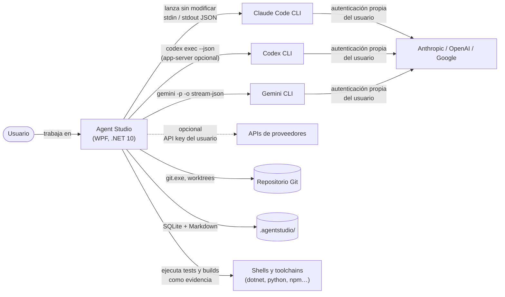
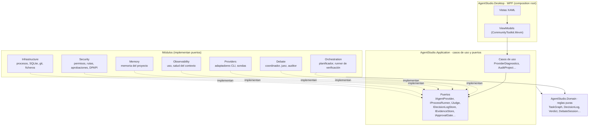
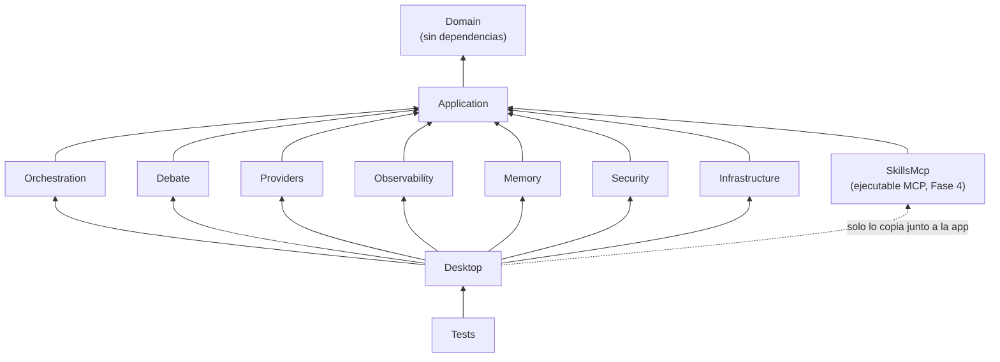
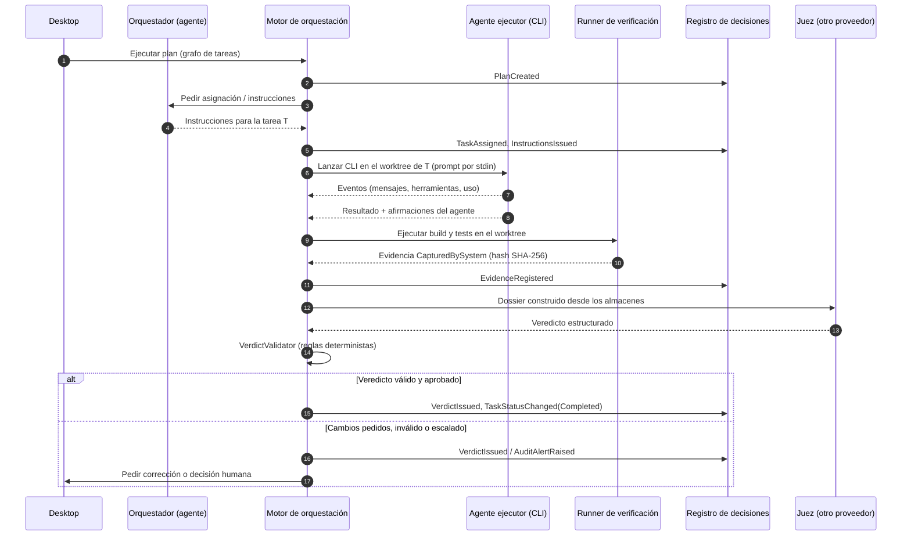
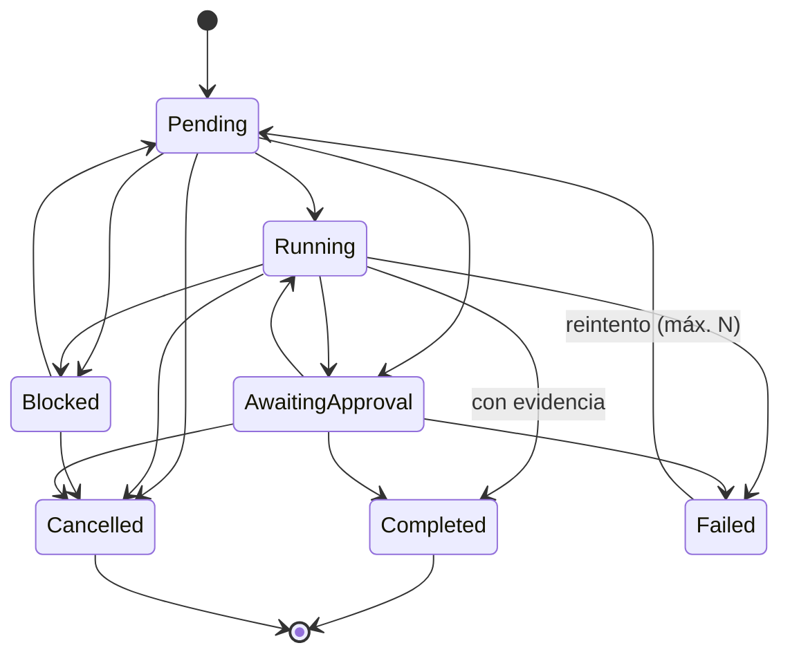

# 02 · Arquitectura recomendada, alternativas y estructura de la solución

> Entregables 3, 4 (en parte) y 6 de la sección 19. Las decisiones con más peso tienen su ADR en [adr/](adr/).

## 1. Principios que ordenan el diseño

1. **El sistema verifica, los agentes proponen.** Los agentes (y el orquestador, que también es un agente) producen
   cambios y afirmaciones. Las pruebas que cuentan como evidencia las ejecuta Agent Studio, no el agente.
2. **Nada se borra sin rastro.** Decisiones, evidencias, contribuciones de debate y veredictos son append-only.
3. **El juez no depende del orquestador.** Recibe un dossier que construye el sistema desde sus propios almacenes.
4. **Cada número dice de dónde sale.** Exacto, estimado o no disponible.
5. **Dominio puro.** Las reglas (estados, ciclos, veredictos, debate) viven en código sin E/S, testeable en
   milisegundos y portable (`net10.0`, no `net10.0-windows`).

## 2. Vista de contexto



Agent Studio nunca habla con los backends de los proveedores usando las credenciales de los CLIs: o lanza el CLI
oficial, o (opcionalmente) usa una API key que el usuario le confía. Agent Studio es de uso personal: no se distribuye.

## 3. Vista de componentes



## 4. Estructura de la solución y dependencias

Los once proyectos que pide la sección 17, más `AgentStudio.SkillsMcp` desde la Fase 4 (doce en total, [ADR-0024](adr/0024-recomendador-asistido-con-mcp-local.md)), con estas reglas de dependencia:



| Proyecto | TFM | Depende de | Por qué |
|---|---|---|---|
| `AgentStudio.Domain` | net10.0 | — | Reglas puras. Sin paquetes ni E/S: se prueba sin infraestructura y no se ata a Windows. |
| `AgentStudio.Application` | net10.0 | Domain | Casos de uso y **puertos** (interfaces). Es el único sitio donde se definen contratos entre módulos. |
| `AgentStudio.Orchestration` | net10.0 | Application | Ejecuta grafos de tareas. Usa proveedores, almacenes y aprobaciones solo a través de puertos. |
| `AgentStudio.Debate` | net10.0 | Application | Protocolo de debate, juez y auditor del orquestador. No puede llamar al orquestador: solo lee almacenes. |
| `AgentStudio.Providers` | net10.0 | Application | Adaptadores de CLIs y sondas. Ejecuta procesos mediante `IProcessRunner`, sin conocer su implementación. |
| `AgentStudio.Observability` | net10.0 | Application | Métricas con procedencia, salud del contexto, exportación CSV/JSON. |
| `AgentStudio.Memory` | net10.0 | Application | Memoria del proyecto (SQLite FTS5 + Markdown). |
| `AgentStudio.Security` | net10.0 | Application | Política de rutas, permisos por herramienta, puerta de aprobación, almacén DPAPI. |
| `AgentStudio.Infrastructure` | net10.0 | Application | Procesos reales, localización de ejecutables, SQLite, git, sistema de ficheros. |
| `AgentStudio.SkillsMcp` | net10.0 | Application | Servidor MCP local de solo lectura del recomendador asistido de skills (Fase 4): un segundo ejecutable que Claude Code lanza por stdio. Ningún módulo lo referencia. |
| `AgentStudio.Desktop` | net10.0-windows10.0.22000.0 | todos | WPF y **raíz de composición**: el único proyecto que conoce todas las implementaciones. Referencia `SkillsMcp` solo para que su ejecutable viaje junto a la app. Desde la Fase 8 apunta al SDK de Windows de la compilación 22000, cuya proyección trae la interoperabilidad de Windows Hello para una ventana de escritorio ([16](16-ampliacion-plataforma-de-proyectos.md#26-autenticación-y-bloqueo-del-ide-sección-6), D-13). |
| `AgentStudio.Tests` | net10.0-windows10.0.22000.0 | Desktop | Un único proyecto de tests (xUnit v3) organizado por carpetas de módulo. Con el mismo TFM que `Desktop`, al que referencia. |

Por qué los módulos no se referencian entre sí: si `Debate` pudiera llamar a `Orchestration`, el juez podría acabar
dependiendo de lo que el orquestador decide enseñarle. Toda colaboración pasa por un puerto de `Application` y se
conecta en `Desktop`. El compilador impide así los atajos.

```text
Agent Studio/
├── AgentStudio.slnx            Solución (formato .slnx de .NET 10)
├── global.json                 Fija el SDK 10.0.303 (hay un SDK 11 preview instalado)
├── Directory.Build.props       Nullable, warnings como errores, analizadores
├── Directory.Packages.props    Versiones centralizadas y verificadas
├── src/
│   ├── AgentStudio.Domain/         Common, Agents, Work, Requirements, Evidence, Decisions, Judging, Debate, Metrics
│   ├── AgentStudio.Application/    Execution, Providers, Diagnostics, Persistence, Judging, Coordination, Security, Knowledge
│   ├── AgentStudio.Orchestration/
│   ├── AgentStudio.Debate/
│   ├── AgentStudio.Providers/      Cli/ (sondas; adaptadores en Fase 2)
│   ├── AgentStudio.Observability/  ContextHealth/
│   ├── AgentStudio.Memory/
│   ├── AgentStudio.Security/       Paths/
│   ├── AgentStudio.Infrastructure/ Processes/, Persistence/Schema/
│   └── AgentStudio.Desktop/        Themes/, ViewModels/, Composition/
├── tests/AgentStudio.Tests/    Domain/, Infrastructure/, Providers/, Observability/, Security/, Desktop/
└── docs/                       Esta documentación, ADR, investigación y referencias
```

Datos de ejecución por proyecto de usuario (no se versionan): `<repo del usuario>/.agentstudio/` con
`agentstudio.db` (SQLite), `evidence/` (contenido direccionado por SHA-256) y `memory/` (exportación Markdown).

## 5. Modelo de procesos y ejecución



- Cada ejecución de agente es **un proceso hijo** del CLI oficial, con su directorio de trabajo en un **git
  worktree** propio cuando hay tareas en paralelo. Agent Studio controla timeout, cancelación (mata el árbol de
  procesos) y concurrencia máxima por proveedor.
- La **validación final** la hace el runner de verificación de Agent Studio en el worktree, no el agente: así un
  agente no puede declarar «tests en verde» sin que sea cierto.
- El **orquestador** es un agente más (con su proveedor y sus permisos). El **motor** de orquestación es código
  determinista que aplica las reglas del dominio y registra todo.

## 6. Estados de una tarea



`TaskGraph.Analyze` detecta tareas abandonadas (en ejecución sin latido), tareas inalcanzables (dependen de una
cancelada o fallida sin reintentos), reintentos agotados y bloqueo total del grafo.

## 7. Decisiones y alternativas

### D1 · Tecnología de escritorio → **WPF sobre .NET 10** ([ADR-0001](adr/0001-wpf-y-dotnet-10.md))

| Opción | Ventajas | Inconvenientes |
|---|---|---|
| **WPF** (elegida) | Madura, estable, MVVM consolidado, ecosistema de docking (AvalonDock) y grafos (Nodify), WebView2 integrado | Solo Windows; estética por defecto anticuada (se resuelve con tema propio) |
| WinUI 3 | Fluent moderno, Windows App SDK | Menos controles de terceros para docking y grafos; empaquetado y ciclo de vida más delicados |
| Avalonia | Multiplataforma, XAML parecido | Menos maduro para un IDE con WebView2 en Windows; WebView en Avalonia aún limitado |
| Electron / Tauri | Ecosistema web, VS Code como referencia | Contradice «C# para todo el núcleo»; dos runtimes; más memoria (Electron) |

### D2 · Integración con proveedores → **CLIs oficiales en modo headless** ([ADR-0003](adr/0003-integracion-por-clis-oficiales.md))

| Opción | Ventajas | Inconvenientes |
|---|---|---|
| **CLI headless propio de cada herramienta** (elegida para la Fase 2) | Interfaz oficial y documentada; el usuario usa su propia sesión; sin dependencias extra | Tres formatos de eventos distintos que normalizar; el control interactivo (aprobaciones) varía |
| Agent Client Protocol (ACP) | Un protocolo común (JSON-RPC por stdio) con permisos y cancelación | Para Claude y Codex depende de adaptadores de terceros (Zed) sobre el Agent SDK y el app-server; sin SDK .NET oficial; más superficie en la zona gris de términos. Se reevalúa tras la Fase 2 como adaptador alternativo |
| API directa | Términos claros para productos; métricas exactas | Requiere API key y pago por uso; hay que reimplementar herramientas de agente (edición, shell) |
| Agent SDK (TS/Python) como proceso auxiliar | Control fino del bucle de agente | Añade Node/Python como runtime del núcleo; los términos del Agent SDK piden API key a terceros |

### D3 · Persistencia → **SQLite con Microsoft.Data.Sqlite + SQL explícito** ([ADR-0005](adr/0005-sqlite-y-markdown.md))

EF Core facilita el mapeo pero oculta el SQL justo donde importa (triggers append-only, FTS5, índices). Se usa SQL
explícito con Dapper cuando haya repositorios (Fase 3-4); Markdown solo como exportación legible.

### D4 · Integridad de decisiones y evidencias → **cadena de hashes + triggers append-only** ([ADR-0004](adr/0004-registro-de-decisiones-append-only.md))

Alternativas: tabla normal (no detecta manipulación), libro mayor externo o firmas (más seguro, más complejo; se
evalúa en la Fase 7).

### D5 · Juez → **otro proveedor + validador determinista + evidencias del sistema** ([ADR-0006](adr/0006-juez-independiente-verificable.md))

Alternativas: juez del mismo proveedor (sesgos compartidos), votación por mayoría (el prompt la prohíbe como
sustituto de las pruebas), solo tests automáticos (no cubren requisitos de diseño o documentación).

### D6 · Lienzo del orquestador → **Nodify (WPF nativo)**; respaldo: React Flow en WebView2

Nodify (MIT) mantiene la UI en XAML y bindings. React Flow (MIT) da más funciones de serie, pero obliga a un puente
JS↔C# para cada interacción. **Decidido el 2026-10-15** con el spike de la Fase 3: Nodify 7.3.0
([ADR-0015](adr/0015-lienzo-nodify.md)).

### D7 · Git → **git.exe** (con `LibGit2Sharp` opcional)

`git worktree` y los hooks del usuario funcionan igual que en su terminal. LibGit2Sharp (MIT) queda para lecturas
rápidas (estado, diff) si el rendimiento lo pide.

## 8. Lo transversal

- **Cancelación:** todo método asíncrono acepta `CancellationToken`; cancelar una ejecución mata el árbol de procesos.
- **Logging:** `Microsoft.Extensions.Logging` con un proveedor propio de fichero estructurado, JSON Lines en
  `%LOCALAPPDATA%\AgentStudio\logs` (Observability, Fase 1). No añade dependencias: Serilog no hizo falta.
  - Redacta secretos con `ISecretRedactor` y nunca registra prompts completos (longitud + hash).
  - La app no usa los proveedores por defecto del host.
- **Recuperación de errores:** reintentos solo en operaciones idempotentes; los fallos de un proveedor no tumban la
  aplicación (ya aplicado en `ProviderDiagnostics`).
- **Convenciones:** código, identificadores y comentarios en inglés; textos de interfaz y documentación en castellano.
