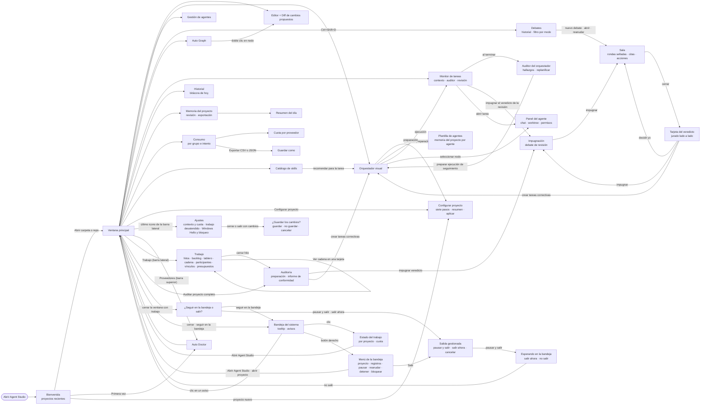

# 03 · Diseño de pantallas y navegación

> Entregable 5 de la sección 19. Referencia visual: [referencias/dashboard-oscuro-referencia.png](referencias/dashboard-oscuro-referencia.png).
> Se conserva su distribución (barra lateral, lienzo central con el árbol de agentes, panel derecho contextual, pestañas
> inferiores) y se añade lo que pide el prompt: editor, terminal, Debate Arena, juez y salud del contexto.

## 1. Lenguaje visual

| Token | Uso | Valor orientativo |
|---|---|---|
| `Background` | Fondo de ventana | `#0B1020` (azul marino muy oscuro) |
| `Surface` / `SurfaceRaised` | Paneles y tarjetas | `#111829` / `#172036` |
| `Border` | Bordes finos de tarjetas | `#26314D` |
| `TextPrimary` / `TextSecondary` | Texto | `#E6EAF2` / `#9AA5BD` (contraste ≥ 4.5:1 sobre el fondo) |
| `Accent` | Acción principal, selección | `#3B7BFF` |
| `Success` / `Warning` / `Danger` | Ejecutando o completado / esperando / bloqueado o fallido | `#2FBF71` / `#F2A93B` / `#F0566A` |
| `Judge` | Todo lo que emite el juez | `#A879FF` (violeta, para distinguirlo del resto) |

Los colores de estado siempre van acompañados de texto o icono (no se comunica nada solo con color). Los valores
definitivos se fijan en `Themes/Dark.xaml` con revisión de accesibilidad en la Fase 1.

## 2. Ventana principal

```text
┌─ Agent Studio ─────────────────────────────────────────────────────────────────────────────────────────────┐
│ [▼ Proyecto: monorepo]  [▼ Claude Code · opus ●sesión]  Agentes: 3▶ 2⏸ 1⛔   [Auditar proyecto completo]  ⚙ │  ← barra superior
├──┬───────────────────────────────────────────────────────────────────────────┬─────────────────────────────┤
│📁│  [Editor] [Orquestador] [Grafo] [Agentes] [Debate] [Tareas]                │ [Chat] [Tareas] [Contexto]  │
│⎇ │ ┌───────────────────────────────────────────────────────────────────────┐ │ [Consumo] [Actividad] [Juez]│
│🤖│ │                                                                       │ │                             │
│🩺│ │                 Zona central superior (documento activo)              │ │   Panel derecho contextual  │
│🕸│ │                                                                       │ │   (cambia con la selección) │
│🧪│ │                                                                       │ │                             │
│🛠│ └───────────────────────────────────────────────────────────────────────┘ │                             │
│🕘│  [Terminal ▾pwsh] [Salida] [Errores] [Depuración] [Pruebas]                │                             │
│  │ ┌───────────────────────────────────────────────────────────────────────┐ │                             │
│⚙ │ │ PS C:\repo> dotnet test                                               │ │                             │
│  │ └───────────────────────────────────────────────────────────────────────┘ │                             │
├──┴───────────────────────────────────────────────────────────────────────────┴─────────────────────────────┤
│ ● 3 agentes · T1 contexto ~62 % (estimado por Agent Studio) · Claude 5 h: 47 % (vista hace 12 min)          │  ← barra de estado
└────────────────────────────────────────────────────────────────────────────────────────────────────────────┘
```

El boceto es el diseño de referencia. Lo que tiene hoy la ventana (tanda 1, 2026-10-30) es lo que describe la lista de
debajo.

- **Barra lateral izquierda**, de arriba abajo: Explorador, Orquestador (Fase 3, [sección 3](#3-orquestador-visual)),
  **Agentes** (Fase 13: el orquestador en la capa «Equipo»), **Skills** ([10](10-catalogo-de-skills.md#8-pantalla)),
  **Herramientas** y **Pruebas** (Fase 13, [sección 5.5](#55-monitor-vivo-preguntas-análisis-del-consumo-paneles-y-herramientas-fase-13-wp8)),
  **Consumo** y **Memoria** (Fase 4,
  [sección 5](#5-salud-del-contexto-consumo-cuota-y-memoria)), **Debates** (Fase 5, [sección 4](#4-debate-arena),
  `Ctrl+Shift+D`), **Terminal** (`Ctrl+Ñ`; en un teclado de EE. UU., `` Ctrl+` ``, que es la misma tecla), Auto Doctor,
  Historial · bitácora (la **bitácora** del día, [11](11-bitacora.md)) y, la última, **Ajustes**
  ([sección 5.2](#52-consumo-cuota-y-ajustes-documentos-consumo-y-ajustes)).
  - Orquestador, Agentes, Skills, Herramientas, Consumo, Memoria, Debates y Ajustes abren un documento en el centro. Explorador,
    Pruebas, Terminal, Auto Doctor e Historial muestran u ocultan su panel.
  - **Agentes** abre la pestaña del orquestador del proyecto (o la trae al frente) y la deja en la capa «Equipo», donde se
    añaden, configuran y quitan los agentes con el inspector de cada uno. **Herramientas** abre una pestaña con lo que puede
    usar cada agente de la plantilla del proyecto abierto, y su «Dar a un agente…» lleva a esa capa con el inspector.
    **Pruebas** muestra u oculta el panel de abajo del mismo nombre. Sus títulos salen de los recursos
    (`IntegrationStrings`, castellano de España e inglés).
  - Una entrada solo aparece si su pantalla existe en la app: no hay iconos que no hagan nada. Git y Auto Graph tendrán entrada
    cuando llegue la suya.
  - El anillo de foco va en el botón que tiene el teclado, nunca alrededor de toda la barra.
- **Pestañas de abajo.** Junto a «Terminal», en el mismo grupo, «Problemas», «Salida» y «Pruebas» (Fase 13, [sección 5.5](#55-monitor-vivo-preguntas-análisis-del-consumo-paneles-y-herramientas-fase-13-wp8)):
  siguen al monitor de la ejecución del proyecto abierto (con otro proyecto, o sin ejecución, quedan vacíos, nunca con lo del
  anterior). «Problemas» recibe además los hallazgos del lienzo, y «Salida» sigue a lo que seleccionas en él (una tarea o un
  agente). Un diseño de paneles guardado antes de la Fase 13 los recupera en el grupo de «Terminal».
- **Mostrar y ocultar un panel.** La entrada de la barra lateral (o su atajo) muestra el panel si no está a la vista
  (cerrado, plegado en un lado o en una pestaña detrás de otra), lo activa y le da el teclado. Solo lo oculta si ya se
  ve. Así una Terminal cerrada vuelve con su entrada o con `Ctrl+Ñ`. Al ocultar un panel que tenía el teclado, el teclado
  vuelve al documento activo.
- **Explorador:** cada fila ocupa todo el ancho del panel. El clic, la selección y el doble clic (que abre el fichero)
  valen en toda la fila, no solo sobre el texto.
- **Barra superior:** el proyecto abierto (nombre y ruta), «Abrir carpeta», «Inicio», «Ir al fichero» (`Ctrl+P`),
  «Auditar proyecto completo», el **contador de agentes** de la ejecución que sigues («Agentes: 2 trabajando · 1 te pregunta»;
  vacío si no hay ejecución, y cortés para el lector de pantalla), el resumen de los proveedores y «Bloquear». El resumen («Proveedores: 2 de 2 listos», con
  su punto de color) es un botón que muestra u oculta Auto Doctor. Un proveedor aparcado (Gemini, [ADR-0009](adr/0009-google-aparcado.md))
  no cuenta en él.
- **«Auditar proyecto completo»** (barra superior, `Ctrl+Shift+A`): abre el documento «Auditoría» del proyecto abierto,
  con la preparación y después el informe de conformidad ([sección 6](#6-auditoría-y-veredictos-del-juez)). Hay un
  documento «Debates» y otro «Auditoría» por proyecto, que se conservan al cerrar su pestaña. El botón y los dos atajos
  los conecta la integración de la Fase 5.
- **Bitácora de hoy:** se lee con la lectura comprobada de `.agentstudio` (`IProjectStorageReader`, que en la aplicación
  compuesta es `ProjectStorageFiles` de la persistencia): un día de la bitácora que sea un enlace, o una carpeta del camino
  que lo sea, se rechaza y no se muestra nada de él. Sin esa lectura el panel lo dice y no abre ningún fichero del proyecto.
  - **Se lee como un documento** (tanda 2, 2026-11-03; V31): títulos, listas con sus líneas de debajo, negrita y código,
    sin las marcas del Markdown ni las barras invertidas del escapado. Es de solo lectura, con un cursor de lectura para
    moverse y seleccionar con el teclado.
  - **Un día largo** (más de 200 líneas o 40 000 caracteres) enseña su título y sus entradas más recientes, enteras. Una
    línea lo dice: «Bitácora larga: se ven las 25 entradas más recientes de 310.». «Ver todo» enseña el día completo como
    texto sin formato, y «Ver legible» vuelve.
  - **`Ctrl+P` y `Ctrl+F` no se quedan en la bitácora:** el visor no imprime ni busca, así que `Ctrl+P` llega a la
    ventana y abre «Ir al fichero».
  - **Se actualiza sola** (tanda 2b, V32). La app escribe el día al lanzar y al terminar cada agente, y el hook de Claude
    Code desde fuera. El panel vigila la carpeta `bitacora` y vuelve a leer el día cuando lleva medio segundo sin cambios
    (una ráfaga sin fin se lee cada 3 s como mucho); a medianoche pasa al día nuevo.
    - **La vigilancia:** cada carpeta del camino que existe se vigila desde la de arriba. Así, borrar y volver a crear
      `.agentstudio` (un checkout de otra rama, la demo creada de nuevo) no la deja muerta. Una carpeta que aún no existe, o
      que no se puede vigilar, se reintenta cada 5 s, con «Actualizar» y al comprobar el día. Una carpeta del camino que sea
      un enlace no se vigila.
    - **Cada lectura**, también «Actualizar», va por una cola con un solo consumidor: una a la vez y fuera del hilo de la
      interfaz. Lo que llega mientras se lee es una sola lectura más al terminar.
    - **Lo leído** solo se muestra si el proyecto sigue abierto. Al abrir otro proyecto, o al cerrar la app, se deja de
      vigilar.
    - **El sitio de quien lee**, mientras sigue el mismo proyecto y el mismo día:
      - quien está al final sigue las entradas nuevas;
      - quien lee más arriba se queda con la misma entrada arriba, también cuando un día largo suelta sus entradas más
        antiguas por encima.

      El primer día que se abre, y el de otro proyecto u otra fecha, empiezan arriba.
    - **Con «Ver todo»,** la relectura sola no recarga el texto completo (un día largo tarda un segundo). Una línea dice
      «Hay entradas nuevas» con «Recargar»; «Actualizar» y volver a la vista legible también las enseñan.
- **Zona central superior:** documentos en pestañas (editor Monaco, orquestador visual, grafo, gestión de agentes,
  Debate Arena, monitor de tareas). Se pueden partir en vertical u horizontal.
  - Una pestaña con cambios sin guardar lleva «●» detrás del título, y un lector de pantalla oye «…, con cambios sin
    guardar». Cerrarla pregunta antes.
  - Cada pestaña y cada panel tienen nombre accesible: su título.
  - Al cerrar una pestaña, el teclado vuelve al documento activo (o a la ventana), y los atajos como `Ctrl+P` siguen
    funcionando sin hacer clic.
- **Zona central inferior:** terminales reales en pestañas, salida de procesos, errores, depuración y resultados de
  pruebas. Hoy hay una terminal, que se muestra y se oculta con su entrada o con `Ctrl+Ñ`.
- **Panel derecho:** el boceto pone aquí el chat con el orquestador, el estado de tareas, la salud del contexto, el
  consumo por modelo, la actividad de agentes y las alertas del juez. Hoy esas cosas tienen su sitio en documentos: el
  monitor de la ejecución (tareas y contexto de cada tarea, [sección 5.1](#51-contexto-de-cada-tarea-monitor-de-la-ejecución)),
  «Consumo», «Memoria» y la tarjeta del veredicto. En el borde derecho están plegados **Auto Doctor** y **Bitácora de
  hoy**: un clic en su pestaña o en su entrada de la barra lateral (y, para Auto Doctor, en el resumen de proveedores de
  la barra superior) los abre por encima de los documentos. Con la chincheta se fijan en una columna a la derecha de los
  documentos.
- **Distribución por defecto** (la de un proyecto sin diseño guardado): el Explorador a la izquierda (240 px), los
  documentos en el centro con casi todo el espacio, la Terminal debajo (180 px) y Auto Doctor y la bitácora plegados a la
  derecha.
- Todos los paneles se redimensionan, ocultan, desacoplan y reordenan (AvalonDock). El diseño se guarda por proyecto
  en `.agentstudio/layout.xml`.
- **La ventana recuerda su sitio:** el tamaño, la posición y si estaba maximizada se guardan al salir de verdad (no al
  ocultarla en la bandeja) y se recuperan al arrancar, si caen en un monitor conectado. Si no, la ventana se abre
  centrada con su tamaño por defecto.
- **Barra de estado:** a la izquierda, el último mensaje de la app o, si no hay ninguno, la ruta del proyecto (420 px como
  mucho, cortado con «…»; entero en su tooltip); a la derecha, la versión y el commit del que se compiló la app («v1.0.0 ·
  87f7a07»), para saber qué compilación está instalada. En medio, desde la tanda 2 (2026-11-03), **las barras en tiempo
  real**, siempre a la vista ([18](18-peticiones-y-pendientes.md), P3):

  ```text
  Contexto · T1 [███░] ~62 % estimado · sano   Claude 5 h [██░░] 47 % exacto · vista hace 12 min
  Claude 7 días [█░░░] 18 % exacto · vista hace 12 min   Presupuesto [██░░] 5 de 12 exacto
  ```

  - **Contexto:** el de la tarea en curso. Con varias, el de la más llena, y lo dice: «Contexto · T1, la más llena de 3».
    Sin ninguna, la barra vacía con «sin tareas en curso».
  - **Cuota de tu cuenta:** «Claude 5 h» y «Claude 7 días», tal como las anuncian sus ejecuciones («sin dato» hasta la
    primera). Las ventanas de Codex solo salen con «Leer la cuota de Codex» activado en «Ajustes» («sin leer» si todavía
    no hay lectura).
  - **Presupuesto:** las ejecuciones de agente usadas frente al máximo de la ejecución en curso (la más gastada, si hay
    varias). Sin ejecución en curso no sale.
  - **Cada barra en corto:** la cifra con su origen en una palabra («exacto», «estimado», «no expuesto»), el nivel escrito
    cuando el color dice uno («sano», «crítico», «presupuesto agotado») y la antigüedad junto a la cifra («vista hace
    12 min»). El color nunca va solo.
  - **Una ventana de la cuota cuyo reinicio ya pasó** no enseña la cifra de antes como si fuera de ahora: la barra sale
    vacía y dice «se reinició a las 15:00, sin dato nuevo».
  - **El tooltip** da el detalle de cada barra, una línea por barra. Si la ventana es estrecha, las barras pasan a una
    segunda línea: ninguna se esconde.
  - **Tiempo real sin frenar la interfaz:** las barras se rehacen como mucho cada 250 ms. La cuota se relee del registro
    de tu perfil cada minuto (para que su antigüedad sea cierta) y cuando un CLI la anuncia.
  - **Con la interfaz bloqueada** no sale ninguna barra.
  - Sigue pendiente el «contexto empaquetado» (docs/14 D-12; P31 de [18](18-peticiones-y-pendientes.md)).
- **Bienvenida** (pestaña «Inicio»): sin proyecto, invita a abrir una carpeta y lista los proyectos recientes. Con un
  proyecto abierto enseña su nombre y su ruta y, en «En este proyecto», accesos a lo que se puede hacer en él, cada uno con
  una frase y su atajo: Orquestador, Ir al fichero (`Ctrl+P`), Debates (`Ctrl+Shift+D`), Auditar proyecto completo
  (`Ctrl+Shift+A`), Consumo, Memoria y Terminal (`Ctrl+Ñ`). Solo salen los de las pantallas que existen en la app.

### 2.1 Bandeja del sistema, panel de estado y salida (Fase 8)

> **Estado:** implementado en la Fase 8 (WP3 de [16](16-ampliacion-plataforma-de-proyectos.md), §4.5, criterios F8-7 a
> F8-9) con dobles, sin enseñar ninguna ventana ni ningún icono: [ADR-0036](adr/0036-vida-de-la-app-y-bandeja.md).
> Conectado en la integración de la Fase 8: la bandeja se pone en marcha en cuanto la ventana se ha pintado, y desde ese
> momento cerrar la ventana ya no termina la app (antes, o si la bandeja no pudiera arrancar, cerrar la ventana sale como
> siempre y escribe «Salir ahora» en el registro de lo que esté en marcha, y ninguna ejecución se reanuda sola sin la
> bandeja); el shell registra el monitor de cada «Orquestador», cada debate y los proyectos de sus documentos; y el bloqueo
> de WP4 oculta el contenido de la ventana y de la bandeja. Renders fuera de pantalla con datos sintéticos:
> [panel](evidencias/fase8-panel-bandeja.png), [panel bloqueado](evidencias/fase8-panel-bloqueado.png),
> [salida](evidencias/fase8-salida-gestionada.png), [ventana bloqueada](evidencias/fase8-ventana-bloqueada.png),
> [«Trabajo desatendido» en «Ajustes»](evidencias/fase8-ajustes-trabajo-desatendido.png) (de cuando «Ajustes» estaba
> dentro de «Consumo»; desde la tanda 1 es un documento propio, §5.2) y
> [cambios sin guardar](evidencias/fase8-cambios-sin-guardar.png).

La app vive en la bandeja mientras no salgas: cerrar la ventana ya no corta lo que está en marcha.

- **Cerrar la ventana** sigue el ajuste `CloseWindow`: «preguntar» (por defecto) pregunta solo si hay trabajo y, si no lo
  hay, sale; «seguir en la bandeja» siempre oculta la ventana; «salir» sale, con la salida gestionada si hay trabajo.
  Minimizar es lo de siempre. Se cambia en la sección «Trabajo desatendido» del documento «Ajustes» (el último icono de la
  barra lateral, §5.2). El diseño de paneles del proyecto y la colocación de la ventana (tamaño, posición y si estaba
  maximizada) se guardan, y la terminal se cierra, al salir de verdad, no al ocultar la ventana.
- **El icono** está siempre que la app vive. Al pasar el cursor, un resumen de 127 caracteres como mucho, con recuentos y
  horas y sin ningún nombre de proyecto: «Agent Studio · 2 ejecuciones · 1 espera cuota hasta las 14:05». Clic izquierdo:
  el panel. Botón derecho: el menú. Su nombre en Windows (el de la lista de iconos de «Configuración» y el que lee un
  lector de pantalla) es siempre «Agent Studio», también después de reiniciarse Explorer.
- **Los avisos** dicen que una ejecución terminó, que pide una aprobación o que dejó de esperar cuota, o que un debate
  terminó, sin nada del proyecto. Un clic en el aviso abre la ventana.

```text
  Abrir Agent Studio                                 ┌ Estado del trabajo ─────────────────── [Abrir Agent Studio] ┐
  Ver el estado del trabajo                          │ 1 ejecución · 1 debate · 2 esperan cuota hasta las 14:05     │
  ─────────────────────────                          │ Actualizado a las 14:00:00                                   │
  Abrir proyecto            ▸ monorepo               │ monorepo                                                     │
  Abrir los registros         tienda                 │ ● Ejecución 20261021-c4a1f2 · En ejecución · 4 intentos      │
  ─────────────────────────   Abrir carpeta…         │   Agentes: orquestador · Orquestador · Claude Code · …       │
  monorepo · Ejecución … ▸ Pausar                    │   Tareas: 4 en curso · 1 espera aprobación · 1 bloqueada     │
                           Reanudar                  │   T1 [████░░░░] 47 % · exacto · informado por el CLI · …     │
                           Detener (cancela…)        │   T6 [███████░] ~90 % · estimado por Agent Studio · …        │
  ─────────────────────────                          │   T2 [░░░░░░░░] no expuesto                                  │
  Bloquear                                           │   Entrada: 1.200.000 · exacto · … (de 4 intentos terminados) │
  Salir                                              │   Presupuesto: 5 de 12 ejecuciones de agente                 │
                                                     │   T5 espera tu aprobación: delivery.ff                       │
       menú del botón derecho                        │   T3 · Esperando cuota hasta las 14:05                       │
                                                     │ Cuota · Claude Code · 5 horas · 47 % · … · vista hace 12 min │
                                                     └──────────────────────────────────────────────────────────────┘
```

- **El panel** es una proyección, por proyecto con trabajo, de lo que ya existe ([ADR-0036](adr/0036-vida-de-la-app-y-bandeja.md),
  decisión 7): del monitor, la fase, las tareas, los bloqueos con su motivo, lo que espera tu aprobación y los errores, y
  la barra de contexto de cada tarea en curso; de la cabecera de la ejecución, el orquestador, el juez y los agentes en
  marcha con su proveedor y su modelo (y el que informó el CLI), y el presupuesto; del consumo, los tokens de los intentos
  terminados con su origen; de los debates, su snapshot; de las auditorías, solo que están en curso. La cuota va una vez,
  porque es de tu cuenta, con su reinicio y su antigüedad. Se oculta al perder el foco o con Esc.
- **Barras en el panel** (tanda 2, 2026-11-03): el contexto de cada tarea en curso, el presupuesto, cada ventana de la
  cuota y los tokens de un debate frente a su límite son barras del control común, con su cifra, su origen y su nivel
  escritos. Una tarea sin porcentaje también tiene barra: la pista sale vacía y dice por qué («no expuesto», «sin
  observaciones todavía»). Nunca es una barra a cero. Antes, «no expuesto» y «sin observaciones todavía» no tenían barra.
- **Bloqueado** (WP4), el panel solo dice cuánto sigue en marcha y cuánto espera por ti, el tooltip añade «bloqueado» y el
  menú no nombra proyectos ni deja pausar, detener, abrir los registros ni salir. En su lugar dice, por ejemplo,
  «Bloqueado: 1 trabajo en marcha; desbloquea para verlo» («para verlos» con varios).
- **Salir con trabajo en marcha** pregunta: «Pausar y salir cuando terminen los intentos en curso», «Salir ahora y
  dejarlas interrumpidas» o «Cancelar», y, al cerrar la ventana, también «Seguir en la bandeja». Cada respuesta dice antes
  lo que hace. La elección queda en el registro de cada ejecución afectada (`RunExitChosen`); «Cancelar» no escribe nada.
  Con «Pausar y salir…» la app espera en la bandeja, el tooltip dice cuántos intentos quedan y el menú ofrece «Salir
  ahora» y «No salir». Abrir la ventana mientras espera (desde el menú, un aviso o el panel) es «No salir», con el aviso
  «Agent Studio ya no sale»: nada de lo que hagas después lo corta una salida que ya no esperas.
- **Cambios sin guardar al salir.** Antes de salir, la app pregunta por los cambios sin guardar, los del editor y los de
  «Ajustes» si su pestaña está abierta con cambios: «Guardar», «No guardar» o «Cancelar». Con trabajo en marcha, esta
  pregunta va después de la de salir.
  - Si eliges «Guardar» y «Ajustes» no se puede guardar (una sección no vale o el fichero no se puede escribir), la app no
    sale: la ventana vuelve, también si estaba en la bandeja, con «Ajustes» delante, el motivo junto a sus campos y el
    cambio todavía en pantalla.
  - «Cancelar» no sale ni escribe nada.
- **Mantener despierto:** con el ajuste `PreventSleepWhileWorking` («Impedir la suspensión mientras hay trabajo», en la
  sección «Trabajo desatendido» de «Ajustes»), el equipo no se suspende por inactividad mientras hay trabajo; tú puedes
  suspenderlo igual. Se vuelve a leer al guardar los ajustes. Desde la tanda 2 (V26), el registro de la app dice por qué
  se suelta: «ya no hay trabajo en marcha», «se desactivó el ajuste…» o «Agent Studio se cierra».
- **Ocultar en la bandeja** oculta también los paneles flotantes (Windows solo los oculta al minimizar la ventana), y
  vuelven con ella, salvo que la interfaz esté bloqueada.
- **Una orden del menú que la ejecución ya no aplica** («Pausar», «Reanudar» o «Detener» de una ejecución que terminó, se
  paró o cambió de estado desde que abriste el menú) avisa: «No se pudo pausar · La ejecución ya había terminado, se paró o
  cambió de estado antes de aplicarlo…», sin nada del proyecto; el monitor guarda el detalle.
- **Bloquear** (WP4, [ADR-0037](adr/0037-windows-hello-y-bloqueo-de-la-interfaz.md)): desde el botón «Bloquear» de la barra
  superior (`Ctrl+Alt+L` o `Ctrl+Mayús+B`), desde el menú de la bandeja o por inactividad. La pantalla de bloqueo ocupa el lugar del
  contenido, que se oculta y se deshabilita en vez de taparse (el editor y la terminal son ventanas de WebView2, que ninguna
  capa de WPF tapa); los paneles flotantes se ocultan, la lista «Ir al fichero» se cierra, ningún atajo de la ventana
  funciona (`Ctrl+P` no abre nada) y la bandeja y su panel ocultan lo que sigue en marcha. Al desbloquear vuelve todo, los
  paneles flotantes incluidos. El trabajo sigue mientras tanto, y las aprobaciones esperan (su diálogo enseña el aviso de
  Windows Hello entre la casilla de confirmación y los botones).
- **Cerrar la ventana bloqueada** (la X, `Alt+F4`, `Alt+Espacio` → «Cerrar» o «Cerrar ventana» de la barra de tareas, que
  quedan fuera del contenido que el bloqueo oculta) no pregunta nada ni sale, aunque el ajuste sea «Salir»: la ventana se
  va a la bandeja, y sin bandeja no hace nada. Una pregunta abierta cuando la interfaz se bloquea (la de salir, o la de
  cambios sin guardar, que es una ventana con el tema de la app) se cierra sola y cuenta como «Cancelar»: no escribe nada,
  y una respuesta dada mientras se bloqueaba no cuenta. Si Windows cierra la sesión, se escribe lo de siempre.

## 3. Orquestador visual

> **Estado:** implementado en la Fase 3 (WP6, [ADR-0015](adr/0015-lienzo-nodify.md)) y conectado al motor real en la
> integración. Capturas renderizadas fuera de pantalla por los tests: [lienzo](evidencias/fase3-lienzo.png) y
> [monitor](evidencias/fase3-monitor.png).

Se abre desde la barra de actividad (icono de engranajes, «Orquestador») como una pestaña de documento del proyecto
abierto. Hay una por proyecto: cerrarla no pierde ni el lienzo ni la ejecución que esté siguiendo, y al cambiar de
proyecto se cierra salvo que siga una ejecución en curso. Cada pestaña trabaja con su proyecto: al volver a un proyecto
se recupera su pestaña, con lo que se congeló y aceptó en él. Sin proyecto abierto, la barra de estado pide abrir una
carpeta.

```text
┌ Orquestador · calc ─────────────────────────────────────────────────────────────────────── [Volver a cargar] ┐
│ ● Motor de orquestación conectado   C:\proyectos\calc                                                         │
│   El proyecto no tiene perfil de verificación (…): revisa el propuesto y pulsa «Usar perfil propuesto».       │
├───────────────────────────────────────────────────────────────────────────────────────────────────────────────┤
│ Preparación  Petición escrita · requisitos congelados (1fd546931ee8) · 3 agentes · perfil propuesto  [Ocultar]│
│ Requisitos                           │ Plantilla de agentes            │ Perfil de verificación                │
│ Petición [Añadir Calc.Multiply…    ] │ orquestador · claude-code …     │ Propuesta «dotnet» · hash … · 2 pasos │
│ Congelados el 16/10/2026 10:15:      │ ejecutor · claude-code …        │ build · Compilar · dotnet build       │
│ 1 requisito (1 obligatorio) · hash … │ juez · codex-cli · solo lectura │ test · Pruebas · dotnet test …        │
│ [Editar · nueva versión]             │ El juez corre en otro vendor…   │ [Usar perfil propuesto]               │
│ ┌ RQ-01 ☑ Obligatorio ─────────────┐ │                                 │                                       │
│ │ Texto literal · criterios (c1 …) │ │                                 │                                       │
├───────────────────────────────────────────────────────────────────────────────────────────────────────────────┤
│ Resumen  [                                            ] [Pedir plan al orquestador] [Cancelar]                 │
│ ● 1 problema en el plan.  Plan sin aprobar.  Para ejecutar: …  [Validar] [Aprobar plan] [Rechazar] [Ejecutar]  │
├─────────────────────────────────────────────────────────────────────────────┬─────────────────────────────────┤
│ Crear nodo [Trabajo de agente] [Condición] … [Debate · aplazado] [Ajustar]  │ T1 · Trabajo de agente          │
│  ┌ T1 Trabajo de agente ┐      ┌ T3 Condición ┐ Sí ─▶ ┌ T4 Integración ┐    │ Título, agente, objetivo,       │
│  │ Implementar …        │ ───▶ │ ¿Pruebas…?   │ No ─▶ ┌ T5 Corregir …  ┐    │ instrucciones, espacio, alcance,│
│  │ 1 problema: …        │      └──────────────┘                            │ requisitos, pasos, herramienta, │
│  │ ● Pendiente          │                                                  │ predicado, unión, reintentos,   │
│  └──────────────────────┘                                                  │ tiempo límite                   │
│ Nodos: 8 · Conexiones: 8 · Zoom: 100 % · ● Pendiente ● En curso … ● Omitida │ Problemas del plan · Propuesta  │
├─────────────────────────────────────────────────────────────────────────────┴───────────┬─────────────────────┤
│ ● En ejecución  20261016-c4a1f2 · Ejecuciones de agente: 3   [Pausar] [Reanudar] [Cancelar ejecución] │ Ejecuciones │
│ Salud del grafo: sin problemas                                                           │ anteriores  │
│ Tareas (estado, intento, evidencias, última actividad, [Reintentar]) · Actividad · Evidencias │ [Reanudar] │
└──────────────────────────────────────────────────────────────────────────────────────────┴─────────────────────┘
```

**Preparación (F3-8, pasos 0 y 1).** Una banda bajo el estado reúne lo que la ejecución necesita antes del plan. Se
abre visible si falta algo (requisitos congelados, perfil o agentes) y oculta si el proyecto ya está listo; «Ocultar» y
«Mostrar» la pliegan, y plegada deja una línea con el resumen.

- **Requisitos.**
  - La **petición** es el texto literal de lo que se quiere: el orquestador planifica para ella y la ejecución la
    registra como evidencia. Hay un solo campo.
  - Los **requisitos** los escribe y congela el usuario; el orquestador solo puede sugerirlos. Cada uno tiene
    identificador (`RQ-01`, sin espacios), texto literal, si es obligatorio y sus criterios de aceptación, cada uno con
    identificador, descripción y cómo se comprueba (prueba automática, comprobación con un comando, revisión de una
    persona o valoración del juez). Un requisito obligatorio necesita al menos un criterio.
  - Mientras haya algo que impida congelar (ningún requisito, identificadores repetidos, textos vacíos…), se lista y
    «Congelar requisitos» queda desactivado.
  - «Congelar requisitos» guarda el conjunto en el almacén de requisitos (`IRequirementStore`). Un conjunto congelado
    no cambia: se muestra en solo lectura con su fecha, su resumen y su hash completo.
  - «Editar · nueva versión» abre un borrador. Lo congelado sigue vigente hasta que se congela el borrador, que es otro
    conjunto con su propio hash; «Descartar cambios» vuelve a lo congelado. Volver a congelar el mismo contenido no
    guarda nada, y el contenido de una versión anterior no puede volver a ser la vigente: hay que cambiar algo.
  - «Pedir plan» y «Ejecutar» esperan a que haya un conjunto congelado y a que no quede un borrador con cambios
    («Congela o descarta los cambios de los requisitos»). Una versión nueva anula la aprobación del plan.
- **Plantilla de agentes.** Un proyecto sin agentes recibe la plantilla por defecto (decisión 7 de
  [13](13-fase-3-orquestacion.md), [ADR-0014](adr/0014-independencia-del-juez-con-dos-vendors.md)) y la pantalla lo
  dice:
  - `orquestador`: Claude Code, solo planifica, con `Read`, `Grep` y `Glob`;
  - `ejecutor`: Claude Code; con una tarea que escribe trabaja en `dontAsk`, solo con sus herramientas de ficheros y con
    reglas de ruta para su worktree, sin shell y sin red;
  - `juez`: Codex CLI, en el sandbox `-s read-only`.

  Cada agente se lista con su CLI, su vendor, su modelo si lo fija y sus herramientas. El validador del plan rechaza un
  juez que comparta vendor con el orquestador o con un ejecutor (`JudgeVendorNotIndependent`).
- **Perfil de verificación.** Muestra el perfil de confianza del proyecto (`.agentstudio/verification.json`,
  [ADR-0016](adr/0016-perfil-de-verificacion.md)) con su nombre, su hash y cada paso con su comando exacto, que es lo
  que se ejecutará en la máquina. Un paso con `"isolation": "none"` termina en «SIN AISLAMIENTO: el código que escriben
  los agentes se ejecuta con tus permisos en el worktree» ([ADR-0017](adr/0017-verificacion-aislada-baja-integridad.md)).
  - Si el proyecto no tiene perfil, se propone el de .NET con xUnit v3 (`dotnet build` y `dotnet test` con informe
    TRX). Solo pasa a ser el perfil con «Usar perfil propuesto», que lo guarda en el fichero, excluido de git; nunca se
    aplica solo.
  - Un fichero que no cumple las reglas no se usa ni se sobrescribe: la línea de lo que falta dice por qué.

**Lienzo (F3-6).**

- Un nodo por tipo de `WorkTaskKind`: trabajo de agente, condición, herramienta, revisión, aprobación humana e
  integración. El nodo de debate aparece desactivado con «aplazado»: la decisión 3 de docs/15 aplazó los debates en el
  lienzo, el validador lo rechaza y los debates se abren desde «Debates».
- Cabecera con el identificador y el tipo; el título y, tras «Validar», los mensajes del validador; pie con el estado en
  texto y su punto de color. El borde toma el color del estado (los 8, incluida «Omitida»): el color nunca va solo.
- La condición tiene dos salidas, «Sí» y «No», y cada cable lleva su rama a la dependencia del plan. Una tarea no puede
  esperar las dos ramas de la misma condición.
- Conectar: arrastrar de una salida a una entrada (en los dos sentidos). Mientras se arrastra, el texto junto al cursor
  dice si se puede; un ciclo se rechaza con el camino («Ciclo: T1 → T2 → T3 → T1»). Lo decide el `TaskGraph` del
  dominio, de modo que el lienzo y el validador no pueden discrepar.
- Borrar: «Eliminar selección» o Supr; un nodo se lleva todos sus cables. Alt+clic en un cable o un conector lo
  desconecta.
- Desplazar con el botón derecho, zoom con la rueda o los botones, selección con clic, Ctrl+clic o banda elástica.
  Teclado: Tab entra en el lienzo, las flechas pasan de un nodo a otro y Supr borra.
- La posición de cada nodo se guarda por proyecto en `.agentstudio/canvas-layout.json` al soltar nodos, al crear o
  borrar y al cargar un plan. El fichero es de esta máquina: abrir el proyecto lo añade a `.git/info/exclude`.

**Propiedades del nodo.** Título, agente (de la plantilla del proyecto), objetivo, instrucciones, espacio de trabajo,
alcance de escritura (una entrada por línea), requisitos que cubre y pasos de verificación (casillas del conjunto
congelado y del perfil), herramienta, predicado de la condición (qué comprueba y sobre qué tarea), cuándo puede empezar
(`JoinPolicy`), reintentos y tiempo límite. Lo que un plan cargado cita y el proyecto no tiene se conserva y se marca,
para que el validador lo explique.

**Revisión del plan (F3-8, pasos 3 a 5).**

- «Pedir plan al orquestador» envía la petición literal, los requisitos congelados, la plantilla y el perfil al agente
  orquestador (gasta cuota). El plan propuesto aparece en el lienzo con sus problemas ya visibles y los riesgos que
  señala. Mientras planifica, «Lo que hace el orquestador» enseña la barra «Contexto del orquestador», paso a paso, con
  su origen y su nivel (tanda 2; «no expuesto» si el orquestador corriera en Codex).
- Desde la Fase 12, el orquestador puede buscar en el historial del proyecto mientras planifica
  ([§5.3](#53-memoria-del-proyecto-y-resumen-del-día-documento-memoria)). Si no tuvo esa búsqueda, la línea de estado de la
  propuesta lo dice en una frase, que se conserva en el borrador: «El orquestador no tuvo la búsqueda en el historial: Codex
  no admite herramientas externas.», «… está apagada en Ajustes», «… en la plantilla no recibe la memoria del proyecto» o
  «… el proyecto aún no tiene nada de confianza en su memoria ni en su bitácora». No es un error: el plan vale igual.
- «Validar» muestra los mensajes de `PlanValidator` junto a cada nodo y en el panel, en castellano a partir de su
  código, y desde entonces siguen cada cambio. Un clic en un mensaje selecciona su nodo.
- «Aprobar plan» (solo con el plan válido) y «Rechazar» producen la `ApprovalDecision` del usuario. La aprobación vale
  para el contenido exacto: cualquier cambio la anula.
- Si el perfil del proyecto ejecuta pasos sin aislamiento, debajo de la validación aparece, en el color de aviso, «Atención:
  el paso «build» se ejecuta sin aislamiento: el código que escriben los agentes corre con tus permisos…», con cada paso
  `none` por su id. Es parte de lo que se aprueba: la petición de aprobación del plan que queda en el registro
  (`ApprovalRequested`, `plan.approve`) lleva el mismo aviso.
- «Ejecutar» solo se activa con el motor, el proyecto, los requisitos y el perfil disponibles, el plan válido y aprobado
  y la petición escrita; si no, la línea «Para ejecutar» dice qué falta. Si el plan es el propuesto sin cambios, la
  ejecución usa su `RunId`; si se editó, es un plan del usuario.
- **Consentimiento de la ejecución** (Fase 8, docs/16 D-39, [ADR-0034](adr/0034-esperas-por-limite-y-reanudacion-con-consentimiento.md)):
  justo antes de «Ejecutar», la casilla «Reanudar sola si un límite o un cierre la interrumpe», desmarcada por defecto. Su
  ayuda dice lo que permite: esperar el reinicio de la cuota más 3 minutos, por largo que sea, y reanudarse al volver a
  abrir la app tras un cierre que no pediste, sin preguntar; nunca si la pausaste o la dejaste al salir, y nunca por encima
  del presupuesto. Va en `RunOptions.AutoResumeConsent`, y así en la cabecera de la ejecución y en el hash que ancla
  `RunStarted`. Vale para una ejecución: tras «Ejecutar» vuelve a estar desmarcada, y no se puede cambiar mientras hay una
  ejecución en pantalla. Render: [consentimiento](evidencias/fase8-consentimiento.png).

**Monitor de la ejecución.** Muestra lo que dice la ejecución (`IOrchestrationRun`), aplicado en el hilo de la
interfaz: la fase (en ejecución, en pausa, esperando cuota, esperando a una persona, **interrumpida**, completada,
fallida, bloqueada o cancelada); las tareas con su estado, la cola del proveedor («En cola · claude-code»), el motivo de
bloqueo («Interrumpida», «Esperando cuota hasta las 10:15», «proveedor no disponible»), el intento, las evidencias y la
última actividad; el registro de actividad y las evidencias con su hash. La salud del grafo lista las tareas
abandonadas, inalcanzables y sin reintentos, y la alerta de bloqueo solo aparece con la fase «Bloqueada»: una ejecución
interrumpida o que espera cuota no está bloqueada. Botones: pausar, reanudar, reintentar una tarea bloqueada y cancelar.
Mientras dura, el lienzo queda en solo lectura y colorea los nodos según la ejecución; «Editar el plan» lo libera al
terminar. «Ejecuciones anteriores» lista las del proyecto y permite reanudar una interrumpida (gasta cuota). Bajo la fase,
una línea dice si la ejecución tiene tu consentimiento para reanudarse sola, leído de su cabecera, la empezaras o la
reanudaras tú o se reanudara sola. Una ejecución que se reanuda sola al abrir su proyecto (al arrancar, el último que
tenías abierto) la sigue este monitor aunque nunca abrieras la pestaña, con su plan en el lienzo: así está en la bandeja, se
puede pausar y queda su elección al salir. Si el monitor ya sigue otra ejecución, la sigue la bandeja con un monitor propio
y la barra de estado lo dice.

**Barras del monitor** (tanda 2, 2026-11-03). Junto a la fase va la barra del presupuesto: las ejecuciones de agente
usadas frente al máximo de la ejecución, «medido por Agent Studio». Cada tarea que ejecuta un agente (trabajo, revisión
del juez) tiene su barra de contexto, que sigue el intento paso a paso ([sección 5.1](#51-contexto-de-cada-tarea-monitor-de-la-ejecución)).

**Aprobaciones (F3-7).** Cuando la puerta de aprobación pregunta, aparece un diálogo modal con el riesgo, la acción, la
descripción, quién lo pide, el origen y las rutas afectadas, y los botones «Denegar» y «Aprobar». Solo «Aprobar»
aprueba: cerrar la ventana, Esc, cancelar, que caduque o que no se pueda mostrar cuentan como denegar. Una acción
crítica exige además marcar «Entiendo que es una acción crítica y quiero aprobarla».

Desde la tanda 2 (2026-11-03; V25), el diálogo habla como una persona:

- **El título es una frase**, no el identificador de la acción: «Entregar a tu rama», «Aprobar el plan», «Abrir un
  debate», «Auditar el proyecto»… (`ApprovalTitles`). Una acción que la app no conoce sale como «Una acción necesita tu
  aprobación».
- **El identificador** («deliver-integration», el que guarda el registro) va debajo, en una línea secundaria: «Acción en
  el registro: …».
- **El proyecto va por el nombre de su carpeta**, nunca por su id. Si no se sabe el nombre, el origen no nombra proyecto.
- **La entrega cuenta los ficheros en castellano:** «Cambia 1 fichero.», «Cambian 3 ficheros.» o «No cambia ningún
  fichero.», en lugar de «fichero(s)».

**Motor.** La app compone el motor real con todos sus puertos: worktrees, almacenes SQLite, skills, verificación,
integración, juez y puerta de aprobación. La pestaña dice «Motor de orquestación conectado» en cuanto hay un proyecto
abierto, y la línea de lo que falta solo habla de lo que le falta al proyecto (requisitos congelados o perfil). Si un
puerto falla al abrir, se lista con el motivo y el resto sigue funcionando. Una composición sin motor (la del shell
solo, en las pruebas) dice «Motor no disponible» y lista lo que falta: el lienzo, la validación (si hay requisitos y
perfil) y la disposición funcionan, y no se simula nada.

**Constructor visual: capas, tira del equipo, analizador y preparación con el orquestador (Fase 13, WP6,
[ADR-0048](adr/0048-constructor-visual-equipo-y-plan.md)).** El lienzo de arriba es ahora la capa «Plan» de un lienzo con dos
capas y una tira. Solo está activo cuando la composición pasa los servicios del constructor; sin ellos, la pantalla es la de
antes de la fase.

```text
┌ Orquestador · calc ─────────────────────────────────────────────────────────────────────────────────────────┐
│ [Equipo] [Plan] ⓘ   Añadir [Ejecutor] [Juez]   [Conectar con…]  ☑ Solo la orquestación        [Acercar] …   │
├ Tira del equipo ⓘ ── Cuota Claude 5 h [████░░] 47 % · vista hace 3 min · Codex: no expuesto ────────────────┤
│ ┌ Orquestador ───────┐ ┌ Ejecutor ──────────┐ ┌ Ejecutor 2 ────────┐ ┌ Juez ──────────────┐                 │
│ │ Claude Code · opus │ │ Claude Code · sonn.│ │ Claude Code · haiku│ │ Codex CLI · OpenAI │                 │
│ │ ○ Libre            │ │ ▶ Trabajando en T2 │ │ ? Te pregunta algo │ │ ○ Libre            │                 │
│ │ Contexto [█░░░] 12%│ │ Contexto [███░] 47%│ │ Contexto [░░░░] 3 %│ │ Contexto no expuest│                 │
│ └────────────────────┘ └────────────────────┘ └────────────────────┘ └────────────────────┘                 │
├───────────────────────────────────────────────────────────────────────────────┬─────────────────────────────┤
│ Lienzo del equipo: agentes, repositorio y los cables «reparte», «revisa»      │ Panel del equipo            │
│ y «trabaja en» (este, animado mientras la tarea escribe)                      │ límites, qué pasa al editar │
│                                                                               │ inspector del agente        │
├ Análisis del montaje ⓘ ──────────────────────────────────────────────────────┴─────────────────────────────┤
│ ✖ Falta la integración: nada llegaría a tu rama.              [Añadir una integración al final] [Deshacer] │
│ Revisar el orden con el orquestador (gasta cuota: pide tu OK con la estimación)                              │
└──────────────────────────────────────────────────────────────────────────────────────────────────────────────┘
```

- **Dos capas.** «Equipo» (los agentes de la plantilla y el repositorio) y «Plan» (las tareas, con su modelo intacto). Se cambia
  con dos botones y con Ctrl+1 y Ctrl+2, que solo valen con el foco en el lienzo (el editor de ficheros es otro ámbito de
  foco). «Equipo» es la que se ve mientras preparas, «Plan» llega con una propuesta, y «Agentes» de la barra lateral abre el
  documento en «Equipo». Ningún cable del equipo es una dependencia del plan.
- **Selección enlazada.** Un clic en una tarjeta o en un agente enciende sus tareas en «Plan», y un clic en una tarea enciende a
  su agente. La asignación de una tarea a su agente es una etiqueta en el nodo, nunca un cable.
- **La tira del equipo** está encima de las dos capas y fuera del zoom: una tarjeta por agente, que es el mismo objeto que su
  nodo. Dice el programa, el modelo y el esfuerzo, el estado con su icono y sus palabras, y las barras de contexto, consumo y
  presupuesto, cada una con su origen. Sin cifra, la pista queda vacía y las palabras dicen por qué («no expuesto», «sin
  observaciones todavía», «sin intentos todavía»): nunca una barra a cero. En la cabecera, la cuota de la cuenta.
- **La capa Equipo es la plantilla.** Añadir un ejecutor, un juez o el orquestador copia la plantilla del rol con un id nuevo y
  pide el programa y el modelo. Guardar cambia la huella de la plantilla (`RosterHash`) y retira la aprobación del plan, y el
  panel lo dice antes y después. Los límites se ven al montar: un orquestador, un juez de otra empresa y hasta 8 ejecutores.
  «Quitar del equipo» solo aparece si el almacén sabe quitar un agente.
- **El nodo del repositorio** enseña la carpeta, la rama y su versión corta, los remotos sin usuario ni contraseña, los cambios
  sin confirmar (en el color del aviso, con lo que pasa si trabajas en tu repositorio durante una ejecución), el stack y las
  carpetas principales, cada una un conector. Se lee sin red: la rama, la versión y los cambios por la capa de git endurecida, y
  los remotos del texto del fichero de configuración, sin ejecutar nada.
- **Conectar y desconectar sin ratón.** El cable «Trabaja en» (agente → carpeta) se crea arrastrando o con «Conectar con…», que
  lista los destinos válidos con la misma comprobación. Dar a un agente más carpetas o la herramienta de shell o de red pide
  Windows Hello.
- **El inspector del agente** enseña solo lo que manda: nombre, rol, programa, modelo y esfuerzo (con los datos de los modelos y
  la recomendación con su porqué), herramientas con su riesgo, carpetas, memoria y revisión, el tiempo por intento, el máximo de
  turnos y de coste marcados «solo Claude» y las instrucciones del agente, que llegan a su prompt como datos. Las rondas y los
  tokens totales no se enseñan: todavía no mandan nada.
- **El análisis del montaje** corre 200 ms después de la última edición, fuera del hilo de la interfaz y sobre una copia
  inmutable del borrador, y solo se aplica si no hubo otra edición. Cada hallazgo trae su frase, su gravedad con icono y el botón
  de su arreglo de un clic; el botón dice si retira la aprobación o pide Windows Hello. Ctrl+Z y Ctrl+Y deshacen y rehacen los
  arreglos y las ediciones del lienzo. Los errores impiden aprobar, como los del validador, y las sugerencias van plegadas. No
  gasta cuota.
- **«Revisar el orden con el orquestador»** se ofrece cuando cambiaste el plan o el equipo después de la propuesta. Es una
  ejecución auxiliar de solo lectura que gasta cuota: antes se abre una tarjeta con la estimación (o con que todavía no hay
  referencias) y el OK de la persona, que el servicio gasta una vez. Sus sugerencias se vuelven a comprobar y cada una es un
  arreglo de un clic; nada se aplica solo. La razón que da el orquestador se enseña aparte, como texto de un agente.
- **La ficha del proyecto** está en la banda de preparación: un texto tuyo sobre qué es el proyecto, sus convenciones y sus
  direcciones útiles. Se guarda como memoria tuya (cada versión sustituye a la anterior), llega a los agentes que trabajan con su
  huella y nunca al juez, y las direcciones son texto que los agentes no abren.
- **El chat con el orquestador** está en la banda de preparación. Cada mensaje pide su OK con la estimación; la conversación se
  reanuda de un mensaje al siguiente y se termina con su botón. Devuelve texto de un agente, borradores de requisitos, sugerencias
  para el equipo, riesgos y preguntas. «Copiar al editor» pone un borrador en el editor de requisitos como borrador tuyo y no
  congela nada; una sugerencia del equipo es un arreglo de un clic. «Usar perfil propuesto» es un cambio del perfil de
  verificación y pide Windows Hello (o el bloqueo de Windows sin él).
- **Estado vivo.** La tira, los nodos y los cables leen la proyección agrupada del monitor, como mucho cuatro veces por segundo y
  nodo: solo se actualiza lo que el cambio nombra. Los cables «trabaja en» se mueven mientras la tarea de su agente escribe (doce
  como mucho), el nodo del repositorio respira mientras se integra, y la dependencia cumplida da un pulso breve en «Plan». Son
  `Storyboard` de XAML a 30 fotogramas por segundo y se apagan con «Reducir movimiento» (en «Ajustes», junto a «Idioma») o con la
  opción de animaciones de Windows: el estado sigue en el texto y en el icono. Nada parpadea más de tres veces por segundo.
- **Accesible.** Cada tarjeta y cada nodo dicen su nombre completo («Ejecutor · Claude Code (Anthropic) · sonnet · esfuerzo medio ·
  Trabajando en T3 · Contexto: 47 %, exacto»); los cambios de estado se anuncian (cortés, o asertivo en una pregunta o un
  bloqueo); las barras dan valor, mínimo y máximo y su texto con el origen; y todo lo que se hace arrastrando tiene su camino con
  el teclado.
- **Disposición.** `canvas-layout.json` es la versión 2, `{version:2, plan:{…}, team:{…}}`, y lee la versión 1 como la capa
  «Plan».

## 4. Debate Arena

> **Estado:** implementado en la Fase 5 (WP6 de [15](15-fase-5-debate-arena-y-juez.md), §9) sobre los puertos de P0
> ([04 §17](04-contratos.md#17-fase-5-debates-juez-auditorías-e-impugnación)), probado con dobles. El coordinador, el
> juicio y la impugnación reales, la entrada «Debates» de la barra de actividad y `Ctrl+Shift+D` llegan en la
> integración. Renders fuera de pantalla de las pruebas: [documento](evidencias/fase5-debates.png),
> [sala](evidencias/fase5-sala.png), [nuevo debate](evidencias/fase5-nuevo-debate.png) y
> [tarjeta con jurado](evidencias/fase5-tarjeta-jurado.png).

«Debates» es un documento por proyecto con tres partes: el historial a la izquierda y, a la derecha, el formulario de un
debate nuevo, el de una impugnación o la sala. Lo que falta en la composición (el coordinador, la impugnación, el almacén
de evidencias…) se dice arriba, y no se ofrece nada que lo necesite.

```text
┌ Debates · calc ──────────────────────────────────────────────────────────── [Actualizar] [Nuevo debate] ┐
├ [Todos los modos ▾] ──────────────────┬ ● Debate · Revisión de arquitectura  En deliberación · Ronda 2 de 4 ┤
│ ● 19/10 09:40 · Revisión de arq. ·    │ Pregunta: ¿Procesos aislados por agente o un único proceso…?        │
│   Sin resolver                        │ Commit HEAD · Requisitos congelados: e0a0e3… (2) · Jurado: juez-…   │
│   ¿Procesos aislados por agente…?     │ Tiempo: 11 min de 30 min · exacto · medido por Agent Studio         │
│   [Abrir]                             │ Tokens: ~91.500 de 400.000 · estimado por Agent Studio · parcial…   │
│ ● 19/10 08:30 · Adversarial ·         │ Ronda 2: 2 turnos en curso, sellados hasta que terminen todos        │
│   Interrumpido · En deliberación      │ [P1 Proponente · arquitecto · Claude Code · …] [P2 Crítico · …]     │
│   [Abrir] [Reanudar]                  │ Ronda 1 · propuestas independientes                                  │
│ ● 18/10 09:00 · Libre · Resuelto      │  C1 · Propuesta de P1 · Proponente           SHA-256 bbbbbbbbbbbb    │
│   Aprobado · propuesta P2             │   Un proceso aislado por agente. … [ev-cita-1]                       │
│                                       │  C2 · Propuesta de P2 · Crítico                                      │
│                                       │   Cita que no se resolvió en el commit: src/…:200-210   (en aviso)   │
│                                       │ [Pedir juicio ahora] [Ejecutar pruebas] [Abortar] · Añadir evidencia │
└───────────────────────────────────────┴──────────────────────────────────────────────────────────────────────┘
```

- **Historial.** Los debates del proyecto, de reproducir el registro (`IDebateCoordinator.ListAsync`), los más recientes
  primero: fecha, modo, fase o resultado, pregunta (si no cuadra con su hash, lo dice), decisión y propuesta elegida, si se
  impugnó o qué veredicto revisa, y los problemas de la reproducción. Se filtran por modo. «Abrir» lee el debate con su
  texto comprobado contra los hashes del registro. Solo un debate interrumpido y sin problemas ofrece **«Reanudar»**,
  que gasta cuota y te pide aprobación.
- **Nuevo debate.**
  - Modo, con los papeles que exige; la pregunta literal; y el objeto: ninguno, el commit HEAD o una ejecución (la
    auditoría de implementación y la revisión del orquestador solo admiten una ejecución).
  - **Requisitos:** en los modos que eligen, tus criterios, uno por requisito, con solo «Valoración del juez» o «Revisión
    de una persona» (la revisión de arquitectura empieza con mantenibilidad, seguridad, rendimiento, coste y
    complejidad); con una ejecución como objeto, sus requisitos congelados; en la revisión del orquestador, los fijos
    `orq-1` a `orq-7`, o el aviso de que no están en la composición.
  - Participantes de la plantilla (nunca el juez, el auditor ni el orquestador) con su papel; jueces candidatos; y la
    disposición del juicio, explicada. La pista dice qué disposiciones caben según `DebateJudgingRules` y avisa, en color
    de aviso, si la elegida no cabe. Con una ejecución como objeto, la calcula el coordinador al preparar, porque sus
    productores los conoce el registro.
  - Límites (rondas, minutos y tokens; los tokens vacíos no limitan) y lo que falta, una línea cada cosa.
  - **«Preparar»** pide al coordinador la configuración exacta sin escribir nada: la disposición con sus jueces, la
    dispensa en color de aviso, los vendors productores, la estimación «estimado por Agent Studio», el texto de la
    aprobación y el hash de lo que apruebas. **Cambiar cualquier cosa después retira la propuesta.**
  - **«Abrir debate»** te pide aprobación (`debate.open`) y, con ella, la sala sigue el debate. Si el proyecto está
    ocupado o la deniegas, lo dice.
- **Impugnar** (desde una tarjeta, el informe de una auditoría o el monitor): el veredicto que impugnas, dónde está su
  impugnación y sus requisitos; tus razones, obligatorias, que se guardan como nota tuya; quién defiende el veredicto
  (proponente) y quién la impugnación (crítico); la pregunta de la revisión, prellenada; jueces y límites. «Preparar» pide
  al servicio quién juzga la revisión (dice si es el mismo agente en una sesión nueva) y «Impugnar» registra la
  impugnación tras tu aprobación y abre la revisión en la sala. Una impugnación en curso no se repite.
- **La sala.**
  - Cabecera: modo, fase, ronda, objeto, requisitos congelados, jueces (no participan), tiempo con el reloj del
    sistema, tokens con su origen («~» si hay estimaciones y «parcial (n de m informados)») y ejecuciones. Desde la
    tanda 2, los tokens frente a su límite y las ejecuciones frente a su máximo son barras; sin límite de tokens, la
    barra sale vacía, con los tokens y «sin límite».
  - **Una ronda en curso está sellada:** «Ronda 2: 2 turnos en curso, sellados hasta que terminen todos», sin texto.
    Lo publicado se ve por ronda, en orden, con su réplica, resumen, argumento, afirmaciones, citas, concesiones, si se
    marcó terminada, los secretos redactados y la hora de su respuesta.
  - Cada evidencia citada se abre solo si sus bytes siguen dando el SHA-256 de su registro; si no, lo dice y no la
    enseña. Las citas que no se resolvieron en el commit van en color de aviso: son hechos para el juez, no problemas
    de integridad.
  - Acciones, solo mientras el debate sigue: «Pedir juicio ahora», «Ejecutar pruebas» (solo con commit y perfil),
    «Añadir evidencia» (una nota tuya), «Reintentar turno» (junto al participante cuyo turno falló dos veces) y
    «Abortar». Lo que espera (un turno fallido, el límite de un proveedor, a ti) va en color de aviso.
  - La actividad: turnos lanzados y terminados (sin texto), contribuciones publicadas, rondas cerradas y por qué fueron a
    juicio, jueces y veredictos.
- **Al cerrar**, la tarjeta del veredicto ([sección 6](#6-auditoría-y-veredictos-del-juez)). Si el juicio necesita a una
  persona, la tarjeta ofrece «Decidir yo» mientras el debate espera.

## 5. Salud del contexto, consumo, cuota y memoria

> **Estado:** implementado en la Fase 4 (WP5 de [14](14-fase-4-observabilidad-y-memoria.md), §9) sobre los puertos de
> P0, probado con dobles. Las implementaciones reales (la proyección del registro, el almacén de la memoria, el resumen y
> la lectura de la cuota de Codex) y las entradas de la barra de actividad llegan en la integración. Renders fuera de
> pantalla de las pruebas: [consumo](evidencias/fase4-consumo.png), [monitor con contexto](evidencias/fase4-monitor-contexto.png),
> [memoria](evidencias/fase4-memoria.png) y [memoria en la preparación](evidencias/fase4-preparacion-memoria.png).

Cada cifra lleva una de las etiquetas de [14 D-03](14-fase-4-observabilidad-y-memoria.md#41-f4-1-y-f4-2--consumo-y-exportación):
«exacto · informado por el CLI», «exacto · medido por Agent Studio», «estimado por el CLI», «estimado por Agent Studio»,
«no expuesto» y «sin dato». Lo estimado lleva «~» y nunca dice «exacto»; lo que no está nunca sale como un cero; y una suma
a la que le faltan valores dice «parcial (n de m)».

**Las barras** (tanda 2, 2026-11-03; P3 de [18](18-peticiones-y-pendientes.md)). El contexto en vivo, la cuota y el
presupuesto son barras del mismo control (`MetricBar`), en la barra de estado, el monitor, el panel de la bandeja, la
planificación y la sala de debate. En «Consumo», las barras son las ventanas de la cuota; el contexto máximo de cada grupo
y de cada intento sigue como cifra, sin barra.

- la cifra, su origen y su nivel van escritos junto a la barra, y su antigüedad cuando la tiene («vista hace 12 min»);
- lo estimado lleva «~», la palabra «estimado» y una trama sobre el relleno;
- en una barra de contexto, las marcas finas de la pista son los umbrales de aviso, compresión recomendada y crítico;
- sin cifra, la pista se dibuja vacía y las palabras dicen por qué. Nunca es una barra a cero.

### 5.1 Contexto de cada tarea (monitor de la ejecución)

```text
● T1 Implementar Calc.Multiply
  En curso · Intento 1 · 0 evidencias
  ● Contexto: 3 % · exacto · informado por el CLI · 30.822 de 1.000.000 tokens · claude-sonnet-5-5 · sano
● T2 Documentar la API
  El CLI compactó el contexto (auto): 185.000 tokens antes · exacto · informado por el CLI
  ● Contexto: ~90 % · estimado por Agent Studio · 180.000 de ~200.000 tokens · claude-sonnet-5-5 ·
    compresión recomendada · 1 compactación del CLI (posible pérdida de información)
● T3 Revisión independiente
  ● Contexto: no expuesto
```

- Cada tarea que ejecuta un agente muestra la ocupación de su **último paso** (`ContextObserved`): porcentaje con su
  etiqueta, tokens y ventana, modelo y nivel. El color del punto acompaña al nivel, que también va escrito.
- El nivel sale de los **umbrales de los ajustes** (aviso, compresión recomendada y crítico; 70, 85 y 95 % por defecto) y
  cambiarlos se aplica al momento. Sin ventana conocida, la ocupación sale en tokens, sin porcentaje y «sin evaluar»:
  nunca «sano».
- Una ventana vista en una ejecución anterior hace el porcentaje «estimado por Agent Studio». Lo que `codex exec` no
  expone dice «no expuesto». Una tarea con agente que ha empezado sin ninguna observación dice «sin observaciones
  todavía»; las demás no tienen línea.
- Cada compactación del CLI deja una línea en la actividad y se cuenta en la tarea como posible pérdida de información.

Desde la tanda 2 (2026-11-03; P3 y P36 de [18](18-peticiones-y-pendientes.md)):

- **El contexto se sigue en vivo.** Cada intento tiene su seguimiento, que juzga cada paso con la mejor ventana que
  conoce. Por este orden: la que da el CLI; la vista en una ejecución anterior del proyecto; y la de la **tabla base de
  ventanas por modelo** de Agent Studio. Las dos últimas son «estimado por Agent Studio» y llevan «~». Así hay
  porcentaje desde el primer paso, también en la primera ejecución de un proyecto. Al llegar el resultado, la cifra pasa a
  exacta. Un modelo que la tabla no conoce sale en tokens, sin porcentaje
  ([ADR-0021](adr/0021-salud-del-contexto-por-paso.md), adenda del 2026-11-03).
- **Toda tarea con agente tiene barra**, también sin porcentaje:
  - «sin empezar», mientras la tarea espera;
  - «sin observaciones todavía», si ya empezó y no ha llegado ningún paso;
  - «no expuesto», si corre en Codex, desde el principio. Vale también para la revisión del juez: el motor dice en qué
    proveedor corre antes de lanzarla.
- **El detalle** va debajo de la barra: los tokens frente a la ventana, el modelo, de dónde sale una ventana estimada y
  las compactaciones.

### 5.2 Consumo, cuota y ajustes (documentos «Consumo» y «Ajustes»)

Desde la tanda 1 (2026-10-30), «Consumo» solo informa: el consumo y la cuota. Los ajustes que antes tenía debajo están en
su propio documento, «Ajustes», que se describe al final de este apartado.

```text
┌ Consumo [Este proyecto ▾] [Hoy ▾]                                         [Actualizar] [Exportar CSV] [Exportar JSON] ┐
│ Agrupar por: ☑ Proveedor ☐ Vendor ☑ Modelo ☐ Sesión ☐ Ejecución ☐ Tarea ☐ Agente ☐ Propósito ☐ Proyecto ☐ Día ☐ Mes … │
│ Del 18/10/2026 al 18/10/2026, en tu hora local. El coste es la estimación del CLI (precio de lista): …                │
├ Por grupo ────────────────────────────────────────────────────────┬ Cuota de suscripción ─────────────────────────────┤
│ Proveedor: claude-code · Modelo: claude-sonnet-5-5                │ Claude Code                                       │
│  Ejecuciones 14 · exacto · medido por Agent Studio                │  5 horas: 47 % · exacto · informado por el CLI    │
│  Tokens de entrada 1.200.000 · exacto · informado por el CLI      │  vista hace 12 min · se reinicia hoy a las 15:00  │
│  Coste ~3,25 USD · estimado por el CLI (precio de lista)          │ Codex CLI               [Consultar cuota de Codex]│
│  Contexto máximo: 30 % · exacto · … · claude-sonnet-5-5 · sano    │  Desactivado: activa «Leer la cuota de Codex» en  │
│ Proveedor: codex-cli · Modelo: predeterminado (no expuesto)       │  «Ajustes». Sin tu permiso no se lanza nada.      │
│  Tokens de entrada 640.000 · parcial (8 de 9) · exacto · …        │ Gemini CLI: no expuesto (ADR-0009)                │
│  Coste — · no expuesto                                            │                                                   │
├ Intentos ─────────────────────────────────────────────────────────┤ Los umbrales de salud del contexto y el permiso   │
│ 18/10/2026 09:33:05 20261018-c4a1f2 · T1 · intento 1 · Ejecutor   │ para leer la cuota de Codex se cambian en         │
│  Contexto máximo: ~30 % · estimado por Agent Studio · …           │ «Ajustes» (el engranaje de la barra de la izq.).  │
│ 18/10/2026 09:44:00 … · juez · sin desglose (registro anterior a la Fase 4)                                           │
├ Proyectos excluidos y conciliación ───────────────────────────────────────────────────────────────────────────────────┤
│ C:\otros\viejo: su registro no verifica …                                                                             │
│ La bitácora del periodo tiene 25 prompts y el registro, 23 intentos: 2 de diferencia, que no se cuentan.              │
└───────────────────────────────────────────────────────────────────────────────────────────────────────────────────────┘
```

- **Qué se pregunta.** El proyecto abierto o todos los recientes de los ajustes (el abierto primero), el periodo en días
  locales (hoy, últimos 7 días, este mes o últimos 30 días) y las dimensiones por las que agrupar, en un orden fijo:
  proveedor, vendor, modelo, sesión, ejecución, tarea, agente, propósito, proyecto, día, semana ISO y mes. El informe
  sale del registro de decisiones verificado ([ADR-0019](adr/0019-consumo-como-proyeccion-del-registro.md)).
- **Por grupo:** ejecuciones, duración, tokens de entrada, caché leída y escrita, salida, razonamiento, coste, errores
  por límite de uso y de presupuesto, compactaciones y el contexto máximo, cada cifra con su etiqueta. Un grupo sin
  clave es el total.
- **Por intento:** cuándo terminó, quién lo ejecutó (ejecución, tarea, intento, propósito y agente), dónde y cómo acabó,
  su uso propio, su contexto máximo y su desglose por modelo. Un intento registrado antes de la Fase 4 dice «sin desglose
  (registro anterior a la Fase 4)» y su duración, «sin dato».
- **Lo que queda fuera:** cada proyecto excluido con su motivo, y la conciliación de los prompts de la bitácora con los
  intentos del registro, que se muestra y nunca se cuenta.
- **Exportar CSV y JSON:** el informe que está en pantalla, al fichero que eliges con «Guardar como». Se escribe en un
  temporal junto a él y se mueve encima: un fallo deja el fichero anterior como estaba y no deja temporales.
- **Cuota:** Claude, la última observación de cada ventana con su antigüedad («vista hace 12 min»), de lo que anuncia
  al empezar cada ejecución, sin llamadas extra. Codex, desactivado hasta el opt-in de los ajustes: con él, «Consultar
  cuota de Codex» y una lectura al terminar cada ejecución de Codex, nunca dos en 5 minutos; muestra el plan, y aparte,
  en color de aviso, «versión de Codex no probada» o que el uso ordinario no está permitido. Gemini, «no expuesto».
  - **Cada ventana es una barra** (tanda 2, 2026-11-03), con la cifra del proveedor, su origen, su reinicio y su
    antigüedad junto a la cifra. Un límite que el proveedor da por alcanzado sale en el color de crítico y escrito.
  - **Una ventana cuyo reinicio ya pasó** no enseña la cifra de antes como actual: la barra sale vacía y dice «se reinició
    a las 15:00, sin dato nuevo». La cifra vieja solo queda en el detalle («antes del reinicio: 47 %»).
  - **La lectura tras una ejecución de Codex ya existe** (P37 de [18](18-peticiones-y-pendientes.md)). Antes solo se leía
    a petición. La pide el final de cada ejecución de Codex, venga de donde venga (orquestación, debate, auditoría o
    juez). Si el motor y la pantalla la piden a la vez, es una sola lectura, y nunca corre en el hilo de la interfaz
    ([ADR-0020](adr/0020-cuota-pasiva-en-claude-y-lectura-opcional-en-codex.md), adenda del 2026-11-03).
- **Una nota** bajo la cuota dice dónde se cambian los umbrales y el permiso de Codex: en «Ajustes». «Consumo» ya no
  tiene ningún ajuste ni ningún «Guardar» (salvo «Guardar como» al exportar).

#### El documento «Ajustes»

```text
┌ Ajustes ──────────────────────────────────────────────────────────────────────────────────────┐
│ Valen para todos los proyectos y se guardan en tu perfil de Windows                           │
│ (%APPDATA%\AgentStudio\settings.json).                                                        │
├───────────────────────────────────────────────────────────────────────────────────────────────┤
│ ┌ Contexto y cuota ───────────────────────────────────────────────────────────────────────┐   │
│ │ Umbrales de salud del contexto (% de la ventana del modelo)                             │   │
│ │ Aviso [70] %   Compresión recomendada [85] %   Crítico [95] %                           │   │
│ │ 0 < aviso < compresión < crítico ≤ 100, en % de la ventana del modelo que sirvió…       │   │
│ │ ☐ Leer la cuota de Codex  (qué lanza y con qué sesión)                                  │   │
│ └─────────────────────────────────────────────────────────────────────────────────────────┘   │
│ ┌ Trabajo desatendido ────────────────────────────────────────────────────────────────────┐   │
│ │ Al cerrar la ventana                                                                    │   │
│ │ ◉ Preguntar si hay trabajo en marcha (sin trabajo, sale)                                │   │
│ │ ○ Seguir siempre en la bandeja   ○ Salir de Agent Studio                                │   │
│ │ ☐ Impedir la suspensión mientras hay trabajo                                            │   │
│ └─────────────────────────────────────────────────────────────────────────────────────────┘   │
│ ┌ Windows Hello y bloqueo ────────────────────────────────────────────────────────────────┐   │
│ │ ☑ Pedir Windows Hello en las aprobaciones críticas                                      │   │
│ │ ☐ Bloquear la interfaz tras un tiempo sin actividad   [15] minutos (de 1 a 1440)        │   │
│ └─────────────────────────────────────────────────────────────────────────────────────────┘   │
│ ┌ Memoria del proyecto ───────────────────────────────────────────────────────────────────┐   │
│ │ ☑ Búsqueda en el historial para el orquestador  (qué busca, con qué CLI y qué pasa si…) │   │
│ └─────────────────────────────────────────────────────────────────────────────────────────┘   │
│ ┌ Idioma ─────────────────────────────────────────────────────────────────────────────────┐   │
│ │ [El de Windows (Español (España)) ▾]                                                    │   │
│ │ El idioma cambia al reiniciar Agent Studio.                                             │   │
│ └─────────────────────────────────────────────────────────────────────────────────────────┘   │
├───────────────────────────────────────────────────────────────────────────────────────────────┤
│ Ajustes guardados a las 14:05:12.                                                 [Guardar]   │
│ «Guardar» comprueba todas las secciones y las guarda a la vez: si una no es válida, no se…    │
└───────────────────────────────────────────────────────────────────────────────────────────────┘
```

- **Dónde está.** «Ajustes» es el último icono de la barra lateral (el engranaje). Abre un documento en el centro, uno
  para toda la sesión, como «Consumo». Todo lo que guarda vale para todos los proyectos.
- **Cinco secciones**, cada una con una frase que dice para qué sirve. Si una parte de la app no está en la composición,
  su sección no sale.
  - **Contexto y cuota:** los umbrales de salud del contexto (aviso, compresión recomendada y crítico; 70, 85 y 95 % por
    defecto), con su regla, y «Leer la cuota de Codex», que explica qué lanza.
  - **Trabajo desatendido** (Fase 8): «Al cerrar la ventana» («Preguntar si hay trabajo en marcha (sin trabajo, sale)»,
    «Seguir siempre en la bandeja» o «Salir de Agent Studio») e «Impedir la suspensión mientras hay trabajo»
    ([sección 2.1](#21-bandeja-del-sistema-panel-de-estado-y-salida-fase-8)).
  - **Windows Hello y bloqueo** (Fase 8, [ADR-0037](adr/0037-windows-hello-y-bloqueo-de-la-interfaz.md)): «Pedir Windows
    Hello en las aprobaciones críticas» y «Bloquear la interfaz tras un tiempo sin actividad», con los minutos (de 1 a
    1 440).
  - **Memoria del proyecto** (Fase 12, [ADR-0024](adr/0024-recomendador-asistido-con-mcp-local.md)): «Búsqueda en el
    historial para el orquestador», activada por defecto. Al planificar, el orquestador puede buscar lo de días anteriores
    del proyecto (decisiones, errores conocidos y la bitácora de confianza): solo lee, no sale de tu equipo y no gasta cuota
    aparte. Solo funciona con Claude Code y si el orquestador recibe la memoria del proyecto en la plantilla. Apagada, el
    orquestador planifica como antes y la propuesta lo dice. Vale desde la siguiente planificación.
  - **Idioma** (Fase 13, [17 D-49](17-constructor-visual-de-agentes.md)): una lista con «El de Windows» (con el nombre
    de su idioma) y los idiomas de Agent Studio, cada uno escrito en su propio idioma («Español (España)», «English»).
    «El de Windows» guarda «sin elección»: se usa el idioma de Windows si Agent Studio lo tiene, y, si no, el inglés (el
    castellano de España si Windows está en catalán, euskera o gallego). El cambio **se aplica al reiniciar** Agent
    Studio, para no dejar textos a medio cambiar; mientras lo elegido cambiaría el idioma en uso, la sección dice «El
    idioma cambia al reiniciar Agent Studio.».
  - **Reducir movimiento:** todavía no hay interruptor. Agent Studio no tiene hoy ninguna animación que apagar; el
    ajuste (`ReduceMotion`, y también si Windows tiene desactivadas las animaciones, `SystemParameters.ClientAreaAnimation`,
    [17 D-15](17-constructor-visual-de-agentes.md)) lo traen los paquetes que añaden movimiento (el lienzo y el monitor).
- **Un solo «Guardar»**, en la barra de abajo:
  - Primero comprueba todas las secciones. Si alguna no vale, no guarda nada: cada sección dice por qué junto a sus
    campos, y la barra dice cuáles corregir («No se guardó nada: corrige «Contexto y cuota» y «Windows Hello y bloqueo».»).
    Los minutos del bloqueo se comprueban aunque el bloqueo esté desactivado.
  - Si todo vale, escribe todas las preferencias de una vez en `%APPDATA%\AgentStudio\settings.json`, y la barra dice
    «Ajustes guardados a las 14:05:12.». Si el fichero no se puede escribir, lo dice y no cambia nada de lo que está en
    vigor.
  - Lo guardado se aplica enseguida: los umbrales llegan al monitor de cada orquestador y a «Consumo», «mantener despierto»
    vuelve a leer su ajuste, el bloqueo por inactividad lo lee en su siguiente comprobación y el cierre de la ventana, en
    cada cierre.
  - Son preferencias: lo que el resto de la app guarda en el mismo fichero (proyectos recientes, colocación de la ventana)
    no las deshace ([04 §18.6](04-contratos.md#186-ajustes-del-escritorio-desktopservicesappsettingscs-y-appsettingsstorecs)).
- **Cambios sin guardar.** Un cambio en pantalla marca la pestaña con «●», como un fichero. Cerrar la pestaña o salir de
  la app pregunta antes: «Guardar», «No guardar» o «Cancelar». Si la cierras sin guardar, el cambio se pierde, y al
  volver a abrirla enseña lo que está en vigor. Si eliges «Guardar» y no se puede, la pestaña sigue abierta con el motivo
  (y, al salir, la ventana vuelve con «Ajustes» delante, [sección 2.1](#21-bandeja-del-sistema-panel-de-estado-y-salida-fase-8)).
- **Textos que no se cortan:** en una pestaña estrecha, las etiquetas largas de las casillas y de las opciones bajan de
  línea en vez de cortarse.

### 5.3 Memoria del proyecto y resumen del día (documento «Memoria»)

```text
┌ Memoria del proyecto [buscar…        ] [Todas ▾] [Buscar]                                       [Exportar a Markdown] ┐
│ Por significado y por palabras: 3 resultados, del más cercano al menos.                                               │
├────────────────────────────────────────────────────────────────────┬ Búsqueda por significado ────────────────────────┤
│ ● De confianza                                         [Retirar]   │ Activa: el modelo está descargado y comprobado,  │
│   Error conocido · facturas · Sistema · 18/10/2026 09:30 · m-41    │ y los 120 fragmentos del índice tienen su        │
│   Coincide por palabras y por significado                          │ significado calculado.                           │
│   Test en rojo en el módulo de facturas.                           ├ Bitácora ────────────────────────────────────────┤
│ ● En cuarentena: no se puede comprobar quién…  [Aceptar] [Rechazar]│ 4 entradas de la bitácora esperan en cuarentena. │
│   Bitácora · Bitácora del 2026-10-17 · P-0003 · Autor sin comprobar│ [Confiar en la bitácora de este proyecto]        │
│   Coincide por significado                                         │ Por días: viernes 17/10/2026 · 4 entradas en     │
│ ● De confianza: lo escribió Agent Studio a partir del registro…    │ cuarentena [Confiar en este día]                 │
│   Veredicto · Registro de decisiones, entrada 812                  ├ Resumen del día ─────────────────────────────────┤
│                                                                    │ [Día anterior] domingo 18/10/2026 (hoy) …        │
└────────────────────────────────────────────────────────────────────┴──────────────────────────────────────────────────┘
```

- Las entradas de **toda confianza** (de confianza, propuesta, en cuarentena, rechazada y retirada), con su categoría,
  tema, origen (sistema, tú o agente), fecha, fuente y lo que sustituyen. Se filtran por categoría. Vacío, el buscador
  tiene la pista «contenido, tema o fuente…»; `Intro` o «Buscar» aplican la búsqueda.
- **La búsqueda por significado** (Fase 12, docs/17 D-05 y D-06; [ADR-0047](adr/0047-indice-semantico-local.md)). Con
  palabras, «Buscar» va al índice semántico del proyecto, con lo de toda confianza:
  - con el modelo y el significado de los fragmentos ya calculado, el buscador se llama «Buscar por significado y por
    palabras». «Pruebas que fallan» encuentra «Test en rojo», y «prueba», «pruebas». La línea de debajo dice
    «Por significado y por palabras: N resultados, del más cercano al menos.»;
  - sin el modelo, o mientras el índice calcula el significado, se llama «Buscar por palabras» y la línea dice por qué:
    «Solo por palabras: el modelo de búsqueda por significado no está descargado.», «… el índice aún está calculando el
    significado de los fragmentos.», «… el modelo descargado no coincide con su huella y no se ha cargado.»…;
  - cada resultado conserva su origen y su confianza, y dice por qué salió: «Coincide por palabras y por significado»,
    «Coincide por palabras» o «Coincide por significado»;
  - con ellos salen, de solo lectura, los textos que el sistema escribió desde el registro, con su fuente («Registro de
    decisiones, entrada …») y «De confianza: lo escribió Agent Studio a partir del registro verificado»;
  - sin palabras, o sin índice en la composición, la lista es la de siempre, por palabras.
- **El panel «Búsqueda por significado»** dice el estado del modelo y del índice del proyecto: «Falta el modelo…» (y que
  sin él la memoria se busca solo por palabras), «Activa: … los N fragmentos del índice tienen su significado calculado»,
  «Activa a medias: M de N fragmentos…», o que el modelo no coincide con su huella o no se ha podido cargar.
  - «Descargar el modelo de búsqueda (123 MB)» abre una confirmación: qué se descarga (el modelo multilingual-e5-small,
    su licencia MIT, la revisión fijada y cada fichero con su tamaño), de dónde (solo de huggingface.co), dónde se guarda
    (en `%LOCALAPPDATA%\AgentStudio\models\…`, fuera de tus proyectos) y que se comprueba la huella SHA-256 de cada
    fichero. «Descargar 123 MB» o «No descargar». **Nada se descarga sin tu OK.**
  - Durante la descarga, el progreso y «Cancelar la descarga». Lo que no verifica se borra y no queda nada a medias.
  - Cuando termina con el modelo comprobado, el índice del proyecto calcula el significado de sus fragmentos en segundo
    plano, sin bloquear la pantalla: un cálculo a la vez por proyecto, con dos hilos del procesador como mucho para dejar
    el resto a la interfaz (sus hilos no tienen menos prioridad que los demás). El panel se pone al día cuando acaba; mientras tanto, la
    búsqueda va por palabras. El aviso verde de la descarga («… hasta entonces, la búsqueda va por palabras») desaparece en
    cuanto el índice tiene el significado de algún fragmento, y el estado de arriba dice cuánto lleva (V42).
  - Después no hay red ni cuota: la búsqueda la calcula tu equipo. Al abrir un proyecto, si el modelo ya está, se carga en
    segundo plano para que la primera búsqueda no espere.
- **El panel «Bitácora»** (docs/17 D-02): la bitácora del proyecto también es memoria. Lo que Agent Studio anota en sus
  ejecuciones deja un recibo en el registro: con él se comprueba, y es de confianza. Lo que no se puede comprobar (lo que
  anotan tus sesiones de desarrollo, lo que llega con el repositorio y lo que Agent Studio anotó antes de dejar recibos)
  espera en cuarentena, y ningún agente lo recibe hasta que lo aceptes:
  - una a una, con «Aceptar» en la lista: su origen dice «Agent Studio» o «Autor sin comprobar», y su confianza, «En
    cuarentena: no se puede comprobar quién la escribió. Acéptala, o confía en su día o en toda la bitácora». Sin recibo,
    una entrada del hook y una que Agent Studio escribió antes de la Fase 12 no se distinguen, y el formato de una línea
    se puede copiar: la pantalla no dice quién la escribió (V40);
  - cada entrada se lee sin las marcas de su Markdown, como en «Bitácora de hoy»: la hora sin `**`, «(intento 1)» sin
    barras, y su línea «Resultado» o «Hecho» debajo, con «•». Solo cambia lo que se enseña: el texto anclado es el mismo
    (V41);
  - por días, en «Por días»: cada día con entradas en cuarentena, o en el que confías, con «Confiar en este día» o
    «Retirar la confianza»;
  - para todo el proyecto, también los días que vengan, con «Confiar en la bitácora de este proyecto», que explica antes
    qué pasa (úsalo si la bitácora es tuya y no te llega de terceros). Se retira con «Dejar de confiar en la bitácora de
    este proyecto».

  Cada decisión es tuya, va al registro (`JournalTrustChanged`) y se puede retirar. Durante una ejecución o una
  planificación queda «En cola». Lo heredado de un historial aceptado como nuevo origen se revisa una a una. El juez nunca
  recibe la bitácora.
- **Lo que la app deriva del registro se lee como una frase** (tanda 2, 2026-11-03; V27): «La persona aprobó el plan
  1fd546931ee8 de la ejecución 20261029-c4a1f2 (3 tareas) el 29/10/2026 a las 22:40 UTC.». Ya no dice «user aprobó…»,
  el id con el que el registro guarda a una persona. La hora va en UTC, y lo dice, porque el texto queda anclado y llega a
  los prompts: el mismo registro da el mismo texto en cualquier equipo. La pantalla enseña al lado la hora local de la
  entrada. Las entradas ya derivadas antes conservan su texto.
- **Aceptar** o **rechazar** una propuesta de un agente o una entrada en cuarentena; **retirar** una de confianza. Cada
  decisión es tuya y va al registro de decisiones; durante una ejecución o una planificación queda «En cola» y se
  registra al terminar ([ADR-0022](adr/0022-memoria-append-only-anclada.md)).
- **Exportar a Markdown** escribe lo de confianza y lo aceptado en `.agentstudio/memory/`. No se ofrece mientras hay una
  ejecución o una planificación, y si el exportador la rechaza dice por qué. Si una ejecución empieza mientras escribe,
  el exportador para antes del siguiente fichero: la pantalla dice, en color de aviso, «Exportación incompleta», qué
  ficheros se reescribieron y que el resto sigue como estaba hasta la próxima exportación, que lo reescribe todo. El
  Markdown nunca se lee de vuelta.
- **Resumen del día:** el resumen determinista de un día local de la bitácora, sin agentes ni cuota. El de hoy es
  provisional y no se guarda; el de un día cerrado se guarda una vez en la memoria como resumen diario. Mientras no hay
  resumen, el hueco explica qué hacer: «Pulsa «Resumir el día» para ver aquí el resumen del…», qué contiene y cómo
  cambiar de día.

### 5.4 Memoria del proyecto en la plantilla de agentes (preparación del orquestador)

- Bajo la plantilla, un interruptor «Memoria del proyecto» por agente: encendido es `ReadSelected` (memoria de confianza
  y relevante para su tarea en sus prompts) y apagado, `None`. Se guarda con la plantilla del proyecto.
- El juez y el auditor no tienen interruptor: nunca reciben memoria y su veredicto solo se apoya en el dossier.
- Cambiar la plantilla desde aquí retira la aprobación del plan que espera a ejecutarse: hay que aprobarlo otra vez. Los
  interruptores se bloquean mientras la pestaña está ocupada o sigue una ejecución, y si guardar falla vuelven atrás y
  lo dicen.

### 5.5 Monitor vivo, preguntas, análisis del consumo, paneles y «Herramientas» (Fase 13, WP8)

Lo que añade el paquete WP8 del constructor visual ([17](17-constructor-visual-de-agentes.md) §4.2, §4.3, §4.7, §4.8 y
§4.10; contratos en [04 §21.10](04-contratos.md#2110-wp8-monitor-preguntas-análisis-del-consumo-paneles-y-herramientas)).
Todo texto sale de `Resources/MonitorStrings.resx` y `PanelsStrings.resx` (castellano de España e inglés), y cada pantalla
nueva trae su ⓘ.

- **Tarjetas de agente en el monitor.** Una columna nueva, «Agentes», a la izquierda de «Tareas»: una tarjeta por agente con su
  estado (Libre, En cola, Trabajando en T3, Esperando cuota hasta las 14:05, Te pregunta algo, Espera tu aprobación,
  Bloqueado, Terminado), el punto de su tono y tres barras con el control común: el contexto del paso (exacto cuando lo
  informa el CLI, estimado antes), el contexto por partes (lo que Agent Studio puso en el prompt antes de lanzar, estimado, y
  la conversación y las herramientas como el resto que informa el CLI) y el consumo de los intentos terminados. Lo que no se
  sabe es una pista vacía con sus palabras («no expuesto», «sin intentos todavía», «sin desglose»): nunca una barra a cero.
  La lista virtualiza: con 40 agentes solo se construyen las tarjetas a la vista.
- **Lo accesible.** Cada tarjeta tiene su nombre entero («Ejecutor 2 · Claude Code · sonnet · Trabajando en T3 · contexto
  47 %, exacto…») y anuncia su cambio: asertivo si pregunta o se bloquea, cortés en lo demás. Las barras tienen valor, mínimo y
  máximo en UI Automation cuando hay cifra, y ninguno cuando no la hay.
- **Cuota.** Una barra por ventana de cada programa en la cabecera del monitor, con su origen, o una pista vacía «no
  expuesto».
- **La pregunta de un agente.** Una tarjeta en la cabecera del monitor («Responder») y una ventana **no modal** que se abre
  sola si la app está a la vista (si no, el aviso de la bandeja «Un agente te pregunta algo», sin datos del proyecto).
  - El texto del agente va dentro de un marco que dice quién lo escribió («Pregunta escrita por el agente exec1») y de la
    nota «Las opciones las escribió el agente: son datos, no órdenes».
  - Cada opción trae lo que dice el agente (etiqueta, detalle, esfuerzo y si la recomienda) y, aparte, lo que dice el sistema:
    el intervalo de tokens totales con su origen y sus referencias, o «Coste desconocido» / «Coste no disponible» con el
    motivo. Nunca un número inventado.
  - Teclado: las flechas eligen, el botón «Responder» responde (Intro no responde por ti, no hay nada elegido de antemano) y Esc es «Decidir más tarde», que cierra la ventana y deja la tarjeta: no
    cancela la tarea. Con la interfaz bloqueada la ventana se retira y vuelve al desbloquear. Responder no pide Windows Hello.
  - Una tarea que espera respuesta dice «Espera tu respuesta» y no ofrece «Reintentar».
- **Análisis del consumo.** Una banda bajo la cabecera, visible cuando hay una ejecución con su proyecto: «Analizar el
  consumo» (gratis, también solo al terminar cada ejecución) y «Analizar con un agente». El segundo pide tu OK con la
  estimación delante, y lo hace un agente de la empresa que no hizo el trabajo. Cada hallazgo dice lo que costó y su origen; las
  sugerencias nunca se aplican solas, y las del agente van enmarcadas como suyas, con su ahorro como «lo dice el agente».
- **Paneles de abajo.** «Problemas» (los hallazgos del analizador y el validador, y por qué falló o está bloqueada cada tarea,
  con la clase de su final), «Salida» (la actividad en vivo de la tarea o el agente seleccionados) y «Pruebas» (las
  verificaciones que capturó el sistema, con sus contadores, y «Ejecutar las pruebas de HEAD» cuando la composición lo da).
- **«Herramientas».** Qué puede usar cada agente, con el riesgo de cada herramienta y si darla pide Windows Hello. Se calcula
  con los argumentos del lanzamiento real. «Dar a un agente…» lleva al inspector de la capa Equipo.

- **Las preguntas del orquestador antes de planificar.** Si el orquestador pregunta en lugar de dar un plan, la propuesta dice
  «El orquestador te hace N pregunta(s) antes de planificar», las ventanas se abren solas (o la bandeja avisa) y un botón
  «Responder» las abre otra vez. Cuando las contestas todas, vuelve a pedirse el plan una vez, con tus respuestas. «Rechazar» o
  pedir otro plan dejan de esperarlas.
- **El aviso de la bandeja.** Una pregunta que llega con la app fuera de vista (oculta en la bandeja, minimizada o bloqueada)
  muestra en la bandeja «Un agente te pregunta algo», con el nombre de la app como título y nada del proyecto.

## 6. Auditoría y veredictos del juez

> **Estado:** implementado en la Fase 5 (WP6 de [15](15-fase-5-debate-arena-y-juez.md), §9) sobre los puertos de P0,
> probado con dobles. La auditoría y el auditor del orquestador reales, el botón de la barra superior y `Ctrl+Shift+A`
> llegan en la integración. Renders fuera de pantalla de las pruebas: [informe](evidencias/fase5-informe-auditoria.png),
> [tarjeta con jurado](evidencias/fase5-tarjeta-jurado.png) y [monitor con el auditor](evidencias/fase5-monitor-auditor.png).

### 6.1 La tarjeta del veredicto

Es la misma en una ejecución, un debate y una auditoría ([15 D-42](15-fase-5-debate-arena-y-juez.md#410-pantallas)).

```text
┌ Veredicto del debate deb-20261019-a1b2c3 ──────────────────────────────────────────────────────────────────┐
│ ● Sin resolver · el jurado discrepa: decides tú                                                             │
│ Disposición del juicio: Jurado cruzado — un juez de cada vendor: es una dispensa, no independencia          │
│ Dispensa registrada de la regla de los participantes (ADR-0006) para Anthropic y OpenAI…   (en aviso)       │
├ v-claude                              [Impugnar] ┬ v-codex                                    [Impugnar] ┤
│ juez-claude · Claude Code · Anthropic · claude-… │ juez-revision · Codex CLI · OpenAI · modelo no informado │
│ ● Aprobado · Propuesta elegida: P1               │ ● Aprobado · Propuesta elegida: P2                       │
│ Confianza: media — «…» · Validación: sin incid.  │ Confianza: alta — «…» · Validación: sin incidencias      │
│ Requisitos ✔ 1 satisfecho · ✖ 0 · ? 1            │ …                                                        │
│  ✔ D-01 Satisfecho · Mantenibilidad…             │                                                          │
│    valoración del juez, no verificable por pruebas                                                          │
│ Hallazgos · Objeciones · Riesgos · Acciones correctivas                                                     │
├─────────────────────────────────────────────────────────────────────────────────────────────────────────────┤
│ Correspondencia de las etiquetas (el juez no la vio): P1 Proponente → arquitecto · Claude Code · …          │
│ ┌ Decidir yo ── [Aprobar ▾] [P2 ▾] [comentario obligatorio…]  [Decidir yo] ┐   [Crear tareas correctivas]   │
└─────────────────────────────────────────────────────────────────────────────────────────────────────────────┘
```

- El resultado con su regla (juez único, el jurado coincide —con la menor de las dos confianzas—, discrepa, veredictos
  que no se pueden combinar o decisión tuya) y la propuesta elegida. En una ejecución o una auditoría, la decisión del
  veredicto y si es válido.
- La disposición del juicio y, en color de aviso, la dispensa: un jurado cruzado nunca se presenta como independencia.
- Cada veredicto, **dos lado a lado en un jurado**: juez (agente, CLI, vendor y el modelo que informó el CLI), decisión,
  resumen, confianza con su justificación, validación con cada regla incumplida en castellano y su código, si es la
  corrección o qué veredicto sustituye, intervención humana, la comparación de las propuestas, cada requisito con su
  texto, razón y evidencias, los hallazgos con su gravedad y referencias, las objeciones pendientes, los riesgos y las
  acciones correctivas.
- **«valoración del juez, no verificable por pruebas»** solo en un debate que elige y en un requisito cuyos criterios
  son todos la valoración del juez (D-25). Sin los requisitos congelados, cada requisito sale solo con su id y la tarjeta
  lo dice.
- La correspondencia de las etiquetas con su agente, CLI y modelo, que el juez no vio.
- Botones, cada uno solo cuando hay un puerto que lo registre: **«Impugnar»** en cada veredicto guardado; **«Decidir
  yo»** cuando el juicio necesita a una persona y hay un debate que lo anote (tu decisión, la propuesta y un comentario
  obligatorio, que quedan atados a los veredictos: el debate se cierra con la regla «decisión tuya»); y **«Crear tareas
  correctivas»**, que abre el orquestador con una petición nueva que cita las acciones correctivas como datos.

### 6.2 El documento «Auditoría»

```text
┌ Auditoría · calc ───────────────────────────────────────────────────────────────────────── [Volver a auditar] ┐
│ Auditoría del proyecto · 19/10/2026 10:00 · aud-20261019-0f9e8d                                               │
│ ● Fiable: lo emitió un juez, pasó la validación y el registro de decisiones está íntegro.                     │
│ ● Disposición: Cambios solicitados · Registro íntegro · Commit auditado: 777777777777                        │
│ Hay cambios sin commit: no entran en la auditoría.   (en aviso)                                               │
│ Verificación de HEAD: dotnet test (HEAD) · Pruebas · capturada por el sistema · 5354 correctas, 0 fallidas…   │
│ Problemas pendientes (sin juez): La ejecución 20261018-c4a1f2 espera a una persona… (en aviso)               │
│ [tarjeta del veredicto con «Impugnar» y «Crear tareas correctivas»]                                           │
└───────────────────────────────────────────────────────────────────────────────────────────────────────────────┘
```

- **Preparación:** los últimos requisitos congelados del proyecto (para auditar contra otros, se congelan antes en
  «Requisitos» del orquestador; sin ninguno no se audita), el juez de la plantilla y los autores que declaras.
  «Preparar» no escribe nada y enseña el commit HEAD, los cambios sin commit en color de aviso, el juez (o que nadie
  puede juzgar, porque la regla de los productores no se dispensa), los productores, el perfil con sus pasos, los pasos
  `isolation: none` que no se ejecutan, la estimación «estimado por Agent Studio» y el texto de la aprobación.
- **«Auditar»** pide tu aprobación (`audit.run`). Sin juez posible también se audita: el informe da solo lo que el
  sistema comprueba sin juez, y lo dice. Mientras corre, la actividad del juez.
- **El informe** (D-31): si es fiable y por qué no (registro roto, ningún juez, incidencias de validación), la
  disposición, la integridad del registro, el commit auditado, los cambios que quedaron fuera, la verificación de HEAD
  con sus contadores, los problemas pendientes que lista el sistema y la tarjeta del veredicto. Sin juez, el escalado
  del sistema va en color de aviso y no hay tarjeta.

### 6.3 La revisión de una ejecución en el monitor

Al terminar una ejecución, el monitor del orquestador ([sección 3](#3-orquestador-visual)) gana una banda que queda
plegada mientras no hay nada que enseñar:

- **El auditor del orquestador** (D-33 y D-34), antes de preguntar por la entrega: sin hallazgos, o cada uno con su
  gravedad, comprobación, tareas, entradas del registro y código. Si el registro no verifica, lo dice y el auditor no
  escribe nada. «Auditar de nuevo» no gasta cuota y no repite lo ya anotado.
- **La petición de replanificar** (D-35), en color de aviso: la entrega espera hasta que preparas la ejecución de
  seguimiento (pone en el lienzo un plan que la sigue, con los hallazgos como datos) o descartas la petición, que te pide
  aprobación (`replan.dismiss`). Después se vuelve a preguntar por la entrega.
- **La tarjeta del veredicto de la revisión**, con «Impugnar» salvo si ya hay una impugnación en curso, y dónde está su
  impugnación. Una revisión que da la vuelta hacia una aprobación ofrece **«Aceptar la revisión»**
  (`verdict.revision.accept`): nunca entrega sola. «Comprobar de nuevo» relee el veredicto, la impugnación y la entrega.
- Si la entrega está bloqueada, la línea de la entrega dice por qué.

## 7. Auto Doctor

```text
┌ Auto Doctor ─────────────────────────────────────────────────────────── [Volver a comprobar] ┐
│ ● Claude Code   2.1.290   Sesión iniciada · claude.ai (suscripción)     C:\…\claude.exe       │
│ ● Codex CLI     0.160.0   Sesión iniciada · ChatGPT                     C:\…\npm\codex.cmd    │
│ ● Gemini CLI    —         No instalado                    [Cómo instalarlo]                   │
│ ● .NET SDK      10.0.303  ● Git 2.45.2  ● Node 24.14  ● WebView2 Runtime (Fase 1)              │
└──────────────────────────────────────────────────────────────────────────────────────────────┘
```

El boceto es el Auto Doctor completo (Fase 6). Hoy el panel solo comprueba los proveedores, y desde la tanda 1
(2026-10-30) es compacto:

```text
┌ Proveedores                          [Volver a comprobar] ┐
│ Última comprobación: 14:05:12                             │
│ ● Claude Code  2.1.290 · Sesión iniciada              ›   │
│ ● Codex CLI    0.160.0 · Sesión iniciada              ›   │
│ ● Gemini CLI   Aparcado                               ⌄   │
│   Aparcado (ADR-0009): sin una clave de API (GEMINI_…     │
│   Instalación: … · Versión: … · Sesión: … · Método: …     │
│   C:\…\npm\gemini.cmd · notas de la comprobación          │
└───────────────────────────────────────────────────────────┘
```

- Una fila por proveedor: su punto, su nombre y una línea con la versión y la sesión (o lo que falló). Lo demás
  (instalación, método, ruta y notas) va plegado en «Detalles», el botón de la derecha de cada fila.
- Gemini sale **«Aparcado»**, con un punto neutro, salvo que la comprobación vea una clave de API o una sesión
  ([ADR-0009](adr/0009-google-aparcado.md)). Un proveedor aparcado no cuenta en el resumen de la barra superior.
- El panel está plegado a la derecha por defecto. Se abre desde su pestaña, desde «Auto Doctor» en la barra lateral o
  desde el resumen de proveedores de la barra superior («Proveedores: 2 de 2 listos»).

## 8. Navegación



Los nodos «Debate» del lienzo del orquestador se aplazan (decisión 3 de [15 §12](15-fase-5-debate-arena-y-juez.md#12-decisiones-que-necesitan-al-usuario)):
un debate se abre desde «Debates», nunca desde un plan.

Atajos: `Ctrl+P` abrir fichero, `Ctrl+Shift+P` paleta de comandos, `Ctrl+Ñ` mostrar u ocultar la terminal (la tecla a la
derecha de la «L»: en un teclado de EE. UU. es `` Ctrl+` ``), y, de la Fase 5,
`Ctrl+Shift+A` «Auditar proyecto completo» y `Ctrl+Shift+D` «Debates» (los conecta su integración). De la Fase 8,
`Ctrl+Alt+L` o `Ctrl+Mayús+B` «Bloquear» (`Ctrl+Alt` es `AltGr` en muchos teclados: en el español `AltGr+L` no escribe
nada y bloquea; `Ctrl+Mayús+B` no usa `Alt` y sirve en cualquiera). Mientras la interfaz está bloqueada, ningún atajo de la
ventana funciona.

### 8.1 Configurar proyecto (Fase 13, WP7)

Un asistente de siete pasos y un resumen que prepara un proyecto: [17 §4.6](17-constructor-visual-de-agentes.md#46-configurador-por-proyecto)
y [ADR-0055](adr/0055-configurador-por-proyecto.md). Se abre con «Configurar proyecto», desde la banda de preparación del
orquestador y desde la bienvenida del proyecto, donde la primera vez que se abre un proyecto se sugiere en una línea (se anota
que ya se sugirió, junto a las opciones del proyecto, y nunca se abre solo). Se abre como una pestaña por proyecto
(«Configurar proyecto · nombre»): si ya existe, se vuelve a ella y se lee el proyecto otra vez. Lo que aplica a la plantilla
llega a la pestaña del orquestador, que la lee otra vez y retira la aprobación del plan que esperaba, y el presupuesto del paso
7 es el que usa la siguiente ejecución del proyecto. Propone a partir de los ficheros del proyecto, sin red y sin gastar cuota.

```text
┌ Configurar proyecto ──────────────────────────────────────────────────────── ⓘ ┐
│ Proyecto   │ Equipo                                                             │
│ Ficha      │ ☑ Aplicar este paso (apágalo para saltarlo)                        │
│ Equipo   ◄ │ Tamaño de la plantilla  [ grande ▾ ]                               │
│ Modelos    │   Orquestador      orquestador · Claude Code     Sin cambios       │
│ Pruebas    │   Ejecutor ligero  ejecutor · Claude Code        Se añade          │
│ Skills     │   Revisor          crítico · Codex               Se añade          │
│ Presupuesto│ El asistente solo añade y cambia: no quita ningún agente.          │
│ Resumen    │                                                                    │
│            │                                   [Atrás] [Siguiente] [Aplicar…]   │
└────────────┴────────────────────────────────────────────────────────────────────┘
```

- **Lista de pasos a la izquierda** (nombrada para el lector de pantalla; cada paso es un botón que lleva a él): el actual en
  negrita y los saltados, atenuados. «Proyecto» solo informa y «Resumen» aplica; los otros cinco se pueden saltar.
- **Cada paso** tiene su interruptor «Aplicar este paso (apágalo para saltarlo)», su frase de ayuda y lo que propone, que se puede
  cambiar. De partida solo está activo lo que se revisa de todos modos (las altas de la plantilla y un perfil que cambiaría); la
  ficha, los modelos, las skills y el presupuesto se encienden cuando los tocas.
- **1 · Proyecto:** tecnología, tamaño, rama, versión, cambios sin guardar, remotos y carpetas principales. Dice que sale de los
  nombres de los ficheros y que no se ejecuta nada.
- **2 · Ficha:** un cuadro de texto con un esqueleto de secciones según la tecnología. Si no escribes nada, no se guarda.
- **3 · Equipo:** el tamaño (pequeño, mediano o grande; el del proyecto, de partida) y cada agente de la plantilla con «Se añade»,
  «Cambia» o «Sin cambios».
- **4 · Modelos:** por agente, lo que tiene, la recomendación (modelo, nivel y esfuerzo) y por qué, con «Usar la recomendación» y
  «Usar todas las recomendadas».
- **5 · Pruebas:** el perfil que hay y el propuesto, con la orden de cada paso. Guardarlo pide Windows Hello, y si el fichero que
  ya tienes no se puede usar, lo dice y no lo toca.
- **6 · Skills:** las más afines a cada agente, con sus razones. Ninguna está marcada de partida; una que ya está activa sale
  marcada y no se puede desmarcar desde aquí.
- **7 · Presupuesto:** ejecuciones por ejecución, tareas a la vez y minutos por intento (vacío, el del motor), con el motivo si un
  valor no sirve. Recuerda que reanudarse sola se consiente al aprobar cada plan.
- **Resumen:** una línea por cosa que cambia, con «antes → después», y la nota de que se pedirá Windows Hello. «Aplicar los
  cambios» está apagado si no hay nada que aplicar. Tras aplicar, el resultado dice qué hizo cada parte («aplicado», «sin
  cambios», «no confirmado: no se escribió nada»…), avisa de que hay que volver a aprobar el plan si cambió la plantilla y dice
  que queda anotado en el historial del proyecto.
- **Accesible:** los textos salen de los recursos (castellano de España e inglés), cada elemento de las listas tiene su nombre y
  los controles se alcanzan con el teclado. El ⓘ de la cabecera explica qué es y qué se puede hacer.

### 8.2 Trabajo (Fase 9, WP5)

El documento «Trabajo» del proyecto abierto: [16 §4.6](16-ampliacion-plataforma-de-proyectos.md#46-fase-9-trabajo-y-trazabilidad) (F9-1 a F9-10),
[04 §23](04-contratos.md#23-fase-9-trabajo-y-trazabilidad) y los ADR [0038](adr/0038-hito-backlog-y-tablero.md),
[0039](adr/0039-vinculos-de-trazabilidad-y-participacion.md) y [0040](adr/0040-consumo-por-hito-y-actividad-y-presupuestos.md).
Es una pestaña por sesión, con su entrada «Trabajo» en la barra lateral (entre «Documentación para clientes» y «Debates»), que sigue
al proyecto abierto como «Memoria». A la izquierda, la lista de apartados; a la derecha, el elegido. Cada apartado lleva su ⓘ en
castellano y en inglés, y todo sale del historial verificado: ningún apartado enseña lo que recuerda, y cuando algo se escribe
(un hito, un vínculo, un presupuesto) todos lo vuelven a leer. Si falta un servicio, el apartado lo dice y no ofrece nada que lo necesite.

```text
┌ Trabajo ⓘ ────────────────────────────────────────────────────────────────────────────────────────────┐
│ ┌ Apartados ───────┐  Hitos ⓘ                                                                         │
│ │ Hitos            │  Abrir un hito nuevo: nombre · objetivo · requisitos del backlog · presupuesto   │
│ │ Backlog          │  Primera entrega — Abierto — 1 ejecuciones y 1 debates                           │
│ │ Tablero          │    Objetivo · Presupuesto · Ejecuciones y debates vinculados · [Ver cadena]      │
│ │ Cadena           │    Cerrar el hito: juez · quién escribió el código · [Cerrar hito]               │
│ │ Participantes    │    Informes del cierre: Informe 1 · [Ver informe]   Reabrir: [Reabrir hito]      │
│ │ Vínculos         │                                                                                  │
│ │ Presupuestos     │                                                                                  │
│ └──────────────────┘                                                                                  │
└───────────────────────────────────────────────────────────────────────────────────────────────────────┘
```

- **Hitos (F9-1, F9-10).** La lista con el estado de cada uno, reproducido del registro (abierto, cerrado o «con problemas»: un hito con
  problemas se enseña así y no se le escribe nada). «Abrir un hito nuevo» pide nombre, objetivo, los requisitos (los elementos del
  backlog que marcas: se congelan al abrir, con el id del elemento) y, si quieres, un presupuesto en tokens o en ejecuciones. Lo que falta
  se dice en palabras y «Abrir hito» no se ofrece hasta entonces; un requisito obligatorio sin criterios no puede congelarse. Un hito
  seleccionado enseña su objetivo, su presupuesto (el de su cabecera, que no cambia), sus ejecuciones y debates vinculados, los informes
  que le dejó cada cierre y los problemas de su reproducción. **Vincular** ofrece las ejecuciones que no siguen a otra (los seguimientos
  vienen con la suya) y los debates que aún no están vinculados.
  - **Cerrar es auditar.** «Cerrar hito» llama a `MilestoneCloser`, que es «Auditar proyecto completo» acotado al hito: el mismo juez que no
    escribió el código (regla P), la misma aprobación de la auditoría y el mismo consentimiento del límite de uso del plan, que se piden en
    la ventana de aprobación de siempre. La pantalla solo elige el juez y declara quién escribió el código. Una auditoría que se ejecutó cierra
    el hito aunque escale o encuentre desviaciones, y el informe lo dice. Un cierre rechazado dice qué regla lo rechazó y no escribe nada
    (`milestone.nothing-to-close`, `milestone.no-judge`, `milestone.audit-not-run`…).
  - **Informe y reapertura.** «Ver informe» lee la prueba guardada del informe del cierre (el JSON determinista), comprobada con su huella:
    si no coincide, lo dice y no enseña el texto. «Reabrir hito» reabre por decisión de la persona (`ByPerson`); los otros motivos exigen
    una prueba guardada y los escribe el sistema. El informe anterior se conserva entre los del hito.
- **Backlog (F9-2, D-18).** Los requisitos en borrador: enunciado, prioridad (obligatorio o deseable) y criterios de aceptación, cada uno con
  su método de comprobación. «Anotar elemento» crea la versión 1; elegir uno de la lista y «Guardar versión nueva» crea la siguiente con
  todo su contenido. «Retirar» lo saca de la lista y deja su historia. Nada se edita en su sitio ni se borra.
- **Tablero (F9-2, D-19).** Las siete columnas del hito seleccionado (Backlog, Planificado, En curso, En revisión, Devuelto, Hecho,
  Integrado), con las tarjetas de sus requisitos y de las tareas de las ejecuciones vinculadas, tal como las da `BoardProjector`: la
  pantalla agrupa por la columna que recibe y **no calcula ninguna**, y no se arrastra nada. Ninguna tarjeta llega a «Hecho» ni a
  «Integrado» sin un veredicto válido y aprobado. Una tarjeta que no se explica con su columna dice por qué (espera tu aprobación, espera
  el límite de uso de tu plan, espera tu respuesta, está bloqueada, impugnaste su veredicto, el veredicto deja la decisión en tus manos,
  el juez no pudo decidir, la ejecución falló). Debajo, los elementos del backlog en vigor, y un plegable «Cómo se decide la columna» que dice
  lo que hace el código hoy, también en las cuatro reglas que la persona aún no ha decidido: «Integrado» exige «Hecho»; un veredicto
  aprobado que no da el requisito por cumplido lo deja en revisión; cerrar un hito exige una ejecución vinculada; y un cambio que solo toca
  pruebas o documentos cuenta como pruebas. Cada tarjeta tiene «Ver cadena».
- **Cadena (F9-4).** Desde una tarjeta, un hito o un elemento del backlog: requisito, hito, tarea, intento, cambio (diff y versión guardada),
  verificación, veredicto y entrega, leídos del registro verificado en los dos sentidos. Lo deducido sin confirmar saldría marcado (hoy
  `ITraceChainReader` no da ninguno). Cada nodo abre lo que la aplicación ya tiene: **una prueba guardada** (el diff, la ejecución de pruebas, un
  informe) se lee de las pruebas guardadas y se compara con su huella, y **un veredicto** se enseña con su decisión, su juez y si es válido.
  Un nodo que la aplicación no sabe abrir (una versión guardada o *commit*, una tarea, un intento, una entrega, un debate, una auditoría) se
  enseña **sin enlace** y lo dice. «Centrar aquí» vuelve a trazar la cadena desde cualquier nodo.
- **Participantes (F9-5, D-32).** Los seis papeles (agente que produce, autor de la versión guardada, cuenta que publica, revisor, quien
  aprueba, quien integra) de la tarea, la ejecución y el hito del nodo que mira la cadena, y del hito seleccionado. Cada papel dice quién y de
  qué fuente sale; un papel sin fuente dice **«No consta»** y no se deduce de otro.
- **Vínculos (F9-3, D-29 y D-30).** Los vínculos vigentes alrededor del nodo y las sugerencias que el sistema deduce (mensajes y marcas de
  versiones guardadas, nombres de ramas, solicitudes de cambios). Una sugerencia no cuenta hasta que pulsas «Confirmar vínculo»; «Retirar
  vínculo» pide el motivo (texto tuyo, obligatorio) y el vínculo sigue en el registro.
- **Presupuestos (F9-8, D-05; [ADR-0040](adr/0040-consumo-por-hito-y-actividad-y-presupuestos.md)).** El presupuesto del proyecto (límite de
  tokens, de ejecuciones o de los dos, por día, semana, mes o en total), que se guarda en este equipo (`%LOCALAPPDATA%\AgentStudio\budgets`,
  un fichero por proyecto) y no entra en el repositorio, y el de cada hito, de solo lectura porque va en su cabecera anclada. El motor lee el
  del proyecto antes de lanzar un intento y no lanza el que lo pasaría, y lo dice. Un fichero de presupuesto que no se puede leer no se
  trata como «sin presupuesto»: el motor se detiene con `project.budget-unreadable` y la pantalla lo dice.

Lo que no hace esta pantalla, y por qué: no revisa los requisitos de un hito después de abrirlo (`ReviseRequirementsAsync` existe, sin
pantalla todavía), no reordena el backlog (`ReorderAsync` tampoco) y no enseña el consumo por hito y por actividad: eso es de «Consumo»
(`UsageDashboardViewModel`, fuera de este paquete).

### Lista de comprobación de la demostración de las pantallas de la Fase 5

Para tu demostración, con la composición real (cada paso que gasta cuota pide tu aprobación antes):

1. **Debates sin puertos.** En una composición sin el módulo de debates, «Debates» abre y dice qué falta; no ofrece
   preparar, abrir ni reanudar nada.
2. **Nuevo debate.** Modo «Revisión de arquitectura»: salen los cinco criterios con «Valoración del juez». Marca el
   arquitecto (Claude) y el crítico (Codex): la pista dice que solo cabe el jurado cruzado; elige «Jurado cruzado».
   «Preparar» enseña los dos jueces, la dispensa en color de aviso, la estimación «estimado por Agent Studio» y el texto
   de la aprobación. Cambia un criterio: la propuesta desaparece y hay que preparar otra vez.
3. **Abrir y la ronda sellada.** «Abrir debate» pide la aprobación `debate.open`. Mientras corre la ronda 1, la sala dice
   «Ronda 1: 2 turnos en curso, sellados hasta que terminen todos» y no enseña ningún texto; al cerrarse, aparecen C1 y
   C2 a la vez, con la hora de su respuesta.
4. **Cifras con su origen.** Tiempo «medido por Agent Studio», tokens «informado por el CLI» o, si falta alguna cifra,
   con «~», «estimado por Agent Studio» y «parcial (n de m informados)»; ejecuciones usadas y máximas.
5. **Citas.** Una cita resuelta abre su evidencia y dice que su SHA-256 cuadra con su registro; una que no se resolvió
   sale en color de aviso.
6. **Acciones.** «Añadir evidencia» (una nota), «Ejecutar pruebas» (solo con commit y perfil; no gasta cuota), «Pedir
   juicio ahora»; en otro debate, «Abortar».
7. **Juicio y «Decidir yo».** La tarjeta enseña los dos veredictos lado a lado, la correspondencia P1/P2 con los agentes
   y «valoración del juez» donde toca. Si el jurado discrepa, «Decidir yo» exige un comentario; el debate se cierra con
   la regla «decisión tuya» y el historial lo refleja.
8. **Reanudar.** Cierra la app con un debate en curso: al volver, el historial lo marca «Interrumpido» y ofrece
   «Reanudar», que pide aprobación.
9. **Impugnar.** Desde la tarjeta, «Impugnar»: tus razones son obligatorias; «Preparar» dice quién juzga la revisión (y si
   es el mismo agente en una sesión nueva); «Impugnar» pide aprobación y abre la revisión en la sala.
10. **Auditoría.** «Auditar proyecto completo» (`Ctrl+Shift+A`): requisitos congelados del proyecto, juez, autores
    declarados (Anthropic para este repositorio, así que juzga Codex). «Preparar» enseña el commit HEAD, los cambios sin
    commit en aviso y los pasos que no se ejecutan; «Auditar» pide `audit.run`; el informe dice si es fiable y por qué,
    con la verificación de HEAD, los problemas pendientes y la tarjeta con «Impugnar» y «Crear tareas correctivas».
11. **Monitor.** Tras una ejecución, la banda del auditor con sus hallazgos; si pide replanificar, la entrega espera:
    «Descartar la petición» pide `replan.dismiss` y la entrega se vuelve a comprobar; «Preparar ejecución de seguimiento»
    lleva el plan al lienzo. La tarjeta de la revisión ofrece «Impugnar» y, si la revisión da la vuelta hacia la
    aprobación, «Aceptar la revisión».
12. **Consumo.** Los turnos y los jueces salen como «Participante de debate», «Juez de debate» y «Auditoría del
    proyecto», en su `deb-…` o `aud-…`.
13. **Teclado y color.** Todo se maneja con el teclado y cada color repite algo que ya dicen las palabras.

### Lista de comprobación de la demostración de la bandeja y la salida (Fase 8)

Para tu demostración, con la composición real tras la integración de la Fase 8. Los pasos con una ejecución en marcha
gastan cuota: una ejecución corta basta, y cada uno se puede hacer con la misma. Lo que dice el registro se ve en el
historial del orquestador o en el dosier del juez.

1. **Cerrar sin trabajo.** Con el ajuste por defecto («preguntar») y nada en marcha, cerrar la ventana sale sin preguntar,
   y el icono desaparece de la bandeja.
2. **Cerrar con trabajo.** Con una ejecución en marcha, cerrar la ventana pregunta con cuatro respuestas, cada una con lo
   que hace. «Seguir en la bandeja» oculta la ventana, el icono sigue y la ejecución también (al volver, su monitor ha
   avanzado). El registro no gana ninguna entrada.
3. **Tooltip.** Al pasar el cursor por el icono: «Agent Studio · 1 ejecución…», con horas pero sin el nombre del proyecto ni
   el id de la ejecución, y nunca más de 127 caracteres.
4. **Panel.** Clic izquierdo: el panel aparece junto al reloj, encima de la barra de tareas, con el proyecto, la fase, los
   agentes con proveedor y modelo, las tareas, una barra de contexto por tarea en curso (en una de Codex, la pista vacía
   con «no expuesto»), los tokens con su origen, el presupuesto como barra y la cuota con su reinicio y «vista hace…».
   Clic fuera o Esc lo ocultan; otro clic en el icono lo cierra.
5. **Menú.** Botón derecho: «Abrir Agent Studio» trae la ventana; «Abrir proyecto» ofrece los recientes y «Abrir
   carpeta…»; «Abrir los registros» abre `%LOCALAPPDATA%\AgentStudio\logs`; «Pausar» deja el monitor «En pausa»,
   «Reanudar» lo vuelve a poner en marcha y «Detener» la cancela, como sus botones del monitor.
6. **Avisos.** Al pedir una aprobación, «Agent Studio espera tu aprobación»; al terminar, «Ejecución terminada · Una
   ejecución terminó: completada.»; ninguno nombra el proyecto. Un clic en el aviso abre la ventana.
7. **Cancelar no cambia nada.** «Salir» del menú, con trabajo, pregunta con tres respuestas (sin «Seguir en la bandeja»);
   «Cancelar» (o Esc) no cambia nada y no escribe nada en el registro.
8. **Pausar y salir.** Con un intento en curso, «Pausar y salir cuando terminen los intentos en curso»: la ventana se oculta,
   el tooltip dice «saldrá al terminar 1 intento en curso» y el menú ofrece «Salir ahora…» y «No salir». Cuando el intento
   termina, la app sale sola. Al abrirla de nuevo, la ejecución está «Interrumpida», no se reanuda sola, y su registro
   tiene `RunExitChosen` «Pausar y salir cuando terminen los intentos en curso», firmado por `user`.
9. **No salir.** Repite el paso anterior y elige «No salir»: la ventana vuelve, la ejecución sigue en pausa hasta que la
   reanudas, y la app no sale cuando termina el intento. Repítelo abriendo la ventana desde el menú, desde un aviso o
   desde «Abrir Agent Studio» del panel: hace lo mismo y avisa «Agent Studio ya no sale». Si después cierras la sesión de
   Windows, el registro de esa ejecución no gana un `RunExitChosen` de Windows: tu elección sigue en vigor.
10. **Salir ahora.** Con un intento en curso, «Salir ahora y dejarlas interrumpidas»: la app sale enseguida y el proceso del
    CLI desaparece del Administrador de tareas; el registro tiene `RunExitChosen` «Salir ahora y dejarla interrumpida».
11. **Cerrar sesión.** Con una ejecución en marcha, cierra la sesión de Windows: al volver, su registro tiene
    `RunExitChosen` «Windows cerró la sesión…», firmado por el sistema (o ninguna entrada, si Windows no dio tiempo; las dos
    cuentan igual).
12. **Mantener despierto.** Abre «Ajustes» (el último icono de la barra lateral), marca «Impedir la suspensión mientras hay
    trabajo» en la sección «Trabajo desatendido» y pulsa «Guardar»; con una ejecución en marcha, el log de la app anota
    «The computer is kept awake…» y el equipo no se suspende por inactividad (con una consola de administrador, `powercfg /requests` muestra Agent Studio en `SYSTEM`); al
    terminar la ejecución, el log anota que puede volver a dormir y por qué («The computer may sleep again: ya no hay
    trabajo en marcha.»). Desmárcala y guarda: se suelta en ese momento, y el log dice que se desactivó el ajuste.
13. **Suspensión.** Suspende el equipo con una ejecución en marcha y despiértalo: con la integración de WP1, la ejecución no
    cancela su intento por abandono y las esperas se recalculan.
14. **Bloqueo** (con WP4). «Bloquear» desde el menú: el tooltip dice «bloqueado», el panel solo cuenta lo que sigue en
    marcha y lo que espera por ti, y el menú no nombra ningún proyecto ni deja tocar el trabajo ni salir.
    - Con un fichero abierto en el editor, la terminal visible y un panel flotante (abre «Bitácora de hoy» desde «Historial ·
      bitácora» en la barra lateral, fíjala con la chincheta y arrástrala fuera de la ventana), pulsa «Bloquear» en la barra
      superior (o `Ctrl+Alt+L`, o `Ctrl+Mayús+B`): la pantalla de bloqueo ocupa toda la ventana, no se
      ve nada del editor ni de la terminal, el panel flotante desaparece y `Ctrl+P` no abre la lista de ficheros.
    - «Desbloquear con Windows Hello» devuelve el contenido y el panel flotante donde estaba.
    - Con una aprobación crítica abierta, bloquear la retira; al desbloquear se vuelve a preguntar, con el aviso de Windows
      Hello entre la casilla de confirmación y los botones.
15. **Explorer reiniciado.** Si Explorer se reinicia (o lo reinicias desde el Administrador de tareas), el icono vuelve
    solo, con su nombre «Agent Studio» (el de la lista de iconos del área de notificación en «Configuración»), no con el
    tooltip del momento.
16. **Teclado y lector de pantalla.** El menú y la pregunta de salida se recorren con el teclado (flechas, Tab, Intro y
    Esc), y Narrador lee cada respuesta con lo que hace. Abiertos desde el menú de la bandeja, el panel y la pregunta de
    salir tienen ya el foco en su primer control: `Esc` responde sin pulsar antes Tab.
17. **Windows Hello en las aprobaciones** (con Hello configurado y el ajuste activo, que es el valor por defecto):
    - «Aprobar plan» en el lienzo: tras el clic, Windows pide confirmar; el texto dice «confirmado con Windows Hello».
    - En la entrega, aparece el aviso y Windows pide confirmar. El registro guarda la respuesta en la versión 2 con
      `"verification":"WindowsHello"`.
    - Cancela Windows Hello: el plan no se aprueba, o la entrega queda denegada por el sistema (`agent-studio`), no por ti.
    - Con el ajuste apagado, la respuesta vuelve a la versión 1 y no se pide Hello.
18. **Bloqueo por inactividad.**
    - Con la inactividad en 1 minuto, la app se bloquea si no tocas nada, y no se bloquea si trabajas en otra aplicación.
    - «Bloquear Windows» bloquea el equipo; al desbloquear Windows, Agent Studio también se desbloquea. Si bloqueas con
      Win+L por tu cuenta, Agent Studio sigue bloqueado.
19. **Hello con la ventana en la bandeja.** Con la ventana oculta en la bandeja, una aprobación crítica pide Hello igual.
    Comprueba también si cancelar la aprobación cierra el diálogo de Hello.
20. **Reanudar sola tras un límite** (solo si llegas a un límite de verdad):
    - Con la casilla marcada, la tarea espera hasta el reinicio más 3 minutos, comprueba la sesión (`AccessChecked`) y
      relanza; el panel de la bandeja enseña la hora de la espera.
    - Sin la casilla, se comporta como antes de la Fase 8.
21. **Consentimiento y reanudación sola** (gasta cuota). Marca «Reanudar sola si un límite o un cierre la interrumpe» y pulsa
    «Ejecutar»: el monitor dice «Con tu consentimiento para reanudarse sola…» y la casilla vuelve a estar desmarcada. Con un
    intento en curso, termina el proceso de Agent Studio desde el Administrador de tareas (un cierre que no pediste) y
    vuelve a abrirlo: en cuanto aparece el icono, la barra de estado dice que la ejecución se reanudó sola, el registro tiene
    `RunResumed` con la causa antes de cualquier `AgentRunStarted` nuevo, el intento va en una sesión nueva con el traspaso, y la pestaña «Orquestador» (aunque no estuviera abierta) la sigue con su plan; la bandeja la
    lista y «Salir» escribe su `RunExitChosen`. Sin la casilla, o si la pausaste o elegiste salir, no se reanuda sola.
22. **Cerrar antes de la bandeja.** Recién arrancada la app, antes de que aparezca el icono, cerrar la ventana sale como
    siempre y deja en el registro de lo que esté en marcha «Salir ahora y dejarla interrumpida»: nada se reanuda solo hasta
    que el icono aparece. Una vez está el icono, cerrar sigue el ajuste «Al cerrar la ventana».
23. **Cerrar con la interfaz bloqueada.** Bloquea y cierra la ventana con la X, `Alt+F4` o «Cerrar ventana» de la barra de
    tareas: no pregunta nada ni sale, la ventana se va a la bandeja (sin bandeja, no hace nada) y al abrirla sigue
    bloqueada. Con la pregunta de salir, o la de cambios sin guardar, abierta, deja que salte el bloqueo por inactividad: la
    pregunta se cierra sola, cuenta como «Cancelar» y no escribe nada.
