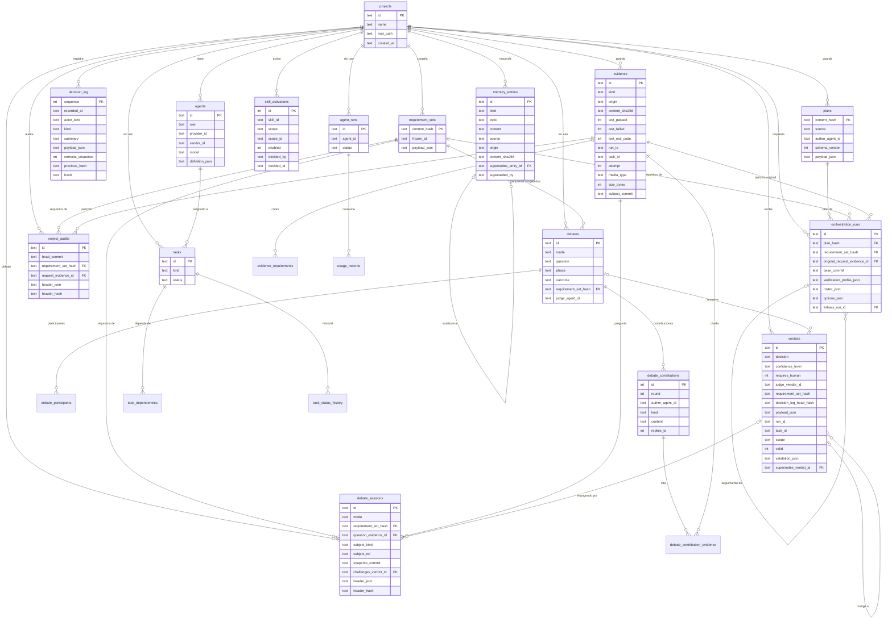

# 05 · Modelo de datos

> Entregable 8 de la sección 19. El esquema real está en las migraciones de
> `src/AgentStudio.Infrastructure/Persistence/Schema/` (`0001_initial.sql`, `0002_orchestration.sql`,
> `0003_evidence_subject_commit.sql`, `0004_memory.sql`, `0005_debates.sql`, `0006_milestones.sql` y
> `0007_replace_by_rowid.sql`) y lo prueban
> los tests de `tests/AgentStudio.Tests/Infrastructure`. Los almacenes que lo leen y escriben están en
> `src/AgentStudio.Infrastructure/Persistence/` (Fase 3, WP2). Este documento explica el porqué.

## 1. Dónde vive cada dato

| Dato | Almacén | Motivo |
|---|---|---|
| Estructura (proyectos, agentes, decisiones, evidencias, planes, ejecuciones, veredictos, memoria) | SQLite `.agentstudio/agentstudio.db` en el repo del usuario, una base por proyecto | Consultas, integridad referencial, triggers append-only y búsqueda FTS5 sin servidor |
| Contenido de evidencias (logs, diffs, salidas de tests, peticiones) | Ficheros en `.agentstudio/evidence/<sha256>` | Direccionado por contenido: el nombre es el hash; deduplicación gratis |
| Ficheros a medio capturar | `.agentstudio/tmp/` | Una evidencia solo entra en `evidence/` cuando está completa |
| Ancla del registro de decisiones | `%LOCALAPPDATA%\AgentStudio\anchors\<projectId>.json`, fuera del proyecto | Detecta un registro truncado, reescrito o ampliado dentro del proyecto ([ADR-0010](adr/0010-estado-derivado-del-registro.md), adenda) |
| Memoria del proyecto (Fase 4) | Tabla `memory_entries`, append-only desde la `0004`, con FTS5; cada fila anunciada en el registro con su SHA-256 (`MemoryRecorded`) | El estado (anclaje, revisión, sustitución, cuarentena) sale del registro ([ADR-0022](adr/0022-memoria-append-only-anclada.md)) |
| Memoria legible | Markdown exportado en `.agentstudio/memory/` (cronológico y temático), solo de exportación: nunca se lee de vuelta | Lo pide el prompt (sección 14) y lo puede leer cualquier persona o agente |
| Debates y auditorías de proyecto (Fase 5) | Tablas `debate_sessions` y `project_audits` (migración `0005`), append-only: solo la cabecera inmutable de cada uno, con su hash anclado en el registro (`DebateOpened`, `ProjectAuditStarted`). El estado sale de reproducir el registro, y el texto de los agentes son evidencias | Una sola fuente, como una ejecución ([ADR-0026](adr/0026-debate-como-unidad-del-registro.md)) |
| Consumo (Fase 4) | Ninguna tabla: es una proyección de `AgentRunStarted` y `AgentRunFinished` del registro verificado | Una sola fuente, encadenada y anclada ([ADR-0019](adr/0019-consumo-como-proyeccion-del-registro.md)) |
| Cuota de las suscripciones (Fase 4) | `%LOCALAPPDATA%\AgentStudio\usage\quota.jsonl`, solo añadir y rotado por tamaño | Es de la cuenta, no de un proyecto |
| Bitácora diaria de prompts | `.agentstudio/bitacora/YYYY-MM-DD.md`, versionada ([11](11-bitacora.md)) | Registro cronológico obligatorio, legible y por día |
| Activaciones de skills de proyecto y de agente (Fase 3) | Tabla `skill_activations` (migración `0002`) | Historial por ámbito: la última decisión gana |
| Activaciones globales de skills (Fase 3) | `%APPDATA%\AgentStudio\skill-activations.jsonl`, una línea por decisión, solo añadir | No pertenecen a ningún proyecto |
| Catálogo y salud de skills | Ninguna tabla: el catálogo es del perfil (`SkillCatalog`, se lee en cada consulta) y la salud local se calcula al vuelo | El catálogo no es de un proyecto; la caché de la salud con red la decide la Fase 6 (docs/14 D-27) |
| Configuración global del usuario | `%APPDATA%\AgentStudio\settings.json` | Preferencias de UI y proveedores; sin secretos |
| Secretos propios de Agent Studio | DPAPI (`%APPDATA%\AgentStudio\vault\`) | Nunca en texto plano; las credenciales de los CLIs no se tocan |

Del directorio `.agentstudio/` se versionan la bitácora y la memoria en Markdown. La base de datos (con sus ficheros
`-wal` y `-shm` y el fichero de bloqueo) y las carpetas `evidence/` y `tmp/` se excluyen en el `info/exclude` del
repositorio, que es local y no se publica; el `.gitignore` del usuario no se toca nunca. Al abrir un proyecto,
`ProjectWorkspace` añade, si faltan:

```text
.agentstudio/*.db*
.agentstudio/evidence/
.agentstudio/tmp/
```

- Si el proyecto no está en la raíz del repositorio, las líneas llevan delante su ruta relativa (`sub/app/.agentstudio/…`).
- En un worktree enlazado van al directorio git común (el que indica `commondir`), que es el único `info/exclude` que git lee.
- Añadirlas es idempotente: una línea que ya está no se repite y el contenido del usuario se conserva.

## 2. Diagrama entidad-relación

Las tablas `tasks`, `task_dependencies`, `task_status_history`, `agent_runs` y `usage_records` de la `0001` siguen en
el esquema, pero ni la Fase 3 ni la 4 las usan, y desde la Fase 5 tampoco `debates`, `debate_participants`,
`debate_contributions`, `debate_contribution_evidence` ni `verdicts.debate_id` (§5).



## 3. Decisiones del modelo

1. **Append-only donde importa.** `decision_log`, `evidence`, `verdicts`, `debate_contributions`, `requirement_sets`,
   desde la `0002` `plans`, `orchestration_runs` y `skill_activations`, desde la `0004` `memory_entries` y desde la `0005`
   `debate_sessions` y `project_audits`, tienen
   triggers `BEFORE UPDATE` y `BEFORE DELETE` que abortan, y `BEFORE INSERT` que impiden `INSERT OR REPLACE` sobre una
   clave existente; la
   conexión activa `recursive_triggers`. Corregir es añadir: una entrada `Correction` que apunta a la anterior, una
   evidencia nueva, un veredicto nuevo que dice a cuál sustituye. Así ninguna decisión del orquestador puede borrar
   evidencias anteriores sin rastro (sección 9). Límite: quien controle el fichero puede borrar los triggers; eso lo
   detecta la cadena de hashes ([ADR-0004](adr/0004-registro-de-decisiones-append-only.md)).
2. **Cadena de hashes en `decision_log`.** Cada fila guarda `previous_hash` y `hash`; el algoritmo está en
   `DecisionLog.ComputeHash` (dominio) para que la verificación no dependa de la base de datos. La secuencia la asigna
   el dominio, no la base. Las fechas se guardan en ISO-8601 `O` y en UTC, el mismo texto que entra en el hash: un
   registro releído verifica con la misma cabeza. La cadena no ve un final cortado ni una reescritura con los hashes
   recalculados: para eso la cabeza se ancla fuera del proyecto en cada escritura y se compara al cargar.
3. **El estado de una ejecución es el registro** ([ADR-0010](adr/0010-estado-derivado-del-registro.md)). Lo que cambia
   (cada transición de tarea, la rama de cada condición) son entradas de `decision_log`; `plans` y `orchestration_runs`
   solo guardan lo inmutable: el plan y la cabecera de la ejecución (requisitos, petición, commit base, perfil de
   verificación congelado, plantilla de agentes y opciones). Desde la Fase 5 un debate y una auditoría de proyecto son
   unidades del registro como una ejecución ([ADR-0026](adr/0026-debate-como-unidad-del-registro.md)):
   - su id (`deb-…`, `aud-…`) va en el `run_id` de sus entradas, evidencias y veredictos, así que `ListByRunAsync` y
     `RunLog.RegisteredEvidence` sirven tal cual;
   - `debate_sessions` y `project_audits` guardan su cabecera inmutable (en `header_json`, los participantes y los jueces con
     su definición entera, la disposición, las dispensas y los límites; o el perfil, el juez, los productores y los autores
     declarados), y `DebateOpened` y `ProjectAuditStarted` anclan su hash canónico (`header_hash`, `DebateHeaderHash`);
   - se escribe primero la pregunta (o la petición) como evidencia, con el id en `run_id`; después, la fila; después, la
     entrada que ancla su hash;
   - un veredicto de debate lleva `run_id` = el debate, `task_id` = la tarea del juez (`juez-<agente>`) y `scope = 'Debate'`;
     uno de auditoría, `run_id` = la auditoría y `scope = 'WholeProject'`; uno de una revisión por impugnación, el `run_id`
     del veredicto impugnado. `verdicts` no cambia de esquema y `payload_json` gana la resolución.
4. **Requisitos y planes por contenido.** `requirement_sets` y `plans` tienen como clave el `ContentHash`; debates,
   ejecuciones y veredictos guardan el hash que examinaron. Guardar uno que ya existe no escribe nada, y al leerlo se
   vuelve a crear desde su contenido y se recalcula el hash: si no coincide con la clave, se rechaza.
5. **Evidencias direccionadas por contenido.** El hash lo calcula el almacén mientras copia el flujo a `tmp/`; quien
   llama no puede dárselo. El fichero solo pasa a `evidence/<sha256>` cuando está completo, el mismo contenido se guarda
   una vez aunque lo citen varias evidencias, y cada lectura vuelve a calcular el hash: un contenido modificado o
   ausente es un error de integridad, no un dato. Cada build y cada ejecución de tests guarda además el commit que
   verificó (`subject_commit`, migración `0003`): el del worktree donde corrió. El validador del juez solo deja que una
   ejecución de tests del commit en revisión apoye una aprobación ([07](07-debate-arena-y-juez.md#5-veredicto-estructurado-y-su-validación)).
6. **Procedencia en cada métrica.** Cada cifra de uso que guarda el registro (`UsageSnapshot` de `AgentRunFinished`)
   lleva su procedencia y, desde la v2 de la Fase 4, su origen: informado por el CLI, medido por Agent Studio, estimado
   por el CLI, estimado por Agent Studio, no expuesto o sin dato. Su valor es nulo cuando no está disponible: nunca un
   cero inventado. `usage_records.provenance` (sin uso) solo admite `Exact`, `Estimated` o `Unavailable`.
7. **Veredicto completo y consultable.** Las columnas de `verdicts` permiten filtrar (decisión, juez, confianza,
   intervención humana, ejecución, validez); el veredicto íntegro va en `payload_json`, tal cual lo dio el juez,
   incluso si es inválido o le faltan campos, y sus incidencias en `validation_json`.
8. **Memoria append-only, anclada y con búsqueda** ([ADR-0022](adr/0022-memoria-append-only-anclada.md)).
   `memory_entries` más la tabla virtual FTS5 `memory_entries_fts` (contenido externo) permiten recuperar solo lo
   relevante.
   - Desde la `0004` una fila nunca cambia: los triggers de FTS de UPDATE y DELETE se retiran y los de append-only los
     sustituyen; el de inserción mantiene el índice al día.
   - Cada fila guarda su origen (`System`, `User` o `Agent`, con `CHECK`), el SHA-256 canónico de su categoría, tema y
     contenido y la entrada a la que sustituye (`supersedes_entry_id`, clave foránea). `superseded_by` queda siempre nula.
   - El estado no está en la tabla: sale del registro. `MemoryRecorded` anuncia cada fila con su SHA-256 antes de
     guardarla, y `MemoryReviewed` la acepta, la rechaza o la retira; los dos llevan `RunId` vacío. Una fila que el
     registro no anunció, o que no da su hash, no se recupera.
9. **Conexión.** SQLite trae desactivadas las claves foráneas: `SqliteSchema.Open` ejecuta, en cada conexión,
   `busy_timeout` (5 s), `journal_mode=WAL` (los lectores no bloquean al escritor y un corte no deja páginas a medias),
   `foreign_keys` y `recursive_triggers`. Las conexiones no usan pool: cerrar un proyecto no deja ningún fichero
   abierto.
10. **Una instancia por proyecto.** `ProjectWorkspace` mantiene abierto `.agentstudio/agentstudio.db.lock` sin
    compartir mientras el proyecto está abierto. Una segunda instancia de la app recibe `ProjectInUseException`; el
    sistema borra el fichero al cerrar el handle, también si la app muere.
11. **SQL explícito con Microsoft.Data.Sqlite, sin Dapper** ([ADR-0010](adr/0010-estado-derivado-del-registro.md)).
    El SQL, con sus triggers e índices, se ve tal cual. Las columnas `*_json` guardan registros propios de
    `Persistence/Json`, mapeados a mano y cubiertos con pruebas de ida y vuelta, de modo que cambiar un tipo del
    dominio no cambia en silencio lo que ya está en disco.
12. **Migraciones numeradas.** `schema_migrations(version, applied_at)`; cada fichero `NNNN_*.sql` se aplica una vez
    dentro de una transacción (§4).

## 4. Migraciones

| Migración | Fase | Contenido |
|---|---|---|
| `0001_initial.sql` | 0 | Proyectos, agentes, requisitos, tareas, registro de decisiones, evidencias, debates, veredictos, ejecuciones de agentes, uso y memoria con FTS5; triggers append-only |
| `0002_orchestration.sql` | 3 | `plans`, `orchestration_runs` y `skill_activations` (con sus triggers append-only); columnas `run_id`, `task_id`, `attempt`, `media_type` y `size_bytes` en `evidence`; `run_id`, `task_id`, `scope`, `valid`, `validation_json` y `supersedes_verdict_id` en `verdicts`; índices `evidence_by_run` y `verdicts_by_run` |
| `0003_evidence_subject_commit.sql` | 3 | Columna `subject_commit` en `evidence`: el commit que verificó cada build o ejecución de tests. Nula en lo que no trata de un commit y en las filas anteriores. No necesita triggers propios: los de la `0001` impiden cambiar cualquier columna de la fila |
| `0004_memory.sql` | 4 | Solo memoria: `memory_entries` pasa a ser append-only (triggers `no_update`, `no_delete` y `no_replace`; se retiran los de FTS de UPDATE y DELETE) y gana `origin` (con `CHECK`), `content_sha256` y `supersedes_entry_id`, además del índice `memory_by_project`. **No crea tablas**: el uso es una proyección del registro (D-01) y las tablas `skills` y `skill_health_checks`, que la numeración anterior reservaba para la `0004`, salen del plan porque el catálogo es del perfil (D-27) |
| `0005_debates.sql` | 5 | `debate_sessions` y `project_audits`, las cabeceras inmutables de los debates y de las auditorías de proyecto, con `CHECK` del modo y del objeto, claves foráneas a `projects`, `requirement_sets`, `evidence` y (la impugnación) `verdicts`, índices por proyecto y fecha y sus triggers `no_update`, `no_delete` y `no_replace`. Idempotente sobre una base en la `0004`. **No borra** las tablas de debate de la `0001`, que quedan sin uso (§5) |
| `0006_milestones.sql` | 9 | `milestones` (la cabecera inmutable de un hito: nombre, objetivo, el primer conjunto de requisitos congelado con clave foránea a `requirement_sets`, el presupuesto opcional y `header_hash`, que `MilestoneOpened` ancla) y `backlog_items` (una fila por versión de cada elemento del backlog, con clave `(item_id, version)`, `CHECK` de la prioridad `Mandatory` o `Desirable`, los criterios en JSON y `content_sha256`, que `BacklogItemRecorded` anuncia antes de guardar la fila). Índices por proyecto y fecha y triggers `no_update`, `no_delete` y `no_replace` en las dos. Idempotente sobre una base en la `0005`. **No crea tablas** para los vínculos de trazabilidad (son entradas del registro, [ADR-0039](adr/0039-vinculos-de-trazabilidad-y-participacion.md)), ni para el tablero, el consumo por hito o la estimación (proyecciones) |
| `0007_replace_by_rowid.sql` | 14 | Solo triggers (P45): recrea los `no_replace` de `decision_log`, `evidence`, `verdicts`, `requirement_sets`, `plans`, `orchestration_runs`, `memory_entries`, `debate_sessions`, `project_audits`, `milestones` y `backlog_items` para que rechacen también un `INSERT` cuyo `rowid` ya existe. Así se cierra el `INSERT OR REPLACE` por `rowid` desde una conexión sin `recursive_triggers`. No toca tablas ni filas. `debate_contributions` y `skill_activations` no cambian: su `id` ya es el `rowid` ([ADR-0010](adr/0010-estado-derivado-del-registro.md), adenda del 2026-11-12) |

### 4.1 Hitos y backlog (migración 0006)

- **Un hito se reproduce, no se guarda.** Su estado (abierto o cerrado, el conjunto de requisitos vigente y su historia, lo vinculado, los informes de sus cierres y sus reaperturas) sale de reproducir las entradas `Milestone*` del registro con `MilestoneStateReplayer`. Esas entradas llevan el id del hito (`mil-yyyyMMdd-xxxxxx`) como `runId`, como las de un debate. La fila de `milestones` solo es lo que no cambia ([ADR-0038](adr/0038-hito-backlog-y-tablero.md)).
- **El backlog es un registro de solo añadir.** Cada cambio de un elemento es una versión nueva con todo su contenido. Retirar y reordenar son entradas del registro (`BacklogItemRetired`, `BacklogOrderChanged`), sin `runId`. Leer el backlog solo devuelve filas anunciadas con el mismo SHA-256, como la memoria.
- **Lo que no se guarda.** Las columnas del tablero y las cifras de consumo son proyecciones; las claves foráneas de `milestones` a `requirement_sets` y a `projects` impiden un hito sin requisitos congelados.

## 5. Tablas de la 0001 sin uso en la Fase 3

`tasks`, `task_dependencies`, `task_status_history`, `agent_runs` y `usage_records` siguen en el esquema, pero ni la
Fase 3 ni la 4 las leen ni las escriben, y desde la Fase 5 tampoco `debates`, `debate_participants`,
`debate_contributions`, `debate_contribution_evidence` ni la columna `verdicts.debate_id`:

- El estado de cada tarea sale de reproducir el registro de decisiones, verificado, con `RunStateReplayer`
  ([ADR-0010](adr/0010-estado-derivado-del-registro.md)). Escribirlo también en esas tablas sería escribir dos veces y
  abriría la puerta a que divergieran; `task_status_history` ni siquiera tiene triggers.
- El panel de consumo de la Fase 4 proyecta en memoria las entradas `AgentRunStarted` y `AgentRunFinished` del registro
  verificado ([ADR-0019](adr/0019-consumo-como-proyeccion-del-registro.md)): no escribe `agent_runs` ni `usage_records`.
  Si una medición con un registro grande pide una caché, será una proyección reconstruible. Se pueden retirar más
  adelante con su propia migración.
- No hay tabla de worktrees: la propiedad está en git (motivo del bloqueo del worktree) y la auditoría, en el registro.
- Las tablas de debate de la `0001` guardaban el estado de un debate con columnas mutables y sin triggers (`phase`,
  `outcome`, `closed_at`) y el texto de los agentes fuera del almacén de evidencias (`debate_contributions.content`). Desde la
  Fase 5 el debate es una unidad del registro con su cabecera en `debate_sessions`, su estado reproducido y sus textos como
  evidencias (docs/15 D-01 y D-02); `SqliteVerdictStore` deja `verdicts.debate_id` a NULL. La `0005` no las borra.

## 6. Correspondencia con el dominio

| Tabla | Tipo | Almacén (Infrastructure) |
|---|---|---|
| `projects` | `ProjectContext` | `ProjectWorkspace` |
| `agents.definition_json` | `AgentDefinition` | `SqliteAgentRoster` (`IAgentRoster`) |
| `requirement_sets` | `FrozenRequirementSet` | `SqliteRequirementStore` (`IRequirementStore`) |
| `decision_log` | `DecisionEntry` / `DecisionLog` | `SqliteDecisionLogStore` (`IDecisionLogStore`), escrito solo por `DecisionRecorder` |
| `evidence`, `evidence_requirements` | `EvidenceRecord`, `TestRunSummary` | `SqliteEvidenceStore` (`IEvidenceStore`) |
| `plans` | `PlanDefinition` | `SqlitePlanStore` (`IPlanStore`) |
| `orchestration_runs` | `RunRecord` | `SqliteRunRegistry` (`IRunRegistry`) |
| `verdicts` | `StoredVerdict`, `Verdict` | `SqliteVerdictStore` (`IVerdictStore`) |
| `skill_activations` | `SkillActivation` | `SkillActivationStore` (`ISkillActivationStore`, en `Infrastructure/Skills`) |
| `debate_sessions` | `DebateRecord` (cabecera inmutable); el estado es un `DebateSession` reproducido con `DebateStateReplayer` | `SqliteDebateRegistry` (`IDebateRegistry`), Fase 5 (WP4) |
| `project_audits` | `ProjectAuditRecord` | `SqliteProjectAuditRegistry` (`IProjectAuditRegistry`), Fase 5 (WP4) |
| `debates`, `debate_participants`, `debate_contributions`, `debate_contribution_evidence` | — | Sin uso (§5) |
| `memory_entries` | `MemoryRow` (fila inmutable); `MemoryEntry` es la fila con la confianza que le da el registro | `SqliteMemoryStore` (`IMemoryStore`), Fase 4 (WP3) |
| `tasks`, `task_dependencies`, `task_status_history` | `WorkTask`, `TaskGraph`, `TaskStatusChange` | Sin uso (§5) |
| `agent_runs`, `usage_records` | — (`UsageRecord` se retiró en la Fase 4: el uso sale del registro) | Sin uso (§5) |

`PersistenceServiceCollectionExtensions.AddAgentStudioPersistence` registra el workspace, los almacenes y
`DecisionRecorder`; `SkillsServiceCollectionExtensions.AddAgentStudioSkills`, el catálogo y las activaciones.

## 7. Pendiente

- La proyección del consumo a partir del registro, el almacén de memoria y su exportación (Fase 4, WP2 y WP3; los
  contratos y la `0004` ya están).
- Los registros de `debate_sessions` y `project_audits` en SQLite (Fase 5, WP4; el contrato y la `0005` ya están).
- Retirar las tablas sin uso de la `0001` (§5), las de debate incluidas, con su propia migración.
- Purgar memoria de verdad (privacidad): retirar solo la oculta (Fase 7).
- Política de retención del almacén de evidencias (tamaño).
- Exportación firmada del registro de decisiones (Fase 7).
