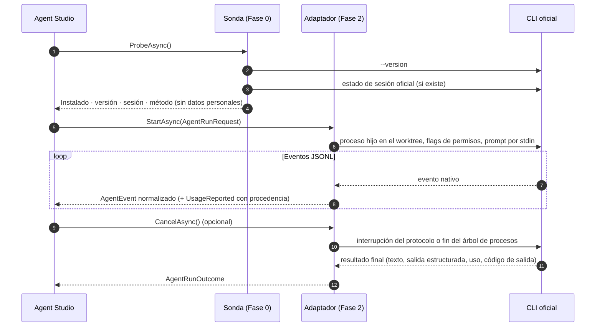

# 06 · Estrategia de integración de proveedores

> Entregable 9 de la sección 19. Hechos y fuentes en
> [investigacion/2026-10-15-proveedores-y-stack.md](investigacion/2026-10-15-proveedores-y-stack.md). Decisión en
> [ADR-0003](adr/0003-integracion-por-clis-oficiales.md).

## 1. Reglas que no se negocian

1. Agent Studio **lanza el binario oficial sin modificar**. No reimplementa clientes, no llama a endpoints privados.
2. **Nunca lee, copia, almacena ni reenvía** tokens, cookies o ficheros de credenciales de los CLIs
   (`~/.claude`, `~/.codex`, `~/.gemini`). El estado de sesión se consulta con el comando oficial de cada CLI.
3. El inicio de sesión lo hace **el usuario** con la herramienta oficial; Agent Studio solo le indica el comando.
4. **No se asume cuota ilimitada.** Concurrencia máxima por proveedor configurable (por defecto 2) y presupuestos por
   agente.
5. El texto libre (prompts, ficheros) viaja **por stdin**, nunca como argumento (los CLIs de npm son shims `.cmd`).
6. El modo de permisos se pasa **siempre de forma explícita** (p. ej. `claude -p` sin `--permission-mode` puede
   arrancar en `auto`, y Codex por defecto es `read-only`).
7. **Solo uso personal** (decisión del usuario, 2026-10-15). Las API keys son opcionales y del propio usuario; no hay
   distribución a terceros (ver [01](01-viabilidad-y-riesgos.md)).

## 2. Ciclo de vida de un adaptador



## 3. Por proveedor

### Claude Code (Anthropic) — verificado en esta máquina (2.1.290)

| Aspecto | Cómo |
|---|---|
| Detección | `claude --version` → `2.1.290 (Claude Code)` |
| Sesión | `claude auth status` → JSON, exit 0/1. Se extraen solo `loggedIn`, `authMethod`, `subscriptionType`; se descartan email y organización. **Implementado en Fase 0.** |
| Ejecución (**implementada en Fase 2**) | `claude -p --output-format stream-json --verbose --setting-sources "" --strict-mcp-config --settings <fichero temporal> --permission-mode dontAsk --tools "Read Grep Glob [Edit Write] [StructuredOutput] …" --allowedTools "Read(//c/<carpeta>/**) … [Edit(//c/<worktree>/**)] …" --disallowedTools "… NotebookEdit EnterWorktree ExitWorktree Agent Task …" --add-dir … --max-turns N [--no-session-persistence] --session-id <uuid>`; prompt por stdin; instrucciones de sistema con `--append-system-prompt-file` (fichero temporal). `--setting-sources ""`, `--strict-mcp-config` y `--settings` aíslan de la configuración del repositorio y del perfil del usuario sin romper la suscripción (ver [Reglas comunes](#reglas-comunes-de-los-adaptadores-fase-2)). Nunca `plan`: usa otro modelo para parte del trabajo y cuesta más |
| Turnos sin estado (**Fase 5**, [D-16](15-fase-5-debate-arena-y-juez.md#44-f5-2--ronda-1-en-paralelo-y-sin-ver-nada-de-los-demás)) | Con `AgentRunRequest.PersistSession = false` (cada turno de un debate) va `--no-session-persistence` justo antes de `--session-id`: una sesión nueva que «will not be saved to disk and cannot be resumed» (`claude --help`, 2.1.290), con su propio id. Junto con `ResumeSessionId` se rechaza antes de lanzar nada (`ArgumentException`): no guardar y reanudar se excluyen. El juez sigue guardando su sesión para la corrección (`--resume`). Un ejecutor nunca pide un turno sin estado, así que la huella medida (`WriteConfinementLaunch`) no cambia, y una prueba lo fija. El turno exacto de un participante (D-09): `--tools "Read Grep Glob StructuredOutput"`, `--allowedTools "Read(//c/<copia>/**) Read(//c/<carpeta del turno>/**)"`, Write, Edit, Bash y la red denegados, `--add-dir <carpeta del turno>`, `--json-schema` y `--no-session-persistence`. **Sin medir** que conviva con `--json-schema`, `--tools` y las reglas de dos carpetas: lo mide `DebateTurnLiveTests` (pendiente, ver [Mediciones de la Fase 5](#mediciones-pendientes-de-la-fase-5)) |
| Permisos (**medido en la Fase 3**, [ADR-0018](adr/0018-modelo-de-amenaza-fase-3.md)) | **`--tools` deja solo las herramientas del perfil**: Read, Grep y Glob; Edit y Write si escribe; Bash con la shell; WebFetch y WebSearch con la red; StructuredOutput si hay esquema; `Skill` solo si hay carpeta de skills. 2.1.290 convierte cada herramienta integrada que no se lista (Monitor, Workflow, las de Cron, Artifact…) en una regla de denegación y retiene PowerShell. El `allowed-tools` de una skill añadiría reglas de permitir mientras está activa, así que la materialización rehace la cabecera de cada `SKILL.md` solo con sus claves descriptivas. Se rechaza un preset (`preset:default`) entre las herramientas del perfil. Todo lanzamiento usa `dontAsk`: en `-p`, lo que ninguna regla permite se deniega. Nunca `acceptEdits`, `plan` ni `bypassPermissions`. **Ninguna herramienta de ficheros se preaprueba a secas**: una regla de toda la herramienta (`Write`) se salta la comprobación de ruta, y así 2.1.290 escribía fuera del worktree. En su lugar, reglas de ruta. `Read(//c/<carpeta>/**)` va para el directorio de trabajo, cada `--add-dir` y la carpeta de skills, y gobierna Read, Grep y Glob. `Edit(//c/<worktree>/**)` solo si el perfil escribe, y gobierna Write, Edit y NotebookEdit (2.1.290 no consulta reglas `Write(...)`). Una carpeta añadida se lee, no se escribe. **Sintaxis en Windows**: unidad tras `//`, barras normales y la ruta tal cual, con espacios y acentos; `//C:/…` no vale. Se rechaza la carpeta que no cabe en una regla exacta: raíz de unidad, UNC o dispositivo, `*?[]{}()\!#\|+^$`, caracteres de control o un segmento que acaba en espacio. También se rechaza la regla de ruta propia de una herramienta de ficheros del perfil. Se deniegan siempre `NotebookEdit`, `EnterWorktree` y `ExitWorktree` (crea un worktree y una rama en el repositorio sin pedir permiso), y `Agent`/`Task`. Medido con `ClaudeWriteConfinementLiveTests`. El CLI denegó escribir y leer fuera, por ruta absoluta, por `../` y con Grep, y permitió dentro. La sesión ofreció exactamente las herramientas de `--tools`, y Monitor y Workflow no existían. La compuerta del repositorio del usuario solo se relaja con este lanzamiento (`ClaudeCodeArguments.WriteConfinementLaunch`) y en 2.1.290 |
| Salida estructurada | `--json-schema` → `structured_output` en el evento `result` (juez y auditor) |
| Uso (**Fase 4**, [ADR-0021](adr/0021-salud-del-contexto-por-paso.md)) | **Por paso:** cada paso del bucle principal llega en varios eventos `assistant` con el mismo `message.id`; el primero da un `ContextObserved` con su prompt (entrada + caché leída + caché creada) y el modelo de ese paso. La ventana llega con el resultado, así que en vivo va «sin dato». Los pasos de un subagente no cuentan. **Total:** `result.usage` (suma de los pasos; la entrada es el prompt entero), con caché escrita, razonamiento (`output_tokens_details.thinking_tokens`) y `num_turns`. **Por modelo:** `modelUsage`, con `contextWindow`, `costUSD` y `costBasis`; la entrada de cada modelo también es su prompt entero. La ventana de `result.usage` es la del modelo del **último paso**, nunca la de `init`, que puede anunciar un modelo auxiliar (en `01-texto`, un 4 % y no un 21 %). `total_cost_usd` es una estimación del cliente: **estimado por el CLI**. `system/compact_boundary` es un `CompactionObserved` (documentado, sin verificar en captura). Lo que el CLI ofrece y no llega es «sin dato» (`Missing`), nunca cero |
| Cuota | `rate_limit_event` llega **al inicio de cada ejecución**, no solo al topar con el límite: `unifiedWindows.five_hour` y `seven_day` con `utilization` (0..1) y `resetsAt`. Se normaliza como `QuotaReported` (verificado en captura real; corrige lo que se dedujo de la documentación en la Fase 0). Desde la Fase 4, `QuotaObservingAgentProvider` guarda cada ventana en el registro de cuota del usuario, sin llamadas extra ([ADR-0020](adr/0020-cuota-pasiva-en-claude-y-lectura-opcional-en-codex.md)). `rateLimitType` nombra la ventana del evento (`five_hour` en las capturas reales); desde la Fase 8 va en `RateLimitSignaled.LimitType`, y un `rejected` da la clase `WindowQuota` (ver [Final clasificado](#final-clasificado-de-un-intento-fase-8-d-41)) |
| Servidores MCP (**Fase 4**, D-30) | Solo en un lanzamiento que no escribe, sin shell ni red (la recomendación asistida de skills): `--mcp-config <carpeta de la ejecución>\mcp.json` justo después de `--strict-mcp-config`, que sigue, así que no carga ningún otro servidor. Las reglas de permitir que lleva cada servidor (`McpServerSpec.AllowedTools`) van tal cual a `--allowedTools`, y cada una tiene que ser `mcp__<ese servidor>__<herramienta>`: nunca una herramienta integrada ni la de otro servidor. Nunca van en `--tools`, y la ruta del ejecutable del servidor va dentro del fichero, no en la línea de órdenes. Cualquier otro perfil falla cerrado: un ejecutor nunca recibe un servidor y la huella medida (`WriteConfinementLaunch`) no cambia |
| Cancelación | Matar el árbol de procesos (Windows no tiene SIGINT para procesos sin consola). El mensaje de interrupción por stdin en `stream-json` no está documentado: no se usa hasta verificarlo |
| Aprobaciones | `--permission-prompt-tool` con un servidor MCP local de Agent Studio que traslada la petición a `IApprovalGate` (a validar en Fase 2) |
| Ojo | `-p` se salta el diálogo de confianza: con la fuente `project` ejecuta los hooks de `.claude/settings.json` y `settings.local.json` y arranca los servidores de `.mcp.json` del repositorio. Por eso Agent Studio no carga ninguna fuente de configuración. `--bare` exige API key. No usar «Claude Code» en el nombre del producto |

### Codex CLI (OpenAI) — verificado en esta máquina (0.160.0)

| Aspecto | Cómo |
|---|---|
| Detección | `codex --version` → `codex-cli 0.160.0` (en Windows es `codex.cmd`) |
| Sesión | `codex login status` → «Logged in using ChatGPT». **Implementado en Fase 0.** `codex doctor --json` como diagnóstico ampliado |
| Ejecución (**implementada en Fase 2**) | `codex exec --json --ignore-user-config --ignore-rules --disable hooks -c windows.sandbox=unelevated -s read-only\|workspace-write -C <worktree> [-c sandbox_workspace_write.network_access=<bool>] [--add-dir …] [-m <modelo>] [--output-schema <fichero temporal>] [resume <id> \| --ephemeral -c history.persistence=none] -`; prompt e instrucciones por stdin (`<agent_instructions>` + `<task>`). Los cuatro primeros flags aíslan de la configuración del repositorio y del usuario (ver [Reglas comunes](#reglas-comunes-de-los-adaptadores-fase-2)). Se lanza el `codex.exe` nativo del paquete npm cuando existe, no el shim `.cmd` |
| Turnos sin estado (**Fase 5**, [D-16](15-fase-5-debate-arena-y-juez.md#44-f5-2--ronda-1-en-paralelo-y-sin-ver-nada-de-los-demás)) | Con `AgentRunRequest.PersistSession = false` (cada turno de un debate) va `--ephemeral -c history.persistence=none` donde iría `resume`, justo antes de `-`. `--ephemeral`: «Run without persisting session files to disk» (`codex exec --help`, 0.160.0). `history.persistence=none` cubre el historial de mensajes (`history.jsonl`), que `--ephemeral` no cubre, por si `exec` lo escribe; va sin comillas, como `windows.sandbox=unelevated`, para pasar por el shim. Junto con `ResumeSessionId` se rechaza antes de lanzar nada: un hilo sin sus ficheros no se reanuda. El juez sigue guardando su hilo para la corrección (`exec resume`). El turno exacto de un participante (D-09): `-s read-only -C <copia> --skip-git-repo-check [-m <modelo>] --output-schema <fichero> --ephemeral -c history.persistence=none -`; la carpeta del turno no va en `--add-dir` (el sandbox de solo lectura no lo admite y lee igual), y `debate.json` va en el prompt. **Sin medir** que `--ephemeral` conviva con `--output-schema` y si 0.160.0 avisa de la clave `history.persistence`: lo mide `DebateTurnLiveTests` (pendiente) |
| Uso | `turn.completed.usage`: input (con la caché), cached input, cache write, output (con el razonamiento) y reasoning tokens (**exactos**). Es el **total del hilo**, no el del turno: al reanudar (`exec resume`) incluye lo de antes, y el uso propio de cada intento lo calcula la proyección (D-02). Si no llegó ninguna notificación de uso, Codex lo escribe todo a cero: es «sin dato». Ventana, ocupación por paso y coste: **no expuestos** (`ReportsContextOccupancy` falso) |
| Cuota (**Fase 4**, [ADR-0020](adr/0020-cuota-pasiva-en-claude-y-lectura-opcional-en-codex.md)) | `CodexAppServerQuotaReader`, **solo con el opt-in del usuario** (sin él no busca ni lanza nada): `codex app-server --listen stdio://` con el `codex.exe` nativo, en una carpeta vacía de la ejecución, y por stdin la lista cerrada de tres mensajes constantes: `initialize`, `initialized` y `account/rateLimits/read` con `excludeResetCreditDetails`. Nunca `account/rateLimitResetCredit/consume`, `account/sendAddCreditsNudgeEmail` ni `supportsLunaReserve`. Respuesta en 20 s, y luego se termina el árbol. Se toma por lista blanca (`CodexRateLimitsParser`): de cada bucket, `primary` y `secondary` (`usedPercent` / 100 como utilización exacta, `windowDurationMins`, `resetsAt`), `limitName`, `rateLimitReachedType` y `planType`, más `ordinaryUsageAllowed`; nunca `accountId`, el upsell, el saldo ni los créditos de reinicio. Con API key, «no expuesto»; sin sesión u otro error, «sin dato». La versión probada es 0.160.0 (`codex --version`); con otra, aviso. El app-server es experimental: la respuesta se fija con una captura grabada por versión |
| Servidores MCP | `codex exec` no carga los de Agent Studio: una petición con `McpServers` se rechaza antes de lanzar |
| Cancelación | En `exec`, terminar el árbol. En app-server, `turn/interrupt` |
| Aprobaciones | En app-server, `item/commandExecution/requestApproval` y `item/fileChange/requestApproval` → `IApprovalGate` (fase posterior) |
| Ojo | Exige repo git salvo `--skip-git-repo-check`. Los avisos de configuración llegan como `item.completed` de tipo `error` y **no** son fallos. La salida estructurada es el texto JSON del último `agent_message`. La autenticación del app-server "has never been permitted for commercial or hosted services" |

### Gemini CLI (Google) — instalado (0.64.0); **aparcado** ([ADR-0009](adr/0009-google-aparcado.md))

> Google dejó de servir Gemini CLI a las cuentas personales el 18-06-2026. Lo comprobó el usuario el 2026-10-15: «This
> client is no longer supported for Gemini Code Assist for individuals». Con una cuenta personal solo funciona con
> una API key (`GEMINI_API_KEY`).
>
> El sucesor, Antigravity CLI (`agy`), no se puede envolver en una aplicación con una cuenta de consumo: lo prohíben
> su FAQ y sus términos. El adaptador se conserva para usarlo con API key.

| Aspecto | Cómo |
|---|---|
| Detección | `gemini --version` → `0.64.0`. **Implementado en Fase 0** |
| Sesión | No hay comando documentado que no consuma cuota → estado **Desconocido**; se informa de qué variables de entorno de API existen (solo nombres) |
| Ejecución (**implementada en Fase 2**, parser según documentación) | `node …/@google/gemini-cli/bundle/gemini.js -p "" -o stream-json --skip-trust --approval-mode plan\|auto_edit [-m …] [--include-directories …] [-r <id>]`; prompt e instrucciones por stdin. Sin `--skip-trust`, en una carpeta no marcada como de confianza `plan` se fuerza a `default`. No hay salida estructurada nativa. Eventos `init`, `message`, `tool_use`, `tool_result`, `error`, `result` |
| Uso | `stats` con tokens por modelo (exactos) y `duration_ms` |
| Códigos de salida | 0 éxito, 1 error, 42 entrada inválida, 53 límite de turnos (documentados) y **41 sin autenticación** (no documentado, verificado: stdout vacío y el motivo en stderr) |
| Ojo | Google declara infracción acceder a los servicios de Gemini CLI con su OAuth desde software de terceros: solo se lanza el binario oficial. Cuotas diarias por plan (1.000 a 2.000 peticiones) |

### Reglas comunes de los adaptadores (Fase 2)

- Ids de sesión, modelos y rutas se validan antes de lanzar (`CliArgumentGuard`). Un valor que empiece por `-` o
  traiga caracteres inesperados se rechaza, en lugar de iniciar otra sesión en silencio.
- **Ningún lanzamiento ejecuta configuración del repositorio** (revisión adversarial, 2026-10-16). El repositorio no
  es de confianza: los agentes escriben en sus worktrees y el usuario puede abrir repositorios de terceros. Los flags,
  todos constantes, se verificaron con ejecuciones reales (evidencia en
  [investigacion/2026-10-15-proveedores-y-stack.md](investigacion/2026-10-15-proveedores-y-stack.md#6-verificado-con-ejecuciones-reales-fase-2-2026-10-15)):
  - **Claude Code 2.1.290**:
    - `--setting-sources ""` no carga ninguna fuente. Del repositorio no lee `.claude/settings.json` ni
      `settings.local.json` (hooks, bloque `env`, `apiKeyHelper`), ni `.mcp.json`, CLAUDE.md, `.claude/rules`, skills,
      comandos y subagentes. Del perfil del usuario no lee nada.
    - `--strict-mcp-config` deja la sesión sin servidores MCP: ni `.mcp.json` ni los conectores de claude.ai. Desde la
      Fase 4, un lanzamiento de lectura puede llevar además `--mcp-config` con los servidores locales de Agent Studio, y
      entonces solo esos (D-30).
    - `--settings <carpeta de la ejecución>\settings.json` lleva `{"disableAllHooks":true}`, que manda sobre la
      configuración de proyecto y local.
  - **Corrección**: hasta ahora se pasaba `--setting-sources project,local`. Solo aislaba de los hooks y plugins del
    **usuario**: cargaba los del repositorio, y una ejecución real los ejecutó todos.
  - **Codex CLI 0.160.0**:
    - `--ignore-user-config`: sin la tabla `[projects]` de `~/.codex/config.toml`, ningún proyecto es de confianza.
      La capa `.codex/` (un `config.toml` con `mcp_servers`, cuyos comandos arrancan fuera del sandbox, hooks y reglas)
      queda desactivada aunque el usuario confíe en el repositorio. Vale también para un worktree, que hereda la
      confianza del checkout principal. La autenticación sigue en `CODEX_HOME`.
    - `--ignore-rules` descarta las reglas `.rules` del usuario y del proyecto.
    - `--disable hooks` desactiva todos los hooks de ciclo de vida.
    - `-c windows.sandbox=unelevated`: el backend del sandbox de Windows sale de la configuración del usuario, y sin
      ella no habría sandbox. Va sin comillas a propósito: Codex toma literal un valor que no es TOML, y una comilla
      no pasaría por el shim `codex.cmd`.
  - **Consecuencias deliberadas**:
    - El planificador y los ejecutores de Claude ya no ven el CLAUDE.md, las reglas, skills, comandos ni subagentes
      del repositorio, ni los conectores de claude.ai. Las skills llegan solo por `--plugin-dir` (plugin de sesión),
      que sigue funcionando.
    - En Codex dejan de aplicarse el modelo por defecto, los servidores MCP y las features de la config del usuario.
      Sin modelo explícito, Codex usa su modelo por defecto.
- Los ficheros que se pasan por ruta (instrucciones y settings de Claude, esquema de Codex) van a
  `%LOCALAPPDATA%\AgentStudio\runs\<id>`, se crean con `CreateNew` y se borran al terminar la ejecución.
- Estados homogéneos:
  - Agotar el tiempo da `LimitReached`.
  - Si se pidió esquema y no llega un JSON válido, el estado es `Failed`, con el texto conservado y el motivo en `Error`.
  - Un límite de uso da `RateLimited` (en Gemini, deducido de la documentación).
  - Desde la Fase 8, el final lleva además su clase cuando el analizador la reconoce en una captura de su CLI: ver
    [Final clasificado de un intento](#final-clasificado-de-un-intento-fase-8-d-41). El estado no cambia.
- **Cifras con origen (Fase 4, [ADR-0019](adr/0019-consumo-como-proyeccion-del-registro.md)).** Cada cifra lleva quién la
  dio. Lo que el CLI no ofrece es «no expuesto» (`NotExposed`); lo que ofrece y no llegó, o llegó fuera de rango, es
  «sin dato» (`Missing`), nunca cero. La línea «Resultado» de la bitácora dice «(acumulado de la sesión)» cuando la
  ejecución reanudó una sesión, porque entonces los CLIs informan del total de toda la sesión.
- **Pipeline de cada proveedor:** `Concurrency(Journaling(QuotaObservation(adaptador)))`. La observación de la cuota va
  solo si la composición registra el registro de cuota del usuario (`IQuotaObservations`).
- **Turnos sin estado (Fase 5, D-16).** `AgentRunRequest.PersistSession = false` es una sesión nueva que el CLI no guarda:
  `--no-session-persistence` en Claude y `--ephemeral -c history.persistence=none` en Codex. Lo que sabe un participante
  está entero en su prompt, que es evidencia. Una petición que no persiste y reanuda (`ResumeSessionId`) se rechaza en los
  dos adaptadores antes de crear ningún fichero o proceso. Sin esa petición nada cambia: ninguna otra ejecución lleva esos
  flags, y el juez reanuda su sesión para la corrección. El adaptador de Gemini (aparcado) no la traduce y ningún debate lo
  usa.
- Una línea de salida de más de 8 M caracteres se descarta con un aviso, en lugar de agotar la memoria.
- Si falla el análisis de la salida, se mata el proceso del CLI antes de liberar el hueco de concurrencia.
- El materializador de skills nunca escribe ni lee en `~/.claude`, `~/.codex`, `~/.gemini` ni `~/.agents`.
  - Rechaza rutas no canónicas: `\\?\`, `\\.\`, UNC y segmentos que acaban en punto o espacio.
  - Compara la identidad física de la ruta (`GetFinalPathNameByHandle`) y rechaza enlaces en el destino.
  - No sigue un `.git` que redirija a esas carpetas.
  - Copia en una carpeta de staging, con marcador y rollback.

### Mediciones pendientes de la Fase 5

Escritas en el paquete WP4 y **sin ejecutar**: las lanza el lead en la integración, con el OK del usuario, porque gastan
cuota. Sin `AGENTSTUDIO_PROVIDER_TESTS=1` se omiten, como las demás pruebas `ProviderLive`. Ninguna lee `~/.claude` ni
`~/.codex`, y solo escriben en carpetas temporales propias, que borran al terminar.

| Prueba | Qué mide | Lanzamientos | Coste estimado |
|---|---|---|---|
| `DebateTurnLiveTests`, Claude | Un turno de participante con `--no-session-persistence`, `--json-schema`, `--tools` y las reglas de lectura de la copia y de la carpeta del turno: responde por su esquema, lee lo suyo (controles positivos) y el CLI deniega leer un centinela fuera de las dos. Después pide reanudar esa sesión, que tiene que fallar porque no se guardó | 2 (haiku) | El turno, unos 40 000 a 80 000 tokens de entrada (casi todo la caché fija del CLI) y entre 0,05 y 0,10 USD a precio de lista. El intento de reanudar no llega al modelo si la sesión no se guardó |
| `DebateTurnLiveTests`, Codex | Un turno con `--ephemeral`, `-c history.persistence=none` y `--output-schema`: responde por su esquema y no escribe nada. Anota los avisos de Codex (una clave que no usa llega como ítem `error`) sin fallar por ellos, y el uso del turno | 1 (`gpt-6-luna`) | Entre 20 000 y 80 000 tokens, exactos; Codex no da coste en dinero |
| `CodexReadOnlyWriteLiveTests` | Con el lanzamiento exacto de un participante (`-s read-only`, sin persistencia, con esquema, `-C` que no es repositorio), Codex intenta escribir dentro de su `-C` y en una carpeta hermana, con el shell y con `apply_patch`. No puede quedar ningún fichero; cada escritura por shell tiene que haberse intentado y denegado | 1 (`gpt-6-luna`) | Entre 20 000 y 80 000 tokens, exactos |

Se lanzan así (PowerShell, desde la raíz del repositorio; `AGENTSTUDIO_CAPTURE_DIR` es opcional y guarda las capturas y
`evidence.log` para el informe):

```powershell
$env:AGENTSTUDIO_PROVIDER_TESTS = "1"
$env:AGENTSTUDIO_CAPTURE_DIR = "<carpeta para las capturas>"
dotnet test --project tests/AgentStudio.Tests/AgentStudio.Tests.csproj -- --filter-class "AgentStudio.Tests.Providers.Live.DebateTurnLiveTests" --filter-class "AgentStudio.Tests.Providers.Live.CodexReadOnlyWriteLiveTests"
Remove-Item Env:AGENTSTUDIO_PROVIDER_TESTS, Env:AGENTSTUDIO_CAPTURE_DIR
```

Lo que deciden:

- Si `CodexReadOnlyWriteLiveTests` encuentra un fichero escrito, Codex no participa ni juzga hasta resolverlo (decisión 7 a
  de [docs/15](15-fase-5-debate-arena-y-juez.md#12-decisiones-que-necesitan-al-usuario)).
- Si un turno de `DebateTurnLiveTests` no funciona con esos flags, ese proveedor no puede dar turnos sin estado en esa
  versión.
- Qué deja cada CLI en su perfil con estos flags no se puede comprobar sin leer esas carpetas, y no se lee: lo dice solo la
  documentación ([docs/15 §13](15-fase-5-debate-arena-y-juez.md#13-sin-verificar)).

### Riesgos residuales conocidos (revisión adversarial con Codex, 2026-10-15)

Deducidos del código, no reproducidos. Aceptados para una herramienta de uso personal; se revisarán en la Fase 7
(F7-2, política de rutas):

- **Carreras entre comprobación y uso (TOCTOU).** Un proceso local que sustituya una carpeta por un junction justo
  entre la validación y la escritura podría redirigir la materialización. Cerrarlo del todo exige trabajar con
  handles abiertos durante toda la operación.
- **Propiedad por marcador.** El fichero `.agent-studio-managed` es una convención de buena fe, no una prueba de
  propiedad: alguien que lo plante en una carpeta podría hacer que `Cleanup` la borre. Se limita a carpetas con el
  prefijo esperado y a marcadores regulares con el contenido exacto.
- **Creación concurrente de la raíz del plugin de Claude.** Otro proceso podría crear la carpeta vacía en el mismo
  instante en que lo hace Agent Studio.

## 4. Normalización de eventos

| Evento normalizado | Claude `stream-json` | Codex `exec --json` | Gemini `stream-json` |
|---|---|---|---|
| `SessionStarted` | `system/init` | `thread.started` | `init` |
| `MessageEmitted` | `assistant`, `stream_event` | `item.*` (mensaje de agente) | `message` |
| `ToolInvoked` / `ToolCompleted` | bloques `tool_use` / `tool_result` | `item.*` (comandos, cambios de fichero, MCP) | `tool_use` / `tool_result` |
| `UsageReported` | `result.usage`, `modelUsage` | `turn.completed.usage` (total del hilo) | `result.stats` |
| `ContextObserved` (Fase 4) | primer `assistant` de cada `message.id` (`message.usage`, `message.model`) | no expuesto | no expuesto |
| `CompactionObserved` (Fase 4) | `system/compact_boundary` | no expuesto | no expuesto |
| `QuotaReported` | `rate_limit_event` (`unifiedWindows`) | — (la da el app-server, fuera de `exec`) | no expuesto |
| `RateLimitSignaled` | `rate_limit_event` con `status` distinto de `allowed`, con la ventana (`rateLimitType`) desde la Fase 8 | `error` / `turn.failed` por límite, sin ventana | `error`, sin ventana |
| `RunFinished` | `result` (`subtype`) | `turn.completed` / `turn.failed` | `result` + código de salida |

Los adaptadores se prueban con **salidas grabadas** por versión del CLI (ficheros en `tests/.../Fixtures/<cli>/<versión>/`),
de modo que un cambio de formato rompe un test en lugar de romper una ejecución real.

### Final clasificado de un intento (Fase 8, [D-41](16-ampliacion-plataforma-de-proyectos.md#215-contexto-y-recuperación-de-sesiones-sección-15))

Cada intento termina con una clase (`AgentRunEnd`, [docs/04 §18.1](04-contratos.md#181-el-final-clasificado-de-un-intento-applicationprovidersagentprovidercs))
que refina el estado y nunca lo sustituye: un `RateLimited` sin clase sigue siendo un límite. La política de cada clase es
del motor (la tabla de D-41). Reglas:

- **Nunca se adivina.** Cada analizador deduce la clase solo de sus señales (`EndClassSignals`), y una prueba por CLI
  (`ClaudeEndClassTests`, `CodexEndClassTests`) falla si una señal no está en ninguna captura de su versión. Lo que no
  reconoce no lleva clase: es «otra» (`AgentRunEnd.Implied`), y un turno que terminó bien es `Completed`.
- **Las capturas que aún no son reales son sintéticas y lo dicen:** `tests/AgentStudio.Tests/Providers/Fixtures/claude-code/2.1.290/limits/`
  y `…/codex-cli/0.160.0/limits/`, cada carpeta con un README que da la fuente de cada campo y lo que falta medir. Cuando
  llegue la real de un caso, sustituye a la sintética.
- **Quién escribe la clase:** `AgentRunner` (planificador y ejecutores) y `JudgeRunRecorder` (el juez de una ejecución, de un
  debate y de una auditoría), en `AgentRunFinished` v3, con la del adaptador o, si no la dio, la que implica el estado. Los
  turnos de un debate (`DebateTurnRecorder`), las ejecuciones auxiliares (`AuxiliaryAgentRunner`) y los cierres por
  interrupción siguen en la v2 o la v1: su clase es la que implica su estado (`ResolvedEnd()`).
- **La bitácora:** la línea «Resultado» lleva la clase en su nota cuando dice más que el estado, por ejemplo
  `RateLimited · 0,4 s · tokens no disponibles · clase WindowQuota five_hour, reinicio 2026-10-15 17:20 UTC · You've hit your session limit · resets 3:45pm`.
  Una línea cuya clase es la que implica su estado (un éxito, una cancelación, un fallo que nadie reconoció) no cambia.

**Claude Code 2.1.290**, en este orden (gana la primera):

| Señal | Captura | Clase | Estado |
|---|---|---|---|
| `result.subtype` `error_max_turns` o `error_max_budget_usd` | Sintéticas `limits/03` y `04` (subtipos documentados) | `AttemptBudget`, `Turns` o `Cost` | `LimitReached` |
| `result.terminal_reason` `prompt_too_long` | Sintética `limits/05` (valor documentado; el campo es real: `completed` en las cuatro capturas) | `ContextExhausted` | `Failed` |
| `error` `authentication_failed` del último `assistant` del bucle principal | Sintética `limits/06` (el código estructurado que la documentación da en `-p`) | `SignedOut` | `Failed` |
| El último `rate_limit_event` dice `rejected`: su `rateLimitType`, tal cual, y su `resetsAt` | Sintéticas `limits/01` (`five_hour`) y `02` (`seven_day`); la forma del evento y `five_hour` son de la captura real `04-skill-plugin` | `WindowQuota`, con la ventana y su reinicio | `RateLimited` con el 429; sin él, `Failed` (el texto del límite no lo reconoce la regla del estado): el motor decide por la clase |
| `error` `overloaded`, o `api_error_status` 529 | Sintética `limits/07` | `RateOrOverload` | `Failed` |
| `result` de un turno que no terminó con «Unable to connect to API» o «Request timed out» | Sintéticas `limits/08` y `09` (textos documentados desde 2.1.227) | `Network` | `Failed` |
| Un turno que terminó | Reales `01` a `04` | Ninguna: `Completed` | `Succeeded` |
| Cualquier otro final: un 429 sin ventana rechazada, `allowed_warning` (una ventana casi agotada), `rate_limit`, `billing_error`, el error de un subagente… | — | Ninguna: «otra» | El suyo |

`RateLimitSignaled.LimitType` lleva el `rateLimitType` en todo `rate_limit_event` cuyo `status` no es `allowed`, también en
`allowed_warning`, que no clasifica. Un `rateLimitType` que no es un token se deja fuera, y la ventana sigue agotada.

**Codex CLI 0.160.0.** `exec --json` solo da el texto del error (`ThreadErrorEvent.message`), así que la clase sale de
fragmentos de los textos de codex-rs 0.160.0 (`codex-rs/protocol/src/error.rs` y `codex-rs/login/src/auth/manager.rs`).
Todas las capturas son sintéticas. La misma tabla sirve para `turn.failed` y para el proceso que termina sin `turn.completed`
(su último error y la cola de stderr), y gana el primer fragmento:

| Fragmento | Error de codex-rs | Clase | Estado |
|---|---|---|---|
| `reason: content_filter` | `ContentFilter` (empieza como un stream cortado y no lo es) | Ninguna: «otra» | `Failed` |
| `Your access token could not be refreshed` | `RefreshTokenFailed` (sus cuatro motivos) | `SignedOut` | `Failed` |
| `ran out of room in the model's context window` | `ContextWindowExceeded` | `ContextExhausted` | `Failed` |
| `hit your usage limit` | `UsageLimitReached` | `WindowQuota`, sin ventana ni reinicio: la hora local del texto no se lee y la espera es la progresiva, «estimada» | `RateLimited` |
| `Selected model is at capacity`, `rate limit exceeded:`, `exceeded retry limit, last status: 429` | `ServerOverloaded`, `RateLimitExceeded`, `RetryLimit` | `RateOrOverload` | `Failed`, `RateLimited`, `RateLimited` |
| `Connection failed:`, `request timed out`, `Error while reading the server response:`, `stream disconnected before completion:` | `ConnectionFailed`, `RequestTimeout`, `ResponseStreamFailed`, `Stream` | `Network` | `Failed` |
| Sin fragmento: los créditos o el tope de gasto de un workspace, «Quota exceeded…», «…upgrade to Plus», «…high demand…» | Varios | Ninguna: «otra» (esperar no los arregla) | El suyo |

**Gemini CLI 0.64.0** (aparcado, [ADR-0009](adr/0009-google-aparcado.md)): ninguna clase. Sin una sesión autenticada
capturada, sus finales son los que implica el estado, y un fallo o un error de cuota es «otra».

**Falta medir en vivo** (con el OK del usuario: cada caso pide lanzar el CLI con un prompt en esa situación, con el límite
agotado, la sesión caducada o la red cortada):

- Claude: si en `-p` el código estructurado llega en `assistant.error` o solo en el texto de `result`; si `rate_limit_event`
  sale con `rejected` antes del `result` de un 429; los valores de `rateLimitType` además de `five_hour`; el
  `api_error_status` y el `terminal_reason` de un contexto agotado; el texto que deja en `result` un fallo de red; y si un
  intento rechazado por la cuota gasta algo.
- Codex: si el límite de uso y la sesión caducada salen en el JSONL de `exec` o solo en stderr, con qué código de salida, y
  qué detalle traen los errores con `{0}`.
- Los dos: el código de salida de cada caso (las sintéticas no tienen `.exit`).

**Fuera de WP2:** el tiempo agotado no dice que fue el tiempo. El de un adaptador (`MaxDuration`) da `LimitReached` con
`Budget` nulo, porque lo construye el adaptador (`…AgentProvider.cs`) y no el analizador; el plazo de una tarea en el motor
cancela el intento (`Cancelled`). Que lleven `AttemptBudget` `Time` lo tiene que decir el adaptador o `Workers` (WP1).

## 5. Alternativas evaluadas

- **ACP (Agent Client Protocol).** Atractivo como protocolo común, pero para Claude y Codex depende de adaptadores de
  terceros sobre el Agent SDK y el app-server, no hay SDK .NET oficial y aumenta la zona gris de términos. Se
  reevaluará al cerrar la Fase 2 como un `IAgentProvider` más (`gemini --acp` es nativo).
- **APIs directas.** Opción para un proveedor sin CLI o para usos concretos con API key del usuario: `IAgentProvider`
  sobre la API, con herramientas de agente implementadas por Agent Studio. No está planificada.

## 6. Qué cambia respecto al prompt maestro

| Prompt | Estrategia | Motivo |
|---|---|---|
| «Prioritariamente mediante suscripciones» | Suscripciones del propio usuario, solo uso personal; API keys opcionales | Términos de los tres proveedores y decisión del usuario |
| «Verificar autenticación mediante mecanismos oficiales» | Cumplido para Claude y Codex; Gemini queda en «Desconocido» | Gemini no documenta un comando de estado sin coste |
| «Informar de las métricas disponibles» | Tokens exactos en los tres, con su origen. Cuota: Claude, la que anuncia en cada ejecución; Codex, la del app-server con opt-in (experimental); Gemini, no expuesta. Ocupación del contexto por paso solo en Claude | Lo que exponen las interfaces oficiales |
