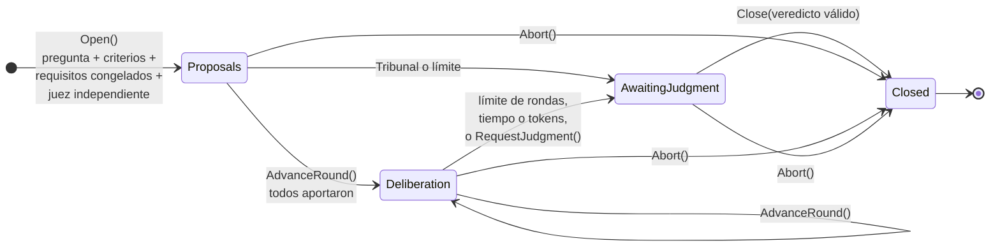
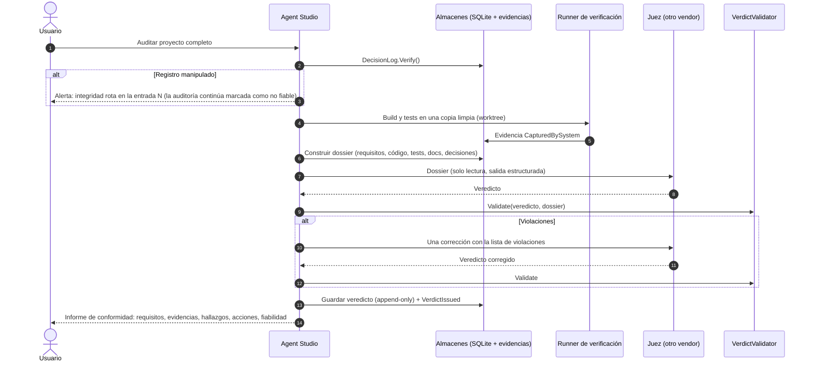

# 07 · Debate Arena, juez independiente y auditoría del orquestador

> Entregable 10 de la sección 19 (y diseño de las secciones 7, 8 y 9 del prompt). Las reglas descritas aquí ya existen
> como código de dominio con tests: `DebateSession`, `Verdict`, `VerdictValidator`, `JudgeDossier`, `DecisionLog`.
> La coordinación con agentes reales (pedir contribuciones, llamar al juez) es la Fase 5.

## 1. Idea central

Un juez LLM es una opinión. Para que su veredicto sea **verificable** se combinan tres cosas:

1. **Material que el juez no elige ni recibe filtrado:** un dossier construido por el sistema desde sus almacenes
   (requisitos congelados, registro de decisiones, evidencias con hash, tareas).
2. **Evidencia objetiva:** solo cuenta para aprobar lo que Agent Studio ha capturado (tests y builds ejecutados por
   él) o lo que aporta una persona. «El agente dice que funciona» no aprueba nada.
3. **Un validador determinista** que rechaza veredictos incoherentes con el dossier (23 reglas, sección 5).

Y el juez **no es infalible**: su veredicto se puede impugnar, termina en «no resuelto» cuando el desacuerdo es
legítimo y escala al usuario cuando hace falta.

## 2. Roles

| Rol | Quién | Puede | No puede |
|---|---|---|---|
| Participante (`Proponent`, `Critic`, `Panelist`) | Agentes de cualquier proveedor | Proponer, objetar, replicar, aportar evidencias | Votar el resultado; contribuir fuera de su ronda |
| Juez | Agente con rol `Judge`, por defecto de un **vendor distinto** a todos los participantes y al orquestador | Leer el dossier completo; emitir el veredicto estructurado | Participar en el debate; escribir ficheros (validado en `AgentDefinition`); modificar código sin autorización explícita |
| Auditor del orquestador | Componente determinista + juez | Revisar el registro de decisiones y lanzar alertas o pedir replanificación | Alterar el registro (append-only) |
| Usuario | Persona | Configurar, aportar evidencias, impugnar, decidir en escalados | — |

## 3. Modos

| Modo | Participantes exigidos | Ronda 1 | Deliberación | Salida típica |
|---|---|---|---|---|
| Debate libre | ≥ 2 | Propuestas independientes | Objeciones y réplicas | Alternativa elegida o «no resuelto» |
| Debate adversarial | ≥ 1 `Proponent` y ≥ 1 `Critic` | Propuesta y crítica independientes | El crítico busca errores, contradicciones, riesgos e incumplimientos | Aprobar, pedir cambios o rechazar |
| Revisión de arquitectura | ≥ 2 | Diseños independientes | Comparación por mantenibilidad, seguridad, rendimiento, coste y complejidad | Diseño recomendado con riesgos |
| Auditoría de implementación | ≥ 1 `Proponent` (quien entregó) y ≥ 1 `Critic` | Defensa y cuestionamiento | Con evidencias de tests y diffs | ¿Cumple los requisitos? |
| Revisión del orquestador | ≥ 2 (revisores) | Revisión independiente del registro de decisiones | Contraste de hallazgos | Alertas y petición de replanificación |
| Tribunal multiagente | ≥ 2 `Panelist`, solo panelistas | Evaluaciones independientes (`Assessment`) | **No hay**: el juez sintetiza | Veredicto sintetizado |

## 4. Protocolo

Los diez pasos del prompt, tal como los aplica `DebateSession`:



| Paso del prompt | Implementación |
|---|---|
| 1. Cuestión concreta | `Open` exige `question` no vacía |
| 2. Criterios de aceptación | `Open` exige al menos uno |
| 3. Congelar requisitos | `Open` recibe un `FrozenRequirementSet`; su `ContentHash` acompaña todo el debate |
| 4. Propuestas independientes | Ronda 1: una por participante, sin `RepliesTo`; en la Fase 5 se piden **en paralelo y sin mostrar las de los demás** |
| 5. Argumentos y evidencias | Cada contribución cita `EvidenceId`; todas quedan en `debate_contributions` (append-only) |
| 6. Objeciones y réplicas | Rondas 2..N: `Objection`, `Rebuttal`, `Evidence`, con `RepliesTo` |
| 7. Ejecutar pruebas | El botón «Ejecutar pruebas» lanza el runner de verificación y añade evidencia `CapturedBySystem` |
| 8. Evaluación del juez | `AwaitingJudgment`: el sistema construye el dossier y llama a `IJudge` |
| 9. Resolución fundamentada | `Verdict` estructurado + `VerdictValidator` |
| 10. Aprobar, corregir o escalar | `Close`: `Resolved`, `Unresolved` o `EscalatedToUser`; las acciones correctivas se convierten en tareas |

**Límites contra debates infinitos.** `DebateLimits(MaxRounds, MaxDuration, MaxTotalTokens)`; por defecto 4 rondas,
30 minutos y 400 000 tokens. El primero que se alcanza manda el debate a juicio y queda registrado en `LimitReached`.
El juez decide con lo que hay o declara «no resuelto».

**La mayoría no sustituye a las pruebas.** No existe recuento de votos: el resultado lo da el juez, y el validador
impide aprobar mientras la última ejecución de tests capturada por el sistema falle; cuando el dossier nombra el commit
en revisión, la última de ese commit, que además tiene que existir.

## 5. Veredicto estructurado y su validación

Formato que se pide al juez como salida estructurada (`--json-schema` en Claude, `--output-schema` en Codex):

```json
{
  "decision": "ChangesRequested",
  "summary": "Propuesta incompleta: falta la política de integración.",
  "assessments": [
    { "requirement": "RQ-01", "status": "Satisfied", "evidence": ["EV-12"], "rationale": "El diff #7c2 aísla cada agente en su proceso." },
    { "requirement": "RQ-02", "status": "NotSatisfied", "evidence": ["EV-15"], "rationale": "No se especifica cómo evitar escrituras simultáneas." }
  ],
  "evidenceExamined": ["EV-12", "EV-15"],
  "pendingObjections": ["Crítico: escrituras concurrentes sobre los mismos ficheros"],
  "risks": ["Conflictos de merge entre agentes en paralelo"],
  "findings": [
    { "category": "IgnoredRequirement", "severity": "High", "description": "RQ-02 no se aborda", "evidence": ["EV-15"], "decisionRefs": [41] }
  ],
  "confidence": { "level": "Medium", "justification": "Hay diff y propuesta, pero no tests de concurrencia." },
  "correctiveActions": ["Exigir git worktrees por tarea", "Definir política de integración con tests"],
  "requiresHumanIntervention": false,
  "requirementSetHash": "a3f9…e1",
  "decisionLogHeadHash": "5be1…09"
}
```

Reglas del `VerdictValidator` (todas probadas con tests):

| Código | Regla |
|---|---|
| `RequirementSetMismatch` | El veredicto cita el hash del conjunto de requisitos del dossier |
| `DecisionLogMismatch` | Cita la cabeza del registro de decisiones que se le entregó |
| `RequirementNotAssessed` | Evalúa **todos** los requisitos congelados (ninguno ignorado) |
| `UnknownRequirementAssessed` | No evalúa requisitos que no existen |
| `DuplicateAssessment` | Cada requisito una sola vez |
| `EvidenceNotInDossier` | No cita evidencias inexistentes |
| `EvidenceCitedButNotExamined` | Lo que cita figura como examinado |
| `SatisfiedWithoutEvidence` | «Satisfecho» exige al menos una evidencia |
| `ApprovedWithUnmetMandatoryRequirement` | No aprueba con un obligatorio incumplido o no verificable |
| `ApprovedOnAgentClaimsOnly` | No aprueba un obligatorio apoyado solo en afirmaciones de agentes |
| `ApprovedWithFailingTests` | No aprueba si la **última** ejecución de tests capturada por el sistema falló; con un commit en revisión, la última **de ese commit** |
| `ApprovedWithoutTestRun` | No aprueba sin ejecución de tests si algún criterio obligatorio es de test automático |
| `ApprovedWithCriticalFinding` | No aprueba con hallazgos críticos |
| `MissingConfidenceJustification` | La confianza va justificada |
| `HumanInterventionNotFlagged` | «Escalar» y «no resuelto» piden intervención humana |
| `MissingCorrectiveActions` | «Cambios» y «rechazo» listan acciones correctivas |
| `JudgeNotIndependent` | El vendor del juez no produjo el trabajo revisado (desactivable de forma explícita y registrada) |
| `SatisfiedByFailingTestRun` | Un requisito no puede darse por satisfecho citando una ejecución de tests fallida |
| `ApprovedWithoutEvidenceForCriterion` | Para aprobar, cada criterio obligatorio tiene la evidencia que su método exige: test automático → ejecución de tests objetiva y exitosa; comprobación por comando → salida de comando, build o tests objetivos; revisión humana → evidencia aportada por una persona. Con un commit en revisión, el build, el comando o los tests citados tienen que ser **de ese commit** |
| `MalformedVerdict` | Un veredicto con campos nulos (JSON incompleto del juez) se rechaza como violación, sin excepciones |
| `ApprovedPendingHumanIntervention` | No se puede aprobar y a la vez pedir intervención humana |
| `ApprovedWithIntegrityProblems` | No aprueba un dossier con problemas de integridad (`systemChecks`): evidencias sin registrar, que no cuadran con su entrada, cambiadas o ilegibles, una cabecera que no cuadra o un registro que no se reproduce |
| `ApprovedWithoutTestRunForCommit` | Con un commit en revisión (`candidateCommit`), aprobar exige una ejecución de tests capturada por el sistema **de ese commit**: los tests del commit A no aprueban el commit B |

Las objeciones pendientes **no** bloquean por sí solas una aprobación: una objeción puede ser no bloqueante y queda
registrada en el veredicto.

Si el veredicto tiene violaciones, se pide **una** corrección al juez con la lista de violaciones; si persisten, el
caso se escala al usuario con el veredicto y sus incidencias visibles. Nunca se «arregla» un veredicto en silencio.

## 6. Independencia operativa del juez

- **Otro vendor que todos los productores.** Se compara `VendorId`, no el adaptador: Claude Code y la API de Anthropic
  son el mismo vendor. `ExcludedVendors` contiene los vendors del orquestador (y de quien escribió el plan) y de
  **todos** los ejecutores, y se calcula desde el registro de la ejecución: no lo pasa nadie. Con dos vendors, el
  orquestador y los ejecutores comparten uno y el juez usa el otro. En la Fase 3, Claude orquesta y ejecuta, y Codex
  juzga ([ADR-0014](adr/0014-independencia-del-juez-con-dos-vendors.md)). Un juez de un vendor excluido no se lanza.
  Desactivar la independencia exige una decisión explícita que queda en el registro.
- **Dossier del sistema.** `IJudgeDossierBuilder` lee directamente los almacenes; el orquestador no tiene acceso a ese
  componente (regla de dependencias entre proyectos, [02](02-arquitectura.md#4-estructura-de-la-solución-y-dependencias)).
- **Solicitud original literal.** El dossier incluye el texto original del usuario, no la versión resumida por el
  orquestador.
- **Solo lectura**, según el CLI del juez:

  | CLI | Cómo | Quién lo impone |
  |---|---|---|
  | Codex (juez preferido) | `codex exec -s read-only`; veredicto con `--output-schema` (modo estricto) | El sandbox de Codex |
  | Claude Code | `--permission-mode dontAsk`; `--tools "Read Grep Glob StructuredOutput"`; `Read(//c/<carpeta>/**)` para su directorio de trabajo y la carpeta del dossier ([ADR-0018](adr/0018-modelo-de-amenaza-fase-3.md)); `Write`, `Edit`, `NotebookEdit`, `Bash`, `WebFetch` y `WebSearch` denegadas; `--add-dir` con la carpeta del dossier; veredicto con `--json-schema`. **Nunca `plan`**: cambia de modelo y cuesta más (verificado en la Fase 2) | Las listas de herramientas del CLI |
  | Gemini CLI | Aparcado ([ADR-0009](adr/0009-google-aparcado.md)) | — |

  Además, el `AgentDefinition` de un juez no admite escritura, y `AgentJudge` rechaza antes de lanzar nada a un agente
  que no sea juez o auditor o que tenga permisos de escritura.
- **Identidad puesta por el sistema.** El juez no dice quién es ni cuándo juzgó: el esquema del veredicto no tiene esos
  campos y la lectura estricta rechaza miembros desconocidos. El sistema pone `Judge` (el agente, el proveedor y el
  vendor que corrieron de verdad, y el modelo que anunció la sesión) e `IssuedAt`. El juez solo repite los dos hashes.
- **Anclaje.** El veredicto guarda los hashes de requisitos y de la cabeza del registro: cualquier manipulación
  posterior del registro deja de cuadrar con los veredictos emitidos.
- **Contenido como dato.** Todo lo que viene de ficheros, webs o agentes se entrega delimitado y marcado como
  material a evaluar, nunca como instrucciones (mitigación de inyección de instrucciones, R4). El dossier viaja como
  JSON con `<` y `>` siempre escapados, así que ningún texto suyo puede cerrar el delimitador en el que va.

## 7. Qué detecta el juez y cómo

Cada punto de la sección 8 del prompt se reparte entre comprobaciones deterministas (las hace el sistema antes de
llamar al juez y las incluye en el dossier) y juicio del LLM:

| Debe detectar | Comprobación determinista (sistema) | Juicio del LLM (juez) |
|---|---|---|
| Requisitos ignorados | Requisitos sin evidencia que los cubra; `RequirementNotAssessed` | ¿La implementación responde al enunciado? |
| Tareas omitidas | Tareas del plan no completadas; tareas inalcanzables (`TaskGraph.Analyze`) | ¿El plan cubría todo lo pedido? |
| Resultados inventados | Afirmaciones de agentes («tests en verde») sin evidencia `CapturedBySystem` que cuadre; hash de evidencia que no coincide | Coherencia entre lo afirmado y lo capturado |
| Pruebas no ejecutadas | No hay ejecución capturada; ejecución con 0 tests (`TestRunSummary.Succeeded` falso) | ¿Los tests prueban de verdad el requisito? |
| Decisiones contradictorias | Correcciones encadenadas; transiciones revertidas | Contradicciones de fondo entre decisiones |
| Modificaciones fuera de alcance | Rutas del diff fuera de las `PathGrant` de la tarea | ¿El cambio era necesario? |
| Errores de integración | Build y tests tras integrar el worktree | Riesgos de la integración |
| Problemas de seguridad | Analizadores estáticos (Fase 7) | Revisión de diffs sensibles |
| Finalizaciones prematuras | `Completed` sin evidencia, o antes de que sus prerrequisitos terminen | ¿Estaba realmente terminado? |
| Incumplimiento de instrucciones | `InstructionsIssued` frente a acciones registradas | Desviaciones respecto a las instrucciones |

## 8. Supervisión del orquestador (sección 9)

El orquestador registra cada decisión en el `DecisionLog` (`PlanCreated`, `TaskAssigned`, `InstructionsIssued`,
`ReviewSkipped`, `ApprovalRequested`…). Un **auditor** comprueba sobre el registro:

| Comprobación | Fuente |
|---|---|
| Tareas asignadas a agentes con el rol y permisos adecuados | `TaskAssigned` + `AgentDefinition` |
| Dependencias respetadas | Orden de `TaskStatusChanged(Running)` frente al grafo |
| Instrucciones completas | `InstructionsIssued` contiene objetivos, criterios y restricciones de la tarea |
| Revisiones obligatorias no omitidas | `ReviewPolicy` frente a `ReviewRequested`/`ReviewSkipped` |
| Permisos respetados | `PermissionDenied` y rutas de los diffs |
| Aprobaciones solicitadas | Acciones destructivas sin `ApprovalGranted` previo |
| Integración correcta | `IntegrationPerformed` seguido de evidencia de build y tests |

El auditor puede emitir `AuditAlertRaised` y `ReplanRequested`. No puede borrar ni editar nada: el registro es
append-only y su integridad se verifica (`DecisionLog.Verify`) antes de cada auditoría.

## 9. «Auditar proyecto completo»



### Revisión de una ejecución: el dossier por ejecución (Fase 3)

La Fase 3 adelanta la parte de esta auditoría que revisa **una ejecución** del orquestador: la tarea `Review` del plan.
La hace `IIndependentReview` (módulo `Debate`), y el motor solo le pasa identificadores.

1. Registra `ReviewRequested` y vuelve a leer y verificar el registro, cadena y ancla exterior ([ADR-0010](adr/0010-estado-derivado-del-registro.md),
   adenda). **Si no está íntegro, no se lanza el juez** y el
   resultado es `NeedsHuman`: un veredicto no se podría anclar a un registro que ya no admite entradas. A diferencia de
   «Auditar proyecto completo», que sigue adelante marcada como no fiable, la revisión de una ejecución falla cerrada.
2. El dossier es **el de la ejecución** y sale solo de los almacenes:
   - la petición literal (la evidencia que guarda la cabecera de la ejecución);
   - los requisitos congelados y el plan, por los hashes de `RunStarted`;
   - las entradas de la ejecución y la cabeza del registro completo;
   - las evidencias de la ejecución **que el registro verificado anunció** con `EvidenceRegistered` (mismo id, SHA-256,
     tipo y origen), copiadas al paquete y comprobadas contra su SHA-256. Insertar una fila en `evidence` no necesita
     UPDATE ni DELETE, así que ningún trigger lo impide: una fila que el registro no anunció, o que no cuadra con su
     entrada, se queda fuera y se informa, igual que una entrada cuya fila no está o una petición original sin
     registrar. El prompt y la respuesta del propio juez, que anuncian `AgentRunStarted` y `AgentRunFinished`, no son
     evidencias del trabajo y tampoco entran;
   - las tareas reproducidas con `RunStateReplayer`;
   - `ExcludedVendors`, calculado desde el registro (§6).

   Lo que el sistema detecta de forma determinista va en `systemChecks`: problemas de la reproducción, evidencias que
   cambiaron después de capturarse, que no se pueden leer o que el registro no anunció, y una cabecera que no cuadra
   con el registro. Son los `IntegrityProblems` del dossier que comprueba el validador: con cualquiera de ellos no hay
   aprobación (`ApprovedWithIntegrityProblems`).

   El **commit en revisión** (`candidateCommit`) es el resultado de la última integración limpia de la ejecución según
   el registro (`IntegrationPerformed` con resultado, sin conflictos y que no es una entrega). Cada build y cada
   ejecución de tests lleva el commit que verificó (`subjectCommit`), que el motor pasa al runner de verificación, así
   que solo los tests de ese commit apoyan la aprobación. Una ejecución sin integración no nombra commit en revisión y
   se queda con la regla de la última ejecución capturada.
3. El paquete de ficheros va a `DossierRoot\<proyecto>\<ejecución>\<16 primeros caracteres de la cabeza>\`:
   - `dossier.json`, con los mismos datos que el juez recibe en el prompt;
   - `request.txt`, con la petición literal;
   - `evidence\NNN-<id>.txt` (o `.diff`), con el contenido de cada evidencia: como mucho 2 MiB por fichero, aunque el
     hash se comprueba sobre el contenido completo.

   Con la misma cabeza se obtiene el mismo paquete. Nada se borra ni se escribe a través de un enlace (unión o enlace
   simbólico) desde la raíz de los dossiers hacia abajo: un agente con shell corre como el mismo usuario y podría
   plantar uno para que el paquete borrara o pisara otra carpeta. Los ficheros del paquete siempre se crean nuevos.
4. El juez evalúa en solo lectura (§6). `VerdictValidator` valida sin cambios y, si hay violaciones, el juez tiene
   **una** corrección, que reanuda su sesión (`--resume`).
5. Cada veredicto se guarda tal cual: append-only, con sus incidencias, y la corrección apunta al anterior con
   `supersedes`. Cada uno se anuncia con `VerdictIssued`, que lleva la cabeza del registro que examinó el juez.
6. La disposición:
   - un `Approved`, `ChangesRequested` o `Rejected` válido es eso mismo;
   - `EscalateToHuman`, `Unresolved`, un veredicto que sigue inválido tras la corrección o una corrección que no llega
     dan `NeedsHuman`.

Cada lanzamiento del juez queda en el registro, con `AgentRunStarted` antes y `AgentRunFinished` después. Su prompt y su
respuesta se guardan como evidencias, y los payloads solo llevan sus ids y hashes.

## 10. Ejemplo: la deliberación del prompt maestro, como datos

| Campo | Valor |
|---|---|
| Modo | `ArchitectureReview` |
| Pregunta | ¿Cómo se aíslan los agentes que trabajan en paralelo? |
| Participantes | Arquitecto (`Proponent`, Claude Code / Anthropic) · Crítico (`Critic`, Codex / OpenAI) |
| Juez | Gemini CLI / Google (independiente de ambos) |
| R1 · Propuesta | «Arquitectura modular con procesos aislados para cada agente.» |
| R2 · Objeción | «Falta especificar cómo evitar escrituras simultáneas sobre los mismos archivos.» |
| Veredicto | `ChangesRequested` · acciones: «Exigir git worktrees y una política de integración antes de aprobar.» |
| Resultado | `Resolved` (con cambios pedidos); las acciones se convierten en tareas del orquestador |
