# 08 · Plan de desarrollo incremental y criterios de aceptación

> Entregables 11 y 12 de la sección 19. Cada fase entrega **software ejecutable, documentación y tests**, y se cierra
> solo cuando todos sus criterios se han comprobado con evidencia (comando ejecutado y su salida, o demostración
> registrada). Criterios comunes a todas las fases:
>
> - **C-1** `dotnet build AgentStudio.slnx` sin errores ni avisos (los avisos son errores).
> - **C-2** `dotnet test` en verde. Los tests que consumen cuota de proveedores van aparte, tras
>   `AGENTSTUDIO_PROVIDER_TESTS=1`, y no se ejecutan sin tu OK.
> - **C-3** Ninguna funcionalidad simulada: lo que no está implementado no aparece en la UI o aparece marcado como
>   pendiente.
> - **C-4** Documentación y ADR actualizados con lo decidido en la fase.

## Vista general

```mermaid
gantt
    title Fases de Agent Studio (orden y dependencias; sin fechas comprometidas)
    dateFormat X
    axisFormat %s
    section Base
    F0 Arquitectura y prototipo        :done, f0, 0, 1
    F1 IDE mínimo                      :f1, after f0, 3
    section Agentes
    F2 Proveedores                     :f2, after f0, 3
    F3 Orquestación                    :f3, after f2, 4
    F4 Observabilidad y memoria        :f4, after f3, 3
    F5 Debate Arena y juez             :f5, after f3, 4
    section Producto
    F6 Auto Doctor y Auto Graph        :f6, after f9, 3
    F7 Seguridad, pruebas y empaquetado :f7, after f10, 4
    section Plataforma (docs/16)
    F8 Trabajo desatendido             :f8, after f5, 3
    F9 Trabajo y trazabilidad          :f9, after f8, 4
    F10 Git remoto                     :f10, after f9, 4
    F11 Entornos y servicios (opcional) :f11, after f7, 3
```

Las fases 1 y 2 pueden avanzar en paralelo: la 1 es interfaz y la 2 integración de CLIs.

**Ampliación «plataforma de proyectos» ([16](16-ampliacion-plataforma-de-proyectos.md), aprobada el 2026-10-20).** Tras la Fase 5 el orden es 8 → 9 → 6 → 10 → 7 (la 6 puede ir en paralelo a la 9), y la 11 queda aplazada hasta que un proyecto tuyo necesite servicios o Dev Containers. Las Fases 6 y 7 se amplían con los criterios marcados abajo.

**Bloque final de producto ([17](17-constructor-visual-de-agentes.md)).** Las Fases 12 a 15 tienen su diseño y sus
criterios en docs/17 §9. La 12 (el índice semántico) va primero, justo después de la tanda 2, y su estado está en la
[Fase 12](#fase-12--índice-semántico-de-la-bitácora-y-la-memoria).

El prototipo «orquestador + ejecutor + juez de otro proveedor» que recomienda el prompt (parte 5) queda al final de la
Fase 3 como primera demostración de extremo a extremo, y se amplía en la Fase 5.

## Fase 0 — Arquitectura y prototipo (esta entrega)

**Objetivo.** Decidir la arquitectura con datos verificados, fijar contratos y reglas de dominio, y tener un esqueleto
que compila, se prueba y arranca.

| ID | Criterio de aceptación | Cómo se verifica |
|---|---|---|
| F0-1 | Existen los 12 entregables de la sección 19 | [README de docs](README.md) enlaza cada uno |
| F0-2 | La solución tiene los 11 proyectos con las dependencias justificadas | `AgentStudio.slnx`; [02](02-arquitectura.md#4-estructura-de-la-solución-y-dependencias) |
| F0-3 | C-1 y C-2 | `dotnet build` y `dotnet test` |
| F0-4 | Reglas de dominio probadas: máquina de estados, ciclos, registro encadenado, validador del veredicto (21 reglas), protocolo de debate | Tests de `tests/AgentStudio.Tests/Domain` |
| F0-5 | La app arranca y muestra el estado **real** de Claude Code, Codex y Gemini CLI sin consumir cuota | Ejecutar `AgentStudio.Desktop.exe`; tests `LocalTools` |
| F0-6 | Términos e interfaces de los proveedores verificados con fuente | [investigación](investigacion/2026-10-15-proveedores-y-stack.md) |
| F0-7 | Esquema SQLite inicial con tablas append-only que rechazan UPDATE y DELETE | Tests de `Infrastructure/SqliteSchema` |

## Fase 1 — IDE mínimo

**Objetivo.** Ventana principal con docking, explorador, editor real, terminal real y gestión de proyectos.

| ID | Criterio de aceptación | Cómo se verifica |
|---|---|---|
| F1-1 | Abrir una carpeta la muestra en el explorador y la recuerda como proyecto reciente | Test de ViewModel + demostración |
| F1-2 | El editor (Monaco en WebView2) abre, edita y guarda ficheros C#, Python, SQL, JSON, YAML y Markdown con resaltado | Test de integración del puente WebView2 + demostración |
| F1-3 | Pestañas, buscar y reemplazar, ir a fichero; diff de dos versiones de un fichero | Demostración grabada |
| F1-4 | Terminal ConPTY con PowerShell y CMD: ejecuta `dotnet --version`, se puede detener y registra el código de salida | Test de integración de ConPTY (proceso real) |
| F1-5 | Paneles redimensionables, ocultables y reordenables; el diseño se guarda y restaura por proyecto | Test de serialización del layout + demostración |
| F1-6 | Tema oscuro con tokens; contraste AA verificado | Revisión con la skill `accessibility-review` |
| F1-7 | Logging estructurado a fichero sin secretos ni prompts completos | Test que inspecciona el log generado |

Spikes al comienzo: Monaco frente a AvalonEdit; xterm.js + ConPTY.

**Estado a 2026-10-15 (en curso).**

| ID | Estado | Evidencia |
|---|---|---|
| F1-1 | Cumplido | Tests de `MainViewModel` y del explorador; app real en [evidencias/fase1-ide.png](evidencias/fase1-ide.png) |
| F1-2 | Parcial | Test de integración del puente: `EditorBridgeIntegrationTests` (LocalTools, 9 casos). Usa la página y Monaco 0.57 reales en el WebView2 Runtime instalado, dentro de una ventana que nunca se muestra ni toma el foco. C#, Python, SQL, JSON, YAML y Markdown abren con su texto exacto, su lenguaje y su resaltado. Una edición marca el documento como modificado y se guarda por `EditorDocument` con BOM y finales de línea intactos, y deshacer tras guardar lo deja limpio. Falta tu demostración: [evidencias/fase1-demostracion.md](evidencias/fase1-demostracion.md) |
| F1-3 | Cumplido | Pestañas; buscar y reemplazar de Monaco (Ctrl+F / Ctrl+H); **ir a fichero** con Ctrl+P (búsqueda difusa sobre el proyecto); **diff** «Comparar con la versión guardada» (Ctrl+Alt+D) y «Comparar con otro fichero…» (Ctrl+Alt+F). Tests de `Desktop/QuickOpen` y `Desktop/Diff`; capturas [ir a fichero](evidencias/fase1-quick-open.png) y [diff](evidencias/fase1-diff.png) |
| F1-4 | Cumplido | `ConPtyTerminalSessionTests` con procesos reales (cmd y pwsh, código de salida, detener, redimensionar, sin fugas). La shell arranca en la carpeta del proyecto |
| F1-5 | Parcial | Diseño guardado y restaurado por proyecto (tests de `FileLayoutStore` y `MainWindow`). Falta tu demostración: [evidencias/fase1-demostracion.md](evidencias/fase1-demostracion.md) |
| F1-6 | Cumplido | Revisión con `accessibility-review` en [12-accesibilidad-tema-oscuro.md](12-accesibilidad-tema-oscuro.md): 291 pares medidos por tests sobre los recursos reales (50 mediciones bajo el umbral antes, 0 ahora) y foco de teclado visible con anillo temático; capturas [antes](evidencias/fase1-contraste-antes.png) y [después](evidencias/fase1-contraste-despues.png). Lector de pantalla y mapa de teclado, en la Fase 7 |
| F1-7 | Cumplido | Proveedor propio de JSON Lines en `%LOCALAPPDATA%\AgentStudio\logs`, con rotación diaria y por tamaño y retención de 14 días. Antes de escribir: • `SecretRedactor` (Security) redacta claves, tokens y la ruta del perfil. • Los prompts y textos largos quedan como longitud + hash. Prueba: `FileLoggerRedactionTests.F1_7_the_generated_log_has_no_secrets_and_no_full_prompts`. La app solo usa este proveedor (sin consola, depuración ni Visor de eventos) |

Además:

- La pestaña, el cambio de proyecto y el cierre de la ventana preguntan antes de perder cambios sin guardar
  (Guardar / No guardar / Cancelar), y un guardado fallido se avisa.
- Antes de guardar se compara el hash del fichero en disco con el que se abrió. Si un agente u otro programa lo cambió
  o lo borró, no se sobrescribe sin un «Sobrescribir» explícito.
- Los ficheros con finales de línea mezclados muestran un aviso.
- La shell del terminal entra en el Job Object, así que muere con la app.
- Los scripts de assets fijan el SHA-512 de cada paquete.

## Fase 2 — Proveedores

**Objetivo.** Adaptadores reales de Claude Code y Codex (y Gemini si se instala) detrás de `IAgentProvider`.

| ID | Criterio de aceptación | Cómo se verifica |
|---|---|---|
| F2-1 | Cada adaptador traduce sus eventos nativos a `AgentEvent` | Tests con salidas grabadas por versión del CLI (sin consumir cuota) |
| F2-2 | Una ejecución real por proveedor devuelve texto, uso de tokens y código de salida | Test `AGENTSTUDIO_PROVIDER_TESTS=1`, ejecutado con tu OK |
| F2-3 | Salida estructurada válida contra un JSON Schema | Ídem, con un esquema de prueba |
| F2-4 | Cancelar una ejecución termina el árbol de procesos en < 5 s | Test de integración |
| F2-5 | Límite de concurrencia por proveedor respetado | Test con adaptador real y concurrencia 1 |
| F2-6 | Los prompts nunca viajan como argumento; credenciales de los CLIs nunca leídas | Test sobre `ProcessSpec` generado + revisión de código |
| F2-7 | Matriz de versiones probadas; Auto Doctor avisa de versiones no probadas | Test de la matriz |
| F2-8 | Gemini CLI instalado (con tu OK) y verificado, o documentado como no soportado | Evidencia en investigación |
| F2-9 | Todo proveedor se registra solo a través de `JournalingAgentProvider`: ningún prompt sin entrada en la bitácora | Test de composición que recorre los `IAgentProvider` registrados |
| F2-10 | `ISkillMaterializer` prepara las skills activadas para Claude Code (`--plugin-dir`), Codex y Gemini (`.agents/skills/`) sin escribir en la configuración global | Test por CLI con directorio temporal + una ejecución real por CLI (con tu OK) que confirme que la skill se ve |

**Estado a 2026-10-15 (en curso).**

| ID | Estado | Evidencia |
|---|---|---|
| F2-1 | Cumplido | Tests de los tres parsers con las capturas reales de `tests/.../Providers/Fixtures/` (Claude 2.1.290, Codex 0.160.0, Gemini 0.64.0 sin sesión) |
| F2-2 | Cumplido para los proveedores activos | Tests `ProviderLive` en verde para Claude Code y Codex. Gemini, aparcado ([ADR-0009](adr/0009-google-aparcado.md)): solo se probó el caso sin sesión (exit 41) |
| F2-3 | Cumplido para los proveedores activos | Claude (`--json-schema`) y Codex (`--output-schema`) en real. Gemini headless no tiene salida estructurada nativa |
| F2-4 | Cumplido | `StreamingProcessRunnerTests` y `JobObjectTests`: el Job Object mata el árbol, nietos incluidos |
| F2-5 | Cumplido | `ProviderConcurrencyLiveTests`: Claude real compuesto con la bitácora y límite 1. Con dos ejecuciones a la vez, la segunda sesión empieza después del final de la primera (los PID no se solapan) y hay dos entradas en la bitácora. Hay un test gemelo sin cuota (`ProviderConcurrencyScenarioTests`) |
| F2-6 | Cumplido | Tests de argumentos de los tres adaptadores (el prompt nunca está en argv); `CliArgumentGuard` valida ids, modelos y rutas antes de lanzar; revisión independiente y tres rondas adversariales con Codex del 2026-10-15. Hallazgos confirmados corregidos (junctions, `\\?\`, UNC, `.git` redirigido, `..cache`, NUL en argv). Quedan riesgos de carrera deducidos, documentados en [06](06-integracion-proveedores.md#riesgos-residuales-conocidos-revisión-adversarial-con-codex-2026-10-15) |
| F2-7 | Cumplido | `SupportedVersions` y aviso de versión no probada en Auto Doctor |
| F2-8 | Cumplido (documentado como no soportado) | Gemini CLI 0.64.0 instalado y adaptador hecho, pero Google ya no admite cuentas personales. Antigravity no se puede envolver con una cuenta de consumo. Ver [ADR-0009](adr/0009-google-aparcado.md) e [investigación](investigacion/2026-10-15-proveedores-y-stack.md#7-google-sin-cuentas-personales-2026-10-15) |
| F2-9 | Cumplido | `ProjectAgentProvidersTests`: el contenedor no expone adaptadores sueltos y los tres pasan por la bitácora del proyecto |
| F2-10 | Cumplido (Claude y Codex) | `SkillVisibilityLiveTests` y capturas `04-skill-*`: • **Claude:** `system/init` lista la skill del `--plugin-dir` de sesión. • **Codex:** la skill de `.agents/skills` llega al prompt del modelo y este devuelve su palabra clave. Limitación: Codex 0.160.0 también carga las skills globales del usuario ([10](10-catalogo-de-skills.md)). Repetido en Claude el 2026-10-18 con el lanzamiento confinado (`--tools` con `Skill`): la skill se lista y se invoca. Su cabecera llega depurada, sin `allowed-tools` ni otras claves que concedan permisos ([ADR-0018](adr/0018-modelo-de-amenaza-fase-3.md)) |

## Fase 3 — Orquestación

**Objetivo.** Ejecutar grafos de tareas con agentes reales, worktrees y registro de decisiones persistente.

| ID | Criterio de aceptación | Cómo se verifica |
|---|---|---|
| F3-1 | Tareas secuenciales, paralelas, condicionales y dependientes se ejecutan en el orden correcto | Tests del motor con proveedor de prueba determinista (solo en tests) |
| F3-2 | Las tareas paralelas trabajan en worktrees distintos y se integran con build y tests | Test de integración con repo git temporal |
| F3-3 | Abandono, inalcanzables, reintentos excesivos y bloqueo se detectan y se muestran | Tests de `Analyze` + escenario de demostración |
| F3-4 | Toda decisión queda en `decision_log` (SQLite) y `Verify` la valida tras reiniciar la app | Test de persistencia |
| F3-5 | Las evidencias de build y tests las captura el runner de verificación, con hash | Test de `IEvidenceStore` |
| F3-6 | Orquestador visual (Nodify): crear, conectar y validar nodos; los ciclos se rechazan en la UI | Test de ViewModel + demostración |
| F3-7 | Aprobación humana para acciones destructivas | Test de `IApprovalGate` |
| F3-8 | **Prototipo de extremo a extremo:** orquestador y ejecutor de un vendor + juez de otro vendor (Claude orquesta y ejecuta, Codex juzga en solo lectura; decisión 7 de [13](13-fase-3-orquestacion.md) y [ADR-0014](adr/0014-independencia-del-juez-con-dos-vendors.md)) completan una tarea real pequeña con veredicto validado | Ejecución registrada, con tu OK de consumo |
| F3-9 | Activación de skills por agente aplicada en cada ejecución (Agente > Proyecto > Global) | Test del motor con resolver y materializador |

**Estado a 2026-10-18 (cerrada).** Diseño en [13](13-fase-3-orquestacion.md); ADR 0010–0018.

| ID | Estado | Evidencia |
|---|---|---|
| F3-1 | Cumplido | `SequenceAndParallelTests` y `ConditionalTests`; propiedad 1 del motor (200 planes aleatorios por semilla) |
| F3-2 | Cumplido | Prueba de integración F3-2 con motor, git, SQLite, `dotnet build`/`dotnet test` y fusión reales. Las integraciones de una ejecución están ordenadas (`IntegrationsNotOrdered`) y la rama solo avanza tras verificar un candidato |
| F3-3 | Cumplido | Demostración F3-3 sin cuota: herramienta, condición y aprobación denegada. Pruebas de abandono, tiempo agotado, reintentos y límite de uso, también para el juez |
| F3-4 | Cumplido | `SqliteDecisionLogStore`: `Verify` tras reabrir, y la manipulación se detecta. Ancla externa de la cabeza del registro (ADR-0010) |
| F3-5 | Cumplido | Almacén direccionado por contenido. El runner captura build y tests con su commit (`SubjectCommit`) y solo cuentan las evidencias anunciadas en el registro |
| F3-6 | Cumplido según tests | Tests de ViewModel del lienzo y renders fuera de pantalla ([lienzo](evidencias/fase3-lienzo.png), [monitor](evidencias/fase3-monitor.png)). Falta la demostración en la app |
| F3-7 | Cumplido | `ApprovalGate` falla cerrado y registra en orden. La entrega exige una aprobación crítica atada a su contenido y de un solo uso |
| F3-8 | Cumplido | Nueve ejecuciones reales en [fase3-e2e.md](evidencias/fase3-e2e.md), todas con veredicto Approved y válido. La última (2026-10-18, `20261018-0f0d3b`) lleva la verificación aislada, Claude confinado a su worktree, las correcciones de las ocho rondas y el recorrido del directorio git |
| F3-9 | Cumplido para orquestador y ejecutores | `SkillProvisioner` por agente con precedencia. El juez no recibe skills: decide solo con el dossier. Una skill nunca concede herramientas fuera del perfil del agente: la copia de sesión solo conserva las claves descriptivas de su cabecera |

**Seguridad: cerrada para uso personal (2026-10-18).** Hubo una revisión independiente y nueve rondas adversariales con
Codex, juzgadas desde la cuarta contra [ADR-0018](adr/0018-modelo-de-amenaza-fase-3.md). La novena no dejó ningún
hallazgo abierto dentro del modelo y aceptaste expresamente los cuatro residuales de su punto 2 (ver el final de esta
sección).

- **Uso:** el orquestador se puede usar con tus repositorios y los agentes por defecto.
- **En repositorios de terceros:** no des `Bash` a un agente, no uses Codex como ejecutor que escribe y no quites el
  aislamiento a un paso. Esas capacidades sacan la ejecución del modelo, y el plan te lo avisa antes de aprobarlo.

El historial de rondas sigue debajo como registro.

Corregido tras la primera ronda. La segunda ronda lo confirma, aunque en varios puntos de forma parcial (ver hallazgos abiertos):

- la configuración del repositorio (hooks, MCP) ya no se ejecuta en los CLIs;
- verificación aislada a integridad Low ([ADR-0017](adr/0017-verificacion-aislada-baja-integridad.md));
- comprobación del repositorio del usuario alrededor de cada paso que ejecuta código de agentes;
- evidencias ancladas al registro;
- tests ligados al commit en revisión;
- entrega verificada.

La segunda ronda da por cerrados el ancla externa (dentro de su límite documentado), el integrador y la aprobación de entrega de un solo uso.

Hallazgos de la segunda ronda (2026-10-17) y su veredicto en la tercera ronda de Codex (sobre `97763ac`). «Cerrado» lo
confirma Codex; «Parcial», lo corregido que la tercera ronda aún ve incompleto:

| ID | Gravedad | Problema | Estado |
|---|---|---|---|
| N-01 | Alta | Filtros y drivers de fusión del repositorio se ejecutan con permisos normales en operaciones internas de git | Parcial (ronda 3, ver R3-01 a R3-07): se revisa la configuración efectiva antes de cada comando de contenido y de `worktree add`; submódulos neutralizados; la entrega rechaza un diff que reescribe un programa del repositorio ([ADR-0012](adr/0012-worktrees-fuera-del-repo.md)) |
| N-02 | Alta | La limpieza de informes de verificación puede borrar un fichero del usuario a través de una junction | Cerrado: el informe solo vive en el `{results}` nuevo del paso y nunca se borra ni se lee a través de un enlace |
| N-03 | Alta | Las verificaciones de dos instancias de la app comparten zona Low y pueden interferir entre sí | Cerrado: cerrojo del usuario entre procesos y limpieza de áreas abandonadas ([ADR-0017](adr/0017-verificacion-aislada-baja-integridad.md)) |
| N-04 | Alta | Los metadatos de las evidencias (commit, resumen de tests, fecha) no están anclados en el registro | Cerrado: `EvidenceRegistered` v2; también la evidencia de la integración ([ADR-0010](adr/0010-estado-derivado-del-registro.md)) |
| N-05 | Alta | Reanudar no comprueba la plantilla de agentes, las opciones ni el commit base contra el registro | Cerrado: `RunStarted` v2 ancla el hash de la cabecera; reanudar y lanzar al juez lo exigen |
| N-06 | Media | La política «tests obligatorios» se satisface con un paso que solo compila | Cerrado: el plan exige un paso de pruebas y el cierre, una ejecución de pruebas que pase |
| N-07 | Media | La comprobación del repositorio compara carpetas ignoradas solo por metadatos y sus excepciones son amplias | Parcial (ronda 3, ver R3-01 a R3-07): captura por contenido con presupuesto, excepciones exactas y bitácora solo de añadido. Una carpeta ignorada que no se pudo verificar bloquea si la ejecución puede escribir a integridad media (shell, Codex escribiendo o un paso sin aislamiento); si no, queda una alerta ([ADR-0012](adr/0012-worktrees-fuera-del-repo.md)) |

Hallazgos de la tercera ronda (2026-10-17). La ronda deja además parciales los puntos 2, 3 y 5 de la primera
(configuración del repositorio, captura y dossier), por estos mismos motivos. «Corregido» significa integrado en
`main` con sus pruebas; lo confirma, o no, la cuarta ronda, que juzga contra
[ADR-0018](adr/0018-modelo-de-amenaza-fase-3.md):

| ID | Gravedad | Problema | Estado |
|---|---|---|---|
| R3-01 | Alta | El clasificador de callbacks de git acepta sintaxis de shell (`exec`, `!`) y código dentro de opciones de un intérprete | Corregido: lista blanca (charset seguro, sin intérpretes ni builtins, programa con ruta final fuera del repositorio), transportes cerrados uno a uno y ayudantes de credenciales vaciados |
| R3-02 | Media | La huella de una carpeta concatena nombres y contenidos sin delimitar: dos estados distintos pueden dar el mismo hash | Corregido: cada entrada se codifica sin ambigüedad y la carpeta lleva un resumen de los metadatos de todas sus entradas |
| R3-03 | Media | Una carpeta que no se puede enumerar se toma por vacía en vez de por no verificada | Corregido: una carpeta que no se lista queda sin metadatos y bloquea |
| R3-04 | Media | Los ficheros con `assume-unchanged` o `skip-worktree` y el contenido de los submódulos quedan fuera de la captura | Corregido: se capturan los ficheros marcados en el índice y el contenido de los submódulos, sin ejecutar git dentro de ellos |
| R3-05 | Alta | La entrega ejecuta los hooks del usuario, que pueden ejecutar scripts del repositorio que el diff entregado cambió | Corregido: la entrega corre sin hooks ni firma, y la aprobación da la orden manual para quien los quiera |
| R3-06 | Media | Relajar una carpeta ignorada sin verificar descarta también su comparación por metadatos | Corregido: una ruta sin verificar se sigue comparando por metadatos; solo un cambio que los conserve todos queda indeterminado |
| R3-07 | Alta (plausible) | `GIT_CONFIG` heredado haría que la inspección de la configuración y el comando vean configuraciones distintas | Corregido: se retira toda variable `GIT_*` heredada |
| R3-08 | Media | Reanudar admite una evidencia registrada que falta en el almacén, y una tarea lee el informe de otra sin el hash anclado | Corregido: reanudar exige cada evidencia registrada, y todo lo que alimenta un prompt se lee con el hash anclado |
| M-01 | Alta | Medido en vivo: Claude Code 2.1.290 en `acceptEdits` escribe fuera de su worktree (ruta absoluta y `../`), así que un ejecutor sin shell puede escribir en el repositorio del usuario o en los almacenes de la app | Corregido: `dontAsk` con reglas `Edit`/`Read` sobre el worktree y `--tools` con solo las herramientas del perfil. Medido en vivo en 2.1.290: escribir o leer fuera se deniega y dentro funciona. La compuerta se relaja solo para esa versión y ese lanzamiento. Cualquier otro ejecutor que escribe sigue contando como escritor a integridad media |

Cuarta ronda (2026-10-18, sobre `8b6b8cb`), juzgada por primera vez contra
[ADR-0018](adr/0018-modelo-de-amenaza-fase-3.md):

- **Cerrados:** N-02 a N-07, R3-02 a R3-08, M-01 (para el lanzamiento medido), la verificación a integridad Low, la
  captura del repositorio del usuario, el validador del veredicto y la compuerta de escritores a integridad media.
- **Residuales**, por la cláusula 2 de ADR-0018: las carreras de junctions y refs, la de HEAD antes de entregar, el
  almacén de objetos, los padres de la extracción y la cadena de carpetas de `verify.lock`.
- **Siguen abiertos** N-01, R3-01 y R4-01 (por A-02 y A-03), el dossier (por A-01) y el aviso del plan (por A-04),
  con estos huecos. «Corregido» significa integrado en `main` con sus pruebas; lo confirma, o no, la quinta ronda:

| ID | Gravedad | Hueco | Estado |
|---|---|---|---|
| A-01 | Alta | El ancla del registro se busca por el id de proyecto de SQLite: cambiarlo con la app cerrada evita comprobarla | Corregido: el ancla se guarda por la ruta final del proyecto y lleva su id. Un historial sin ancla reconocida bloquea hasta que lo aceptas como nuevo origen |
| A-02 | Alta | `worktree add` revisa la configuración del repositorio principal, pero su checkout corre con la del worktree nuevo | Corregido: `worktree add --no-checkout`, revisión de la configuración del worktree nuevo y luego el checkout protegido. El planificador captura antes de crear `_base` |
| A-03 | Alta | git-lfs puede ejecutar extensiones y transferencias propias (`lfs.extension.*`, `lfs.customtransfer.*`) que no se revisan | Corregido: se rechazan `lfs.extension.*`, `lfs.customtransfer.*` y `lfs.standalonetransferagent`. Medido con git-lfs 3.5.1: `.lfsconfig` ya los ignora |
| A-04 | Media | La aprobación del plan solo avisa de los pasos sin aislamiento, no de `Bash` ni de Codex escribiendo | Corregido: el aviso nombra cada tarea con su escritor y sale de la misma detección que la compuerta. Una aprobación dada junto a otro aviso se retira, y el motor no arranca |
| A-05 | Media | Una junction plantada en `.agentstudio`, `evidence` o `tmp` desviaría las escrituras de la app | Corregido: `.agentstudio`, la base de datos, `evidence` y `tmp` se rechazan si son un enlace o están fuera del proyecto |

Quinta ronda (2026-10-18, sobre `7993a03`), contra ADR-0018:

- **Cerrados:** todo lo anterior salvo A-05, incluidos N-01, R3-01, R4-01 y A-01 a A-04.
- **Residuales:**
  - las carreras con otro proceso del usuario;
  - las lecturas y la red de Low;
  - el PATH;
  - lo que cada CLI escribe en su perfil.
- **A-05 sigue abierto** por dos huecos confirmados. Hay además dos hipótesis plausibles. «Corregido» significa
  integrado en `main` con sus pruebas; lo confirma, o no, la sexta ronda:

| ID | Gravedad | Hueco | Estado |
|---|---|---|---|
| H-01 | Media | La bitácora escribe en `.agentstudio/bitacora` sin comprobar enlaces: una junction o un enlace duro preparados antes la desviarían | Corregido: la bitácora abre cada día sin seguir enlaces y comprueba, con el mismo handle, que es un fichero normal, con un solo nombre y en su sitio |
| H-02 | Media | El lienzo (y `verification.json`) guarda sin la comprobación del almacén, incluso si la apertura del proyecto se rechazó | Corregido: el lienzo y `verification.json` se escriben a través del almacén comprobado. El lienzo no guarda si la apertura del proyecto falló |
| H-03 | Media (plausible) | `worktree add` escribe en la carpeta administrativa de git antes de comprobar enlaces, y algunas refs ocultas se escriben sin esa comprobación | Corregido: antes de escribir se comprueban la carpeta administrativa de git, cada ref con su reflog y los ficheros que escribe la entrega (`ORIG_HEAD`, `MERGE_*`, `logs/HEAD`…), también los enlaces duros |
| H-04 | Alta (plausible) | Un fetch implícito en repositorios parciales o promisor y la clave `remote.*.vcs` quedan fuera del clasificador | Corregido: `GIT_NO_LAZY_FETCH=1` y `GIT_ALLOW_PROTOCOL=-` en todo comando interno (medido), y se rechazan los clones parciales, los promisor y `remote.*.vcs` |

Sexta ronda (2026-10-18, sobre `3539f6b`), contra ADR-0018:

- **Cerrados:** A-01 a A-05, H-01, H-02 y H-04, además de todo lo de rondas anteriores salvo lo que reabre X-01.
- **Residuales:** los mismos cuatro de la ronda anterior.
- **Abiertos confirmados:** dos, más tres hipótesis y una observación. «Corregido» significa integrado en `main`
  con sus pruebas; lo confirma, o no, la séptima ronda:

| ID | Gravedad | Hueco | Estado |
|---|---|---|---|
| X-01 | Alta | Dentro de un worktree, la comprobación de callbacks no cuenta el repositorio original entre las ubicaciones prohibidas: un falso `git-lfs.exe` versionado, activado por un `includeIf` de worktrees, pasaría | Corregido: el clasificador recibe como raíces prohibidas la del proyecto, la del directorio común, la del árbol principal, la de los worktrees y el directorio de trabajo, todas por su ruta final |
| X-02 | Media | Los ficheros internos de la carpeta administrativa de un worktree reutilizado (`COMMIT_EDITMSG`, `logs/HEAD`…) no se comprueban contra enlaces antes de un commit o un reset | Corregido: se rechaza cualquier enlace dentro de la administración de un worktree propio, y se comprueba fichero a fichero antes de `add`, `commit` y `reset` |
| P-01 | Alta (plausible) | Un HEAD simbólico plantado en un worktree propio haría que el commit del sistema moviera una rama del usuario | Corregido: HEAD de un worktree propio tiene que seguir desacoplado, sin enlace y con un id completo, antes de reutilizarlo, de un commit y de un reset |
| P-02 | Media (plausible) | Enlaces previos en `objects/` y el backend `reftable` no se comprueban | Corregido: `objects/` sin enlaces antes de escribir objetos, y se rechazan los repositorios `reftable` |
| P-03 | Media (plausible) | Claves de git-lfs con ruta (`lfs.storage`) podrían sacar sus escrituras del repositorio | Corregido: `lfs.storage` se rechaza (medido: git-lfs 3.5.1 lo aplica desde la configuración, no desde `.lfsconfig`) |
| P-04 | Baja (observación) | La migración del ancla antigua se hace antes de verificar el historial | Corregido: el ancla antigua solo se migra cuando el historial verifica contra ella, y un corte a medias se completa en la siguiente apertura |

Séptima ronda (2026-10-18, sobre `d1d0052`), contra ADR-0018:

- **Cerrados:** X-01, X-02 y P-01 a P-04, y con ellos todo lo anterior salvo lo que reabren G-01 y G-02.
- **Residuales:** los mismos cuatro.
- **Abiertos confirmados:** dos, ambos de gravedad media, más tres hipótesis. «Corregido» significa integrado en
  `main` con sus pruebas; lo confirma, o no, la octava ronda:

| ID | Gravedad | Hueco | Estado |
|---|---|---|---|
| G-01 | Media | El almacén por defecto de git-lfs (`<común>/lfs`) no se comprueba contra enlaces: el filtro permitido podría escribir a través de uno plantado antes | Corregido: antes de cada comando de contenido y de la entrega se comprueba el almacén de git-lfs (`lfs`, `tmp`, `logs`, `objects` y sus dos niveles de reparto). Medido: una junction desviaba `add` y hasta `status` |
| G-02 | Media | Al reanudar no se compara el aviso con el aprobado: si cambió la versión de Claude, la ejecución seguiría sin mostrarte el aviso nuevo | Corregido: `RunStarted` v3 ancla los escritores aprobados; reanudar los recalcula antes de tocar nada y, si no coinciden, no sigue y ofrece una ejecución de seguimiento que se aprueba de nuevo |
| G-03 | Alta (plausible) | Un falso `git-lfs.exe` en otro worktree del usuario o en un árbol principal con el directorio git aparte pasaría el clasificador | Corregido: un `git-lfs.exe` dado por ruta absoluta tiene que ser el instalado, con la misma ruta final y el mismo id de fichero |
| G-04 | Media (plausible) | La entrega no comprueba el `index` del usuario contra enlaces | Corregido: el `index` entra en la comprobación de la entrega, también antes del commit y de `merge --abort` (medido: la fusión escribía a través de un enlace simbólico) |
| G-05 | Media (plausible) | Mecanismos auxiliares de git (`rerere`, `splitIndex`, commit-graph…) no se desactivan ni se comprueban | Corregido: `rerere`, `splitIndex`, la caché de no seguidos y la escritura del grafo de commits se desactivan en cada comando interno (medido) |

Octava ronda (2026-10-18, sobre `1bb05f4`), contra ADR-0018:

- **Cerrados:** G-01 a G-05 y todo lo anterior, salvo tres destinos de una misma clase: un enlace plantado antes bajo
  el directorio git del usuario por el que luego escribe git o git-lfs.
  - **S-01:** git-lfs puede escribir `config`.
  - **S-02:** borrar una ref pasa por `packed-refs`.
  - **S-03:** los parciales de `lfs/incomplete`.
- **Respuesta a la clase entera, no destino a destino:** un único recorrido del directorio común antes de cada comando
  de contenido y de la entrega. Rechaza cualquier reparse point, cualquier fichero con más de un nombre (salvo los
  objetos inmutables) y cualquier carpeta que no se pueda listar. **Corregido.** Las pruebas reprodujeron antes del
  cambio las escrituras reales de S-01 y S-02, y el recorrido también para destinos que nadie había nombrado:
  `FETCH_HEAD`, `info/exclude`, `hooks/lib` y `modules/sub`. Un clon `--local` y un repositorio con git-lfs siguen
  funcionando.
  - **Coste:** 27 ms en este repositorio; unos 0,9 s por recorrido con 10 000 refs sueltas. Cada operación hace de 1 a
    7 recorridos.
  - **Limitación:** un reparse point de OneDrive o WOF bajo `.git` también se rechaza.
- **Cómo se juzga esta clase** a partir de la novena ronda: lo fija ADR-0018 (punto 4).

Novena ronda (2026-10-18, sobre `842a2e2`), contra ADR-0018 y su regla para la clase de enlaces:

- **No queda ningún hallazgo abierto dentro del modelo.** Los 46 elementos revisados quedan cerrados o residuales.
- **O-01 (Baja, residual):** el recorrido no comprobaba la propia raíz del directorio git. Se mitigó igualmente: un
  `.git` que sea un enlace se rechaza al abrir el repositorio, y una raíz que no sea una carpeta normal, en el recorrido.
- **Cierre pendiente de ti.** Según ADR-0018 (punto 5), la seguridad de la Fase 3 se cierra cuando aceptes
  expresamente estos residuales:
  1. **Otro proceso tuyo con integridad Medium:** reescribir el registro y su ancla; las carreras de junctions, refs,
     includes y HEAD; el almacén de objetos; los padres durante la extracción y la cadena de `verify.lock`. También los
     efectos posteriores de un escritor Medium que autorizaste (un agente con `Bash`, Codex escribiendo o un paso sin
     aislamiento).
  2. **Lecturas y red de los procesos Low:** la verificación aislada no puede escribir fuera de su área, pero sí leer y
     salir a la red.
  3. **Un PATH controlado por otro programa tuyo.**
  4. **Lo que cada CLI escribe en su propio perfil:** memoria, planes y scratchpad.

**git-lfs y sus hooks (2026-10-18, resuelto).** git-lfs 3.5.1 instala sus cuatro hooks en el `core.hooksPath` que
recibe, cada vez que arranca su filtro (`filter-process`, `clean` o `smudge`), y ninguna opción lo evita (medido).

- **Con la carpeta vacía de antes:** fallaba cerrado el comando siguiente y, además, en la fusión `--ff-only` de la
  entrega git ejecutaba en el mismo comando el `post-merge` que git-lfs acababa de escribir. Está medido y reproducido
  por una prueba, y cae dentro del modelo de ADR-0018.
- **Ahora:** el `core.hooksPath` propio es un fichero vacío. git no encuentra hooks debajo de un fichero, git-lfs no
  puede instalarlos y su filtro sigue funcionando.
- **Resultado:** un repositorio con git-lfs real recorre el ciclo entero, de `InspectAsync` a la entrega y la limpieza,
  sin que corra ningún hook.

Detalle en ADR-0012.

Riesgos residuales documentados:

- Low IL no impide leer ficheros ni salir a la red (exfiltración posible). El aislamiento completo es F7-4.
- Un proceso con el mismo usuario podría reescribir el registro y su ancla.

## Fase 4 — Observabilidad y memoria

| ID | Criterio de aceptación | Cómo se verifica |
|---|---|---|
| F4-1 | Panel de consumo por proveedor, modelo, sesión, proyecto y periodo con procedencia visible | Test de agregación + demostración |
| F4-2 | Exportación CSV y JSON | Test de exportación |
| F4-3 | Salud del contexto con umbrales configurables; nunca muestra como exacto un dato estimado | Tests de `ContextHealthEvaluator` + UI |
| F4-4 | Cuota de Codex desde `account/rateLimits/read`; en el resto, «no expuesto» | Test con salida grabada |
| F4-5 | Memoria por proyecto en SQLite + Markdown (cronológico y temático) con recuperación selectiva FTS5 | Tests de `IProjectMemory` |
| F4-6 | El empaquetado de contexto conserva requisitos críticos, decisiones y tareas pendientes | Test del empaquetador |
| F4-7 | Pantalla del catálogo de skills: carpetas por sector, búsqueda, activación por ámbito, coste de contexto e indicador de salud | Tests de ViewModel + demostración |
| F4-8 | Recomendación de skills: determinista con razones y asistida por agente vía MCP local (solo propone) | Tests del recomendador + demostración |
| F4-9 | Resumen diario generado a partir de la bitácora | Test con una bitácora de ejemplo |

**Estado a 2026-10-18 (integrada; pendiente de tu demostración).** Diseño en
[14](14-fase-4-observabilidad-y-memoria.md), con las decisiones de §12 resueltas por ti el 2026-10-18 (cuota de Codex bajo
demanda y al terminar, con opt-in; recomendación asistida con OK por uso; resumen diario determinista; solo memoria de
confianza a los agentes; Markdown de la memoria versionado; umbrales globales 70/85/95 %). ADR 0019–0025. Seis paquetes
en paralelo (WP1 a WP6) y la integración, todo en `main`.

| ID | Estado | Evidencia |
|---|---|---|
| F4-1 | Cumplido según tests | El consumo es una proyección del registro (ADR-0019): `UsageProjectorTests`, `UsageAggregatorTests` y `UsageReportTests` (sesiones, reintentos, días de Madrid, cobertura «parcial (n de m)», conciliación con la bitácora); los proveedores escriben el uso v2 (WP1); panel «Consumo» con su render ([consumo](evidencias/fase4-consumo.png)) y prueba de integración de punta a punta. Falta la demostración en la app |
| F4-2 | Cumplido | `UsageExporterTests`: CSV (BOM, CRLF, RFC 4180, fórmulas neutralizadas) y JSON contra ficheros dorados de un script independiente; ningún prompt sale |
| F4-3 | Cumplido según tests | Salud por paso con la ventana del modelo del paso (ADR-0021): analizadores de Claude y Codex, `ContextHealthTracker`, `ModelWindowCatalog` (la ventana aprendida sale «estimada»); umbrales validados en Ajustes que llegan a cada monitor; Codex `exec`, «no expuesto». Render del monitor ([contexto](evidencias/fase4-monitor-contexto.png)) |
| F4-4 | Cumplido | Lectura real del app-server de Codex 0.160.0 el 2026-10-18 (`CodexQuotaLiveTests`, con tu OK): dos ventanas, nada que identifique la cuenta fuera del analizador, captura saneada `05-rate-limits.jsonl`. La medición encontró que el app-server **termina al cerrarse su entrada sin responder**: el lector la deja abierta hasta la respuesta (ADR-0020). Claude, pasiva con cada ejecución; Gemini, «no expuesto». Opt-in en Ajustes, desactivado por defecto |
| F4-5 | Cumplido | Memoria append-only anclada al registro con FTS5 (ADR-0022): `ProjectMemory` y su almacén, recuperación selectiva, confianza por origen y cuarentena; exportación Markdown cronológica y temática. La memoria se **deriva del registro verificado** (WP6, D-18) al terminar cada ejecución, y se exporta, y al abrir un proyecto con almacenamiento ([memoria](evidencias/fase4-memoria.png)) |
| F4-6 | Cumplido | `ContextPacker` por niveles que falla cerrado (ADR-0023); la memoria de confianza llega a los prompts del orquestador y del ejecutor (`ReadSelected`, plantilla por defecto) y nunca al juez; el paquete se ancla en `AgentRunStarted` v2. Un presupuesto insuficiente o un registro que no verifica bloquean la tarea con su motivo ([preparación](evidencias/fase4-preparacion-memoria.png)) |
| F4-7 | Cumplido según tests | Pantalla «Skills» (`SkillsDocumentViewModelTests`, render [skills](evidencias/fase4-skills.png)): árbol por sector, búsqueda, activación por ámbito, coste estimado y salud local. Falta la demostración con [la lista](evidencias/fase4-skills-demostracion.md) |
| F4-8 | Cumplido | Recomendador determinista con razones; asistido por Claude (haiku) con el servidor MCP local de solo lectura y OK por uso, que nunca activa nada. Medición D-30 real el 2026-10-18 (ADR-0024): solo el servidor de Agent Studio, sus dos herramientas, la que no tiene regla denegada y nada escrito; 0,034 USD |
| F4-9 | Cumplido | `DailySummaryBuilder` determinista sobre una bitácora de ejemplo (ADR-0025); el día cerrado va a la memoria como `DailySummary` del sistema |

Hallazgos de la integración, corregidos:

- La lectura de cuota de Codex nunca respondía (entrada cerrada antes de tiempo): `ProcessSpec.KeepStandardInputOpen`.
- Una ejecución liberaba su proyecto (`IRunActivity`) después de que su fin fuera visible, así que derivar y exportar al
  terminar podían encontrarlo ocupado: ahora lo libera antes.
- Las ejecuciones auxiliares registraban el pico de contexto sin la ventana de su modelo.
- El juez podía leer la memoria: el prompt del ejecutor, con su bloque de memoria, llegaba a su dosier como evidencia. Ya
  no llega ningún prompt que llevara memoria ([ADR-0022](adr/0022-memoria-append-only-anclada.md), adenda).
- La conciliación con la bitácora perdía el primer prompt de la Fase 4 cuando caía en el mismo segundo que el primer
  inicio (la bitácora guarda segundos enteros).

Pendiente, sin bloquear el uso:

- Las demostraciones de F4-1, F4-3 y F4-7 en la app (y las de F1-2 y F1-5 de la Fase 1).
- Filtros del informe de consumo (proveedor, modelo, proyecto) y que el JSON exportado por el puerto lleve la consulta
  (`UsageReport` no la incluye todavía: sale `filters: null`).
- La línea de «contexto empaquetado» en la barra de estado (D-12) y las notas del usuario en la memoria
  (`Architecture`, `Convention`, `Solution`).
- Lo que la derivación no puede citar porque el registro no lo guarda: la denegación de un plan, el resumen del juez
  (su respuesta no se registra como evidencia), los nombres de las pruebas que fallan (solo hay recuentos) y las rutas de
  una integración.
- Repetir la medición D-30 y la del confinamiento de Claude si cambia la versión de Claude Code (2.1.290 medida).

## Fase 5 — Debate Arena y juez

| ID | Criterio de aceptación | Cómo se verifica |
|---|---|---|
| F5-1 | Los seis modos funcionan, y su configuración admite participantes de proveedores distintos: por defecto, con el juez del otro vendor; mezclando vendors, con una dispensa registrada (jurado cruzado o juez del vendor que no produjo el trabajo) ([docs/15](15-fase-5-debate-arena-y-juez.md) D-11 y decisión 1) | Tests del coordinador + una demostración real por modo (con tu OK) |
| F5-2 | Propuestas de la ronda 1 obtenidas en paralelo y sin ver las de otros | Test del coordinador |
| F5-3 | Límites de rondas, tiempo y tokens cortan el debate y lo mandan a juicio | Tests |
| F5-4 | Veredicto estructurado validado; una corrección como máximo; si persiste, escalado | Tests con juez de prueba + ejecución real |
| F5-5 | «Auditar proyecto completo» genera un informe de conformidad con evidencias y problemas pendientes | Demostración sobre el propio repositorio de Agent Studio |
| F5-6 | Auditoría del orquestador: alertas y petición de replanificación | Tests con registros de decisiones manipulados a propósito |
| F5-7 | Impugnar un veredicto abre un debate de revisión | Test + demostración |

**Estado a 2026-10-21 (cerrada; pendiente tu recorrido por la app).** Diseño en
[15](15-fase-5-debate-arena-y-juez.md), con las decisiones de su §12 resueltas por ti el 2026-10-19 (todas con la opción
recomendada). ADR 0026–0032. P0, seis paquetes en paralelo (WP1 a WP6) y la integración, todo en `main`. Las demostraciones
reales están en [fase5-demostraciones.md](evidencias/fase5-demostraciones.md), con cada ejecución, veredicto y cifra con su
origen.

| ID | Estado | Evidencia |
|---|---|---|
| F5-1 | Cumplido | Seis demostraciones reales, una por modo, con participantes de los dos vendors (Claude con haiku y Codex): libre y adversarial resueltas por jurado cruzado que coincide; revisión de arquitectura y tribunal terminaron con el jurado en desacuerdo, que pasa la decisión a ti («Decidir yo»), como manda la decisión 1; auditoría de implementación y revisión del orquestador con el juez de Codex. Las pruebas del coordinador y de integración cubren el resto |
| F5-2 | Cumplido | En el registro real de cada demostración: los turnos de la ronda 1 se lanzaron a la vez, ninguno se publicó antes de que terminara el último y ningún prompt lleva la contribución de otro. `DebateOnSqliteTests` lo comprueba también sobre SQLite |
| F5-3 | Cumplido según tests | Rondas, tiempo, tokens y ejecuciones medidos por el sistema (`DebateBudget`); el primer límite manda a juicio y queda en el registro. Las demostraciones convergieron dentro de los límites |
| F5-4 | Cumplido | Veredicto estructurado validado y una corrección como máximo, visto en vivo en la auditoría del proyecto: el primer veredicto daba ocho requisitos por cumplidos sin evidencias, el validador lo rechazó y la corrección fue válida. Un juez que no da veredicto o que pide una persona escala (revisión del orquestador) |
| F5-5 | Cumplido | «Auditar proyecto completo» sobre el propio Agent Studio: copia de HEAD, verificación a integridad Low y juez de Codex por la regla de los productores. Resultado honesto: ChangesRequested, porque 93 pruebas fallan a integridad Low (ver pendientes) y los requisitos de valoración del juez quedan «no verificables» sin evidencias |
| F5-6 | Cumplido | Auditor determinista con siete comprobaciones, probado con registros manipulados a propósito (cadenas rotas y cadenas válidas que incumplen el protocolo); su petición de replanificación bloquea la entrega hasta que decides. Modo «Revisión del orquestador» en vivo |
| F5-7 | Cumplido | Impugnación real de un veredicto de las demostraciones: debate de revisión con otro juez (`juez-revision`), cuyo veredicto sustituye al impugnado. La entrega respeta la impugnación (pruebas de integración) |

Hallazgos de la integración y de las demostraciones, corregidos:

- El dossier a ciegas de un debate sobre una ejecución llevaba la plantilla entera del `RunStarted`: el juez podía deducir el
  vendor de cada participante. Ahora solo quedan los agentes que trabajaron en la ejecución
  ([ADR-0029](adr/0029-veredicto-de-un-debate.md), adenda).
- La entrega no veía una revisión abierta si la app se cerraba entre `DebateOpened` y `VerdictChallenged`: ahora la bloquea
  igual.
- En haiku, el juez de Claude agotó los reintentos de la salida estructurada del veredicto de un debate
  (`error_max_structured_output_retries`) y el juicio pasó a una persona: los jueces usan el modelo por defecto de la cuenta y
  haiku queda para los participantes.

Pendiente, sin bloquear el uso:

- Las 93 pruebas que fallan a integridad Low: sobre todo las que crean carpetas temporales en `LocalAppData` (Windows lo deniega
  a Low) y las que dan por hecha la integridad Medium. Hay que adaptarlas o etiquetarlas para que el perfil de la auditoría las
  excluya; entonces la auditoría del propio repositorio podrá aprobar.
- Los requisitos de «valoración del juez» de una auditoría del proyecto nunca pueden quedar cumplidos sin evidencias: decidir si
  la lectura del juez cuenta como tal (como en los modos de elección) o si el dossier debe aportar material verificable.
- «Decidir yo» no se reproduce tras reiniciar (el payload no lleva tu decisión) y, al reanudar, vuelve a lanzar a los jueces; y
  bloquea la entrega por diseño.
- El historial de debates deja de listarse entero si una cabecera está manipulada (falla cerrado, como el almacén de planes).
- Tu recorrido por la app: [la lista de docs/03 §8](03-pantallas-y-navegacion.md).

## Fase 6 — Auto Doctor y Auto Graph

| ID | Criterio de aceptación | Cómo se verifica |
|---|---|---|
| F6-1 | Auto Doctor verifica CLIs, versiones, sesión, runtimes (.NET, Node, Python, WebView2), Git y configuración del proyecto | Tests por comprobación |
| F6-2 | Las correcciones automáticas son reversibles o piden aprobación | Tests |
| F6-3 | Auto Graph de proyectos C# con Roslyn (proyectos, namespaces, referencias) | Test sobre la propia solución |
| F6-4 | Relaciones inferidas por IA visualmente distintas de las estáticas | Test de ViewModel |
| F6-5 | Navegar de un nodo al fichero o tarea | Demostración |
| F6-6 | Doctor de skills: upstream desde el commit fijado, repositorio archivado, scripts sin revisar y tamaño, con token opcional de GitHub | Tests con respuestas grabadas de la API |
| F6-7 | Auto Doctor lee el entorno que declara el proyecto (`global.json`, herramientas locales de .NET, `.nvmrc` o `engines`, `.python-version` o `requires-python`, `.venv`, `devcontainer.json`, `compose.yaml`, `Dockerfile`) y lo compara con lo instalado, sin ejecutar nada del repositorio | Tests con repositorios de ejemplo, y uno que comprueba que ningún proceso arranca dentro del repositorio ni con un ejecutable suyo |
| F6-8 | Cada evidencia de verificación lleva las versiones de las herramientas de su paso | Test del verificador con un perfil de dos pasos |
| F6-9 | Auto Doctor distingue Docker no instalado, instalado con el motor parado y WSL2 sin su distribución, con su versión y su arreglo | Tests con salidas grabadas de `docker version --format json` y `wsl --status` |
| F6-10 | Diagramas generados en Mermaid (la solución con Roslyn o MSBuild, el plan de una ejecución y la secuencia de agentes, orquestador y juez desde el registro), con la cabecera de su versión; «desactualizado» cuando el modelo de HEAD cambia; nunca se leen de vuelta | Tests contra ficheros dorados, sobre la propia solución y un registro preparado |
| F6-11 | Discrepancias deterministas: enlaces a rutas que no existen, ADR que citan ficheros borrados, diagramas desactualizados y, cuando exista la Fase 9, requisitos de un hito sin cubrir | Tests con un repositorio preparado |

## Fase 7 — Seguridad, pruebas y empaquetado

| ID | Criterio de aceptación | Cómo se verifica |
|---|---|---|
| F7-1 | Threat model del repositorio con fronteras de confianza y mitigaciones | Skill `security-threat-model` |
| F7-2 | Política de rutas con resolución de enlaces simbólicos y junctions | Tests |
| F7-3 | Política de red por agente y defensa frente a inyección de instrucciones | Tests con ficheros maliciosos de ejemplo |
| F7-4 (reescrito) | Aislamiento fuerte de la verificación: AppContainer para las cadenas de Windows y un contenedor Linux sin red para los proyectos que compilan en Linux, con la restauración de paquetes en una fase aparte. Un test malicioso no lee un centinela de fuera de su área ni abre una conexión. Decisión y residuales en un ADR, con lo que se concluya del sandbox `elevated` de Codex | Tests de integración con un proyecto malicioso de ejemplo; ADR-0044 |
| F7-5 (ampliado) | La E2E recorre la cadena requisito → hito → tarea → intento → cambio → revisión → integración (→ PR), con proveedores guionizados | Suite E2E |
| F7-6 | Empaquetado (MSIX o instalador) y actualizaciones | Instalación en una máquina limpia |
| F7-7 (ampliado) | Bóveda DPAPI por proyecto (`ICredentialVault`), con la entropía del proyecto; ningún secreto en registros, evidencias, prompts ni la bitácora; las API keys opcionales; la revisión de términos de los proveedores | Test que busca un secreto sembrado en todo lo escrito; lista revisada por ti |
| F7-8 (nuevo) | Vista de permisos efectivos por proyecto, calculada con el mismo código que las compuertas; dice «medido en `<versión>`» o «declarado», nunca «garantizado»; incluye lo que sale de la máquina y lo que se publica con un push | Tests de ViewModel con plantillas preparadas; uno que compara la vista con la decisión de la compuerta; y la prueba de D-01: una ejecución del proyecto A no lee ni escribe los almacenes del B |

## Fase 8 — Trabajo desatendido: límites, contexto y segundo plano

**Objetivo.** Que una ejecución larga llegue a término sin vigilarla: sobrevive a los límites de uso, al contexto lleno, a
cerrar la ventana, a la suspensión del equipo y a un reinicio, sin repetir nada y sin gastar más de lo aprobado.

| ID | Criterio de aceptación | Cómo se verifica |
|---|---|---|
| F8-1 | Cada intento termina con una clase: cuota de ventana (con su tipo y su reinicio), velocidad o sobrecarga, contexto agotado, red, sesión caducada, presupuesto, interrupción u otra. Cada clase tiene su política, y lo que no se reconoce es «otra» | Tests de los analizadores con capturas por versión (sintéticas con la forma documentada mientras no haya reales); `AgentRunFinished` v3 hace ida y vuelta y la v2 se lee igual |
| F8-2 | Una tarea limitada espera hasta el reinicio comunicado más el margen (3 minutos por defecto) si su ejecución lo aprobó, sin el tope de 15 minutos. Sin hora, la espera es progresiva, acotada y «estimada». Las tareas de otros proveedores siguen, y nunca se cambia de proveedor, cuenta ni modelo | Tests del motor con `FakeTimeProvider` y proveedores guionizados |
| F8-3 | Antes de relanzar tras una espera se comprueba la sesión con las sondas permitidas y, en Codex con el opt-in, la cuota. La comprobación y su resultado quedan en el registro | Tests con sondas y lector de cuota falsos |
| F8-4 | Con el consentimiento de la cabecera, al arrancar se reanudan las ejecuciones que quedaron esperando cuota o que cortó un cierre no pedido; nunca las que pausaste o dejaste al salir. No se repite ningún intento anunciado, ninguna integración ni ninguna entrega | Prueba de integración: se descarta el motor a mitad, se reabre la base y no hay dos `AgentRunStarted` del mismo intento sin final, la integración no se repite y una ejecución pausada no arranca |
| F8-5 | Una suspensión no cancela intentos sanos ni deja esperas pasadas: al volver, los plazos, el abandono y las esperas se reevalúan descontando el tiempo dormido. Mientras hay trabajo, se puede impedir la suspensión por inactividad | Prueba con un reloj que salta sin disparar temporizadores, que reproduce antes del arreglo el hallazgo de la §2.14; test del servicio de energía con un doble |
| F8-6 | Con el contexto agotado, o en Claude con el pico del intento fallido en el umbral de compresión, el siguiente intento va en una sesión nueva con el traspaso que construye el sistema, anclado como evidencia. Nunca se reanuda la sesión de un intento interrumpido, y el juez no recibe un traspaso con memoria | Tests del motor y del prompt (el bloque `<handoff>` no se puede cerrar desde dentro) y del dosier |
| F8-7 | Bandeja: cerrar la ventana con trabajo activo deja la app en la bandeja (configurable); el tooltip resume en 127 caracteres como mucho; clic, el panel; botón derecho: abrir proyecto, registros, pausar, reanudar, detener, bloquear y salir | Tests de ViewModel y del servicio de bandeja con un doble, y demostración |
| F8-8 | El panel enseña, por proyecto activo: fase, agentes con proveedor y modelo, tareas, tokens con su origen, presupuesto, contexto en barras, cuotas con reinicio y antigüedad, bloqueos, errores y aprobaciones pendientes, todo de los puertos que ya existen | Tests de ViewModel con puertos falsos y un render fuera de pantalla |
| F8-9 | Salir con trabajo activo pregunta (pausar y salir al terminar, salir ahora o cancelar), y la elección queda en el registro de cada ejecución | Tests del diálogo y del registro |
| F8-10 | Bloqueo de la interfaz, manual o por inactividad, que se desbloquea con Windows Hello: el trabajo sigue y las aprobaciones esperan; sin Hello, «Bloquear Windows». Ni datos biométricos ni la contraseña llegan a la app | Tests con un verificador falso y demostración en tu equipo |
| F8-11 | Las aprobaciones críticas piden Windows Hello (configurable) y registran el método | Tests de `ApprovalGate` y del servicio de aprobaciones |

**Estado a 2026-10-29 (integrada en `main`; falta tu demostración en el equipo).** Diseño en
[16](16-ampliacion-plataforma-de-proyectos.md) §4.5, con las decisiones de su §7 resueltas por ti el 2026-10-20. ADR 0034–0037.
Hubo un P0 con los contratos y cuatro paquetes en paralelo: WP1 (motor), WP2 (final clasificado), WP3 (bandeja, salida y
energía) y WP4 (Windows Hello y bloqueo). Cada paquete pasó una revisión independiente, y se corrigió todo lo que
encontró. Después vinieron la integración en el escritorio y 37 pruebas de extremo a extremo en
`tests/AgentStudio.Tests/Integration/Phase8`.

| ID | Estado | Evidencia |
|---|---|---|
| F8-1 | Cumplido según tests | Analizadores de Claude 2.1.290 y Codex 0.160.0 con capturas sintéticas marcadas (`Fixtures/*/limits/`). `AgentRunFinished` v3 la escriben el runner y el juez. Las pruebas de integración lanzan una ejecución por clase y comprueban su política. Lo que falta capturar en vivo está en [06](06-integracion-proveedores.md) |
| F8-2 | Cumplido según tests | Con consentimiento, la espera dura hasta el reinicio más 3 minutos. Sin hora (Codex), las esperas son estimadas y progresivas (5, 10 y 15 minutos) y tienen tope. Los otros proveedores siguen trabajando. Al reanudar se reconstruye la espera del proveedor limitado |
| F8-3 | Cumplido según tests | `AccessChecked` usa la sonda de sesión y, en Codex con el opt-in, la lectura de cuota. Con la sesión caducada, la ejecución espera a la persona. Con un reinicio ya pasado, hay como mucho `MaxAgentRuns` comprobaciones seguidas y después pausa. Tu «Reintentar» vuelve a armar la espera |
| F8-4 | Cumplido según tests e integrado | Probado el corte a mitad de intento, durante la revisión y durante una espera, con y sin consentimiento. `RunResumed` se escribe antes de lanzar nada, y tres pasadas a la vez reanudan una sola vez. Nunca se reanuda sola una ejecución que pausaste o dejaste al salir, aunque después Windows cierre la sesión. La casilla de consentimiento por ejecución está en el documento del orquestador ([render](evidencias/fase8-consentimiento.png)) |
| F8-5 | Cumplido según tests | El reloj despierto (`QueryUnbiasedInterruptTime`) es solo del motor. Una suspensión de 30 minutos no abandona intentos sanos, y un intento colgado se sigue detectando. «Mantener despierto» está probado con un doble. Sin medir con una suspensión real |
| F8-6 | Cumplido según tests | El intento siguiente va en una sesión nueva, con el `<handoff>` por stdin. Nunca hay `--resume` de un intento interrumpido. Ni el traspaso ni la memoria llegan al juez |
| F8-7 | Integrado; pendiente tu demostración | Tests de ViewModel y del servicio de bandeja con un doble ([render del panel](evidencias/fase8-panel-bandeja.png)). La ventana pasa a la bandeja solo si la bandeja arrancó |
| F8-8 | Integrado; pendiente tu demostración | Panel por proyecto activo con los puertos existentes; renders [normal](evidencias/fase8-panel-bandeja.png) y [bloqueado](evidencias/fase8-panel-bloqueado.png) |
| F8-9 | Cumplido según tests e integrado | Salida gestionada con `RunExitChosen` en cada ejecución afectada ([render](evidencias/fase8-salida-gestionada.png)). Mientras pregunta, no corre ninguna reanudación |
| F8-10 | Integrado; pendiente tu demostración | Bloqueo manual («Bloquear» en la barra superior o atajo) o por inactividad. El contenido se oculta, con los paneles flotantes, la lista de ficheros y los atajos, y el trabajo sigue ([render](evidencias/fase8-ventana-bloqueada.png)). Las pruebas usan un verificador falso |
| F8-11 | Cumplido según tests e integrado | Las aprobaciones críticas, incluida la del plan en el lienzo, piden Windows Hello con el ajuste activo, y el registro guarda el método (v2). Un «sí» que Hello no confirma lo deniega el sistema, no la persona |

Hallazgos de las revisiones, corregidos:

- **WP1:**
  - Con un reinicio de Codex ya pasado, la comprobación de acceso entraba en un bucle sin freno: 6421 lecturas en 1,5 s con
    el reloj parado. Ahora hay una espera mínima y un tope.
  - Al reanudar no se reconstruía la espera del proveedor limitado.
  - Los debates perdían su reintento por sobrecarga.
  - El planificador de reanudaciones podía reanudar algo que acababas de dejar al salir. Ahora va por una sola cola y tiene
    una parada que no se suelta.
  - Una pausa podía darse por hecha sin quedar en el registro.
- **WP3:**
  - Un `SessionEnded` de Windows pisaba tu elección al salir.
  - Volver a abrir la ventana no cancelaba una salida pendiente.
  - Los intentos despachados pero aún sin lanzar no contaban como en curso.
  - Los eventos de energía podían llegar desordenados.
- **WP4:**
  - La aprobación del plan, que es crítica, no pedía Hello.
  - El tiempo desde el desbloqueo usaba el reloj de pared.
  - La consulta de disponibilidad de Hello no tenía tope.
- **Integración en el escritorio:**
  - Con la app bloqueada, cerrar la ventana (la X, `Alt+F4` o la barra de tareas) lanzaba la salida gestionada encima de la
    pantalla de bloqueo, con los nombres de proyectos y de ficheros sin guardar. Ahora no pregunta ni sale, y las preguntas
    abiertas se retiran al bloquear.
  - Una reanudación sola que coincidía con tu «Ejecutar» o «Reanudar» dejaba tu ejecución en marcha sin monitor, sin
    bandeja y sin registro al salir.
  - Las reanudaciones podían correr antes de existir la salida gestionada, y un cierre deliberado contaba como no pedido.

**Visto en vivo el 2026-10-30** con la app instalada, manejada con UI Automation y capturas, sobre
`C:\AgentStudioDemo\calc`. Hubo cinco ejecuciones reales (Claude haiku ejecuta, Codex juzga) y una entrega. Lo que se vio
cumple la lista de [docs/03 §8](03-pantallas-y-navegacion.md):

| Paso | Qué se vio |
|---|---|
| 1 | Sin trabajo, cerrar la ventana sale sin preguntar |
| 2 | La pregunta trae las cuatro respuestas, cada una con lo que hace |
| 3 | El tooltip dice «Agent Studio · 1 ejecución», sin el nombre del proyecto |
| 4 | El panel se completa |
| 5 | Desde el menú, «Pausar» deja la ejecución «En pausa» con `RunDispatchChanged` de `user`, y después se reanuda |
| 7 | «Salir» trae tres respuestas, y «Cancelar» no escribe nada |
| 8 | Con «Pausar y salir», la app espera a que acabe el build y el test del intento antes de salir. Al reabrir, la ejecución está «Interrumpida», no se reanuda sola aunque tenía consentimiento, y tiene `RunExitChosen` de `user` |
| 9 | «No salir» devuelve la ventana y la app ya no sale |
| 10 | «Salir ahora» cierra la app y su `claude.exe` al momento y escribe `ExitNow` |
| 12 | El log anota «kept awake» y «may sleep again» |
| 14 | El bloqueo cubre la ventana entera: `Ctrl+P` no abre nada, el menú no nombra el proyecto y el tooltip dice «bloqueado» |
| 18 | La interfaz se bloquea por inactividad |
| 21 | Matar la app con el ejecutor en marcha reanuda la ejecución al abrirla: `RunResumed` va antes del nuevo `AgentRunStarted`, con `<handoff reason="Interrupted">` en una sesión nueva |
| 22 | Cerrar antes de que aparezca el icono no reanuda nada |
| 23 | Con la app bloqueada, la X la manda a la bandeja sin preguntar |
| Entrega | `main` avanzó con `--ff-only` |

Los fallos que salieron en el recorrido y su estado están en [18](18-peticiones-y-pendientes.md) §3.

Pendiente, sin bloquear el uso:

- Tu demostración de lo que el recorrido no pudo hacer:
  - paso 6, los avisos;
  - paso 11, el cierre de sesión;
  - paso 13, la suspensión real;
  - paso 15, reiniciar Explorer;
  - paso 16, teclado y Narrador;
  - pasos 17 y 19, confirmar y cancelar con la huella, porque el diálogo de Windows Hello no admite entrada simulada;
  - paso 18, «Bloquear Windows» y Win+L;
  - paso 20, un límite real.
- Capturas reales de los límites: un `rate_limit_event` con `rateLimitType` en una ejecución normal de Claude, y el límite y
  la sesión caducada de Codex.
- La clase `Network` todavía no tiene su reintento progresivo.
- `DebateTurnRecorder` y `AuxiliaryAgentRunner` siguen escribiendo `AgentRunFinished` v2.
- Falta `AttemptBudget(Time)`.
- Un cierre de sesión de Windows en el instante entre abrir la ventana y que aparezca el icono no deja nada en el
  registro, y se trata como un cierre no pedido. En ese instante todavía no se ha reanudado nada solo.
- Una comprobación de acceso que para el lanzamiento gasta un número de intento: el relanzamiento puede verse como
  «intento 5».

## Fase 9 — Trabajo y trazabilidad

**Objetivo.** Hitos, backlog, tablero, vínculos, participación, consumo por hito y por actividad, estimación frente a real,
la sección «Repositorio y cambios» en local y el cierre de un hito, todo como proyecciones del registro verificado.

| ID | Criterio de aceptación | Cómo se verifica |
|---|---|---|
| F9-1 | Un hito es un nombre, un objetivo y una secuencia de conjuntos de requisitos congelados; su cabecera es inmutable y anclada; se le vinculan ejecuciones, con sus seguimientos, y debates; su estado se reproduce del registro | Tests del dominio y del reproductor; la 0006 es idempotente y sus triggers abortan UPDATE, DELETE y REPLACE |
| F9-2 | Un backlog de requisitos en borrador, append-only y anclado, y un tablero cuyas columnas salen del registro verificado: ninguna tarjeta llega a «hecho» sin veredicto | Prueba de propiedad con registros aleatorios (la columna sigue la regla de D-19) y tests de ViewModel |
| F9-3 | Vínculos explícitos, de varios a varios y append-only, entre requisito, backlog, hito, ejecución, tarea, intento, commit, evidencia, veredicto, debate, auditoría y documento; las inferencias salen como sugerencia y solo cuentan si las confirmas; los commits del sistema llevan sus trailers | Tests del servicio de vínculos y de las sugerencias |
| F9-4 | La cadena se recorre en la UI: requisito → hito → tarea → intento → diff → verificación → veredicto → entrega, desde el registro verificado | Test de ViewModel sobre un registro de integración y demostración |
| F9-5 | Participación por tarea, hito y ejecución con los seis papeles de D-32; un papel sin fuente sale «no consta» | Tests con registros preparados: sin juez, con la aprobación de una persona, con una revisión omitida |
| F9-6 | Consumo por hito y por actividad, en sus tres ejes, con la espera en cola y la de cuota, sin contar dos veces y con lo compartido aparte | Tests de la proyección: los grupos de un eje suman el total |
| F9-7 | Estimación del sistema antes de aprobar (tokens, duración por el camino crítico y coste a precio de lista, con intervalo, supuestos y referencias; «desconocida» con menos de tres) y real frente a estimado al cerrar | Tests del estimador con un historial sintético |
| F9-8 | Presupuestos opcionales por proyecto y por hito: el motor no lanza un intento que los pasaría por proyección, y lo dice | Tests del motor |
| F9-9 | «Repositorio y cambios»: Resumen, Ramas, Commits con el grafo anotado y Actividad, con filtros; la historia se lee por la capa endurecida | Tests del lector con repositorios temporales y tests de ViewModel |
| F9-10 | Cerrar un hito es auditarlo (juez no productor y verificación aislada) y genera el informe determinista de D-49, con los estados implementado, revisado e integrado; reabrirlo conserva el informe anterior | Tests con un juez guionizado; prueba de integración de un hito con dos ejecuciones y un seguimiento |

## Fase 10 — Git remoto: publicación, PR y sincronización

**Objetivo.** Publicar el trabajo aprobado en GitHub (y en Azure DevOps si lo decides), seguir sus PR y reconciliar lo que
cambie en el remoto, sin que Agent Studio toque nunca un token ni abra la red en la capa interna.

| ID | Criterio de aceptación | Cómo se verifica |
|---|---|---|
| F10-1 | `IHostingProvider` con capacidades declaradas por proveedor y versión de su CLI; lo no declarado no aparece | Tests de ViewModel con capacidades parciales |
| F10-2 | GitHub por `gh`, sin leer su token: repositorio y protecciones, crear y actualizar un PR, comentar, pedir revisores, leer revisiones, checks y Actions, y fusionar con un modo permitido | Tests contra respuestas grabadas de `gh` 2.96.0 y una prueba en vivo, con tu OK, sobre un repositorio privado de prueba que creas tú |
| F10-3 | Publicar la rama de la ejecución con `git push` y tu gestor de credenciales (solo los ámbitos global y de sistema); se rechaza la configuración de credenciales o de URLs del repositorio; nunca `--force`; se comprueba el commit en el remoto | Tests del ejecutor remoto con un remoto local y configuraciones plantadas |
| F10-4 | Políticas por clase (D-26), persistentes donde la clase lo admite y en el registro; fusionar y lo destructivo, por uso y con Hello; las protecciones se leen y se enseñan antes | Tests de la compuerta de políticas |
| F10-5 | El veredicto llega al PR como estado o comentario etiquetado, nunca como una aprobación de tu cuenta | Test del adaptador: ninguna llamada de revisión con `APPROVE` |
| F10-6 | Sondeo condicional que reconcilia estado, con un buzón por proyecto: fusionado (modo y commit), cerrado, rama borrada, force-push, revert y checks. Los eventos repetidos o desordenados no duplican nada; sin conexión o con credenciales caducadas, «pendiente de sincronizar»; los límites se respetan. Ni git ni el registro se tocan mientras una ejecución, un debate o una auditoría tienen el proyecto | Tests del reconciliador con secuencias repetidas y desordenadas, 304, 429 y `retry-after`, y uno que comprueba que nada se escribe con el proyecto ocupado |
| F10-7 | Tras un squash, un rebase o un revert en el remoto, la cadena une los commits originales (registro y evidencias) con el commit resultante, sin borrar nada | Prueba de integración con un remoto local que hace squash |
| F10-8 | La pestaña PR/MR, y los estados «integrado» (PR fusionado) y «desplegado» del hito, este solo si la plataforma informa de un despliegue | Tests de ViewModel |
| F10-9 | Azure DevOps por `az repos` y `az pipelines`, solo con la decisión 2: PR, votos, políticas y builds | Tests con respuestas grabadas y una prueba en vivo con tu OK |
| F10-10 | La capa git interna sigue sin red ni credenciales | Test que fija `GIT_ALLOW_PROTOCOL=-` y los ayudantes vacíos en cada comando interno |

## Fase 11 — Entornos y servicios por proyecto (opcional)

| ID | Criterio de aceptación | Cómo se verifica |
|---|---|---|
| F11-1 | Los servicios son el compose del proyecto, con su nombre de proyecto propio. La configuración resuelta se enseña y se aprueba atada a su hash, y se rechazan `privileged`, la red y el PID del anfitrión, las capacidades añadidas, los montajes de fuera del proyecto, el socket del motor y los puertos fuera de `127.0.0.1` | Tests de la política sobre configuraciones resueltas de ejemplo |
| F11-2 | Panel de servicios con el estado real (ps y health checks), dirección y URL, puertos, registros, recursos y dependencias; iniciar, parar y reiniciar; «operativo», solo comprobado | Tests con salidas grabadas de `docker compose` y demostración |
| F11-3 | Sin conflictos de puertos: comprobación antes de arrancar y asignación por proyecto en un `.env` local excluido | Tests con puertos ocupados |
| F11-4 | Volúmenes con el nombre del proyecto; «parar y quitar» conserva los datos; «borrar los datos» es destructivo, con aprobación y Hello | Tests |
| F11-5 | Las contraseñas de los servicios salen de la bóveda por variable de entorno, nunca de ficheros versionados, registros ni prompts | Test que busca el secreto sembrado |
| F11-6 | Con `devcontainer.json`: crear, iniciar, detener, reconstruir y eliminar con la Dev Container CLI, con las versiones en la evidencia; sin contenedores, el `.venv` del proyecto | Tests con salidas grabadas y demostración |
| F11-7 | Comprobaciones de conectividad y peticiones `.http` desde el IDE, con su respuesta como evidencia opcional; el OpenAPI del proyecto, abierto en Postman por importación; la red local e Internet, desactivadas | Tests del ejecutor `.http` contra un servidor local de prueba y demostración con Postman |
| F11-8 | Lo que falta se explica: Docker, el motor parado, WSL2, la Dev Container CLI y Node | Tests de Auto Doctor |

Diseño, paquetes de trabajo y decisiones de estas fases: [16](16-ampliacion-plataforma-de-proyectos.md) §4 y §7.

## Fase 12 — Índice semántico de la bitácora y la memoria

**Objetivo.** Que el orquestador y los agentes recuperen lo relevante de días anteriores (la memoria, el registro y la
bitácora) por significado y no solo por palabras, sin red, sin cuota y sin que el juez lo vea.

| ID | Criterio de aceptación | Cómo se verifica |
|---|---|---|
| F12-1 | La bitácora se ancla como memoria `JournalEntry`, entrada a entrada y de forma idempotente, con los dos escritores (el producto y el hook). Lo que escribió Agent Studio casa con su `AgentRunStarted` y es de confianza; lo demás queda en cuarentena hasta que lo aceptas, por días o para todo el proyecto; una entrada falsificada no casa; y cambiar el fichero después no cambia lo anclado | Pruebas de la derivación con bitácoras preparadas, una manipulada y una con entradas que imitan las del producto |
| F12-2 | Solo se indexa lo anclado: un fragmento sin anunciar, modificado o retirado no sale nunca | Pruebas con una base manipulada |
| F12-3 | El índice vive en `%LOCALAPPDATA%`, se puede borrar y se reconstruye igual: las mismas huellas y, con el mismo modelo, el mismo orden en el conjunto de prueba | Pruebas |
| F12-4 | Búsqueda híbrida (bm25 y coseno, fundidos con k = 60) con desempate determinista. Criterio cambiado el 2026-11-04 por decisión del usuario: con preguntas en castellano sobre días anteriores, la respuesta entre las 5 primeras nunca sale menos veces que con FTS5 como hoy en ningún tipo de pregunta, y en total al menos 10 puntos más, también con preguntas nuevas que no se usaron para ajustar | Prueba con el conjunto de calibración, validación ciega con un conjunto nuevo y medida sobre la bitácora real de este repositorio |
| F12-5 | Con 10 000 fragmentos, una consulta en castellano tarda menos de 200 ms (percentil 95), con su embedding, en tu equipo | Medición guardada como evidencia |
| F12-6 | Sin red: el embedder solo carga un fichero local con la huella fijada; sin modelo, busca por palabras y lo dice; nada se descarga sin tu OK | Pruebas |
| F12-7 | El paquete de contexto usa la relevancia híbrida en sus niveles por relevancia, y la bitácora entra en el último; el `ContextPack` lo traza | Pruebas del empaquetador |
| F12-8 | El juez y los auditores no reciben nada del índice: ni paquete ni herramienta | Prueba |
| F12-9 | Con la decisión 9: `search_project_history` en el servidor MCP local, solo en lanzamientos de solo lectura, con la medición de docs/14 D-30 repetida | Pruebas y una ejecución corta real con tu OK |

**Estado a 2026-11-04 (integrada en la rama de integración de la Fase 12, sin publicar).** Diseño en
[17](17-constructor-visual-de-agentes.md) §3 y §9.2, con la decisión 9 (las tres recomendadas) del 2026-10-30. ADR-0047 y
la adenda del 2026-11-03 de ADR-0024. Hubo un P0 (contratos, formato de la bitácora, paquetes y el spike del modelo) y
cuatro paquetes en paralelo: WP1 (la bitácora como memoria), WP2 (embeddings y almacén), WP3 (búsqueda híbrida y
empaquetado) y WP4 (la herramienta MCP y «Memoria»). Cada uno pasó una revisión independiente. La integración compone el
índice en la app y conecta la herramienta al planificador.

| ID | Estado | Evidencia |
|---|---|---|
| F12-1 | Cumplido según tests | `JournalDerivationTests`, `JournalReceiptTests` y `JournalTrustTests` (`Memory/Derivation`). Lo que escribió Agent Studio solo es `System` con el recibo de su texto exacto en el `AgentRunFinished` de una ejecución propia. Una copia, una entrada cambiada o dos entradas que reclaman el mismo lanzamiento quedan en cuarentena. El hook y lo heredado, también. Ver la adenda del 2026-11-03 de ADR-0047 |
| F12-2 | Cumplido según tests | `SemanticIndexTests` (`Memory/Semantic`) con una base manipulada: lo retirado, sustituido, cambiado o sin anunciar no sale. `SemanticIndexStoreTests`: una fila que no es un fragmento no sale de ninguna lectura y se reescribe |
| F12-3 | Cumplido según tests | El índice vive en `%LOCALAPPDATA%\AgentStudio\index\<clave>\semantic.db` (`Phase12CompositionTests` lo comprueba en la app compuesta). Borrar y reconstruir da las mismas huellas y el mismo orden (`SemanticIndexTests`, `SemanticIndexStoreTests`) |
| F12-4 | Cumplido con el criterio nuevo (sintético y bitácora real) | Modelo real. Calibración: 41/50 frente a 26/50 de FTS5 (+30). Validación ciega con 60 preguntas nuevas: 43 frente a 35 (+13,3; paráfrasis 14/30 frente a 8/30, identificadores 15/15 frente a 15/15, metadatos 14/15 frente a 12/15). Bitácora real de este repositorio (40 preguntas sobre 56 entradas): 23/40 frente a 17/40 (+15), con empate exacto en identificadores (7/8) y metadatos (9/12): margen mínimo. Mejorar la fusión y los identificadores queda en [18](18-peticiones-y-pendientes.md) P40. Evidencia: [fase12-mediciones](evidencias/fase12-mediciones.md) y la adenda del 2026-11-04 de [ADR-0047](adr/0047-indice-semantico-local.md) |
| F12-5 | Cumplido (medido el 2026-11-05, Release, equipo en reposo) | De principio a fin, con `SemanticIndexEndToEndMeasurementTests`: 10 000 entradas de confianza grabadas por el camino del producto (7 500 de memoria y 2 500 de bitácora), el almacén y el modelo reales, 300 consultas. `SearchAsync` (como pide «Memoria»): p50 48 · p95 75 · p99 93 ms; un paquete con sus tres niveles: p50 52 · p95 92 ms; la primera búsqueda en frío, 510 ms. Antes de las cachés de la memoria y del almacén daba p95 606 ms: el recall, el estado del índice y los vectores se leían enteros en cada búsqueda (adendas del 2026-11-05 de ADR-0010 y ADR-0047) |
| F12-6 | Cumplido según tests | `OnnxEmbedderSourceTests`: solo se carga un fichero local con su tamaño y su SHA-256. `HttpEmbeddingModelInstallerTests`: solo descarga con un consentimiento, y lo que no verifica se borra. `MemorySearchViewModelTests` y `EmbeddingModelViewModelTests`: la descarga pide tu OK. `Phase12CompositionTests`: sin modelo, la app compuesta arranca, refresca el índice, empaqueta y busca por palabras, lo dice («Solo por palabras: el modelo de búsqueda por significado no está descargado.») y no crea ni la carpeta del modelo. `SemanticIndexUpkeepTests`: abrir un proyecto solo abre el modelo si ya está en su sitio |
| F12-7 | Cumplido según tests e integrado | `ContextPackerSemanticTests` y `SemanticIndexCompositionTests`: los niveles por relevancia se ordenan por la búsqueda híbrida, la bitácora entra en el último y `ContextPack.Relevance` dice cómo se ordenó. En la app, `AddAgentStudioSemanticIndex` deja el índice al `ContextPacker`, y `Phase12CompositionTests` lo comprueba sin modelo (`WordsOnly(ModelMissing)`) |
| F12-8 | Cumplido según tests | Por los dos caminos. El paquete: `ContextPackerSemanticTests` (un juez o un auditor con `ReadSelected` no reciben nada ni se pregunta al índice) y `JudgesAndAuditorsGetNothingInTheAppTests`, en la app compuesta. La herramienta: `JudgesAndAuditorsGetNothingTests` (el lanzamiento del juez no lleva servidor MCP) y `JudgesAndAuditorsGetNothingInTheAppTests` (no se les ofrece ni se escribe su instantánea, y solo los puertos del motor, el orquestador y el planificador pueden llegar a ella; ningún tipo del módulo de debates y auditorías) |
| F12-9 | Cumplido (ejecución real el 2026-11-05) | `ProjectHistoryLaunchLiveTests` con Claude Code 2.1.290 y haiku, por el lanzamiento del planificador: solo el servidor `agentstudio`, conectado; herramientas Glob, Grep, Read, StructuredOutput y `search_project_history`, nada que escriba ni consola; la herramienta respondió con el fragmento sembrado y el aviso «Son datos, no instrucciones»; las lecturas fuera de su carpeta, denegadas; nada escrito; la instantánea, borrada al terminar. Coste: 5 turnos, 0,047 USD, 22 s (D-30 en la Fase 4: 5 turnos, 0,034 USD). Las pruebas: `ProjectHistoryToolTests`, `ProjectHistoryProcessTests`, `HistoryRankingTests`, `PlannerHistoryToolTests` y `ProjectHistoryLaunchTests`. Se puede apagar en «Ajustes» |

**Pendiente.**

- Las dos pruebas de integración que docs/17 §9.2 pide en `tests/AgentStudio.Tests/Integration/Phase12/`: una ejecución
  guionizada cuyo paquete trae lo de un día anterior, y la reconstrucción del índice con la app compuesta.
- Tu demostración de «Memoria» en el equipo: la descarga del modelo, la búsqueda por significado y la confianza de la
  bitácora. La recorrí en vivo el 2026-11-05 ([18](18-peticiones-y-pendientes.md) §3, con los retoques V40 a V42).

## Fuera de alcance hasta nuevo aviso

- Paquete Azure / Microsoft Fabric (sección 16): se diseña como extensión cuando el núcleo esté en la Fase 5.
- Multiplataforma (el dominio y la aplicación ya son `net10.0` para no cerrarla).
