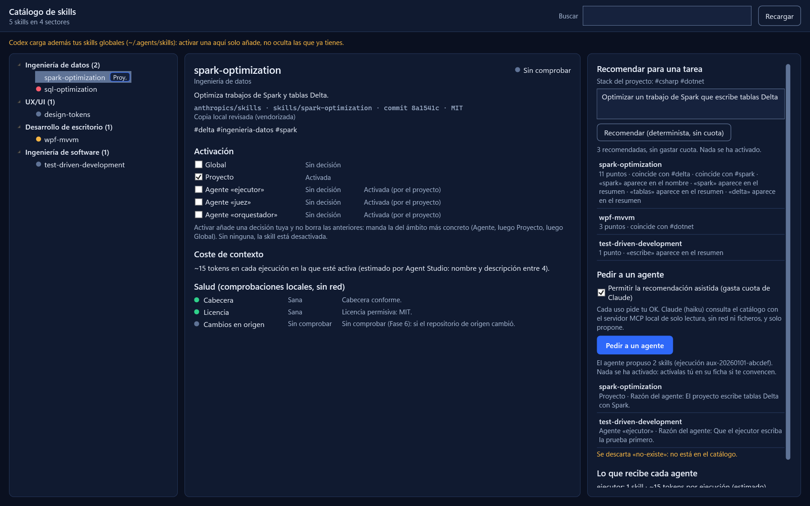

# 10 · Catálogo de skills

> Requisito del usuario (2026-10-15): un índice de las mejores skills de agentes, oficiales y de la comunidad,
> **clasificado en carpetas por sector TI**, con **tags** para que los agentes las recomienden según lo que se les
> pide y el contexto, **activable y desactivable** al gusto y con un **indicador de salud (doctor)**.
> Hechos verificados en [investigacion/2026-10-15-skills.md](investigacion/2026-10-15-skills.md). Decisión en
> [ADR-0007](adr/0007-catalogo-de-skills.md).

## 1. Qué es una skill aquí

Una carpeta con `SKILL.md` según el estándar abierto **Agent Skills**, que adoptan Claude Code, Codex y Gemini CLI:
frontmatter `name` y `description`, cuerpo de instrucciones y, opcionalmente, `scripts/`, `references/` y `assets/`.
El agente ve el nombre y la descripción de todas las skills disponibles y carga el cuerpo solo cuando la usa. Por eso
cada skill activada **cuesta contexto en cada ejecución**, aunque no se use: activar pocas y buenas es parte del diseño.

## 2. Organización

```text
Catálogo
├── Arquitectura de software        ├── UX/UI                 ├── Ciberseguridad
├── Arquitectura de datos           ├── Frontend              ├── Testing y QA
├── Ingeniería de datos             ├── Backend               ├── IA y LLM
├── Ciencia de datos                ├── Móvil                 ├── Ingeniería de software
├── Analítica y BI                  ├── Escritorio            └── Documentación
                                    └── DevOps y cloud
```

- **Carpeta = sector principal** (una por skill). La taxonomía es fija en código (`SkillSectors.All`) para que las
  carpetas sean estables; añadir un sector es un cambio deliberado con su ADR.
- **Tags = todo lo demás**: tecnologías (`#spark`, `#dax`, `#react`, `#wpf`…), sectores secundarios, plataforma
  (`#fabric`, `#azure`) y prácticas (`#tdd`, `#threat-model`). Los genera `SkillTagger` de forma determinista y el
  usuario puede añadir los suyos.
- **Fuente fijada por commit:** repositorio, ruta, rama, commit SHA y licencia. Modo `Vendored` (copia local
  auditada) o `Linked` (solo enlace hasta que se revise).

## 3. Fuentes

| Fuente | Cómo entra | Estado |
|---|---|---|
| Índice local del usuario (`C:/skills-index/catalog.json`, 120 skills) | Importador `SkillsIndexCatalogImporter`, que traduce sus dominios a los sectores de arriba y genera tags | Implementado en este incremento |
| Repos oficiales: `anthropics/skills`, `openai/skills`, `microsoft/skills` | Propuesta de alta con revisión (§6) | Diseño |
| Comunidad con tracción: `obra/superpowers`, `github/awesome-copilot`, listas curadas (`VoltAgent/awesome-agent-skills`) | Ídem; las listas solo aportan candidatas | Diseño |
| Skills propias del usuario o del proyecto | Carpeta local con `SKILL.md` | Diseño |

Ninguna fuente se sincroniza sola: lo nuevo llega como **propuesta** que el usuario aprueba, igual que el flujo
`index-review` que ya usa en su índice.

### Resultado de importar el índice actual (verificado el 2026-10-15)

| Sector | Skills | Sector | Skills |
|---|---|---|---|
| Ingeniería de datos | 20 | Ciberseguridad | 8 |
| Ciencia de datos | 13 | Móvil | 7 |
| IA y LLM | 11 | Escritorio | 6 |
| Frontend | 10 | Testing y QA | 6 |
| UX/UI | 9 | Backend | 2 |
| DevOps y cloud | 9 | Documentación | 1 |
| Ingeniería de software | 8 | Arquitectura de datos | 1 |
| Analítica y BI | 8 | **Arquitectura de software** | **0** |

- 119 skills importadas; 1 omitida con aviso (`fabric-common`, de tipo `support`). Las 57 de tipo enlace traen una
  URL de GitHub en lugar de `repo`: el importador extrae repositorio, rama y ruta de esa URL, y valida repositorio,
  ruta (sin `..` ni rutas absolutas) y que la URL sea `https://github.com`.
- 15 de esas enlazadas no declaran rama y su URL `tree/…` es ambigua (una rama puede contener `/`): se importan con
  el primer segmento como rama y un aviso «ref ambigua». Conviene añadirles `ref` en tu índice (`index-review`).
- De las 62 copias locales (`Vendored`), 61 tienen un `SKILL.md` totalmente válido; `git-integration-operations-cli`
  da un aviso.
- **Hueco detectado:** el índice no tiene skills de arquitectura de software y casi ninguna de arquitectura de datos
  ni de documentación. Son los primeros candidatos a buscar en fuentes oficiales y de la comunidad.

## 4. Activación

| Ámbito | Para qué | Precedencia |
|---|---|---|
| Global | Skills que quieres en todos tus proyectos | Baja |
| Proyecto | Las propias del stack del proyecto (p. ej. Fabric en un repo de datos) | Media |
| Agente | Lo que necesita un rol concreto (el juez solo lleva `write-judge-prompt`) | Alta |

- Sin ninguna activación, una skill está **desactivada**: lo de terceros nunca se activa solo.
- `SkillActivationResolver` decide el estado efectivo (Agente > Proyecto > Global).
- Activar añade una decisión tuya (`ISkillActivationStore.AppendAsync`, con el usuario como `decidedBy`) y no borra las
  anteriores: para una skill y un ámbito, manda la última.
- La pantalla muestra el coste estimado de contexto de cada skill y el total de lo que recibe cada agente
  (`SkillContextCost`: nombre y descripción entre 4, redondeado hacia arriba, siempre «estimado por Agent Studio»). Una
  skill enlazada no llega a ningún agente, así que no cuenta.

### Cómo llega una skill activada a cada CLI (Fase 2)

Regla: **nunca escribir en la configuración global del usuario** (`~/.claude`, `~/.codex`, `~/.gemini`, `~/.agents`).
Por cada ejecución, `ISkillMaterializer` prepara un directorio de sesión con solo las skills activadas para ese agente:

| CLI | Mecanismo | Verificación |
|---|---|---|
| Claude Code | Directorio de sesión con forma de plugin (`skills/<n>/SKILL.md` + `plugin.json` mínimo) pasado con `--plugin-dir` | Flag verificado en la ayuda local; el comportamiento junto con `-p` se prueba en la Fase 2 |
| Codex CLI | `.agents/skills/` dentro del worktree de la tarea | Verificado el 2026-10-15: la skill llega al modelo. **Limitación:** Codex 0.160.0 carga además las skills globales del usuario, y `--enable skip_host_skill_discovery` no lo evita. En Codex, la activación explícita solo añade skills: no puede ocultar las globales |
| Gemini CLI | `.agents/skills/` del workspace; `-e` limita extensiones | Ubicación documentada; por verificar en la Fase 2 |

En las sesiones no se respeta `allowed-tools`. Cada `SKILL.md` llega con una cabecera rehecha solo con sus claves
descriptivas, porque el perfil del agente decide qué puede hacer ([ADR-0018](adr/0018-modelo-de-amenaza-fase-3.md)).

Las skills que el usuario tenga instaladas globalmente seguirán cargándose en esos CLIs: la UI lo avisa en lugar de
fingir que el conjunto activado es el único.

## 5. Recomendación

Dos niveles, del más barato al más caro ([ADR-0024](adr/0024-recomendador-asistido-con-mcp-local.md)):

1. **Determinista** (`SkillRecommender`, gratis): puntúa coincidencias de tags del contexto, palabras del pedido, sector
   y términos del nombre y el resumen. Devuelve razones legibles («coincide con #spark») y nunca recomienda con
   puntuación 0.
   - El contexto es el stack del proyecto que `ProjectStackDetector` saca de los **nombres** de sus ficheros, nunca de
     su contenido: `*.csproj` y `*.sln(x)` dan `#dotnet` y `#csharp`; `package.json`, `#node`; `pyproject.toml` y
     `requirements.txt`, `#python`; `*.sql`, `#sql`; `Dockerfile`, `#docker`; `*.tf`, `#terraform`; `*.pbip` y
     `*.tmdl`, `#power-bi`.
2. **Asistida por un agente** (botón «Pedir a un agente» de la pantalla Skills): apagada por defecto, y cada uso pide tu
   OK porque gasta cuota.
   - Es una ejecución auxiliar de Claude Code con haiku, de solo lectura, sin red y en una carpeta vacía, registrada en
     el registro de decisiones como `SkillRecommendation`. Nunca va dentro de la planificación (ADR-0013 no cambia).
   - Consulta el catálogo con el servidor MCP local de Agent Studio (`AgentStudio.SkillsMcp.exe`), que solo tiene dos
     herramientas de lectura, `search_skills` y `recommend_skills` (la determinista), sobre una instantánea del catálogo
     sin cuerpos de `SKILL.md` ni rutas.
   - El agente **propone**: el sistema valida su respuesta contra el catálogo y la plantilla (skill y agente que existen,
     con copia local, como mucho 10 y una razón de hasta 300 caracteres) y descarta lo demás con un aviso. Activar
     sigue siendo decisión tuya, con los interruptores de la ficha.

## 6. Salud (doctor)

Indicador por skill: verde (sana), ámbar (aviso), rojo (crítico), gris (sin comprobar). El estado es el peor de sus
comprobaciones (orden de gravedad: sana < sin comprobar < aviso < crítico):

| Comprobación | Cómo | Estado |
|---|---|---|
| `frontmatter` | `SKILL.md` cumple el estándar: nombre distinto de la carpeta → aviso; nombre inválido o descripción ausente o > 1024 → crítico | Implementado (parser propio) |
| `size` | Cuerpo de más de 500 líneas → aviso. El coste de contexto del cuerpo, Fase 6 | Implementado en local |
| `license` | Licencia presente y libre; «source-available» o ausente → aviso | Implementado |
| `pinned` | Commit SHA fijado; sin fijar → aviso | Implementado |
| `upstream` | GitHub `compare/{sha}...{rama}`: ¿cambió algo bajo la carpeta de la skill? → «actualización por revisar» | Fase 6 |
| `archived` | Repositorio archivado → crítico | Fase 6 |
| `scripts` | Tiene `scripts/` sin revisar → aviso hasta que el usuario los audite | Fase 6 |

La salud que enseña la pantalla es la local, sin red (`SkillHealthReader`): lee el `SKILL.md` de la copia local sin
seguir enlaces y sin pasar de 1 MiB, y suma la licencia y la fijación. `upstream`, `archived` y `scripts` salen «sin
comprobar (Fase 6)», que pesa más que «sana»: ninguna skill parece sana por lo que nunca se miró. Una skill enlazada no
tiene copia que comprobar, así que su cabecera también sale «sin comprobar».

Las consultas a GitHub usan token opcional del usuario (5 000 peticiones/h frente a 60 sin token) y `ETag` para no
gastar cuota.

## 7. Seguridad

- Una skill son instrucciones de terceros y, a veces, scripts: se trata como instalar software.
- Fijada por commit; una actualización es una propuesta con diff, nunca un cambio silencioso.
- Los scripts nunca se ejecutan sin revisión; en Claude Code se puede añadir `disableSkillShellExecution`.
- El contenido de una skill es material para el agente, no instrucciones para Agent Studio.

## 8. Pantalla

Se abre como el documento «Skills» desde la barra de actividad. Captura hecha fuera de pantalla por
`SkillsRenderTests` ([evidencias/fase4-skills.png](evidencias/fase4-skills.png)):



- **Cabecera:** el resumen («5 skills en 4 sectores») y la búsqueda por nombre, resumen y etiquetas, sin distinguir
  mayúsculas ni acentos; todas las palabras deben aparecer. «Recargar» vuelve a leer el índice, la plantilla y las
  decisiones.
- **Avisos:** lo que falta (sin proyecto no se activa nada; sin un servicio, la pantalla lo dice en lugar de fingirlo),
  los avisos del catálogo y la nota de Codex, que carga además tus skills globales.
  - Desde la tanda 1 (2026-10-30), los avisos del índice sobre sus entradas (una skill enlazada, una de copia local sin
    copia que se pueda usar, una entrada omitida) van resumidos en una línea con su recuento, por ejemplo «27 skills
    enlazadas no se pueden dar a un agente · 1 aviso más del índice.». Con un solo aviso, la línea es el propio aviso.
    Con más de uno, «Ver el detalle (28)» los lista uno por línea y «Ocultar el detalle» los pliega otra vez. Así ya no
    tapan el catálogo.
- **Árbol de sectores** con su recuento, en el orden de la taxonomía. Cada skill lleva un punto de salud (verde, ámbar,
  rojo o gris) y una etiqueta de dónde está activa («Proy.», «Global», «2 agentes»).
- **Ficha:** fuente (repositorio, ruta, commit y licencia), copia local o enlazada, etiquetas, avisos, un interruptor por
  ámbito (Global, Proyecto y uno por agente de la plantilla, con lo que ese agente recibe de verdad y qué ámbito lo
  decidió), el coste estimado y las comprobaciones de salud. Una skill enlazada no tiene interruptores.
- **Recomendar para una tarea:** el stack detectado, la tarea, «Recomendar (determinista, sin cuota)» y, debajo, «Pedir a
  un agente» con su permiso apagado por defecto, el estado de la última petición, lo que propuso el agente con su razón y
  los avisos de lo descartado. Pulsar una recomendación la selecciona en el árbol; nada se activa solo.
- **Lo que recibe cada agente:** sus skills activas con copia local y su coste estimado por ejecución.

## 9. Estado y fases

| Pieza | Fase |
|---|---|
| Dominio (sectores, entradas, tags, activación por ámbitos, salud, recomendación determinista, frontmatter) e importador del índice local | Implementado |
| Materialización por CLI (`ISkillMaterializer`) | 2 · implementado |
| Activación por agente desde el orquestador, con las decisiones de proyecto y agente en SQLite y las globales en tu perfil | 3 · implementado |
| Pantalla del catálogo, coste estimado, salud local, detector de stack y recomendación asistida con el servidor MCP local | 4 · implementado (WP4). La barra de actividad la activa la integración, y la medición en vivo del lanzamiento MCP (D-30) se hace entonces, con tu OK |
| Doctor completo (upstream, archivado, scripts, coste del cuerpo) | 6 |

El catálogo no tiene tablas propias: es tuyo, del perfil, y se lee en cada consulta; la salud local se calcula al vuelo
(D-27 de [docs/14](14-fase-4-observabilidad-y-memoria.md)).

## 10. Demostración

La lista para comprobar a mano la pantalla y las dos recomendaciones está en
[evidencias/fase4-skills-demostracion.md](evidencias/fase4-skills-demostracion.md).
