# 16 · Ampliación «plataforma de proyectos»: análisis y plan

> **Estado:** aprobada el 2026-10-20, con las decisiones de la [§7](#7-decisiones-que-necesitan-al-usuario) resueltas (todas con la opción recomendada). Los criterios de las Fases 6 a 11 están en [docs/08](08-plan-y-criterios-de-aceptacion.md).
> Parte de `main` en `bb6ac3a`: Fases 0 a 4 hechas, Fase 5 con su integración 1/2 fusionada y Fases 6 y 7 planificadas en
> [docs/08](08-plan-y-criterios-de-aceptacion.md).
>
> **Qué analiza.** El texto de 19 secciones que pegaste («Amplía el IDE multiagente existente…») con tu encargo: «Analiza
> si es útil, funcional y tiene sentido. Si lo es, añádelo al desarrollo; si no, cámbialo o descártalo». También tu
> aclaración posterior: incorporar solo lo que aporte, buscar cambios de perspectiva que mejoren el producto en vez de
> copiar el requisito, y dar a cada sección uno de cuatro veredictos:
>
> - **«ya lo tenemos»**, con rutas;
> - **«se puede añadir»**, con su sitio en el plan;
> - **«necesita un cambio de perspectiva»**, con cuál y por qué mejora el producto;
> - **«descartado»**, con el motivo.
>
> La redactó un arquitecto independiente a partir de:
>
> - el código de `src/**` y `tests/**`, los documentos 01 a 15, los ADR 0001 a 0032 y el
>   [prompt maestro](referencias/prompt-maestro.md);
> - las versiones de las herramientas instaladas;
> - la documentación oficial de Microsoft, GitHub, Atlassian, Docker, Anthropic y OpenAI (fuentes al final, consultadas el
>   2026-10-20). Lo que se afirma de GitLab y de Postman no se consultó hoy, y está en la [§8](#8-sin-verificar).
>
> **Sin cuota, sin sesión y sin contenedores.** Solo se ejecutaron:
>
> - `docker version` y `docker info`: respondió el cliente 27.3.1 (contexto `desktop-linux`, Compose v2.29.7); **el motor
>   de Docker Desktop no estaba arrancado** y la parte del servidor dio error;
> - `gh --version` (2.96.0), `az --version` (2.87.0, con la extensión `azure-devops` 1.0.5), `git --version` (2.45.2),
>   `dotnet --version` (10.0.303), `node --version` (24.14.0) y `python --version` (3.12.5);
> - `wsl --version` (2.6.3.0, núcleo 6.6.87.2-1) y `wsl --status` (distribución por defecto `docker-desktop`, versión 2).
>   La primera llamada a `wsl` la rechazó el entorno por lanzarse fuera del worktree, y se repitió desde él.
>
> Ningún CLI de IA recibió un prompt, no se inició sesión en nada, no se leyeron carpetas de los CLIs ni tokens de `gh` o
> `az`, y no se creó ningún contenedor. Lo que no se pudo comprobar está en la [§8](#8-sin-verificar).

## 0. Resumen y veredicto global

**El texto describe una plataforma de proyectos genérica:** aislamiento entre inquilinos, entornos y contenedores
gestionados, Git de cuatro proveedores, un Jira e informes de hito. Agent Studio no es eso. Es un IDE personal, de un solo
usuario y en Windows ([ADR-0003](adr/0003-integracion-por-clis-oficiales.md)), cuyo valor es que el trabajo de los
agentes sea **verificable**: requisitos congelados, un registro encadenado y anclado, evidencias que captura el sistema y
un juez de otro vendor. Leído desde ahí, el texto tiene tres partes de valor muy distinto:

1. **Que el trabajo largo de los agentes llegue a término sin vigilarlo** (§7, §14 y §15). Es lo más útil y lo más barato:
   el motor ya espera la cuota, reanuda por reproducción y empaqueta el contexto, y falta extenderlo. Va primero, en la
   Fase 8.
2. **Que la trazabilidad que ya guarda el registro se pueda recorrer** (§8, §11, §12, §13, §16 y §18). Casi todo existe
   como datos. Lo que el texto pide como sistemas nuevos (un Jira, un gestor de hitos, una tabla de costes) sale mejor como
   **vistas sobre el registro**, con solo tres cosas nuevas que guardar: el hito, el backlog y los vínculos. Fase 9.
3. **Las plataformas** (§3, §4, §5 y §10):
   - publicar en GitHub con políticas tiene un valor claro, porque tu remoto es GitHub y hoy la entrega termina en tu rama
     local. Fase 10, con los CLIs oficiales y sin tocar ningún token;
   - contenedores, servicios y pruebas de APIs solo valen si un proyecto tuyo los necesita. Fase 11, opcional
     (decisión 1).

**Seguridad (§2 y §6): entra, con cambio de perspectiva.** Varias promesas del texto no se pueden cumplir en Windows sin
administrador, o chocan con reglas del proyecto. Lo que sí entra:

- la separación de datos por proyecto, que ya existe;
- los permisos efectivos, medidos y visibles;
- el aislamiento fuerte donde se ejecuta código de agentes (la verificación, F7-4);
- la bóveda DPAPI y el presupuesto por proyecto;
- Windows Hello como confirmación reforzada de lo crítico.

**Se descarta, con su motivo en la §2:**

- controlar la red de cada proyecto por destino, que exige administrador;
- credenciales de los CLIs por proyecto copiadas de las tuyas, que `CLAUDE.md` prohíbe;
- los webhooks: una app de escritorio no tiene endpoint público;
- «simular IPs» editando `hosts`, y exponer servicios a la red local o a Internet por defecto;
- el coste imputado de la suscripción, que sería un número inventado;
- un cliente git completo;
- los adaptadores de GitLab y Bitbucket mientras no haya un repositorio real con el que verificarlos.

| Veredicto | Secciones |
|---|---|
| «ya lo tenemos» | 1, 11, 12, 13 y 17. Lo que les falta se añade en la fase que dice cada una |
| «se puede añadir» | 7, 14 y 19 |
| «necesita un cambio de perspectiva» | 2, 3, 4, 5, 6, 8, 9, 10, 15, 16 y 18 |
| «descartado» | Ninguna sección entera; sí partes concretas de 2, 5, 10, 13, 16 y 17 |

**Un hallazgo de paso, por comprobar.** Leyendo el motor para la §14: tras una suspensión del equipo de más de 10 minutos,
el detector de abandono compara el reloj de pared con la última actividad y cancelaría intentos sanos. Es lo primero que
prueba la Fase 8 ([§2.14](#214-límites-y-reanudación-automática-sección-14)).

**Orden recomendado** (decisión 1): Fase 8 (trabajo desatendido) → Fase 9 (trabajo y trazabilidad) → Fase 6 ampliada →
Fase 10 (Git remoto) → Fase 7 ampliada → Fase 11 (opcional). Los números 6 y 7 se conservan porque docs/08 ya los usa en
sus criterios: el número es un nombre, no el orden.

---

## 1. Matriz de las 19 secciones

Prioridad y valor, para este producto: un usuario, Windows, suscripciones de Claude y Codex, repositorios propios.

| # | Sección | Veredicto | Qué hay hoy | Qué se hace | Fase | Prioridad | Valor |
|---|---|---|---|---|---|---|---|
| 1 | Análisis inicial y ejecución | ya lo tenemos | Diseño por fase de un arquitecto independiente, criterios C-1 a C-4, ADR, evidencias, bitácora | Nada: este documento lo aplica | — | — | — |
| 2 | Aislamiento y seguridad por proyecto | cambio de perspectiva | Datos, ancla, plantilla, perfil y memoria por proyecto; Claude confinado a su worktree (medido); verificación a integridad Low; ADR-0018 | Separación (ya) + permisos efectivos visibles + aislamiento fuerte de la verificación + bóveda y presupuesto por proyecto. Sin red por destino | F7, F9 | Media | Medio |
| 3 | Entornos reproducibles | cambio de perspectiva | `global.json`; NuGet por ejecución en la verificación aislada; detector de stack por nombres de fichero | El entorno es código del proyecto (`global.json`, `.venv`, `devcontainer.json`): detectar y verificar en F6; crear y gestionar con la Dev Container CLI en F11 | F6, F11 | Media / Baja | Medio |
| 4 | Contenedores, servidores y bases de datos | cambio de perspectiva | Nada | Servicios = el `compose.yaml` del proyecto con nombre de proyecto propio, configuración resuelta aprobada y estado comprobado | F11 (opcional) | Baja | Condicional |
| 5 | Direcciones locales y pruebas de APIs | cambio de perspectiva | Nada | Direcciones reales en `127.0.0.1` y nombres de servicio del compose; ficheros `.http`; OpenAPI a Postman por importación. Descartado: `hosts`, LAN e Internet por defecto | F11 (opcional) | Baja | Condicional |
| 6 | Autenticación y bloqueo con Windows Hello | cambio de perspectiva | Aprobaciones con diálogo propio, sin verificación del sistema | Hello como confirmación reforzada de lo crítico, y bloqueo de la interfaz que no detiene el trabajo | F8 | Media | Medio |
| 7 | Segundo plano y bandeja | se puede añadir | Cerrar la ventana mata los CLIs; ejecuciones que siguen al cambiar de proyecto; `IProjectActivity` | Bandeja, panel de estado como proyección, salida gestionada y suspensión controlada | F8 | Alta | Alto |
| 8 | Gestor de trabajo estilo Jira | cambio de perspectiva | Requisitos congelados, plan con tareas y reparto, juez que devuelve trabajo, cierre solo con evidencia | Hito = conjunto de requisitos congelado con nombre; backlog anclado; tablero derivado del registro; estimación del sistema | F9 | Alta | Alto |
| 9 | Diagramas y documentación automáticos | cambio de perspectiva | Diagramas Mermaid a mano; lienzo del plan; Auto Graph (F6-3 a F6-5) planificado | Generados desde artefactos reales con la versión que describen y comprobación de vigencia; la documentación por agentes, como cualquier cambio revisado | F6 | Media | Medio |
| 10 | Proveedores Git | cambio de perspectiva | Capa git local endurecida, sin red; `gh` y `az` instalados | Componente remoto aparte con tu gestor de credenciales y los CLIs oficiales; capacidades declaradas; políticas por clase; GitHub primero | F10 | Alta | Alto |
| 11 | Trazabilidad | ya lo tenemos | Requisito → tarea → instrucciones → intento → commit → verificación → integración → veredicto → entrega, encadenado y anclado | Vínculos explícitos entre ejecuciones y hacia fuera (hitos, commits tuyos, PR), inferencias como sugerencia, cadena navegable | F9, F10 | Alta | Alto |
| 12 | Participación y supervisión | ya lo tenemos | Agente, proveedor, vendor y modelo por intento; identidad del juez puesta por el sistema; quién aprobó; revisiones omitidas registradas | Vista de participantes; identidades remotas (quién publicó y fusionó); el veredicto nunca como aprobación de tu cuenta | F9, F10 | Media | Medio |
| 13 | Consumo, costes y estimaciones | ya lo tenemos | Proyección del registro por proveedor, modelo, sesión, ejecución, tarea, agente, propósito, proyecto y periodo; seis orígenes; sin doble cuenta; cuota y contexto aparte | Hito y actividad como dimensiones; espera en cola; estimación del sistema frente a real; presupuestos. Descartado: coste imputado | F9 | Media | Medio |
| 14 | Límites y reanudación automática | se puede añadir | `RateLimitedUntil(t)`, enfriamiento por proveedor, espera automática ≤ 15 min, reanudación por reproducción | Espera hasta el reinicio con margen, espera progresiva, comprobación antes de seguir, reanudación tras reiniciar con tu consentimiento, suspensión | F8 | Alta | Alto |
| 15 | Contexto y recuperación de sesiones | cambio de perspectiva | Salud del contexto por paso; empaquetado; `<previous_attempt>`; reintentos con `--resume` | Final clasificado del intento y sesión nueva con un traspaso que construye el sistema desde el registro | F8 | Alta | Alto |
| 16 | «Repositorio y cambios» | cambio de perspectiva | Capa git, diffs como evidencia, refs de ejecución; no hay panel Git | Vista sobre la capa git, el registro y las evidencias; PR/MR con la Fase 10. Descartado: cliente git completo | F9, F10 | Media | Medio |
| 17 | Trabajo simultáneo y sincronización | ya lo tenemos | Worktrees, commits y fusiones del sistema, integración ordenada con CAS, una actividad por proyecto, motor como actor con buzón | Sincronización remota por sondeo con estado reconciliado y buzón por proyecto. Descartado: webhooks | F10 | Media | Medio |
| 18 | Cierre de hitos con informe | cambio de perspectiva | «Auditar proyecto completo», veredictos por requisito, auditor del orquestador, consumo | El informe es una auditoría del hito más proyecciones deterministas; estados implementado, revisado, integrado | F9, F10 | Alta | Alto |
| 19 | Validación y entrega | se puede añadir | Criterios por fase con evidencia (docs/08) | Cada punto de la lista, un criterio de su fase; la cadena completa en la E2E (F7-5) | Todas | — | Alto |

---

## 2. Análisis por sección

### 2.0 Choques con decisiones ya tomadas

El texto pide cosas que contradicen decisiones aceptadas. Ninguna se rompe en silencio. Cada una se resuelve así:

| Petición | Decisión con la que choca | Cómo se resuelve |
|---|---|---|
| Push, PR y operaciones remotas (§10) | ADR-0012, punto 10: «Nunca hay `push` ni red». Además, `GIT_ALLOW_PROTOCOL=-` y los ayudantes de credenciales vaciados en cada comando interno (R3-01, H-04) | La capa interna no cambia, y una prueba lo fija. Lo remoto es otro componente: lo inicias tú o una política tuya, usa tu configuración global de git y tu gestor de credenciales, y tiene su propio modelo de amenaza (ADR-0041, enmienda de ADR-0012) |
| Autorizaciones persistentes por proyecto (§10) | F3-7 y la adenda de ADR-0012: la entrega exige una aprobación crítica, atada a su contenido y de un solo uso | La entrega a tu rama local no cambia. Las clases nuevas admiten autorización persistente: publicar la rama de la ejecución, abrir un PR y comentar. Fusionar y lo destructivo siguen siendo por uso, con Windows Hello (D-26, decisión 3) |
| Reanudación automática y sobrevivir a reinicios (§14) | ADR-0010, decisión 3: «Nada se relanza solo… Reanudar es una decisión del usuario, porque gasta cuota» | Sigue siendo la regla por defecto. Lo automático es un consentimiento que das al aprobar el plan: va en la cabecera de la ejecución (su hash ya cubre `MaxAutoWaitForQuota`) y nunca pasa del presupuesto aprobado (`MaxAgentRuns`). Enmienda de ADR-0010 (ADR-0034, decisión 4) |
| Credenciales y permisos por proyecto (§2) | `CLAUDE.md` y ADR-0003: nunca leer, copiar ni registrar credenciales de los CLIs | Las credenciales de los CLIs son de tu cuenta, no del proyecto, igual que la cuota (D-14 de docs/14). Por proyecto, solo las propias de Agent Studio: la bóveda DPAPI (F7-7). Los perfiles de CLI por proyecto con su propio inicio de sesión son la decisión 6 |
| Backlog, tareas e historial (§8) | ADR-0010: las tablas `tasks*` de la 0001 quedan sin uso a propósito, porque el estado se deriva del registro | El tablero es una proyección. Lo único nuevo que se guarda es la cabecera del hito, los elementos del backlog y los vínculos, todo append-only y anclado con el patrón de `MemoryRecorded` (ADR-0022) |
| Consumo por hito y actividad, estimación frente a real (§13) | ADR-0019: el consumo es una proyección del registro, sin tabla de uso; D-06 de docs/14: sin tabla de precios propia | Las dimensiones nuevas son proyecciones. La estimación la calcula el sistema desde el historial, con su origen («estimado por Agent Studio»). El coste imputado se descarta |
| Aislamiento efectivo de procesos, ficheros y red (§2) | ADR-0017 y ADR-0018: Low IL no bloquea lecturas ni red, y aceptaste esos residuales | No se promete lo imposible sin administrador. F7-4 deja de «evaluar» y decide entre AppContainer, para las cadenas de Windows, y un contenedor Linux sin red, para los proyectos que compilan en Linux (D-04) |
| Windows Hello (§6) | ADR-0001: Desktop en `net10.0-windows`, el dominio y los módulos en `net10.0` | Solo Desktop y el proyecto de pruebas pasan a un TFM con versión del SDK de Windows. El puerto vive en Application y los módulos no cambian (D-13) |
| Cerrar la ventana y seguir (§7) | `MainWindow.OnClosing`: cerrar la ventana termina la app, y el Job Object mata los CLIs | La vida del host deja de ser la de la ventana: la app sigue en la bandeja hasta que eliges salir (D-14) |
| Webhooks (§17) | Uso personal; una app de escritorio no tiene endpoint público | Sondeo condicional. El relé se descarta (D-47) |
| Despliegue (§18 y §19) | Agent Studio no despliega nada | «Desplegado» solo aparece si la plataforma lo informa (Fase 10). Si no, ese eslabón no existe en la cadena (D-50) |

Cada sección sigue el mismo orden: qué pide el texto, qué existe (con rutas relativas a la raíz del repositorio), qué
falta, el veredicto y su justificación técnica. Las decisiones de diseño llevan un número (D-01…) para que el plan de la
§4 las cite.

### 2.1 Análisis inicial y ejecución (sección 1)

**Pide.**

- Revisar la arquitectura y clasificar lo cubierto, lo que hay que ampliar y lo que falta.
- Un plan breve por fases, con dependencias y criterios.
- Conservar lo existente.
- Preguntar solo ante una ambigüedad que cambie el alcance, una acción irreversible o una autorización.
- Mantener documentación, tareas y evidencias.

**Qué existe.** Es el método con el que se construye Agent Studio:

- cada fase la diseña antes un arquitecto independiente sobre el código real, con inventario, decisiones, contratos,
  pruebas, paquetes de trabajo y preguntas para ti ([13](13-fase-3-orquestacion.md), [14](14-fase-4-observabilidad-y-memoria.md)
  y [15](15-fase-5-debate-arena-y-juez.md));
- los criterios comunes C-1 a C-4 y el estado de cada criterio con su evidencia ([08](08-plan-y-criterios-de-aceptacion.md));
- un ADR por decisión relevante ([adr/](adr/)), la bitácora de prompts ([ADR-0008](adr/0008-bitacora-obligatoria.md)) y
  las evidencias ([evidencias/](evidencias/));
- las reglas de `CLAUDE.md`: commits solo con tu OK, nada simulado, build con 0 avisos y pruebas en verde.

**Veredicto: «ya lo tenemos».** Este documento es esa sección aplicada al propio texto. Lo único que añade es la
disciplina de la [§7](#7-decisiones-que-necesitan-al-usuario): solo te pregunto lo que cambia el alcance.

### 2.2 Aislamiento y seguridad por proyecto (sección 2)

**Pide.**

- Un espacio propio por proyecto: código, documentación, historial, configuración y registros; agentes, orquestador y juez;
  entornos, dependencias y servicios; credenciales y permisos; consumos, límites y presupuestos; repositorios y conexiones.
- Ningún acceso entre proyectos sin autorización explícita, con un aislamiento efectivo de procesos, ficheros y red: «una
  carpeta o una instrucción en el prompt no bastan».
- Datos sensibles cifrados en reposo con claves del sistema, y credenciales nunca en texto plano, en registros ni en prompts.
- Distinguir cifrado en reposo, aislamiento en ejecución, permisos e información enviada a los proveedores, sin prometer
  protección frente a un administrador comprometido.
- Una vista de permisos por proyecto (recursos, red, herramientas y excepciones) y mínimo privilegio.

**Qué existe.**

| Pieza | Dónde | Qué separa o protege |
|---|---|---|
| Datos por proyecto | `.agentstudio/agentstudio.db` y `.agentstudio/evidence/` de cada proyecto (`src/AgentStudio.Infrastructure/Persistence/ProjectWorkspace.cs`), fuera de git por `info/exclude` (`GitExclude.cs`) | Registro, evidencias, planes, veredictos, memoria y debates: un juego por proyecto |
| Ancla del registro | `%LOCALAPPDATA%\AgentStudio\anchors\`, por la ruta final del proyecto (`FileDecisionLogAnchorStore.cs`; A-01) | Una base plantada, truncada o reescrita se detecta |
| Escrituras sin enlaces y una instancia por proyecto | `ProjectStorageGuard.cs` y `ProjectLock.cs` | Una junction en `.agentstudio` no desvía nada |
| Agentes, orquestador y juez por proyecto | La plantilla de cada proyecto (`SqliteAgentRoster.cs`), congelada en la cabecera de cada ejecución (`RunHeaderHash`) | Quién trabaja en cada proyecto y con qué permisos |
| Perfil de verificación por proyecto | `.agentstudio/verification.json`, escrito por ti y excluido de git ([ADR-0016](adr/0016-perfil-de-verificacion.md)) | Qué comandos se ejecutan en tu máquina |
| Ejecución | Worktrees por ejecución y tarea fuera del repositorio ([ADR-0012](adr/0012-worktrees-fuera-del-repo.md)); Claude confinado a su worktree en lecturas y escrituras, medido ([ADR-0018](adr/0018-modelo-de-amenaza-fase-3.md)); verificación a integridad Low ([ADR-0017](adr/0017-verificacion-aislada-baja-integridad.md)); Job Objects; una actividad con agentes por proyecto ([ADR-0026](adr/0026-debate-como-unidad-del-registro.md)) | Lo que un agente o un build pueden tocar |
| Acceso entre proyectos | Solo el panel de consumo, de solo lectura, sin cerrojo y cuando lo pides (`ReadOnlyProjectLogReader.cs`; D-05 de docs/14) | Ningún otro componente lee otro proyecto |
| Permisos | Herramientas, rutas (`PathGrant`) y presupuesto por agente (`AgentDefinition`); aprobaciones que fallan cerradas y se registran (`ApprovalGate.cs`); el aviso del plan sobre los escritores a integridad media, con la misma detección que la compuerta (`MediumIntegrityWriters.cs`, A-04) | Mínimo privilegio por defecto |
| Secretos | `SecretRedactor` en el log, la memoria y las contribuciones; nunca se leen las credenciales de los CLIs ([ADR-0003](adr/0003-integracion-por-clis-oficiales.md)). `ICredentialVault` (DPAPI) es un contrato sin implementación (`src/AgentStudio.Application/Security/SecurityContracts.cs`; F7-7) | Que un secreto no acabe en un registro |
| Modelo de amenaza | ADR-0018, con los residuales que aceptaste | Contra quién se protege cada cosa |

**Lo que no se puede hacer sin administrador, y por qué** (detalle en la [§3](#3-restricciones-de-la-plataforma-y-lo-que-no-se-puede-prometer)):

- **La red de un proyecto, o filtrada por destino.** Cortarla o filtrarla para un proceso exige reglas del firewall o filtros
  de la Windows Filtering Platform. Low IL no la corta. Un AppContainer sin la capacidad de red la corta entera, pero no
  filtra por destino, y su acceso al bucle local solo se puede eximir con administrador.
- **Los CLIs de IA necesitan red** hacia su proveedor: no se pueden encerrar sin red, y no hay nada documentado que permita
  «solo hacia su proveedor» sin administrador.
- **Credenciales de los CLIs por proyecto:** no hay forma sin leer o copiar las tuyas, que `CLAUDE.md` prohíbe. Lo único
  legítimo es un perfil por proyecto en el que vuelves a iniciar sesión (decisión 6).
- **Codex de solo lectura lee todo el disco** en el modo `unelevated`, el que usa Agent Studio (docs/15 §3.2). Su modo
  `elevated` admite rutas de lectura denegadas y tiene una regla de firewall propia, pero exige una configuración aprobada
  por un administrador.
- **Un proceso tuyo a integridad media, o un administrador,** pueden leer y cambiar cualquier cosa de tu usuario. Es el
  residual 1 de ADR-0018, y no se promete lo contrario.

**Veredicto: «necesita un cambio de perspectiva».** Un aislamiento de procesos, ficheros y red por proyecto no es
alcanzable sin administrador ni compatible con unos CLIs que necesitan red, y prometerlo sería simular (C-3). El cambio:
lo que separa es lo que ya existe; lo que protege se mide y se enseña tal cual; y el aislamiento fuerte va donde de verdad
se ejecuta código que nadie ha revisado, la verificación.

**D-01 · La separación por proyecto, con una regla escrita.** Ningún componente lee los datos de otro proyecto, salvo el
panel de consumo cuando lo pides, en solo lectura. Las ejecuciones de un proyecto trabajan en sus worktrees, con su
plantilla y su perfil. Una prueba lo fija: una ejecución del proyecto A no lee ni escribe los almacenes del B.

**D-02 · La vista de permisos efectivos de cada proyecto (F7-8).**

- **Por agente de la plantilla:**
  - vendor, proveedor y modelo;
  - las herramientas que su lanzamiento concede de verdad: la lista `--tools` que calcula `ClaudeCodeArguments`, o el modo
    de sandbox de Codex;
  - los ficheros: Claude, su worktree, en una versión medida (`SupportedVersions.WriteConfinementMeasured`); Codex de solo
    lectura, todo el disco (residual);
  - la red: sin herramientas de red, o con `WebFetch`, `WebSearch` o `Bash`, siempre como «no impuesto por el sistema
    operativo»;
  - lo que sale de la máquina: el prompt, y lo que lea con sus herramientas, llegan a su vendor.
- **Por paso de verificación:** su aislamiento (Low o `none`) y lo que Low bloquea y lo que no.
- **Excepciones:** pasos `isolation: none`, agentes con `Bash` y Codex escribiendo. Las skills nunca conceden herramientas.
- **Lo que se publica:** si haces push (Fase 10), la bitácora y la memoria en Markdown, que están versionadas.
- **Los residuales de ADR-0018,** con su texto.

La vista se calcula con el mismo código que las compuertas (`MediumIntegrityWriters`, `ClaudeCodeArguments.Build`,
`VerificationStepText.PlanWarning`), como el aviso del plan (A-04), así que no puede decir otra cosa que lo que se aplica.
Nunca dice «garantizado»: dice «medido en `<versión>`» o «declarado».

**D-03 · La bóveda por proyecto, y qué se cifra y qué no (F7-7).**

- Los secretos propios de Agent Studio van en `ICredentialVault`: las API keys opcionales, la contraseña inicial de un
  servicio del proyecto (Fase 11) o el token de una plataforma sin CLI oficial. Se cifran con DPAPI del usuario
  (`ProtectedData`), con la entropía del proyecto, en `%APPDATA%\AgentStudio\vault\<proyecto>\`. La entropía evita que el
  secreto de un proyecto se use por error en otro; no es una barrera frente a un proceso tuyo.
- Nunca en texto plano, en registros, en evidencias ni en prompts. Una prueba busca el secreto en todo lo que escribe una
  ejecución.
- Usar o revelar un secreto pide Windows Hello si lo activas (D-13).
- **Qué no se cifra, y se dice:** la base del proyecto, las evidencias y la memoria quedan en claro en tu disco. La bitácora
  y la memoria en Markdown son, además, contenido versionado a propósito. Para el disco entero, la herramienta del sistema
  es BitLocker, y Agent Studio no la sustituye.
- **Qué protege DPAPI:** frente a otra cuenta del equipo y frente a una copia del disco sin tu sesión. **No** frente a un
  proceso tuyo ni frente a un administrador: los dos pueden descifrar con tu sesión.

**D-04 · El aislamiento fuerte, donde se ejecuta código de agentes: la verificación (F7-4, reescrito).** F7-4 deja de
«evaluar» y decide, midiendo, entre dos caminos que bloquean también las lecturas y la red:

- **AppContainer por ejecución,** para las cadenas de Windows (.NET con WPF, como Agent Studio). Sin la capacidad de red, no
  tiene red; sus lecturas solo alcanzan lo que se concede a su SID. Cuesta conceder el área, el SDK y las cachés, y una
  restauración de paquetes en una fase aparte con red, porque el build y las pruebas van sin ella. Un paso que necesite el
  bucle local (una base de datos de la Fase 11) no puede ir en un AppContainer sin administrador, y se queda en Low.
- **Un contenedor Linux sin red** (`--network none`, con solo la copia del commit montada), para los proyectos que compilan
  en Linux. Corta lecturas y red sin tocar Windows, pero exige un motor de contenedores en marcha, y no vale para una suite
  `net10.0-windows` como la de Agent Studio.
- **Low IL sigue como mínimo garantizado,** y lo que no se pueda aislar más lo dice la evidencia.
- **El sandbox `elevated` de Codex:** se evalúa si sus rutas de lectura denegadas, tras tu configuración única con
  administrador, cierran el residual de lectura de los participantes de Codex (decisión 7 de docs/15).

**D-05 · Presupuesto por proyecto y por hito (F9-8).** Opcional, en tokens y en ejecuciones por periodo. Antes de lanzar un
intento, el motor proyecta lo gastado con el uso v2: lo que falta cuenta su estimación, nunca de menos, como `DebateBudget`.
Si se pasaría, no lanza y dice por qué. La cuota sigue siendo de la cuenta: el presupuesto reparte tu uso, no lo amplía.

### 2.3 Entornos de desarrollo reproducibles (sección 3)

**Pide.** Entornos independientes y reproducibles por proyecto (runtimes, frameworks, librerías y herramientas), sin tocar
otros proyectos ni el entorno global, con entornos virtuales, contenedores u otros. Registrar las versiones. Crear, iniciar,
detener, reconstruir y eliminar desde la UI, distinguiendo eliminar la infraestructura de borrar los datos persistentes.

**Qué existe.**

- `global.json` fija el SDK de Agent Studio (10.0.303): es el mecanismo estándar de .NET por proyecto
  ([ADR-0001](adr/0001-wpf-y-dotnet-10.md)).
- La verificación aislada usa cachés de NuGet, `DOTNET_CLI_HOME` y TEMP propios de cada ejecución, con el entorno fijo de
  ADR-0016 y ADR-0017: las dependencias de la verificación no tocan las globales.
- `ProjectStackDetector` reconoce el stack por nombres de fichero (`*.csproj`, `package.json`, `pyproject.toml`,
  `Dockerfile`…), sin leer su contenido.
- Auto Doctor comprueba hoy los CLIs de IA; F6-1 ya prevé .NET, Node, Python, WebView2 y Git.
- La verificación usa los SDK instalados que encuentra en el PATH (residual 3 de ADR-0018).

**Qué falta.** Leer lo que declara el proyecto y compararlo con lo instalado, las versiones en las evidencias y gestionar
entornos.

**Veredicto: «necesita un cambio de perspectiva».** Un sistema de entornos propio de Agent Studio sería un formato más que
nadie entiende, que hay que mantener y que instala herramientas por su cuenta, con su riesgo de cadena de suministro. El
estándar ya existe y vive en el proyecto:

- `global.json` y las herramientas locales de `dotnet` para .NET;
- `.venv` con `pyproject.toml` o `requirements.txt` para Python;
- `.nvmrc` o `engines` de `package.json`, con `node_modules` local, para Node;
- `devcontainer.json`, la especificación Dev Containers que impulsó Microsoft, cuando hace falta el entorno entero.

El cambio: **el entorno es código del proyecto,** versionado y revisable. Agent Studio lo lee, lo comprueba y lo ejecuta con
las herramientas estándar.

**D-06 · Detectar y comprobar el entorno declarado (Fase 6).**

- Auto Doctor lee `global.json`, `.config/dotnet-tools.json`, `.nvmrc` o `.node-version` y `engines`, `.python-version` y
  `requires-python`, `.venv`, `devcontainer.json`, `compose.yaml` y `Dockerfile`. No ejecuta nada del repositorio: solo
  `--version` de ejecutables resueltos fuera de él. Y lo compara con lo instalado.
- Cada evidencia de verificación lleva las versiones de las herramientas de su paso, como el SDK que resolvió `global.json`
  en la copia del commit.
- Lo que falta se explica con su arreglo («instala el SDK 10.0.303»), que Auto Doctor solo aplica con tu aprobación y, si se
  puede, de forma reversible (F6-2).

**D-07 · Crear y gestionar entornos con las herramientas estándar (Fase 11, opcional).**

- Con `devcontainer.json`: crear, iniciar, detener, reconstruir y eliminar con la Dev Container CLI. Las versiones de la
  imagen y de sus features quedan en la evidencia.
- Sin contenedores: el `.venv` del proyecto (`py -m venv`), sin administrador.
- «Eliminar el entorno» quita el contenedor o el `.venv`. «Borrar los datos» (los volúmenes) es otra acción, destructiva y
  con su aprobación (D-10).
- Proponer un `devcontainer.json` nuevo es trabajo de un agente, revisado como cualquier cambio (D-22).

### 2.4 Contenedores, servidores y bases de datos (sección 4)

**Pide.** Docker si está; SQL (también SQL Server), MongoDB, APIs y servidores web, con redes, volúmenes y configuración
separados por proyecto. Por servicio: estado real y disponibilidad, dirección, puerto y URL, registros, recursos,
dependencias, e iniciar, parar y reiniciar. Sin conflictos de puertos, con los datos persistentes protegidos y las
dependencias del sistema que falten explicadas. Nada «operativo» sin verificar.

**Qué existe.** Nada. Docker 27.3.1 está instalado (Docker Desktop con WSL2, distribución `docker-desktop`), con el motor
parado al medir. `ProjectStackDetector` reconoce un `Dockerfile`.

**Veredicto: «necesita un cambio de perspectiva»,** y su sitio es la Fase 11, opcional. Un gestor de contenedores propio
duplicaría Docker Desktop. Lo que aporta Agent Studio es atar los servicios al proyecto y comprobar su estado, y eso sale
mejor si los servicios son **el `compose.yaml` del propio proyecto**.

**D-08 · Los servicios son el compose del proyecto.**

- Se ejecutan con `docker compose -p <nombre propio del proyecto>`. El nombre de proyecto separa la red (`<nombre>_default`,
  con DNS por nombre de servicio) y los volúmenes con nombre.
- El estado sale de `docker compose ps --format json` y de los health checks. «Operativo» solo con el health check en verde
  o con una conexión comprobada al puerto. Los registros, de `docker compose logs`; los recursos, de
  `docker stats --no-stream`; las dependencias, de `depends_on` con `condition: service_healthy`.
- SQL Server, MongoDB o PostgreSQL son servicios de ese fichero, con sus imágenes oficiales. Su contraseña inicial sale de la
  bóveda del proyecto por una variable de entorno al arrancar, nunca de un fichero versionado (D-03).
- Las dependencias del sistema que faltan las explica Auto Doctor: Docker no instalado, instalado con el motor parado (lo
  medido hoy), WSL2 sin su distribución, o una versión antigua.

**D-09 · El compose es contenido del repositorio, así que se revisa antes de arrancar.** En un repositorio de terceros,
`docker compose up` ejecuta lo que diga ese fichero con los permisos de tu motor de contenedores, y Docker Desktop puede
montar carpetas tuyas. Por eso:

- antes de arrancar se lee la configuración resuelta (`docker compose config`), se enseña, y el arranque es una aprobación
  tuya atada a su hash;
- se rechazan, salvo que los apruebes uno a uno: `privileged`, `network_mode: host`, `pid: host`, capacidades añadidas,
  montajes de rutas tuyas fuera del proyecto, el socket del motor y puertos publicados fuera de `127.0.0.1`.

**D-10 · Puertos sin conflicto y datos protegidos.**

- Antes de arrancar se comprueba qué puertos escuchan ya en el equipo, y los del proyecto se asignan en un `.env` local,
  excluido de git. Se publican en `127.0.0.1` por defecto.
- Los datos persistentes viven en volúmenes con nombre del proyecto, nunca montados dentro del repositorio: la comprobación
  del repositorio del usuario haría fallar una tarea si cambiaran durante una ejecución.
- «Parar y quitar» (`docker compose down`) conserva los volúmenes. «Borrar los datos» (`down -v`) es destructivo, con
  aprobación y Windows Hello.

**La licencia de Docker Desktop.** Es gratis para uso personal, educación, proyectos de código abierto no comerciales y
empresas de menos de 250 empleados y menos de 10 millones de dólares de facturación; el trabajo profesional en
organizaciones más grandes necesita suscripción. Si usas Agent Studio con repositorios de tu trabajo, eso te afecta
(decisión 1). Agent Studio usaría la CLI de Docker y no depende de Docker Desktop: Docker Engine dentro de WSL2 u otro motor
compatible deberían servir igual (sin verificar).

### 2.5 Direcciones locales y pruebas de APIs (sección 5)

**Pide.** Exponer los servicios por direcciones que se puedan usar desde el IDE y desde Postman. «Simular una IP» con
puertos, redes de contenedores o nombres locales reales. Distinguir el anfitrión, entre contenedores, otros dispositivos de
la red e Internet: local por defecto, y exponer solo con permiso explícito. Comprobaciones de conectividad, pruebas de
endpoints, OpenAPI y colecciones de Postman.

**Qué existe.** Nada específico. La terminal ConPTY permite `curl` a mano.

**Veredicto: «necesita un cambio de perspectiva»** (Fase 11, opcional), con dos partes descartadas.

**D-11 · Direcciones reales, no simuladas.**

| Desde | Dirección |
|---|---|
| Tu equipo (el IDE, Postman, el navegador) | `http://127.0.0.1:<puerto del proyecto>` |
| Entre contenedores del mismo proyecto | El nombre del servicio en la red del compose (`http://api:8080`) |
| Otros dispositivos de tu red | Descartado por defecto: exige publicar en todas las interfaces y que el firewall deje entrar. Crear esa regla pide administrador, aunque el motor de contenedores puede traer la suya (sin verificar, §8): por eso Agent Studio publica solo en `127.0.0.1` |
| Internet | Descartado por defecto: un túnel (Microsoft Dev Tunnels, ngrok) exige una cuenta, y con acceso anónimo cualquiera que adivine la URL llega a tu servidor |

- **Descartado: «simular una IP»** editando `hosts`, que exige administrador y cambia tu equipo entero, o con alias de red.
- Los nombres `*.localhost` los resuelven los navegadores; que los resuelva el sistema para Postman o `curl` está sin
  verificar (§8), así que no se usan.
- Exponer a la red o a Internet, si algún día lo quieres, sería una acción explícita, con aprobación y aviso. Nunca por
  defecto.

**D-12 · Las pruebas de APIs, en tres niveles.**

- **Las pruebas de verdad van en la suite del proyecto,** como las de integración con `WebApplicationFactory` en .NET. Las
  ejecuta la verificación del sistema y cuentan como evidencia (TRX o JUnit), como cualquier otra. El mecanismo ya existe.
- **Comprobaciones de conectividad** en el panel de servicios: la conexión al puerto y, si la hay, la ruta de salud.
- **Peticiones a mano con ficheros `.http`,** el formato de Visual Studio y de VS Code, versionables con el proyecto. Agent
  Studio las ejecuta, enseña la respuesta y, si quieres, la guarda como evidencia.
- **OpenAPI y Postman:** si el proyecto publica su documento OpenAPI (en ASP.NET Core, con `MapOpenApi`), «Abrir en Postman»
  es importar esa URL o ese fichero, que Postman convierte en colección. Agent Studio no genera colecciones propias: sería
  mantener un convertidor para algo que Postman ya hace (la importación de OpenAPI 3.1, sin verificar, §8).

### 2.6 Autenticación y bloqueo del IDE (sección 6)

**Pide.** Autenticarse con el sistema (Windows Hello u otra alternativa segura) al iniciar, al desbloquear tras un tiempo de
inactividad, para los secretos y para las acciones sensibles, sin guardar huellas ni la contraseña de Windows. Distinguir
bloquear la interfaz de detener los trabajos, y decir qué sigue en segundo plano y qué queda pendiente.

**Qué existe.** Las aprobaciones (`IApprovalGate`), con su diálogo propio en `src/AgentStudio.Desktop/Orchestrator/Approvals/`:
fallan cerradas y registran quién decidió. No hay verificación del sistema ni bloqueo.

**Veredicto: «necesita un cambio de perspectiva».** Windows ya te autentica y ya bloquea la sesión (Win+L). Pedir Windows
Hello al abrir la app, en un equipo de un solo usuario, repite lo que Windows acaba de hacer. Donde Hello sí añade algo es al
**decidir** algo crítico: confirma que eres tú, delante del equipo, y no un clic por error o una entrada simulada por otro
programa.

**D-13 · Windows Hello como confirmación reforzada, y un bloqueo que no detiene el trabajo (Fase 8).**

- **Confirmación reforzada.** Las aprobaciones críticas piden Windows Hello además del diálogo: la entrega; con la Fase 10,
  fusionar y lo destructivo en el remoto; borrar datos persistentes; y usar un secreto de la bóveda. La aprobación registra
  el método: «Windows Hello» o «sin Hello: no disponible». Se puede desactivar.
- **Bloqueo de la interfaz.** Manual, o tras un tiempo de inactividad si lo activas. Bloqueadas, la ventana y el panel de la
  bandeja ocultan el contenido; el trabajo sigue; las aprobaciones esperan en cola; y la pantalla de bloqueo dice qué sigue
  en marcha y qué espera por ti. Se desbloquea con Hello.
- **Al iniciar la app:** opcional, desactivado por defecto (decisión 5).
- **Sin Hello configurado o sin dispositivo** (`NotConfiguredForUser`, `DeviceNotPresent`): la confirmación vuelve al
  diálogo de siempre, con un aviso, y el bloqueo ofrece «Bloquear Windows» (`LockWorkStation`), que también deja el trabajo
  en marcha. Agent Studio nunca pide tu contraseña de Windows.
- **Lo que nunca llega a la app:** la API devuelve solo un resultado (`Verified`, `Canceled`, `RetriesExhausted`…). Ningún
  dato biométrico ni el PIN.
- **Técnica.** En una app de escritorio se llama a `UserConsentVerifierInterop.RequestVerificationForWindowAsync` con la
  ventana de WPF. Su interfaz de interoperabilidad exige Windows 11 (compilación 22000), y Desktop necesita un TFM con
  versión del SDK de Windows; el proyecto de pruebas, que lo referencia, también. El dominio y los módulos siguen en
  `net10.0`, y el puerto (`IUserPresenceVerifier`) vive en Application.
- **Lo que no promete.** Hello confirma tu presencia ante la app. No impide que un proceso tuyo a integridad media haga lo
  mismo sin pasar por Agent Studio (residual 1 de ADR-0018), ni protege los datos en reposo.

### 2.7 Segundo plano y bandeja del sistema (sección 7)

**Pide.**

- Minimizar o cerrar a la bandeja, configurable, distinguiendo minimizar, cerrar y seguir, bloquear y salir.
- Al pasar el cursor, un resumen; al hacer clic, un panel de estado; con el botón derecho, acciones.
- El panel, por proyecto: estado, orquestador, juez y agentes activos, tareas, proveedor y modelo, tokens y presupuesto,
  contexto en barras, cuotas y su restablecimiento, bloqueos, errores y pendientes.
- Acciones: abrir proyectos y registros, pausar, reanudar y detener.
- Guardar el estado antes de salir y gestionar los trabajos activos.

**Qué existe.**

- Las ejecuciones siguen al cambiar de proyecto, y su pestaña se queda (`MainViewModel.OpenProjectAsync`).
- `IProjectActivity` sabe qué tiene cada proyecto en este proceso: una ejecución, una planificación, un debate o una
  auditoría.
- El monitor de cada ejecución: fase, tareas, motivo de bloqueo, contexto por tarea, cuota, y pausar, reanudar y cancelar
  (`RunMonitorViewModel`).
- El consumo, la cuota con su antigüedad y la salud del contexto.
- El estado ya está en el registro: no hay nada que «guardar antes de salir».
- **Cerrar la ventana termina la app:** `MainWindow.OnClosing` cierra la terminal y, al salir, el Job Object mata los CLIs.
  Lo que estaba en marcha queda interrumpido hasta que lo reanudes.

**Veredicto: «se puede añadir» (Fase 8).** Vale mucho: una ejecución dura de minutos a horas, y hoy cerrar la ventana la
corta.

**D-14 · La vida de la app deja de ser la de la ventana.**

- Un icono en la bandeja mientras la app vive. Al cerrar la ventana, configurable: «preguntar», «seguir en la bandeja» o
  «salir». Por defecto, pregunta si hay trabajo activo y sale si no lo hay.
- Minimizar es lo de siempre. Cerrar y seguir oculta la ventana con el trabajo en marcha. Bloquear oculta el contenido
  (D-13). Salir termina, con la salida gestionada (D-16).
- WPF no tiene icono de bandeja propio. Se decide en el ADR, con una medición, entre `System.Windows.Forms.NotifyIcon`, del
  propio .NET (`UseWindowsForms`), y un envoltorio pequeño de `Shell_NotifyIcon`. Sin paquetes de terceros.
- **Al pasar el cursor:** el tooltip estándar, de 127 caracteres como mucho (`szTip`), con un resumen como «Agent Studio · 2
  ejecuciones · 1 espera cuota hasta las 14:05». Un resumen más rico al pasar el cursor es una ventana propia
  (`NOTIFYICON_VERSION_4` con `NIN_POPUPOPEN`).
- **Clic:** el panel de estado (D-15). **Botón derecho:** abrir un proyecto, abrir los registros
  (`%LOCALAPPDATA%\AgentStudio\logs`), pausar, reanudar o detener una ejecución, bloquear y salir.
- **Avisos** cuando una ejecución termina, pide una aprobación o deja de esperar cuota: una notificación del icono, con
  título y texto, sin datos del proyecto.

**D-15 · El panel de estado es una proyección de lo que ya existe.** Por cada proyecto activo:

- el estado y la fase, de `IProjectActivity` y del monitor de cada ejecución;
- el orquestador, el juez y los agentes en marcha, con proveedor y modelo, del registro de la ejecución;
- las tareas por estado;
- los tokens de la ejecución, con su origen; el presupuesto, como ejecuciones usadas frente al límite (`MaxAgentRuns`) y,
  con la Fase 9, el del proyecto;
- una barra de contexto por tarea en curso, con su etiqueta: exacto, estimado o no expuesto
  ([ADR-0021](adr/0021-salud-del-contexto-por-paso.md));
- las cuotas, con su reinicio y su antigüedad («vista hace 12 min»);
- los bloqueos con su motivo, los errores y las aprobaciones pendientes.

Nada se calcula aparte, y lo que no se sabe sale «no expuesto» o «sin dato» (C-3).

**D-16 · Salida gestionada, con tu elección en el registro.**

- Salir con trabajo activo pregunta: «Pausar y salir cuando terminen los intentos en curso» (la app espera en la bandeja),
  «Salir ahora y dejarlas interrumpidas» o «Cancelar».
- La elección queda en el registro de cada ejecución afectada, como una entrada nueva, y decide si se reanuda sola después
  (D-39).
- Un cierre de sesión o un apagado de Windows cuenta como «salir ahora»: lo que no terminó queda interrumpido y se reanuda
  por reproducción.
- La suspensión del equipo se trata en D-40.

### 2.8 Gestor de trabajo estilo Jira (sección 8)

**Pide.**

- Tablero, backlog, hitos, tareas e historial por proyecto, conectados con el código, los repositorios, la documentación
  y las ejecuciones.
- Antes de una implementación relevante, generar o actualizar:
  - objetivos, requisitos y criterios;
  - la propuesta técnica, los hitos, las tareas y sus dependencias;
  - el reparto entre agentes, orquestador y juez;
  - estimaciones de tiempo, tokens y costes;
  - riesgos y decisiones.

  El detalle se adapta al tamaño.
- El orquestador coordina; el juez revisa y puede devolver trabajo, con otro proveedor o modelo; las rondas las limita el
  presupuesto; una tarea nunca se cierra solo porque un agente dice que terminó.

**Qué existe.** Casi todo lo que el texto pide *dentro* de un trabajo:

| Lo que pide | Dónde existe |
|---|---|
| Objetivos, requisitos y criterios | `FrozenRequirementSet`, `Requirement` y `AcceptanceCriterion` con su `VerificationMethod` (`src/AgentStudio.Domain/Requirements/Requirements.cs`). Los escribe `src/AgentStudio.Desktop/Orchestrator/Preparation/RequirementsEditorViewModel.cs`, y cada cambio es un conjunto congelado nuevo (`IRequirementStore`) |
| Propuesta técnica, tareas, dependencias, reparto y riesgos | El plan del orquestador: `PlanDefinition` (resumen, tareas y riesgos) y `TaskSpec` (agente, objetivo, dependencias, requisitos que cubre, alcance de escritura, pasos de verificación y tiempo), en `src/AgentStudio.Domain/Orchestration/PlanDefinition.cs`. Lo comprueba `PlanValidator` y lo apruebas tú antes de ejecutarlo ([ADR-0013](adr/0013-protocolo-del-orquestador.md)) |
| Decisiones | El registro de decisiones ([ADR-0004](adr/0004-registro-de-decisiones-append-only.md), [ADR-0010](adr/0010-estado-derivado-del-registro.md)), los debates ([ADR-0026](adr/0026-debate-como-unidad-del-registro.md)) y los ADR del repositorio |
| El juez revisa y devuelve trabajo, desde otro vendor | [ADR-0006](adr/0006-juez-independiente-verificable.md) y [ADR-0014](adr/0014-independencia-del-juez-con-dos-vendors.md). Tras un rechazo, la corrección es una ejecución de seguimiento (`RunRequest.Follows`). Además, la impugnación ([ADR-0032](adr/0032-impugnacion-de-veredictos.md)) y el auditor del orquestador ([ADR-0031](adr/0031-auditor-determinista-del-orquestador.md)) |
| Rondas limitadas por presupuesto | `RunOptions.MaxAgentRuns` (12 por defecto) y `MaxParallelTasks`; `ExecutionBudget` por agente; una corrección del plan y una del juez; los límites de un debate (4 rondas, 30 minutos y 400 000 tokens) |
| No cerrar porque el agente lo diga | `WorkTask.Complete` exige evidencia (`task.completion-requires-evidence`). Las pruebas las captura el sistema: un commit final sin una ejecución de pruebas que pase deja la ejecución `Failed` (N-06). La entrega exige un veredicto `Approved` y válido (adenda de ADR-0012) |

**Qué falta.**

- La capa que está por encima de una ejecución: hitos que agrupan varias, un backlog de lo que aún no se ha
  planificado y la historia de una línea de trabajo con sus seguimientos.
- Un tablero.
- Estimaciones antes de aprobar.

**Veredicto: «necesita un cambio de perspectiva».** Un Jira paralelo tendría su propio estado. Sería otra fuente de
verdad, como las tablas `tasks*` que ADR-0010 dejó sin uso a propósito, con tarjetas que se mueven a mano. Es justo lo que
el producto evita: aquí una tarea se cierra con evidencia y veredicto, no arrastrándola. El cambio:

**D-17 · El hito es un conjunto de requisitos congelado con nombre.**

- Tiene un nombre, un objetivo y la secuencia de sus versiones de requisitos: cada cambio es un conjunto congelado nuevo,
  y el anterior queda en la historia.
- Sus tareas son las de los planes de las ejecuciones que le vinculas, con sus seguimientos. Su revisión son los
  veredictos de esas ejecuciones y, al cerrar, una auditoría del hito (D-49).
- Lo único nuevo que se guarda es su cabecera inmutable (tabla `milestones`, migración 0006), anclada en el registro como
  la de un debate ([ADR-0026](adr/0026-debate-como-unidad-del-registro.md)). Sus cambios son entradas: `MilestoneOpened`,
  `MilestoneRequirementsRevised`, `MilestoneLinked`, `MilestoneClosed` y `MilestoneReopened`. Su estado se reproduce.

**D-18 · El backlog son requisitos que aún no se han planificado.**

- Lo que anotas para más adelante es un requisito en borrador: enunciado, prioridad y, si quieres, sus criterios.
- Se guarda append-only y anclado, con el patrón de `MemoryRecorded` ([ADR-0022](adr/0022-memoria-append-only-anclada.md)).
  Se añade, se cambia con una versión nueva o se retira; nunca se borra. Cambiar el orden o la prioridad es una decisión
  tuya registrada.
- Al planificar un hito, los que elijas entran en su conjunto congelado.
- No hay «tareas libres» al margen: el trabajo de los agentes lo descompone el orquestador, y el que haces tú en tu rama
  se vincula (D-29).

**D-19 · El tablero es una vista.** Sus columnas se derivan del registro verificado. Ninguna tarjeta se arrastra a
«hecho»:

| Columna | Un requisito del hito, cuando… | Una tarea de un plan, cuando… |
|---|---|---|
| Backlog | Ninguna tarea de una ejecución vinculada lo cubre (`TaskSpec.Covers`) | — |
| Planificado | Lo cubre un plan aprobado que aún no ha empezado | Está `Pending` |
| En curso | Alguna tarea que lo cubre está en marcha, esperando aprobación o esperando cuota | Está `Running`, `AwaitingApproval` o `Blocked`, con su motivo |
| En revisión | Su ejecución terminó y no tiene veredicto, o el veredicto está impugnado | Está `Completed` y su ejecución espera veredicto |
| Devuelto | El último veredicto válido lo da por no satisfecho (`ChangesRequested`, `Rejected`), o la ejecución falló | Está `Failed` o `Cancelled` |
| Hecho | Un veredicto `Approved` y válido lo da por `Satisfied` | Está `Completed` y su ejecución tiene veredicto aprobado |
| Integrado | Su ejecución se entregó a tu rama (`IntegrationPerformed` con `IsDelivery`) o, con la Fase 10, su PR se fusionó | — |

Un veredicto `EscalateToHuman` o `Unresolved` deja el requisito «En revisión» con el motivo, porque decides tú.

**D-20 · La estimación la calcula el sistema antes de que apruebes el plan.**

- **Por tarea:** tokens de entrada y de salida, duración y coste a precio de lista. Salen de los intentos parecidos del
  registro de este proyecto y de los recientes (mismo agente, mismo modelo informado y mismo propósito), con su intervalo
  (percentiles 25 y 75), el número de intentos de referencia y los supuestos. Su origen es «estimado por Agent Studio».
- **Sin historial suficiente** (menos de tres intentos de referencia): «desconocida». Nunca un número de relleno.
- **Por plan:** la duración sale del camino crítico del grafo, con `MaxParallelTasks` y la concurrencia de cada proveedor
  (2 por defecto). Si una ventana de cuota está por encima del aviso, se dice «puede esperar hasta las HH:MM, cuando se
  reinicia la ventana»; los tokens nunca se convierten en porcentaje de cuota, porque esa equivalencia no existe (§2.13).
- **Lo que declare el orquestador**, si su esquema llega a admitir estimaciones, sale como «declarado por el orquestador»,
  nunca como una medición.
- **Al cerrar el hito,** real frente a estimado (D-49).
- **El detalle se adapta solo:** un hito pequeño es una ejecución; uno grande, varias con sus seguimientos.

### 2.9 Diagramas y documentación automáticos (sección 9)

**Pide.** Diagramas y documentación por proyecto (arquitectura, flujos, dependencias, el flujo entre agentes, orquestador y
juez, documentación técnica y funcional, registro de decisiones):

- editables, versionables y vinculados a elementos reales;
- actualizados ante los cambios, diciendo qué versión describen;
- con las discrepancias entre código y documentación;
- distinguiendo lo propuesto, lo que está en curso y lo implementado.

**Qué existe.**

- **Auto Graph, planificado** en la Fase 6: F6-3 (proyectos C# con Roslyn: proyectos, namespaces y referencias), F6-4 (las
  relaciones que infiere una IA, distintas de las estáticas) y F6-5 (navegar de un nodo al fichero o a la tarea), según la
  sección 13 del prompt maestro.
- **El lienzo del plan** (Nodify, [ADR-0015](adr/0015-lienzo-nodify.md)), con su disposición guardada (`CanvasLayoutStore`).
- **Los diagramas Mermaid** de docs/02, 03, 05, 06, 07 y 08, escritos a mano; los ADR y el registro encadenado.
- **Un patrón de exportación generada:** la memoria en Markdown (`MemoryMarkdownExporter`), con una cabecera que dice que se
  genera y que editarla no cambia nada. Nunca se lee de vuelta ([ADR-0022](adr/0022-memoria-append-only-anclada.md)).

**Qué falta.** Generar desde los artefactos reales con su versión, su vigencia y sus discrepancias; el diagrama del flujo de
una ejecución; y la documentación técnica y funcional.

**Veredicto: «necesita un cambio de perspectiva».** «Documentación automática» escrita por un agente sería texto de agente
presentado como verdad. Además, «editable» y «actualizada automáticamente» chocan: regenerar borra lo editado. El cambio
separa tres cosas: lo generado sale solo de artefactos reales, con su versión; lo escrito (documentación funcional y ADR) lo
escribe una persona o un agente como un cambio revisado; y el sistema comprueba que los dos casan.

**D-21 · Diagramas generados de artefactos reales, con la versión que describen.**

- **Qué se genera:**
  - la arquitectura y las dependencias, del grafo de proyectos y referencias (MSBuild y Roslyn, F6-3) para .NET; en otros
    lenguajes, lo que dé su manifiesto (`package.json`, `pyproject.toml`), marcado «parcial»;
  - el plan de una ejecución, del grafo de `PlanDefinition`, que el lienzo ya pinta;
  - el flujo entre agentes, orquestador y juez de una ejecución o de un debate: un diagrama de secuencia generado del
    registro (lanzamientos, informes, integraciones, veredictos y aprobaciones).
- **Formato:** Mermaid en Markdown, en `.agentstudio/diagrams/`, con una cabecera que dice el commit que describe, el hash
  del modelo de origen, la fecha y «generado: editarlo no lo cambia; se regenera». Se escribe como la exportación de la
  memoria: por el almacén comprobado, nunca durante una ejecución, y nunca se lee de vuelta. Versionarlo es tu elección,
  como la memoria (decisión 4 de docs/14).
- **Editar:** lo generado no se edita. Para un diagrama propio, se copia a un fichero tuyo, que el sistema no toca.
- **Vigencia:** un diagrama está «al día» si el modelo de HEAD tiene el hash de su cabecera. Si no, sale «desactualizado:
  describe `<commit>`», y se regenera cuando lo pides o al cerrar un hito.
- **Estático frente a inferido (F6-4):** lo que proponga un agente se dibuja distinto y con su origen.

**D-22 · La documentación técnica y funcional es trabajo revisado.** Es una tarea normal del orquestador: un `AgentWork`
con alcance `docs/**`, verificado y revisado por el juez como cualquier cambio. Hasta que se integra, está «propuesta». Los
ADR siguen siendo el registro de las decisiones de diseño; el registro encadenado, el de las decisiones del sistema.

**D-23 · Discrepancias deterministas, sin IA:**

- enlaces de la documentación a rutas que no existen en HEAD;
- ADR y documentos que citan ficheros o tipos borrados;
- diagramas generados desactualizados;
- requisitos de un hito que ninguna tarea cubre.

Lo propuesto, en curso e implementado es el estado del requisito en su hito (D-19 y D-50).

### 2.10 Proveedores Git (sección 10)

**Pide.**

- GitHub, GitLab (también instancias propias), Azure DevOps Repos y Bitbucket, con una interfaz común y capacidades
  declaradas, sin simular lo que un proveedor no soporte.
- Operaciones: clonar o vincular, ramas, cambios y diffs, commits y etiquetas, fetch, pull y push; PR/MR (crear, consultar,
  comentarios, revisores y aprobaciones), conflictos, fusiones, checks y pipelines.
- Credenciales seguras y respeto a las protecciones.
- Políticas independientes para el commit local, publicar una rama, abrir un PR, fusionar y las operaciones destructivas,
  con autorizaciones persistentes por proyecto, sin confirmar una y otra vez.

**Qué existe.**

- **La capa git local, endurecida** en nueve rondas adversariales ([ADR-0012](adr/0012-worktrees-fuera-del-repo.md),
  [ADR-0018](adr/0018-modelo-de-amenaza-fase-3.md)): worktrees fuera del repositorio, refs propias, commits y fusiones del
  sistema, integración verificada, entrega a tu rama con una aprobación crítica de un solo uso y limpieza con aprobación.
  **Sin red:** `GIT_ALLOW_PROTOCOL=-`, ayudantes de credenciales vaciados y «nunca hay `push` ni red».
- `ApprovalRiskClassifier` ya trata `push`, `force`, `merge` y `rebase` como críticas
  (`src/AgentStudio.Security/Approvals/ApprovalRiskClassifier.cs`).
- **Instalados:** `gh` 2.96.0, y `az` 2.87.0 con la extensión `azure-devops` 1.0.5. El remoto de este repositorio es GitHub,
  privado.

**Qué falta.** Todo lo remoto.

**Veredicto: «necesita un cambio de perspectiva».** Cuatro proveedores con su API, con sus tokens guardados por Agent
Studio y con operaciones lanzadas desde la capa endurecida meterían la red y tus credenciales justo en el componente que más
costó cerrar. El cambio sigue el patrón que ya funciona con la IA ([ADR-0003](adr/0003-integracion-por-clis-oficiales.md)):
**las plataformas por sus CLIs oficiales y git por tu gestor de credenciales,** en un componente aparte y con políticas por
clase de operación.

**D-24 · Un componente remoto aparte; la capa interna no cambia.**

- Las operaciones remotas las hace un ejecutor nuevo, nunca `GitCommandRunner`. Una prueba fija que la capa interna sigue
  sin red ni credenciales (F10-10).
- `git push` y `git fetch` usan tu configuración **global y de sistema** y tu gestor de credenciales: en Windows, Git
  Credential Manager guarda los tokens en el Administrador de credenciales. Agent Studio nunca ve el token; lo usa git.
- La configuración del **repositorio** es contenido, el adversario del punto 1 de ADR-0018, así que no puede decidir cómo se
  autentica ni adónde se envía. Se rechazan `credential.*`, `url.*.insteadOf`, `remote.*.pushurl`, `core.sshCommand`,
  `http.*` y `remote.*.vcs` definidos en el repositorio o en el worktree, con la inspección por ámbito que ya existe
  (`--show-scope`).
- Solo se publican las ramas de Agent Studio (`agentstudio/run-*`) o la rama que nombre tu aprobación. Nunca `--force` ni
  `--mirror`. Después se comprueba que el remoto tiene ese commit.

**D-25 · Una interfaz común con capacidades declaradas.**

- `IHostingProvider` declara, por proveedor y por versión de su CLI, qué sabe hacer: leer el repositorio y sus
  protecciones, crear un PR, comentar, pedir revisores, leer revisiones y aprobaciones, fusionar y con qué modos, leer checks
  y pipelines, y leer despliegues. Lo que no declara no aparece en la UI (C-3).
- Cada adaptador habla con **el CLI oficial,** con salida JSON, como los de IA: `gh` para GitHub, `az repos` y
  `az pipelines` para Azure DevOps y `glab` para GitLab. Las respuestas se fijan con capturas grabadas por versión, y Auto
  Doctor avisa de una versión no probada, como en F2-7.
- **Clonar o vincular:** vincular es abrir un repositorio que ya clonaste; clonar es `git clone` con tu gestor de
  credenciales, a la carpeta que elijas. Ramas, cambios, diffs, commits y etiquetas son git local, y para lo de los agentes
  ya los cubre la capa interna.

**D-26 · Políticas por clase de operación, por proyecto.**

| Clase | Ejemplo | Autorización |
|---|---|---|
| Commit local | Los commits del sistema en sus refs propias | El sistema, siempre, como hoy |
| Entrega local | A tu rama, con la integración aprobada | Por uso, crítica, atada y de un solo uso (ADR-0012, sin cambios) |
| Publicar la rama de la ejecución | `git push origin agentstudio/run-<id>` | Persistente por proyecto, si la das (decisión 3) |
| Abrir y actualizar un PR, comentar y pedir revisores | Desde la rama de la ejecución hacia la tuya | Persistente por proyecto, si la das |
| Fusionar un PR | Con un modo que la rama destino permita | Por uso, crítica y con Windows Hello. Persistente solo con la opción (c) de la decisión 3 |
| Destructivas | Borrar una rama remota, cerrar un PR, cualquier `--force` | Siempre por uso, crítica y con Hello. Nunca persistentes |

- Una autorización persistente es una entrada del registro (`HostingPolicyGranted`, con la clase, el remoto y el destino)
  que se retira con otra. Cada uso deja su propia entrada con su resultado.
- Cada uso sigue exigiendo lo de siempre: un registro que verifica y un veredicto aprobado y válido de la ejecución.

**D-27 · Respetar las protecciones y las firmas.**

- Antes de actuar se leen y se enseñan las protecciones o las políticas de la rama destino, si el proveedor las expone:
  revisiones requeridas, checks, firmas o historia lineal.
- Nunca se usa un permiso de administración para saltarse una protección.
- Los commits del sistema no van firmados (ADR-0012). Si la rama destino exige firmas, el camino es el PR con la fusión en la
  plataforma, que crea su propio commit.
- La plataforma impone sus reglas igualmente: Agent Studio avisa antes y registra lo que pasó.

**D-28 · GitHub primero, y los demás cuando haya con qué verificarlos (decisión 2).**

- **GitHub,** en la Fase 10: es tu remoto y `gh` está instalado.
- **Azure DevOps:** `az repos` y `az pipelines` están instalados, y entra si lo vas a usar con Agent Studio. Sus votos de PR
  son números (10 aprobar, 5 aprobar con sugerencias, 0 sin voto, -5 esperar al autor y -10 rechazar) y sus políticas de
  rama se leen por API.
- **GitLab** (también instancias propias, con `glab`) **y Bitbucket Cloud:** aplazados hasta que exista un repositorio real
  con el que grabar sus respuestas. Bitbucket, además, retiró las contraseñas de aplicación en favor de tokens de API, con
  cortes programados entre junio y julio de 2026 según Atlassian, y no se ha comprobado que tenga un CLI oficial para sus PR:
  necesitaría la bóveda (D-03).

### 2.11 Trazabilidad de requisitos, tareas y código (sección 11)

**Pide.**

- Por tarea y por hito: objetivo y criterios, trabajo previsto y hecho, repositorios y ramas, commits (id completo, resumen
  y enlace), PR/MR y su estado, ficheros y componentes, pruebas y evidencias, documentación y decisiones, y bloqueos.
- Una relación bidireccional y de varios a varios, con ids estables y vínculos explícitos, no solo mensajes de commit.
- Lo inferido, como sugerencia hasta que se confirme.
- Que se conserve tras un squash, un rebase, un revert, el cierre de un PR o el borrado de una rama, sin borrar historial.

**Qué existe.** Dentro de cada ejecución, la cadena completa, encadenada por hash y anclada fuera del proyecto
([ADR-0004](adr/0004-registro-de-decisiones-append-only.md), [ADR-0010](adr/0010-estado-derivado-del-registro.md)):

| Eslabón | Dato | Dónde |
|---|---|---|
| Requisito y criterios | `RequirementId`, `AcceptanceCriterion` y el hash del conjunto | `src/AgentStudio.Domain/Requirements/Requirements.cs`; `RunStarted.RequirementSetHash` |
| Petición original | Evidencia `Document`, aportada por ti | `orchestration_runs.original_request_evidence_id` |
| Tarea prevista | `TaskSpec` con `Covers`, `WriteScope` y `VerificationSteps` | `src/AgentStudio.Domain/Orchestration/PlanDefinition.cs`; `PlanCreated` |
| Instrucciones | El prompt como evidencia, con los requisitos que cubre | `InstructionsIssuedPayload` |
| Intento | Agente, proveedor, vendor, modelo, sesión y uso | `AgentRunStarted` y `AgentRunFinished` v2 |
| Cambio | Commit del sistema por intento (id completo), rutas cambiadas y el diff como evidencia | `AttemptRecord` (`src/AgentStudio.Orchestration/Engine/AttemptRecord.cs`), `refs/agentstudio/<ejecución>/<tarea>`, `IWorktreeManager.WriteDiffAsync` |
| Verificación | `BuildLog` y `TestRun` con `SubjectCommit` y sus contadores | `EvidenceRegistered` v2 |
| Integración | Destino, fuentes, commit resultante y conflictos | `IntegrationPerformedPayload` |
| Revisión | Decisión, evaluación de cada requisito con sus evidencias, identidad del juez y cabeza del registro | `VerdictIssued`; `StoredVerdict` |
| Entrega | `IsDelivery = true` hacia `refs/heads/<rama>` | Adenda de ADR-0012 |
| Seguimiento, impugnación y alertas | `Follows`, `VerdictChallenged`, `AuditAlertRaised` y `ReplanRequested` | [ADR-0031](adr/0031-auditor-determinista-del-orquestador.md), [ADR-0032](adr/0032-impugnacion-de-veredictos.md) |

Los ids son estables (`RunId`, `TaskId`, `EvidenceId`, `VerdictId` y los commits completos), y la relación se recorre en
los dos sentidos sobre el registro: de un requisito a las tareas que lo cubren, y de un commit al intento que lo produjo.

**Qué falta.** Los vínculos entre ejecuciones y hacia fuera (hitos, backlog, commits tuyos hechos fuera de una ejecución,
ADR y documentos, PR/MR); las inferencias; una vista navegable; y qué pasa cuando el remoto hace squash o rebase.

**Veredicto: «ya lo tenemos»** dentro de cada ejecución. Lo que falta se añade en las Fases 9 y 10:

**D-29 · Vínculos explícitos como entradas del registro.**

- `TraceLinkRecorded` une un origen (tipo e id) con un destino (tipo e id), con quién lo afirma (el sistema o tú) y el
  motivo. `TraceLinkRetracted` lo retira. Un vínculo nunca se edita: se retira y se registra otro.
- Varios a varios. Tipos: requisito, elemento del backlog, hito, ejecución, tarea, intento, commit (id completo), evidencia,
  veredicto, debate, auditoría, ADR o documento (ruta y commit) y, con la Fase 10, PR/MR.
- El sistema registra los que conoce, como una ejecución que lanzas desde un hito. Tú añades los demás, como un commit tuyo
  que cumple un requisito.

**D-30 · Lo inferido es una sugerencia.**

- Se infiere de las menciones en mensajes de commit (`T3`, el id de una ejecución), de los trailers que escribe el propio
  sistema, de las ramas `agentstudio/run-*` y de los PR que citan un hito.
- Los commits del sistema ganan trailers (`Agent-Studio-Run`, `Agent-Studio-Task`, `Agent-Studio-Attempt` y
  `Agent-Studio-Agent`, con el agente y el modelo). Sobreviven a un push y a un rebase; tras un squash, depende de la
  plataforma. Son una ayuda para inferir, nunca la fuente.
- Lo inferido se muestra «sugerido (inferido de …)» y solo pasa a ser vínculo cuando lo confirmas. Nunca llega al juez como
  un hecho.

**D-31 · La trazabilidad sobrevive al squash, al rebase, al revert y al borrado de ramas,** porque los ids viven en el
registro, no en git:

- el registro guarda los commits originales, y el diff de cada intento es una evidencia direccionada por contenido que la
  limpieza no borra, aunque git llegue a podar los objetos;
- lo que pasa en el remoto (la fusión con squash y su commit, un rebase, un revert, una rama borrada) llega como
  observaciones nuevas (D-46), nunca reescribiendo las anteriores.

### 2.12 Participación de agentes y supervisión (sección 12)

**Pide.** Qué agentes participaron y qué hizo cada uno, el proveedor y el modelo de cada ejecución, el orquestador, el juez
o la persona revisora, sus observaciones, la aprobación y sus evidencias, y quién hizo el merge. Distinguir el agente
productor, la identidad git que publicó, el autor y el committer, el revisor y el responsable de aprobar o integrar. No
atribuir revisiones que no se hicieron.

**Qué existe.**

- **Por intento:** agente, proveedor, vendor, modelo configurado (`AgentRunStarted.Model`) e informado
  (`AgentRunFinished.ReportedModel`) y propósito (planificador, ejecutor, juez, debate, auditoría…).
- **La plantilla congelada** con el rol y el vendor de cada agente (`RunStarted.Roster`, `RosterEntry`).
- **El juez:** su identidad la pone el sistema ([ADR-0014](adr/0014-independencia-del-juez-con-dos-vendors.md), punto 4), y
  los productores salen del registro (`RunLog.ProducerVendors`).
- **Las personas:** `ApprovalGranted` y `ApprovalDenied` con `DecidedBy`, y las impugnaciones. Una revisión escalada que
  aprobó una persona no basta para entregar (adenda de ADR-0012).
- **Revisiones omitidas:** `ReviewSkipped` y la comprobación de revisiones del auditor
  (`src/AgentStudio.Debate/Audit/Checks/ReviewCheck.cs`).
- **Identidad git:** los commits internos llevan la identidad «Agent Studio», sin hooks ni firma; la entrega usa tu
  identidad, tus hooks y tu firma (ADR-0012, punto 8).

**Qué falta.** Una vista que lo junte por tarea, hito y ejecución; las identidades del remoto (la cuenta que publicó, quién
fusionó en la plataforma y los revisores humanos del PR); y que el agente productor viaje en el commit (D-30).

**Veredicto: «ya lo tenemos»** en los datos. Se añade en las Fases 9 y 10:

**D-32 · Seis papeles que nunca se confunden,** cada uno con su fuente:

| Papel | Fuente |
|---|---|
| Agente productor | El intento del registro |
| Autor y committer de git | El commit: «Agent Studio» en los internos, tú en la entrega, la plataforma en un squash |
| Cuenta que publicó | La operación remota registrada (Fase 10) |
| Revisor | El veredicto (juez) o la revisión del PR observada (persona) |
| Responsable de aprobar | Quien firma la aprobación (`DecidedBy`) |
| Quien integró | La entrega local o el `merged_by` del remoto |

Un papel sin fuente sale «no consta». Nunca se deduce.

**D-33 · El veredicto del juez nunca es una aprobación de tu cuenta.** Llega al PR como un estado o un comentario
etiquetado «Agent Studio · juez (vendor, modelo)». Una revisión «Approve» enviada con tu sesión atribuiría a una persona
una revisión que no hizo (Fase 10). Es el mismo criterio que sigue Azure DevOps con las revisiones de Copilot: siempre dejan
un comentario, que no cuenta para los revisores obligatorios.

### 2.13 Consumo, costes y estimaciones (sección 13)

**Pide.**

- Consumo por proyecto, hito, tarea, ejecución, agente, proveedor y modelo: entrada, salida, caché, coste, contexto, cuotas,
  límites de velocidad y tiempos de ejecución y de espera, sin confundir tokens, ventana y cuota.
- Clasificar por actividad (análisis, implementación, pruebas, revisión, coordinación, documentación, conflictos, reintentos
  y trabajo descartado), también sin commit.
- Estimación frente a real, con dependencias, paralelismo, modelos, planes y esperas; con intervalos y supuestos;
  «desconocida» o «estimada».
- Sin equivalencia fija entre suscripción y tokens, sin contar dos veces (totales desde ejecuciones únicas, reparto
  explícito), y separando el coste imputado de la suscripción del gasto incremental de API.

**Qué existe** ([ADR-0019](adr/0019-consumo-como-proyeccion-del-registro.md), [ADR-0020](adr/0020-cuota-pasiva-en-claude-y-lectura-opcional-en-codex.md)
y [ADR-0021](adr/0021-salud-del-contexto-por-paso.md)):

- **Dimensiones** (`UsageDimension` en `src/AgentStudio.Application/Usage/UsageContracts.cs`): proveedor, vendor, modelo,
  sesión, ejecución, tarea, agente, propósito, proyecto, día, semana y mes.
- **Cifras:** entrada, caché leída, caché escrita, salida, razonamiento, coste (Claude: a precio de lista, estimado por el
  CLI; Codex: no expuesto), duración desde el arranque del proceso, errores por límite de uso y por presupuesto, pico de
  contexto y compactaciones.
- **Seis orígenes y cobertura** (`MetricOrigin`, `MetricAggregate<T>`): nada se mezcla en silencio, y un agregado con
  huecos sale «parcial (n de m)».
- **Sin contar dos veces:** deduplicación por sesión, porque los CLIs informan acumulados.
- **Cuota y contexto, aparte:** la cuota es de la cuenta (ventanas, utilización y reinicio, en
  `%LOCALAPPDATA%\AgentStudio\usage\quota.jsonl`) y el contexto, por paso, frente a la ventana del modelo. Tokens, ventana y
  cuota ya no se confunden.
- **Exportación** a CSV y JSON; los debates y las auditorías cuentan con su propósito.

**Qué falta.** El hito y la actividad como dimensiones; la espera como cifra (la diferencia entre `AgentRunStarted` y
`LaunchedAt` ya está en el registro, falta enseñarla); la estimación frente a real; y los presupuestos.

**Veredicto: «ya lo tenemos»** en casi todo. Se añade en la Fase 9:

**D-34 · Hito y actividad, dos dimensiones nuevas y proyectadas.**

- **Hito:** por los vínculos (D-29). Un intento vinculado a dos hitos sale en cada uno marcado «compartido», con el reparto
  explícito, y una sola vez en el total.
- **Actividad:** una clasificación determinista y documentada, sin preguntar a ningún agente. Cada intento tiene un valor en
  cada uno de tres ejes, así que nunca cuenta dos veces:

| Eje | Valores y regla |
|---|---|
| Qué | **Coordinación** (planificador y su corrección), **análisis** (participantes de un debate, recomendación de skills), **implementación** (ejecutor cuyo diff toca código), **pruebas** (ejecutor cuyo diff solo toca rutas de pruebas: `tests/**` o las del perfil), **documentación** (diff que solo toca `docs/**` o `*.md`), **revisión** (juez, auditorías e impugnaciones) y **conflictos** (ejecución de seguimiento abierta tras un conflicto de integración) |
| Intento | Primero o reintento |
| Destino | Conservado (llegó a una integración entregada) o descartado (tarea fallida o cancelada, ejecución no entregada), con o sin commit |

- **Espera:** la cola del proveedor (de `AgentRunStarted` a `LaunchedAt`) y la espera de cuota (los bloqueos
  `RateLimitedUntil`) son duraciones medidas, aparte de la ejecución.
- **Estimación frente a real:** D-20. **Presupuestos:** D-05.

**D-35 · Descartado: el coste imputado de la suscripción.** Repartir una cuota mensual entre tokens sería una equivalencia
que no existe ([ADR-0019](adr/0019-consumo-como-proyeccion-del-registro.md), decisión 7; prompt maestro, sección 11). Se
mantienen las dos cifras que sí son verdad:

- el coste a precio de lista que estima Claude Code, con la nota «con suscripción no es lo que pagas»;
- si algún día usas una API key, su gasto incremental tal como lo informe el proveedor.

### 2.14 Límites y reanudación automática (sección 14)

**Pide.**

- Identificar el tipo de límite, guardar un punto de recuperación persistente, pausar lo afectado y seguir con lo
  independiente, mostrando el motivo y la hora.
- Reintentar tres minutos después del reinicio comunicado y comprobar el acceso antes de seguir. Sin hora conocida, una
  espera configurable o progresiva y limitada, marcada «estimada».
- No eludir cuotas cambiando de cuenta.
- Sobrevivir a la suspensión y al reinicio, comprobar al arrancar, no duplicar ejecuciones ni efectos externos, y verificar
  el estado de lo incierto antes de reintentar.

**Qué existe** (leído en el código):

- **Punto de recuperación:** una tarea limitada queda `Blocked` con `RateLimitedUntil(t)` en el registro
  (`TaskStatusChanged.BlockReason`; `src/AgentStudio.Orchestration/Engine/BlockReason.cs`).
- **Pausar lo afectado y seguir con lo demás:** un enfriamiento por proveedor (`Cooldowns` en
  `src/AgentStudio.Orchestration/Engine/OrchestrationRun.cs`). Las tareas de otros proveedores siguen, y las que están listas
  en el mismo proveedor esperan.
- **Espera automática:** si el reinicio llega en `MaxAutoWaitForQuota` o menos (15 minutos por defecto,
  `RunContext.DefaultMaxQuotaWait`), la ejecución pasa a `WaitingForQuota` y la tarea se desbloquea sola a esa hora. Si es
  más, queda `Paused` con «reintenta la tarea cuando quieras». Sin hora de reinicio, el enfriamiento es de 5 minutos
  (`DefaultRateLimitCooldown`).
- **Motivo y hora en el monitor:** «Esperando cuota hasta las 10:15» ([03 §3](03-pantallas-y-navegacion.md#3-orquestador-visual)).
- **El juez y los debates:** `ReviewDisposition.RateLimited` con `RetryAfter`, y los debates esperan con la misma regla
  (`DebateArenaOptions.DefaultMaxAutoWaitForQuota`).
- **Las horas de reinicio:** Claude anuncia sus ventanas con `resetsAt` en cada ejecución (`rate_limit_event`). Codex solo
  las da con la lectura de cuota opcional ([ADR-0020](adr/0020-cuota-pasiva-en-claude-y-lectura-opcional-en-codex.md)); en
  `codex exec`, el límite se reconoce por el mensaje y sin hora (`CodexExecJsonParser.IsRateLimitMessage`).
- **Reinicio:** se reanuda reproduciendo el registro. Cada tarea `Running` pasa a `Blocked` (`Interrupted`) y su intento se
  cierra con `AgentRunFinished(Interrupted)`, sin gastar reintentos. El intento siguiente parte del commit registrado («Every
  attempt starts exactly where the last one left the worktree», `src/AgentStudio.Orchestration/Engine/Workers.cs`). La
  integración es idempotente (`merge-base --is-ancestor` y CAS) y la entrega no se repite.
- **Nunca cambia de cuenta, proveedor ni modelo:** la plantilla queda congelada en la cabecera (`RunHeaderHash`), y una
  tarea limitada se bloquea, nunca se reasigna.

**Qué falta.**

1. Las esperas de más de 15 minutos, como las de la ventana de cinco horas o la semanal, acaban en una pausa manual.
2. No hay margen tras el reinicio.
3. Sin hora de reinicio, la espera es fija, ni progresiva ni marcada.
4. No se comprueba el acceso antes de seguir.
5. Tras reiniciar la app no se reanuda nada solo, por diseño (ADR-0010).
6. La suspensión del equipo no se trata (ver el hallazgo).
7. El analizador de Claude reduce el motivo a `status != allowed`: no guarda `rateLimitType`, así que una ventana de cinco
   horas y la semanal se ven igual.

**Hallazgo por comprobar (de la lectura del código).** Tras una suspensión de más de 10 minutos, el detector de abandono
(`TaskGraph.Analyze`, que compara el reloj de pared con `LastActivityAt`) vería abandonada toda tarea en marcha y cancelaría
intentos sanos (`StopCause.Stalled`) antes de que su CLI mande otro evento. Puede que no sea lo único:

- en .NET 10 y anteriores, `Environment.TickCount64` cuenta en Windows el tiempo dormido (.NET 11 lo cambia);
- Windows hace vencer al despertar los temporizadores relativos que habrían vencido durante la suspensión.

Así que el plazo de cada intento (20 minutos por defecto) también podría vencer nada más despertar. Cómo se comporta un
`ITimer` de .NET 10 tras una suspensión no está medido (§8). Se prueba en la Fase 8 con un reloj que salta.

**Veredicto: «se puede añadir» (Fase 8).** La mitad ya existe; lo que falta extiende el motor:

**D-36 · Esperar hasta el reinicio comunicado, más un margen.**

- El margen es de 3 minutos por defecto y se puede configurar.
- Vale para cualquier duración si la ejecución lo aprobó: es una opción de su cabecera.
- El reinicio es el de la ventana que se agotó: en Claude, la de `rateLimitType` con su `resetsAt`.

**D-37 · Sin hora de reinicio, una espera progresiva y acotada:** 5, 10, 20, 40 y 60 minutos, con un tope configurable.
Cada espera sale «estimada».

**D-38 · Comprobar antes de seguir, sin turno del modelo cuando se puede.**

- La sesión, con las sondas permitidas (`claude auth status` y `codex login status`).
- La cuota de Codex, con la lectura del app-server si tienes el opt-in.
- En Claude no hay lectura de cuota sin turno: la comprobación es el propio intento, cuyo primer evento (`rate_limit_event`)
  dice si sigue limitado. Si un intento rechazado gasta algo está sin verificar (§8).

**D-39 · Reanudar tras reiniciar, solo con tu consentimiento.**

- El consentimiento va en la cabecera de la ejecución y lo das al aprobar el plan (decisión 4).
- Al arrancar la app, y mientras sigue en la bandeja, se reanudan las ejecuciones que quedaron esperando cuota o que
  interrumpió un cierre que no pediste. Nunca las que pausaste o dejaste al salir: tu elección queda en el registro (D-16).
- Sin duplicar nada: cada intento interrumpido se cierra antes de lanzar el siguiente, la integración y la entrega son
  idempotentes, y un efecto remoto se consulta antes de repetirse (D-46).
- Nunca pasa del presupuesto aprobado (`MaxAgentRuns`).

**D-40 · Suspensión y reloj.**

- Mientras haya trabajo, se puede impedir la suspensión por inactividad (`SetThreadExecutionState`, sin administrador),
  como opción.
- Al volver de una suspensión, las esperas, los plazos y el abandono se reevalúan con el reloj de pared, descontando el
  tiempo dormido. Esto corrige el hallazgo.

**Sin eludir cuotas:** regla explícita, con prueba. Ante un límite nunca se cambia de proveedor, de cuenta ni de modelo, ni
se reasigna la tarea.

### 2.15 Contexto y recuperación de sesiones (sección 15)

**Pide.**

- Tratar por separado el agotamiento del contexto, el de la cuota, los límites de velocidad, los fallos de conexión y los
  reinicios.
- Antes de renovar el contexto, un resumen estructurado: objetivos, decisiones, estado de las tareas, ficheros, commits y
  PR, pruebas, errores y la siguiente acción.
- Continuar desde el estado persistido y, al reanudar, comprobar la sesión anterior o reconstruir y validar el
  repositorio.

**Qué existe.**

- **Salud del contexto por paso** ([ADR-0021](adr/0021-salud-del-contexto-por-paso.md)): ocupación frente a la ventana del
  modelo del paso, umbrales de 70, 85 y 95 % y compactaciones. En `codex exec`, «no expuesto».
- **Empaquetado por niveles** que falla cerrado ([ADR-0023](adr/0023-empaquetado-de-contexto-por-niveles.md)).
- **El intento anterior como dato:** el bloque `<previous_attempt>` de `ExecutorPrompt`, con la nota del fallo; y el
  `AttemptRecord` (base, cabeza, rutas, salidas y pruebas) junto al `ExecutorReport` del agente.
- **Reintentos que reanudan la sesión** del intento anterior (`--resume`); turnos sin estado en los debates
  ([ADR-0028](adr/0028-turnos-sin-estado-y-rondas-selladas.md)).
- **Reanudación tras reiniciar** por reproducción, con el worktree reconstruido al commit registrado.

Las cinco causas caen hoy en cuatro estados: el contexto agotado, en `LimitReached` o `Failed`, sin clase propia; la cuota y
la velocidad, juntas en `RateLimited`; la conexión, en `Failed` con su error; el reinicio, en `Interrupted`.

**Qué falta.** Una clase por causa, la política de renovación y lo que la Fase 4 aplazó: «Reintentar en una sesión nueva
cuando el contexto está alto» ([14 §1](14-fase-4-observabilidad-y-memoria.md#1-alcance-de-la-fase-4)).

**Veredicto: «necesita un cambio de perspectiva».** El texto pide un resumen estructurado antes de renovar el contexto. Si
lo escribe el agente, es texto de agente: una propuesta que nadie verifica y que cuesta un turno. En Agent Studio el
contexto de cada intento ya lo construye el sistema, así que el resumen también: sale del registro, y lo que diga el agente
va como dato.

**D-41 · El final de cada intento, clasificado.**

- `AgentRunFinished` v3 añade su clase: cuota de ventana (con su tipo y su reinicio), velocidad o sobrecarga del proveedor,
  contexto agotado, red, sesión caducada o sin sesión, presupuesto del intento (turnos, coste o tiempo), interrupción por
  reinicio u otra.
- Cada adaptador reconoce los mensajes de su CLI con capturas grabadas por versión, como en la Fase 2. Lo que no reconoce es
  «otra»: nunca se adivina.
- Cada clase tiene su política:

| Clase | Qué se hace |
|---|---|
| Cuota de ventana | D-36 a D-38 |
| Velocidad o sobrecarga | Espera corta y progresiva en la misma sesión |
| Contexto agotado | Sesión nueva con traspaso (D-42) |
| Red | Reintento acotado con espera progresiva, en la misma sesión |
| Sesión caducada o sin sesión | Bloqueo con el comando que lo arregla (`claude auth login`, `codex login`), sin reintentos |
| Presupuesto del intento | Como hoy: `LimitReached` |
| Interrupción | Sesión nueva con traspaso (D-43) |

**D-42 · El traspaso lo construye el sistema.**

- Es un bloque `<handoff>` del prompt, guardado como evidencia y anclado, con:
  - el objetivo y los criterios de la tarea, del plan y del conjunto congelado;
  - las decisiones: el plan aprobado y la memoria de confianza, si la política del agente lo permite;
  - el estado de la tarea y del grafo;
  - los ficheros cambiados y el commit actual del worktree;
  - las últimas pruebas (contadores; el registro no guarda los nombres de las que fallan);
  - los errores del intento anterior;
  - la siguiente acción que propuso el agente en su último informe, marcada como dato del agente.
- El intento va en una sesión nueva, sin `--resume`.
- **Cuándo:** con el contexto agotado; o, en Claude, cuando el pico del intento fallido llegó al umbral de compresión
  (85 %). En `codex exec`, solo por la clase del final, porque no expone la ocupación.
- No interrumpe un intento en marcha: la compactación del propio CLI hace su trabajo y queda registrada.
- El juez sigue sin recibir memoria: el prompt con memoria se deja fuera de su dosier, como hoy (adenda de ADR-0022).

**D-43 · Nunca `--resume` de un intento interrumpido** ni de uno cuya sesión no consta que se guardara. Tras un reinicio, el
intento siguiente va con traspaso. Agent Studio no puede comprobar la sesión anterior sin leer las carpetas del CLI, que no
lee. Reconstruir y validar el repositorio ya se hace: el worktree vuelve al commit registrado, y la comprobación del
repositorio del usuario rodea cada paso.

### 2.16 Sección «Repositorio y cambios» (sección 16)

**Pide.** Por proyecto, las pestañas Resumen, Ramas, Commits (con grafo), PR/MR y Actividad, con filtros por repositorio,
rama, tarea, hito, agente, proveedor de IA, modelo, estado y periodo. Cada acción, con su resultado real, sus errores y lo
pendiente de sincronizar.

**Qué existe.**

- **La capa git endurecida** (`src/AgentStudio.Application/Git/GitContracts.cs`,
  `src/AgentStudio.Infrastructure/Git/GitWorktreeManager.cs`): `InspectAsync` (HEAD, rama, cambios sin confirmar y versión
  de git), `CaptureUserRepositoryStateAsync`, `ChangedPathsAsync`, `ListRunRefsAsync`, `ResolveCommitAsync` e
  `IsAncestorAsync`. Cada comando pasa la revisión de la configuración ([ADR-0012](adr/0012-worktrees-fuera-del-repo.md)).
- **Los diffs como evidencia;** las integraciones y las entregas en el registro; las ramas `agentstudio/run-*`.
- **El monitor** de una ejecución, con sus worktrees y sus refs; el diff de ficheros del editor (F1-3).
- **No hay panel Git.** La sección 4 del prompt maestro lo pone en la barra lateral y no se construyó.

**Veredicto: «necesita un cambio de perspectiva».** No es un cliente git (para eso están tu cliente habitual y la
terminal), sino la vista de lo que hicieron los agentes y tú, anotada con el registro.

**D-44 · Cinco pestañas sobre lo que ya existe.**

| Pestaña | Contenido |
|---|---|
| Resumen | Rama y HEAD, cambios sin confirmar, ejecuciones con su rama pendiente de entregar o de publicar, y avisos (por ejemplo, un repositorio que la capa endurecida no acepta, con el motivo) |
| Ramas | Locales y de ejecución; con la Fase 10, las remotas con lo que llevan delante y detrás |
| Commits | El grafo de `git log`, acotado por número y periodo y leído por la capa endurecida, sin filtros ni textconv. Cada commit, anotado desde el registro: ejecución, tarea, intento, agente y modelo si es del sistema, sus vínculos (D-29) y las sugerencias (D-30) |
| PR/MR | Con la Fase 10 (F10-8) |
| Actividad | La línea de tiempo del registro: integraciones, entregas, limpiezas, publicaciones y observaciones del remoto, cada una con su resultado real, su error y lo pendiente de sincronizar |

Todos los filtros son dimensiones que ya están en el registro o en los vínculos.

**D-45 · Descartado: un cliente git completo** (preparar y confirmar a mano, rebase interactivo, resolver conflictos).
Duplicaría a tu cliente y a la terminal. Agent Studio supervisa lo que tiene sentido supervisar: el trabajo de los agentes y
su entrega.

### 2.17 Trabajo simultáneo y sincronización externa (sección 17)

**Pide.**

- Agentes en ramas y directorios separados (worktrees), sin modificaciones simultáneas sin coordinar, con el orquestador al
  mando de los conflictos y de la integración.
- Sincronizar los cambios externos por webhooks o por sondeo.
- Resistir el trabajo sin conexión, las credenciales caducadas, los límites de peticiones, los eventos duplicados o
  desordenados, los cambios desde la web y los rebase, squash, revert y borrados de ramas, sin que un evento repetido
  duplique nada.

**Qué existe** ([ADR-0012](adr/0012-worktrees-fuera-del-repo.md), [ADR-0026](adr/0026-debate-como-unidad-del-registro.md),
[13 §4](13-fase-3-orquestacion.md#4-algoritmo-del-motor)):

- un worktree por tarea, fuera del repositorio; los commits y las fusiones los hace el sistema, nunca un agente;
- la integración, en un orden determinista, con CAS e idempotente; un conflicto es un fallo con evidencia y nunca se
  resuelve solo;
- una sola actividad con agentes por proyecto, y la comprobación del repositorio del usuario alrededor de cada paso, que
  detecta un cambio externo durante una ejecución;
- **el motor es un actor de un solo hilo con buzón:** los trabajadores publican mensajes (`Post`) y el bucle los procesa en
  orden. Es la cola de mensajes que evita las carreras dentro de una ejecución.

**Qué falta.** Todo lo que viene del remoto.

**Veredicto: «ya lo tenemos»** el trabajo simultáneo. La sincronización remota «necesita un cambio de perspectiva»
(Fase 10). Resolver conflictos con un agente sigue aplazado (ADR-0012): un conflicto abre una ejecución de seguimiento que
decides tú.

**D-46 · Un sondeo que reconcilia el estado, con un buzón por proyecto.**

- No se aplican eventos: se observa el estado actual de lo vinculado (los PR y las ramas de las ejecuciones, sus checks y su
  fusión) y se reconcilia con lo último observado. Un evento repetido o desordenado no puede duplicar nada, porque dos
  observaciones iguales son una.
- Un buzón por proyecto pone en serie las observaciones y las acciones remotas, como el motor. Es justo lo que recomienda
  GitHub para no tocar sus límites secundarios: peticiones en serie, no concurrentes, con una cola.
- Peticiones condicionales (`ETag` con `If-None-Match`): en GitHub, un 304 no cuenta contra el límite principal. Se sondea a
  intervalo fijo (o al que pida `x-poll-interval`) y solo lo vinculado y abierto.
- Un cambio se registra como observación nueva (`RemoteStateObserved`, con el id del objeto remoto, su versión y lo que
  cambió): fusionado (con su modo y su commit), cerrado, rama borrada, force-push (la cabeza nueva no desciende de la
  anterior), revert y checks. Nunca se reescribe una observación anterior.
- Cada acción remota es idempotente por clave: antes de crear un PR se busca uno abierto desde esa rama, y tras un corte a
  mitad se consulta el estado antes de repetir.
- **Nunca a la vez que una actividad del proyecto.** `git fetch` escribe `refs/remotes/*` y `FETCH_HEAD`, y un `push` mueve
  la rama de seguimiento: la comprobación del repositorio del usuario, que rodea cada paso, lo vería como un cambio externo
  y pararía la tarea. Por eso el estado remoto se sondea por el CLI de la plataforma, que no toca el repositorio, y git solo
  corre cuando `IProjectActivity` no tiene el proyecto, o entra en él como una actividad propia.
- **Las entradas del registro sin ejecución** (`RemoteStateObserved`, `HostingPolicyGranted`) esperan, como la memoria, a
  que el proyecto esté libre ([ADR-0022](adr/0022-memoria-append-only-anclada.md), decisión 3): la cabeza del registro no
  se mueve entre que se enseña un veredicto o una aprobación y se usa.

**D-47 · Descartados los webhooks.** Una app de escritorio no tiene un endpoint público, y un relé añade una pieza viva y
otra cuenta: Microsoft Dev Tunnels publica un puerto local en Internet (con acceso anónimo, cualquiera que adivine la URL
entra), y la extensión `gh webhook forward` reenvía los eventos de GitHub (su estado, sin verificar, §8). Para unos pocos PR,
el sondeo condicional basta, y GitHub lo admite si es a intervalo fijo y con peticiones condicionales.

**D-48 · Sin conexión, con credenciales caducadas o con límites.**

- **Sin conexión:** la acción queda «pendiente de sincronizar», con su motivo, y se reintenta con una espera progresiva.
  Nada se da por hecho.
- **Credenciales caducadas:** lo dicen el CLI o git, y queda «inicia sesión con `gh auth login`». Agent Studio nunca toca el
  token.
- **Límites:** se respetan `retry-after` y `x-ratelimit-reset`. Sin ellos, al menos un minuto de espera y luego progresiva,
  como pide GitHub, porque insistir puede llevar al bloqueo de la integración.

### 2.18 Cierre de hitos con informe (sección 18)

**Pide.** Al cerrar un hito, un informe con: el objetivo, la funcionalidad realmente implementada, los commits y PR/MR, los
agentes y la supervisión, el consumo y su desglose, la estimación frente a lo real, las pruebas y evidencias, la
integración y el despliegue, y las desviaciones y lo pendiente. Distinguir implementado, revisado, fusionado y desplegado.
Actualizarlo si se revierte, se reabre o falla una comprobación, conservando el historial.

**Qué existe.**

- **«Auditar proyecto completo»** ([ADR-0030](adr/0030-auditar-proyecto-completo.md)): el commit HEAD, la verificación
  aislada, un dosier índice, un juez no productor y un informe de conformidad con evidencias y problemas pendientes
  (`AuditReport` y `PendingProblem` en `src/AgentStudio.Application/Judging/JudgingContracts.cs`).
- **Veredictos por requisito:** `RequirementAssessment` con `Satisfied`, `NotSatisfied` o `NotVerifiable` y sus evidencias.
- El auditor del orquestador, la impugnación, el consumo y la memoria derivada (`Change`, `KnownError`, `PendingTask` y
  `Verdict`).

**Qué falta.** El alcance de un hito, un informe que junte todas las piezas y los estados.

**Veredicto: «necesita un cambio de perspectiva».** El informe no lo escribe nadie: un resumen de un agente sería texto de
agente. Es una auditoría del hito rodeada de proyecciones deterministas.

**D-49 · Cerrar un hito es auditarlo.**

- Es «Auditar proyecto completo» con el conjunto congelado del hito y el commit integrado: tu rama tras la entrega o, con la
  Fase 10, el commit de fusión del PR. Lleva su juez no productor, la verificación aislada y una corrección como máximo.
- Su veredicto, requisito a requisito, es «la funcionalidad realmente implementada».
- Alrededor van proyecciones deterministas, como `DailySummaryBuilder`:
  - el objetivo y las versiones de los requisitos;
  - los commits y los PR;
  - los agentes y la supervisión (D-32);
  - el consumo con su desglose (D-34) y la estimación frente a lo real (D-20);
  - las pruebas y las evidencias, y la integración;
  - las desviaciones (requisitos no satisfechos, tareas sin cubrir, alertas del auditor, impugnaciones) y lo pendiente.

**D-50 · Cuatro estados que no se mezclan, y reabrir sin borrar.**

| Estado | Cuándo |
|---|---|
| Implementado | Las tareas que cubren el requisito están completadas con evidencia |
| Revisado | Un veredicto aprobado y válido lo da por satisfecho |
| Integrado | Se entregó a tu rama o, con la Fase 10, se fusionó su PR |
| Desplegado | Solo si la plataforma informa de un despliegue de ese commit. Agent Studio no despliega nada; sin ese dato, el estado no aparece |

Una reversión, un check que falla o una impugnación nueva registran `MilestoneReopened` con el motivo y su evidencia. El
informe se regenera, y el anterior queda como evidencia.

### 2.19 Validación y entrega (sección 19)

**Pide.** Validar una lista de comportamientos de punta a punta, una cadena navegable en la UI (requisito → hito → tarea →
ejecución del agente → cambio de código → revisión → integración → despliegue) y una entrega por fase con sus
funcionalidades, componentes, configuración, validaciones y limitaciones. Si algo depende de una capacidad que no existe,
explicarlo y ofrecer una alternativa, sin marcarlo como completado con una simulación.

**Qué existe.** Las fases ya se cierran así: criterios con su evidencia en docs/08 (comando y salida, o demostración
registrada), C-3 (nada simulado) y las demostraciones pendientes marcadas como tales.

**Veredicto: «se puede añadir».** Cada punto de la lista pasa a ser un criterio de su fase, y la cadena completa entra en la
prueba de extremo a extremo (F7-5):

| Punto | Criterio |
|---|---|
| Aislamiento entre proyectos | F7-8 y su prueba: una ejecución del proyecto A no lee ni escribe los datos del B. La red y las lecturas de Codex figuran como residuales (§3) |
| Versiones distintas de dependencias | F6-7 (detección) y F11-6 (Dev Containers) |
| Servicios sin conflictos de puertos | F11-3 |
| API probada desde el IDE y desde Postman | F11-7 (el IDE, con prueba automática; Postman, con demostración) |
| Autenticación y bloqueo con el trabajo en segundo plano | F8-10 y F8-7 |
| Bandeja | F8-7 a F8-9 |
| Git real y protecciones de rama | F10-2 a F10-4, en vivo y con tu OK, sobre un repositorio de prueba |
| Dos agentes en paralelo | F3-2 (cumplido) |
| Tareas e hitos con cambios, participantes y evidencias | F9-1 a F9-5 |
| Consumo sin duplicados | F4-1 (cumplido) y F9-6 |
| Contexto, cuota y velocidad distinguidos | F8-1 |
| Reanudación sin repetir acciones | F8-4 |
| Trazabilidad tras squash, rebase y revert | F10-7 |
| Fallos que no aparecen como éxito | C-3, una prueba por clase de F8-1 y los estados de F10-6 |
| Cadena navegable | F9-4 en local, F10-8 en remoto y la E2E de F7-5. «Despliegue», solo si la plataforma lo informa (D-50) |
| Entrega por fase | La tabla de estado de cada fase en docs/08, como hasta ahora |

---

## 3. Restricciones de la plataforma y lo que no se puede prometer

Windows 11 (10.0.26300), una cuenta sin administrador y uso personal ([ADR-0003](adr/0003-integracion-por-clis-oficiales.md)):

| Capacidad | Sin administrador | Lo que haría falta para más | Qué hace Agent Studio |
|---|---|---|---|
| Bloquear las escrituras de un proceso | Sí: integridad Low (medido, ADR-0017) | — | Ya lo hace la verificación |
| Bloquear sus lecturas | Solo en un AppContainer, que lee lo que se concede a su SID. Low no las bloquea | — | F7-4 (D-04) |
| Cortarle la red entera | En un AppContainer sin la capacidad de red | — | F7-4, para la verificación |
| Filtrar su red por destino | No documentado | Reglas del firewall o la Windows Filtering Platform | No se promete |
| El bucle local desde un AppContainer | No: la exención solo con administrador (`CheckNetIsolation LoopbackExempt`) | Administrador | Los pasos que usan servicios locales siguen en Low |
| Encerrar a los CLIs de IA | No: necesitan red hacia su proveedor, y meterlos en un AppContainer está sin verificar | — | El confinamiento medido de Claude y el sandbox de Codex |
| Las lecturas de Codex | En `unelevated`, sin rutas de lectura denegadas | `elevated`: configuración aprobada por un administrador, con usuarios de sandbox y una regla de firewall | Residual aceptado (decisión 7 de docs/15); se evalúa `elevated` (D-04) |
| Credenciales de los CLIs por proyecto | Solo con un perfil propio y otro inicio de sesión (`CLAUDE_CONFIG_DIR`, `CODEX_HOME`) | — | Decisión 6 |
| Cifrado en reposo | DPAPI del usuario para los secretos; BitLocker para el disco | — | D-03 |
| Protegerse de un programa con tu sesión o de un administrador | No | No | Residual 1 de ADR-0018 |
| Windows Hello en una app de escritorio | Sí: la interfaz de interoperabilidad (Windows 11, compilación 22000) y un TFM con el SDK de Windows | — | D-13 |
| Icono en la bandeja con WPF | Sí: `NotifyIcon` de WinForms o `Shell_NotifyIcon`, con un tooltip de 127 caracteres | — | D-14 |
| Impedir la suspensión por inactividad | Sí: `SetThreadExecutionState` | — | D-40 (en equipos con espera moderna, sin verificar) |
| Recibir webhooks | No, sin un endpoint público | Un relé con cuenta | Sondeo (D-46) |
| Editar `hosts` o exponer a la red local | No | Sí | Descartado por defecto (D-11) |
| Docker | Instalado, con el motor parado al medir | Instalarlo y preparar WSL2 (sin verificar) | Auto Doctor (D-08) |

**Lo que no se promete, en ninguna fase:**

- un aislamiento de red por proyecto o por destino;
- que un agente no lea lo que tu usuario puede leer, fuera de lo medido (el confinamiento de Claude en su versión medida);
- protección frente a un programa que corre con tu sesión o frente a un administrador;
- que la base del proyecto, las evidencias o la memoria estén cifradas: solo lo están los secretos de la bóveda;
- que los CLIs no escriban en su propio perfil (residual 4 de ADR-0018);
- que un intento rechazado por la cuota no gaste nada (§8);
- un despliegue: Agent Studio no despliega.

---

## 4. Plan por fases

### 4.1 Vista general y orden

```mermaid
gantt
    title Ampliación (orden recomendado y dependencias; sin fechas comprometidas)
    dateFormat X
    axisFormat %s
    section Hecho
    F0 a F4 :done, base, 0, 1
    F5 Debate Arena y juez :active, f5, 1, 2
    section Ampliación
    F8 Trabajo desatendido :f8, after f5, 3
    F9 Trabajo y trazabilidad :f9, after f8, 4
    F6 Auto Doctor, Auto Graph y entorno :f6, after f8, 3
    F10 Git remoto :f10, after f9, 4
    F7 Seguridad, pruebas y empaquetado :f7, after f10, 4
    F11 Entornos y servicios (opcional) :f11, after f7, 4
```

| Fase | Contenido | Depende de | Tamaño |
|---|---|---|---|
| 8 · Trabajo desatendido | §14, §15, §7 y el Windows Hello de §6 | Fase 5 cerrada: toca el motor, los debates y la revisión | L |
| 9 · Trabajo y trazabilidad | §8, §11, §12, §13, la parte local de §16 y §18 | Fase 5, por la auditoría del cierre de un hito | XL |
| 6 · Auto Doctor y Auto Graph, ampliada | F6-1 a F6-6, más detectar el entorno (§3) y los diagramas (§9) | Fase 3. Puede ir en paralelo con la 9: son otros módulos | L |
| 10 · Git remoto | §10, la pestaña PR/MR de §16, §17 y lo remoto de §12 y §18 | Fase 8 (Hello para lo crítico) y Fase 9 (vínculos y «Repositorio y cambios») | XL |
| 7 · Seguridad, pruebas y empaquetado, ampliada | F7-1 a F7-7, más §2 y la cadena de §19 en la E2E | Fases 6, 8, 9 y 10: la vista de permisos y la E2E las cubren todas | L-XL |
| 11 · Entornos y servicios (opcional) | §3 (gestionar), §4 y §5 | Fase 6 (detectar), Fase 7 (la bóveda) y Fase 8 (Hello) | XL |

**Por qué este orden** (decisión 1):

- la Fase 8 da valor desde el primer día (ejecuciones que sobreviven a los límites, al contexto lleno, a cerrar la ventana y
  a la suspensión) y solo extiende el motor;
- la 9 hace navegable lo que ya se guarda, sin abrir la red;
- la 6 es independiente;
- la 10 abre la red y usa tus credenciales: mejor con los vínculos y Hello ya hechos;
- la 7 cierra la seguridad sobre todo lo anterior y empaqueta;
- la 11 solo si un proyecto tuyo la pide.

### 4.2 Reglas comunes de los paquetes

Las de las Fases 4 y 5 ([14 §9](14-fase-4-observabilidad-y-memoria.md#9-desglose-de-trabajo),
[15 §9](15-fase-5-debate-arena-y-juez.md#9-desglose-de-trabajo)):

- P0 va en serie y se fusiona a `main` antes de abrir los paquetes. Después, los paquetes van en paralelo, en worktrees
  distintos y sin ningún fichero en común, y al final integra el lead.
- **Propietarios únicos de los ficheros compartidos:**
  - P0: `Directory.Packages.props`, `AgentStudio.slnx`, todos los `*.csproj`, la migración y los enums del dominio y de
    Application;
  - el lead, en la integración: `src\AgentStudio.Desktop\Composition\{PlatformServices,ShellServices}.cs`,
    `…\ViewModels\MainViewModel.cs`, `…\MainWindow.xaml(.cs)`, `…\App.xaml(.cs)`, `…\Themes\DocumentTemplates.xaml`,
    `docs\08-…`, `docs\README.md` y la bitácora; `CLAUDE.md`, solo con tu OK.
- **«Hecho» exige siempre:** `dotnet build AgentStudio.slnx` con 0 avisos, `dotnet test` en verde sin `ProviderLive`, los
  ADR y los documentos del paquete, y nada simulado en la UI.
- **Pruebas:** solo `Assert` de xUnit; `using System.IO;` en el proyecto de pruebas, que es WPF; propiedades con `Random`
  sembrado. Lo que gasta cuota o usa tu sesión en una plataforma va con `[Trait("Category","ProviderLive")]` y
  `Assert.SkipUnless`, y solo se ejecuta con tu OK.
- **Registro:** los tipos nuevos van al final de `DecisionKind` y empiezan en `V = 1`; los payloads anteriores se leen y se
  reescriben byte a byte. Una opción nueva de la cabecera de una ejecución solo se escribe cuando no es la de por defecto,
  para que el hash de las cabeceras guardadas no cambie, como el campo `isolation` de ADR-0016.

### 4.3 Fase 6 ampliada: Auto Doctor, Auto Graph, entorno y diagramas

F6-1 a F6-6 no cambian. Se añaden:

| ID | Criterio de aceptación | Cómo se verifica |
|---|---|---|
| F6-7 | Auto Doctor lee el entorno que declara el proyecto (`global.json`, herramientas locales de .NET, `.nvmrc` o `engines`, `.python-version` o `requires-python`, `.venv`, `devcontainer.json`, `compose.yaml`, `Dockerfile`) y lo compara con lo instalado, sin ejecutar nada del repositorio | Tests con repositorios de ejemplo, y uno que comprueba que ningún proceso arranca dentro del repositorio ni con un ejecutable suyo |
| F6-8 | Cada evidencia de verificación lleva las versiones de las herramientas de su paso | Test del verificador con un perfil de dos pasos |
| F6-9 | Auto Doctor distingue Docker no instalado, instalado con el motor parado y WSL2 sin su distribución, con su versión y su arreglo | Tests con salidas grabadas de `docker version --format json` y `wsl --status` |
| F6-10 | Diagramas generados en Mermaid (la solución con Roslyn o MSBuild, el plan de una ejecución y la secuencia de agentes, orquestador y juez desde el registro), con la cabecera de su versión; «desactualizado» cuando el modelo de HEAD cambia; nunca se leen de vuelta | Tests contra ficheros dorados, sobre la propia solución y un registro preparado |
| F6-11 | Discrepancias deterministas: enlaces a rutas que no existen, ADR que citan ficheros borrados, diagramas desactualizados y, cuando exista la Fase 9, requisitos de un hito sin cubrir | Tests con un repositorio preparado |

**Paquetes que añade** (el documento de diseño de la Fase 6 fija el resto):

- **WP-E · Entorno declarado (M).** `src\AgentStudio.Domain\Environments\**` (nuevo: la lectura pura de los manifiestos),
  `src\AgentStudio.Application\Diagnostics\EnvironmentContracts.cs` (nuevo), `src\AgentStudio.Infrastructure\Diagnostics\**`
  (nuevo: las sondas de `--version`, Docker y WSL) y, para F6-8,
  `src\AgentStudio.Orchestration\Verification\VerificationRunner.cs`. Pruebas en
  `tests\AgentStudio.Tests\{Domain\Environments,Infrastructure\Diagnostics}\**`.
- **WP-D · Diagramas y discrepancias (M-L).** `src\AgentStudio.Memory\{Diagrams,Consistency}\**` (nuevos), que leen el modelo
  de Auto Graph (F6-3) por un puerto, y su vista en `src\AgentStudio.Desktop\Docs\**`. ADR-0045.

### 4.4 Fase 7 ampliada: seguridad, pruebas y empaquetado

| ID | Criterio de aceptación | Cómo se verifica |
|---|---|---|
| F7-4 (reescrito) | Aislamiento fuerte de la verificación: AppContainer para las cadenas de Windows y un contenedor Linux sin red para los proyectos que compilan en Linux, con la restauración de paquetes en una fase aparte. Un test malicioso no lee un centinela de fuera de su área ni abre una conexión. Decisión y residuales en un ADR, con lo que se concluya del sandbox `elevated` de Codex | Tests de integración con un proyecto malicioso de ejemplo; ADR-0044 |
| F7-5 (ampliado) | La E2E recorre la cadena requisito → hito → tarea → intento → cambio → revisión → integración (→ PR), con proveedores guionizados | Suite E2E |
| F7-7 (ampliado) | Bóveda DPAPI por proyecto (`ICredentialVault`), con la entropía del proyecto; ningún secreto en registros, evidencias, prompts ni la bitácora; las API keys opcionales; la revisión de términos de los proveedores | Test que busca un secreto sembrado en todo lo escrito; lista revisada por ti |
| F7-8 (nuevo) | Vista de permisos efectivos por proyecto, calculada con el mismo código que las compuertas; dice «medido en `<versión>`» o «declarado», nunca «garantizado»; incluye lo que sale de la máquina y lo que se publica con un push | Tests de ViewModel con plantillas preparadas; uno que compara la vista con la decisión de la compuerta; y la prueba de D-01: una ejecución del proyecto A no lee ni escribe los almacenes del B |

**Paquetes que añade:**

- **W-AI · Aislamiento de la verificación (L).** `src\AgentStudio.Infrastructure\Processes\Isolation\AppContainer\**` y
  `src\AgentStudio.Infrastructure\Containers\Verification\**` (nuevos), y el ejecutor en
  `src\AgentStudio.Orchestration\Verification\**`. ADR-0044.
- **W-V · Bóveda (S-M).** `src\AgentStudio.Security\Vault\**` (nuevo: `ICredentialVault` con DPAPI). Con el paquete
  `System.Security.Cryptography.ProtectedData`, que P0 fija tras comprobar su versión y su licencia.
- **W-P · Vista de permisos (M).** `src\AgentStudio.Application\Security\EffectivePermissions.cs` (nuevo) y
  `src\AgentStudio.Desktop\Security\**` (nuevo). ADR-0043.

### 4.5 Fase 8: trabajo desatendido (límites, contexto y segundo plano)

**Objetivo.** Que una ejecución larga llegue a término sin vigilarla: sobrevive a los límites de uso, al contexto lleno, a
cerrar la ventana, a la suspensión del equipo y a un reinicio, sin repetir nada y sin gastar más de lo aprobado.

| ID | Criterio de aceptación | Cómo se verifica |
|---|---|---|
| F8-1 | Cada intento termina con una clase: cuota de ventana (con su tipo y su reinicio), velocidad o sobrecarga, contexto agotado, red, sesión caducada, presupuesto, interrupción u otra. Cada clase tiene su política, y lo que no se reconoce es «otra» | Tests de los analizadores con capturas por versión (sintéticas con la forma documentada mientras no haya reales); `AgentRunFinished` v3 hace ida y vuelta y la v2 se lee igual |
| F8-2 | Una tarea limitada espera hasta el reinicio comunicado más el margen (3 minutos por defecto) si su ejecución lo aprobó, sin el tope de 15 minutos. Sin hora, la espera es progresiva, acotada y «estimada». Las tareas de otros proveedores siguen, y nunca se cambia de proveedor, cuenta ni modelo | Tests del motor con `FakeTimeProvider` y proveedores guionizados |
| F8-3 | Antes de relanzar tras una espera se comprueba la sesión con las sondas permitidas y, en Codex con el opt-in, la cuota. La comprobación y su resultado quedan en el registro | Tests con sondas y lector de cuota falsos |
| F8-4 | Con el consentimiento de la cabecera, al arrancar se reanudan las ejecuciones que quedaron esperando cuota o que cortó un cierre no pedido; nunca las que pausaste o dejaste al salir. No se repite ningún intento anunciado, ninguna integración ni ninguna entrega | Prueba de integración: se descarta el motor a mitad, se reabre la base y no hay dos `AgentRunStarted` del mismo intento sin final, la integración no se repite y una ejecución pausada no arranca |
| F8-5 | Una suspensión no cancela intentos sanos ni deja esperas pasadas: al volver, los plazos, el abandono y las esperas se reevalúan descontando el tiempo dormido. Mientras hay trabajo, se puede impedir la suspensión por inactividad | Prueba con un reloj que salta sin disparar temporizadores, que reproduce antes del arreglo el hallazgo de la §2.14; test del servicio de energía con un doble |
| F8-6 | Con el contexto agotado, o en Claude con el pico del intento fallido en el umbral de compresión, el siguiente intento va en una sesión nueva con el traspaso que construye el sistema, anclado como evidencia. Nunca se reanuda la sesión de un intento interrumpido, y el juez no recibe un traspaso con memoria | Tests del motor y del prompt (el bloque `<handoff>` no se puede cerrar desde dentro) y del dosier |
| F8-7 | Bandeja: cerrar la ventana con trabajo activo deja la app en la bandeja (configurable); el tooltip resume en 127 caracteres como mucho; clic, el panel; botón derecho: abrir proyecto, registros, pausar, reanudar, detener, bloquear y salir | Tests de ViewModel y del servicio de bandeja con un doble, y demostración |
| F8-8 | El panel enseña, por proyecto activo: fase, agentes con proveedor y modelo, tareas, tokens con su origen, presupuesto, contexto en barras, cuotas con reinicio y antigüedad, bloqueos, errores y aprobaciones pendientes, todo de los puertos que ya existen | Tests de ViewModel con puertos falsos y un render fuera de pantalla |
| F8-9 | Salir con trabajo activo pregunta (pausar y salir al terminar, salir ahora o cancelar), y la elección queda en el registro de cada ejecución | Tests del diálogo y del registro |
| F8-10 | Bloqueo de la interfaz, manual o por inactividad, que se desbloquea con Windows Hello: el trabajo sigue y las aprobaciones esperan; sin Hello, «Bloquear Windows». Ni datos biométricos ni la contraseña llegan a la app | Tests con un verificador falso y demostración en tu equipo |
| F8-11 | Las aprobaciones críticas piden Windows Hello (configurable) y registran el método | Tests de `ApprovalGate` y del servicio de aprobaciones |

**P0 · Contratos, payloads v3, opciones, ajustes y TFM (M; camino crítico).** Propiedad (rutas absolutas):

- `C:\Personal Projects\Agent Studio\src\AgentStudio.Application\Providers\AgentProvider.cs`: la clase del final de un
  intento y el tipo de límite en `RateLimitSignaled`.
- `…\src\AgentStudio.Application\Decisions\{DecisionPayloads.cs, DecisionPayloadSerializer.cs}`: `AgentRunFinished` v3 con
  la clase, y la entrada de la salida gestionada (`RunExitChosen`).
- `…\src\AgentStudio.Application\Orchestration\{OrchestratorContracts.cs, RunHeaderHash.cs}`: las opciones de
  `RunOptions` (margen, espera progresiva y consentimiento de reanudación), que solo se escriben si no son las de por
  defecto.
- `…\src\AgentStudio.Application\Security\{SecurityContracts.cs, UserPresenceContracts.cs}`: el método de verificación en
  `ApprovalDecision` y el puerto `IUserPresenceVerifier` (nuevo).
- `…\src\AgentStudio.Application\Execution\PowerContracts.cs` (nuevo): los eventos de energía y mantener despierto.
- `…\src\AgentStudio.Infrastructure\Persistence\Json\RunJson.cs`: las opciones nuevas.
- `…\src\AgentStudio.Desktop\Services\{AppSettings.cs, AppSettingsStore.cs}`: los ajustes nuevos (cerrar a la bandeja,
  bloqueo, suspensión y Hello), para que los paquetes solo los lean.
- `…\src\AgentStudio.Desktop\AgentStudio.Desktop.csproj` y `…\tests\AgentStudio.Tests\AgentStudio.Tests.csproj`: el TFM con
  el SDK de Windows; se mide el tamaño de la salida antes y después.
- Pruebas: `…\tests\AgentStudio.Tests\Application\**` (ida y vuelta de la v3 y de las opciones; el hash de una cabecera
  anterior no cambia) y `…\tests\AgentStudio.Tests\Desktop\AppSettingsTests.cs`.
- Documentos: `docs\04-contratos.md` (§18, Fase 8) y ADR-0034.

**WP1 · El motor: esperas, comprobación, reanudación, reloj y traspaso (L; depende de P0).**

- `…\src\AgentStudio.Orchestration\Engine\{OrchestrationRun.cs, RunContext.cs, BlockReason.cs, Workers.cs, RunResumer.cs, Signals.cs, ExecutorPrompt.cs}`
  y los nuevos `…\Engine\{QuotaWaitPolicy.cs, ResumeScheduler.cs, SleepAwareClock.cs, Handoff.cs}`.
- `…\src\AgentStudio.Debate\Arena\{DebateRun.cs, DebateArenaOptions.cs}`: la misma política de espera en los debates.
- Pruebas: `…\tests\AgentStudio.Tests\Orchestration\Engine\{QuotaWaitTests, ResumeAfterRestartTests, SleepTests, HandoffTests}.cs`
  y `…\tests\AgentStudio.Tests\Debate\Arena\DebateQuotaWaitTests.cs`.
- Documentos: ADR-0034, con P0, y ADR-0035.
- **Hecho cuando:** las pruebas de F8-2 a F8-6 están en verde, el hallazgo de la suspensión se reprodujo antes del arreglo y
  las pruebas de las Fases 3 y 5 siguen en verde.

**WP2 · Proveedores: el final clasificado (M; depende de P0).**

- `…\src\AgentStudio.Providers\Cli\Claude\ClaudeStreamJsonParser.cs` (`rateLimitType`, contexto agotado, red y sesión),
  `…\Cli\Codex\CodexExecJsonParser.cs` y `…\Cli\Gemini\GeminiStreamJsonParser.cs` (solo «otra»).
- `…\src\AgentStudio.Orchestration\Engine\AgentRunner.cs` y `…\src\AgentStudio.Debate\Judging\JudgeRunRecorder.cs`: escriben
  la v3.
- `…\src\AgentStudio.Application\Providers\JournalingAgentProvider.cs`: la clase en la línea de resultado de la bitácora.
- Pruebas: `…\tests\AgentStudio.Tests\Providers\{Claude,Codex}\**`, con las capturas sintéticas marcadas como tales en
  `…\Providers\Fixtures\**\limits\`.
- Documentos: `docs\06-integracion-proveedores.md`.
- **Hecho cuando:** F8-1 está en verde y ninguna clase se deduce de un texto que no esté en una captura.

**WP3 · Escritorio: bandeja, panel, salida y energía (M-L; depende de P0).**

- `…\src\AgentStudio.Desktop\Background\**` (nuevo: icono, panel de estado, salida gestionada, eventos de energía y
  mantener despierto) y `…\Desktop\Views\Background\**`.
- Pruebas: `…\tests\AgentStudio.Tests\Desktop\Background\**`.
- Documentos: `docs\03-pantallas-y-navegacion.md` (§2 y §8) y ADR-0036.
- **Hecho cuando:** F8-7 a F8-9 están en verde con dobles, con un render del panel y una lista de comprobación para tu
  demostración.

**WP4 · Escritorio: Windows Hello y bloqueo (S-M; depende de P0).**

- `…\src\AgentStudio.Desktop\Lock\**` (nuevo: el verificador con Windows Hello, la pantalla de bloqueo y la inactividad) y
  `…\Desktop\Views\Lock\**`.
- `…\src\AgentStudio.Desktop\Orchestrator\Approvals\{ApprovalPromptService.cs, ApprovalDialogViewModel.cs}` y
  `…\src\AgentStudio.Security\Approvals\ApprovalGate.cs`: la confirmación reforzada y su método en el registro.
- Pruebas: `…\tests\AgentStudio.Tests\Desktop\Lock\**` y las de `ApprovalGate` y `ApprovalPromptService`.
- Documentos: ADR-0037.
- **Hecho cuando:** F8-10 y F8-11 están en verde con un verificador falso, y el resultado «sin Hello» está cubierto.

**Integración (el lead).** La composición; `App.xaml.cs` (la app ya no termina al cerrar la ventana) y `MainWindow` (cerrar
a la bandeja y la capa de bloqueo); las pruebas de integración en `…\tests\AgentStudio.Tests\Integration\Phase8\**` (el
corte a mitad con reapertura, el salto de reloj y la reanudación con consentimiento). En vivo, con tu OK: una ejecución
normal de Claude para grabar `rate_limit_event` con su `rateLimitType` (llega en cada ejecución, no hace falta topar el
límite) y la demostración de Hello en tu equipo.

### 4.6 Fase 9: trabajo y trazabilidad

**Objetivo.** Hitos, backlog, tablero, vínculos, participación, consumo por hito y por actividad, estimación frente a real,
la sección «Repositorio y cambios» en local y el cierre de un hito, todo como proyecciones del registro verificado.

| ID | Criterio de aceptación | Cómo se verifica |
|---|---|---|
| F9-1 | Un hito es un nombre, un objetivo y una secuencia de conjuntos de requisitos congelados; su cabecera es inmutable y anclada; se le vinculan ejecuciones, con sus seguimientos, y debates; su estado se reproduce del registro | Tests del dominio y del reproductor; la 0006 es idempotente y sus triggers abortan UPDATE, DELETE y REPLACE |
| F9-2 | Un backlog de requisitos en borrador, append-only y anclado, y un tablero cuyas columnas salen del registro verificado: ninguna tarjeta llega a «hecho» sin veredicto | Prueba de propiedad con registros aleatorios (la columna sigue la regla de D-19) y tests de ViewModel |
| F9-3 | Vínculos explícitos, de varios a varios y append-only, entre requisito, backlog, hito, ejecución, tarea, intento, commit, evidencia, veredicto, debate, auditoría y documento; las inferencias salen como sugerencia y solo cuentan si las confirmas; los commits del sistema llevan sus trailers | Tests del servicio de vínculos y de las sugerencias |
| F9-4 | La cadena se recorre en la UI: requisito → hito → tarea → intento → diff → verificación → veredicto → entrega, desde el registro verificado | Test de ViewModel sobre un registro de integración y demostración |
| F9-5 | Participación por tarea, hito y ejecución con los seis papeles de D-32; un papel sin fuente sale «no consta» | Tests con registros preparados: sin juez, con la aprobación de una persona, con una revisión omitida |
| F9-6 | Consumo por hito y por actividad, en sus tres ejes, con la espera en cola y la de cuota, sin contar dos veces y con lo compartido aparte | Tests de la proyección: los grupos de un eje suman el total |
| F9-7 | Estimación del sistema antes de aprobar (tokens, duración por el camino crítico y coste a precio de lista, con intervalo, supuestos y referencias; «desconocida» con menos de tres) y real frente a estimado al cerrar | Tests del estimador con un historial sintético |
| F9-8 | Presupuestos opcionales por proyecto y por hito: el motor no lanza un intento que los pasaría por proyección, y lo dice | Tests del motor |
| F9-9 | «Repositorio y cambios»: Resumen, Ramas, Commits con el grafo anotado y Actividad, con filtros; la historia se lee por la capa endurecida | Tests del lector con repositorios temporales y tests de ViewModel |
| F9-10 | Cerrar un hito es auditarlo (juez no productor y verificación aislada) y genera el informe determinista de D-49, con los estados implementado, revisado e integrado; reabrirlo conserva el informe anterior | Tests con un juez guionizado; prueba de integración de un hito con dos ejecuciones y un seguimiento |

**P0 · Dominio, payloads y migración 0006 (M-L; camino crítico).**

- `C:\Personal Projects\Agent Studio\src\AgentStudio.Domain\Work\{Milestones,Backlog}\**` (nuevos: el hito, su reproductor,
  las columnas del tablero y el elemento del backlog), `…\Domain\Tracing\**` (nuevo: el vínculo y sus referencias),
  `…\Domain\Metrics\{Estimate.cs, ActivityClass.cs}` (nuevos) y `…\Domain\Decisions\DecisionLog.cs` (solo el enum).
- `…\src\AgentStudio.Application\Work\**` (nuevo: hitos, backlog, tablero, vínculos, estimación y presupuestos),
  `…\Application\Decisions\{WorkPayloads.cs, DecisionPayloadSerializer.cs}` (el primero, nuevo),
  `…\Application\Usage\UsageContracts.cs` (las dimensiones `Milestone` y `Activity`) y
  `…\Application\Git\RepositoryViewContracts.cs` (nuevo).
- `…\src\AgentStudio.Infrastructure\Persistence\Schema\0006_milestones.sql`: las cabeceras de hitos y los elementos del
  backlog, append-only.
- Pruebas: `…\tests\AgentStudio.Tests\Domain\{Work,Tracing,Metrics}\**`, `…\tests\AgentStudio.Tests\Application\**` y
  `…\tests\AgentStudio.Tests\Infrastructure\SqliteSchemaTests.cs`.
- Documentos: `docs\04-contratos.md` (§19), `docs\05-modelo-de-datos.md`, ADR-0038 y ADR-0039.

**WP1 · Hitos, backlog, tablero y vínculos (L).** `…\src\AgentStudio.Orchestration\Work\**` (nuevo: los servicios del
hito, del backlog y de los vínculos, el proyector del tablero y las sugerencias),
`…\src\AgentStudio.Infrastructure\Persistence\{SqliteMilestoneRegistry.cs, SqliteBacklogStore.cs}` (nuevos) con
`PersistenceServiceCollectionExtensions.cs`, y los trailers del mensaje de commit en
`…\src\AgentStudio.Orchestration\Engine\Workers.cs`. Pruebas en `…\tests\AgentStudio.Tests\Orchestration\Work\**` y
`…\Infrastructure\Persistence\{SqliteMilestoneRegistryTests,SqliteBacklogStoreTests}.cs`.

**WP2 · Consumo por hito y actividad, estimación y presupuestos (M-L).**
`…\src\AgentStudio.Observability\Usage\{UsageProjector.cs, UsageAggregator.cs, ActivityClassifier.cs}` (el último, nuevo),
`…\Observability\Estimates\**` (nuevo) y el presupuesto en el motor, `…\src\AgentStudio.Orchestration\Engine\{ProjectBudgetGate.cs, OrchestrationRun.cs}`
(el primero, nuevo). Pruebas en `…\tests\AgentStudio.Tests\Observability\{Usage,Estimates}\**` y
`…\Orchestration\Engine\ProjectBudgetTests.cs`. ADR-0040.

**WP3 · Cierre de un hito (M).** `…\src\AgentStudio.Debate\Audit\{ProjectAuditService.cs, ProjectDossierBuilder.cs, MilestoneReport.cs, AuditServiceCollectionExtensions.cs}`
(`MilestoneReport.cs`, nuevo). Pruebas en `…\tests\AgentStudio.Tests\Debate\Audit\Milestones\**`.

**WP4 · Lectura de la historia git (S-M).** `…\src\AgentStudio.Infrastructure\Git\RepositoryHistoryReader.cs` (nuevo: el
grafo acotado de `git log` y las ramas, por `GitCommandRunner`, con la revisión de configuración de siempre). Pruebas en
`…\tests\AgentStudio.Tests\Infrastructure\Git\RepositoryHistoryReaderTests.cs`.

**WP5 · Escritorio: tablero, hito, cadena, participantes y «Repositorio y cambios» (L).**
`…\src\AgentStudio.Desktop\{Work,Repository}\**` y `…\Desktop\Views\{Work,Repository}\**` (nuevos), y
`…\Desktop\Observability\UsageDashboardViewModel.cs` (las dimensiones nuevas). Pruebas en
`…\tests\AgentStudio.Tests\Desktop\{Work,Repository}\**`. Documentos: `docs\03-pantallas-y-navegacion.md`.

**Integración (el lead).** La composición, las entradas «Trabajo» y «Repositorio» de la barra de actividad y las pruebas de
integración en `…\tests\AgentStudio.Tests\Integration\Phase9\**`: un hito con dos ejecuciones y un seguimiento, el tablero
sobre un registro real y el cierre con un juez guionizado.

### 4.7 Fase 10: Git remoto (publicación, PR y sincronización)

> **Nota (2026-11-13).** El diseño de esta fase está en [21-fase-10-git-remoto.md](21-fase-10-git-remoto.md), que **sustituye** a los paquetes de este
> apartado y concreta D-24 a D-28, D-31 y D-46 a D-48. Lo que cambia respecto a lo escrito aquí, pendiente de tus decisiones de su §14:
>
> - **los paquetes** son P0, WP1 a WP5 e integración, con otro reparto de ficheros (docs/21 §10); las proyecciones de la cadena, el tablero y el hito pasan a un paquete propio (WP4);
> - **sin `git fetch`:** el ejecutor remoto solo hace `push` y `ls-remote`, y el estado del remoto se lee por `gh` (D-24 hablaba de `push` y `fetch`);
> - **el destino del `push`** lo construye el código desde un identificador validado, por HTTPS, y solo a ramas `agentstudio/run-*` (D-24 admitía «la rama que nombre tu aprobación»);
> - **GitHub, solo por `gh api`** con un catálogo cerrado, no por `gh pr …` (el título iría como argumento y no se verían `ETag` ni los límites);
> - **Azure DevOps (WP5 de aquí)** queda fuera de la primera entrega: solo su costura (`IHostingProvider` con capacidades);
> - **los ADR** son 0064 a 0068, que ocupan el lugar de los 0041 y 0042 reservados en §5 y nunca escritos;
> - **tres criterios más,** F10-11 a F10-13 (el token, la inyección de argumentos y el permiso de red).
>
> Los criterios F10-1 a F10-10 de abajo siguen valiendo tal cual.

**Objetivo.** Publicar el trabajo aprobado en GitHub (y en Azure DevOps si lo decides), seguir sus PR y reconciliar lo que
cambie en el remoto, sin que Agent Studio toque nunca un token ni abra la red en la capa interna.

| ID | Criterio de aceptación | Cómo se verifica |
|---|---|---|
| F10-1 | `IHostingProvider` con capacidades declaradas por proveedor y versión de su CLI; lo no declarado no aparece | Tests de ViewModel con capacidades parciales |
| F10-2 | GitHub por `gh`, sin leer su token: repositorio y protecciones, crear y actualizar un PR, comentar, pedir revisores, leer revisiones, checks y Actions, y fusionar con un modo permitido | Tests contra respuestas grabadas de `gh` 2.96.0 y una prueba en vivo, con tu OK, sobre un repositorio privado de prueba que creas tú |
| F10-3 | Publicar la rama de la ejecución con `git push` y tu gestor de credenciales (solo los ámbitos global y de sistema); se rechaza la configuración de credenciales o de URLs del repositorio; nunca `--force`; se comprueba el commit en el remoto | Tests del ejecutor remoto con un remoto local y configuraciones plantadas |
| F10-4 | Políticas por clase (D-26), persistentes donde la clase lo admite y en el registro; fusionar y lo destructivo, por uso y con Hello; las protecciones se leen y se enseñan antes | Tests de la compuerta de políticas |
| F10-5 | El veredicto llega al PR como estado o comentario etiquetado, nunca como una aprobación de tu cuenta | Test del adaptador: ninguna llamada de revisión con `APPROVE` |
| F10-6 | Sondeo condicional que reconcilia estado, con un buzón por proyecto: fusionado (modo y commit), cerrado, rama borrada, force-push, revert y checks. Los eventos repetidos o desordenados no duplican nada; sin conexión o con credenciales caducadas, «pendiente de sincronizar»; los límites se respetan. Ni git ni el registro se tocan mientras una ejecución, un debate o una auditoría tienen el proyecto | Tests del reconciliador con secuencias repetidas y desordenadas, 304, 429 y `retry-after`, y uno que comprueba que nada se escribe con el proyecto ocupado |
| F10-7 | Tras un squash, un rebase o un revert en el remoto, la cadena une los commits originales (registro y evidencias) con el commit resultante, sin borrar nada | Prueba de integración con un remoto local que hace squash |
| F10-8 | La pestaña PR/MR, y los estados «integrado» (PR fusionado) y «desplegado» del hito, este solo si la plataforma informa de un despliegue | Tests de ViewModel |
| F10-9 | Azure DevOps por `az repos` y `az pipelines`, solo con la decisión 2: PR, votos, políticas y builds | Tests con respuestas grabadas y una prueba en vivo con tu OK |
| F10-10 | La capa git interna sigue sin red ni credenciales | Test que fija `GIT_ALLOW_PROTOCOL=-` y los ayudantes vacíos en cada comando interno |

**Paquetes** (rutas bajo `C:\Personal Projects\Agent Studio\`):

- **P0 · Contratos, payloads y políticas (M).** `src\AgentStudio.Application\Git\{HostingContracts.cs, RemoteGitContracts.cs}`
  y `src\AgentStudio.Application\Decisions\HostingPayloads.cs` (nuevos), `…\Decisions\DecisionPayloadSerializer.cs`,
  `src\AgentStudio.Domain\Hosting\HostingPolicy.cs` (nuevo, puro), `src\AgentStudio.Domain\Decisions\DecisionLog.cs` (el
  enum) y `src\AgentStudio.Security\Approvals\ApprovalRiskClassifier.cs` (las clases nuevas). ADR-0041 y ADR-0042.
- **WP1 · Ejecutor remoto de git (M-L).** `src\AgentStudio.Infrastructure\Git\Remote\**` (nuevo: push y fetch con la
  inspección por ámbito y la comprobación posterior) y la prueba de F10-10.
- **WP2 · GitHub por `gh` (M-L).** `src\AgentStudio.Infrastructure\Hosting\GitHub\**` (nuevo), con sus capturas en
  `tests\AgentStudio.Tests\Infrastructure\Hosting\GitHub\Fixtures\gh-2.96.0\**` y la prueba en vivo.
- **WP3 · Publicación, políticas y sincronización (L).** `src\AgentStudio.Orchestration\Publication\**` (nuevo: el servicio
  de publicación, la compuerta de políticas, el buzón por proyecto, el reconciliador y el vigilante de PR). El buzón espera a
  que `IProjectActivity` deje libre el proyecto antes de tocar git o el registro (D-46).
- **WP4 · Escritorio (M).** `src\AgentStudio.Desktop\Repository\{PullRequests,Policies}\**` y sus vistas.
- **WP5 · Azure DevOps por `az` (M; solo con la decisión 2).** `src\AgentStudio.Infrastructure\Hosting\AzureDevOps\**`
  (nuevo), con sus capturas y su prueba en vivo.
- **Integración (el lead).** La composición, «Publicar y abrir PR» junto a la entrega y las pruebas de integración en
  `tests\AgentStudio.Tests\Integration\Phase10\**`, con un remoto local y un `gh` falso.

### 4.8 Fase 11 (opcional): entornos y servicios por proyecto

| ID | Criterio de aceptación | Cómo se verifica |
|---|---|---|
| F11-1 | Los servicios son el compose del proyecto, con su nombre de proyecto propio. La configuración resuelta se enseña y se aprueba atada a su hash, y se rechazan `privileged`, la red y el PID del anfitrión, las capacidades añadidas, los montajes de fuera del proyecto, el socket del motor y los puertos fuera de `127.0.0.1` | Tests de la política sobre configuraciones resueltas de ejemplo |
| F11-2 | Panel de servicios con el estado real (ps y health checks), dirección y URL, puertos, registros, recursos y dependencias; iniciar, parar y reiniciar; «operativo», solo comprobado | Tests con salidas grabadas de `docker compose` y demostración |
| F11-3 | Sin conflictos de puertos: comprobación antes de arrancar y asignación por proyecto en un `.env` local excluido | Tests con puertos ocupados |
| F11-4 | Volúmenes con el nombre del proyecto; «parar y quitar» conserva los datos; «borrar los datos» es destructivo, con aprobación y Hello | Tests |
| F11-5 | Las contraseñas de los servicios salen de la bóveda por variable de entorno, nunca de ficheros versionados, registros ni prompts | Test que busca el secreto sembrado |
| F11-6 | Con `devcontainer.json`: crear, iniciar, detener, reconstruir y eliminar con la Dev Container CLI, con las versiones en la evidencia; sin contenedores, el `.venv` del proyecto | Tests con salidas grabadas y demostración |
| F11-7 | Comprobaciones de conectividad y peticiones `.http` desde el IDE, con su respuesta como evidencia opcional; el OpenAPI del proyecto, abierto en Postman por importación; la red local e Internet, desactivadas | Tests del ejecutor `.http` contra un servidor local de prueba y demostración con Postman |
| F11-8 | Lo que falta se explica: Docker, el motor parado, WSL2, la Dev Container CLI y Node | Tests de Auto Doctor |

**Paquetes:** P0 con los contratos (`src\AgentStudio.Application\Environments\**`) y la política pura del compose
(`src\AgentStudio.Domain\Environments\ComposePolicy.cs`); WP1, el ejecutor de compose
(`src\AgentStudio.Infrastructure\Containers\**`); WP2, Dev Containers y `.venv` (`src\AgentStudio.Infrastructure\DevContainers\**`);
WP3, las comprobaciones y los `.http` (`src\AgentStudio.Infrastructure\Http\**`); WP4, el panel
(`src\AgentStudio.Desktop\Environment\**`). Tamaño: XL. ADR-0046.

---

## 5. ADR a escribir

| ADR | Tema | Fase y paquete |
|---|---|---|
| 0033 | El alcance de esta ampliación: qué entra, con qué cambio de perspectiva y qué se descarta (credenciales de CLI copiadas por proyecto, red por destino, webhooks, `hosts`, exposición por defecto, coste imputado, cliente git completo, y GitLab y Bitbucket hasta poder verificarlos) | Al aprobar este documento |
| 0034 | Esperas por límite de uso y reanudación con consentimiento: hasta el reinicio con margen, espera progresiva, comprobación antes de seguir y reanudación tras reiniciar solo con el consentimiento de la cabecera; nunca cambiar de cuenta, proveedor ni modelo. Enmienda la decisión 3 de ADR-0010 | F8, P0 y WP1 |
| 0035 | El final clasificado de un intento y la renovación del contexto con un traspaso que construye el sistema; nunca `--resume` de un intento interrumpido | F8, WP1 y WP2 |
| 0036 | La vida de la app y la bandeja: cerrar y seguir, el panel como proyección, la salida gestionada en el registro, la suspensión y el reloj | F8, WP3 |
| 0037 | Windows Hello como confirmación reforzada y un bloqueo que no detiene el trabajo; el TFM con el SDK de Windows solo en Desktop (amplía ADR-0001) | F8, WP4 |
| 0038 | El hito como conjunto de requisitos congelado con nombre, el backlog anclado y el tablero como proyección del registro | F9, P0 |
| 0039 | Vínculos de trazabilidad explícitos y append-only, inferencias como sugerencia y seis papeles de participación | F9, P0 y WP1 |
| 0040 | Consumo por hito y por actividad, estimación del sistema desde el historial y presupuestos por proyecto (amplía ADR-0019) | F9, WP2 |
| 0041 | Git remoto en un componente aparte, con tu gestor de credenciales y políticas por clase de operación; enmienda el punto 10 de ADR-0012 solo para ese componente. **No se escribió con este número:** lo sustituyen [ADR-0064](adr/0064-ejecutor-remoto-de-git.md) y [ADR-0068](adr/0068-politicas-por-clase-de-operacion-remota.md) ([docs/21 §11](21-fase-10-git-remoto.md#11-adr-a-escribir)) | F10, P0 y WP1 |
| 0042 | Plataformas por sus CLIs oficiales y con capacidades declaradas; sincronización por sondeo que reconcilia estado; sin webhooks. **No se escribió con este número:** lo sustituyen [ADR-0065](adr/0065-github-por-gh-sin-leer-el-token.md), [ADR-0066](adr/0066-el-veredicto-en-el-pr-nunca-es-una-aprobacion.md) y [ADR-0067](adr/0067-reconciliacion-por-sondeo-con-buzon.md) | F10, P0 y WP3 |
| 0043 | Permisos efectivos visibles, bóveda por proyecto y qué se cifra y qué no (amplía ADR-0018) | F7, W-P y W-V |
| 0044 | El aislamiento fuerte de la verificación: AppContainer o contenedor Linux sin red, y lo que se decida del sandbox `elevated` de Codex (decide F7-4; amplía ADR-0017) | F7, W-AI |
| 0045 | Diagramas y documentación generados con la versión que describen y su comprobación de vigencia | F6, WP-D |
| 0046 | Entornos y servicios como código del proyecto: compose y Dev Containers, con la configuración resuelta aprobada | F11, si entra |

---

## 6. Riesgos

| Riesgo | Mitigación |
|---|---|
| La reanudación automática gasta cuota sin que lo veas | Consentimiento en la cabecera, dentro del presupuesto aprobado; cada reanudación queda en el registro y avisa en la bandeja |
| Reconocer mal un límite o un contexto agotado por textos que cambian entre versiones del CLI | Capturas por versión; lo desconocido es «otra»; aviso de versión no probada |
| Un intento de Claude rechazado por la cuota gasta algo | Sin verificar (§8). La espera es progresiva y cada comprobación cuenta en `MaxAgentRuns`, así que no puede haber un bucle |
| La suspensión cancela intentos sanos (el hallazgo de la §2.14) | F8-5 empieza por reproducirlo |
| La bandeja deja procesos vivos que no ves | El icono está siempre que haya trabajo; salida gestionada; Job Object |
| Hello no está configurado o lo desactiva una directiva | Vuelve al diálogo con un aviso, y «Bloquear Windows» |
| El TFM con el SDK de Windows engorda la salida de Desktop | Se mide en P0 de la Fase 8; si no compensa, una interoperabilidad COM mínima escrita a mano |
| El tablero se lee como un Jira y se esperan tareas libres | D-18 lo dice: el backlog son requisitos, y el trabajo de los agentes lo descompone el orquestador |
| Estimaciones con poco historial que engañan | «Desconocida» con menos de tres referencias; intervalo y supuestos visibles |
| La clasificación por actividad se discute | Reglas deterministas y documentadas, con tres ejes |
| El Git remoto abre la red y usa tus credenciales | Componente aparte, inspección por ámbito, nunca `--force`, políticas por clase, Hello en lo crítico y la capa interna sin red, con prueba |
| Una aprobación atribuida a tu cuenta sin que la hicieras | D-33 y F10-5 |
| `gh` cambia su salida JSON | Capturas por versión y aviso de versión no probada |
| Los límites de GitHub | Sondeo condicional, en serie y con espera progresiva |
| Un push publica la bitácora y la memoria en Markdown, que están versionadas | La vista de permisos lo dice. En un repositorio de terceros decides si versionarlas (la decisión 4 de docs/14 ya admite dejar la memoria en local) |
| Docker Desktop: la licencia en uso laboral, el motor parado o un compose peligroso de terceros | D-09, Auto Doctor y la decisión 1 |
| AppContainer no es compatible con MSBuild, NuGet o Microsoft.Testing.Platform | La medición de F7-4 decide, y Low sigue como mínimo |
| El alcance del texto es enorme | Cada fase da valor sola, la 11 es opcional y los descartes están escritos |

---

## 7. Decisiones que necesitan al usuario

> **Resueltas el 2026-10-20.** Elegiste la opción recomendada en las cuatro que se te preguntaron: 1 (a) el orden 8 → 9 → 6 → 10 → 7, con la 11 aplazada; 2 (a) GitHub en la Fase 10, Azure DevOps solo si lo vas a usar con Agent Studio (entonces entra como WP5) y GitLab y Bitbucket aplazados; 4 (a) la reanudación automática con un consentimiento por ejecución, marcado al aprobar el plan; 5 (a) Windows Hello en las aprobaciones críticas y un bloqueo opcional, sin pedirlo al abrir la app. Las otras dos se aplicaron con su opción recomendada, y puedes cambiarlas: 3 (a) publicar la rama, abrir y actualizar el PR y comentar con una autorización persistente por proyecto; fusionar y lo destructivo, por uso y con Hello; 6 (a) un perfil por CLI, como hoy.

Seis decisiones, todas de las que cambian el alcance. La recomendada va primero.

1. **Alcance y orden de las fases nuevas.**
   - **(a) Recomendada:** 8 → 9 → 6 → 10 → 7, con la 6 en paralelo a la 9 si hay manos, y la 11 aplazada hasta que un
     proyecto tuyo necesite servicios o Dev Containers (detectarlos ya entra en la 6). Cada fase da valor sin la siguiente,
     y la red llega cuando la trazabilidad ya está.
   - (b) El orden original primero (6 → 7) y después 8 → 9 → 10, con la 11 al final.
   - (c) La 10 antes que la 9: publicarías en GitHub antes, pero los PR nacerían sin hitos ni vínculos.
   - **Si entra la 11,** el motor de contenedores: Docker Desktop es gratis para uso personal, pero si vas a usar Agent
     Studio con repositorios de tu trabajo en una organización grande necesitaría suscripción. La alternativa sería Docker
     Engine dentro de WSL2, sin verificar con Agent Studio.
2. **Proveedores Git.**
   - **(a) Recomendada:** GitHub en la Fase 10; Azure DevOps solo si lo vas a usar con Agent Studio (entonces entra como
     WP5); GitLab y Bitbucket, aplazados hasta tener un repositorio real con el que verificarlos.
   - (b) GitHub y Azure DevOps a la vez, en cualquier caso.
   - (c) Los cuatro ya: dos sin poder verificarlos, contra C-3.
3. **Políticas por defecto del Git remoto.**
   - **(a) Recomendada:** publicar la rama de la ejecución, abrir y actualizar el PR y comentar, con una autorización
     persistente por proyecto que das una vez; fusionar y lo destructivo, por uso y con Windows Hello.
   - (b) Todo por uso, como la entrega de hoy.
   - (c) Como (a) y, además, fusionar con autorización persistente cuando la rama destino tiene protecciones con checks
     obligatorios en verde y el veredicto está aprobado.
4. **Reanudación automática tras límites y reinicios** (enmienda la decisión 3 de ADR-0010).
   - **(a) Recomendada:** un consentimiento por ejecución, que marcas al aprobar el plan. Espera hasta el reinicio con 3
     minutos de margen, comprueba antes de seguir y, tras reiniciar la app, reanuda solo lo que no pausaste ni dejaste al
     salir. Nunca pasa del presupuesto aprobado.
   - (b) Activada por defecto en todas las ejecuciones, con la opción de quitarla.
   - (c) Como hoy: espera automática de 15 minutos como mucho, y lo demás a mano.
5. **Windows Hello.**
   - **(a) Recomendada:** confirmación reforzada en las aprobaciones críticas, y bloqueo manual o por inactividad,
     opcional. No se pide al abrir la app.
   - (b) Además, al abrir la app.
   - (c) Sin Hello: Desktop no cambia de TFM y el bloqueo es «Bloquear Windows».
6. **Perfiles de los CLIs por proyecto.**
   - **(a) Recomendada:** un perfil por CLI, como hoy. Las credenciales y la cuota son de tu cuenta.
   - (b) Un perfil por proyecto, opcional (`CLAUDE_CONFIG_DIR`, `CODEX_HOME`), en el que vuelves a iniciar sesión. Aísla lo
     que cada CLI escribe en su perfil (el residual 4 de ADR-0018: sesiones, memoria de agentes y planes), a cambio de más
     copias de tus credenciales en disco, un inicio de sesión por proyecto y repetir la medición del confinamiento de
     Claude. Nunca con otra cuenta: eso sería eludir la cuota.

---

## 8. Sin verificar

- **Claude Code 2.1.290:**
  - los valores de `rateLimitType` y los mensajes de contexto agotado, de red y de sesión caducada: no hay capturas;
  - si un intento rechazado por la cuota gasta algo;
  - si `CLAUDE_CONFIG_DIR` también mueve el inicio de sesión. La documentación dice que mueve los ajustes, el historial de
    sesiones y los plugins, y que el inicio de sesión vive en `~/.claude.json`.
- **Codex CLI 0.160.0:**
  - el mensaje de `codex exec` al topar el límite (si trae la hora de reinicio) y el de la ventana de contexto agotada;
  - si el sandbox `elevated` y la implementación «MXC» que menciona la documentación actual existen en esa versión y qué
    exigen.
- **.NET 10 tras una suspensión:** cómo se comportan `ITimer` y `TimeProvider.System`. El hallazgo de la §2.14 se apoya en el
  código del motor y en la documentación; falta la prueba.
- **`SetThreadExecutionState` en equipos con espera moderna.**
- **Windows Hello en tu equipo:** si está configurado, qué versión de la proyección del SDK de Windows trae
  `UserConsentVerifierInterop`, y el tamaño de la salida tras cambiar el TFM.
- **El icono de bandeja y sus notificaciones** en la compilación 26300, sin identidad de paquete.
- **AppContainer** con `dotnet build` y `dotnet test` (ya lo decía ADR-0017).
- **Docker:**
  - el motor estaba parado: no se probó `docker compose config` ni `ps --format json` con Compose v2.29.7;
  - publicar en `127.0.0.1` con Docker Desktop;
  - qué pide administrador al instalarlo o configurar WSL2;
  - qué licencia de Docker Desktop corresponde a tu uso: la página no lo aclara para todos los casos;
  - si Docker Desktop trae su propia regla de entrada del firewall, que haría alcanzable desde tu red un puerto publicado
    en todas las interfaces (D-11).
- **Nombres `*.localhost`** fuera del navegador, y la importación en Postman del OpenAPI 3.1 que genera ASP.NET Core.
- **GitHub:** la salida JSON de `gh` 2.96.0 para crear, ver, comprobar y fusionar un PR; el autor del commit de un squash;
  si los commits de un PR fusionado conservan su ref (`refs/pull/N/head`) tras borrar la rama; y el estado y los requisitos
  de la extensión `gh webhook forward` (D-47).
- **Azure DevOps:** la salida JSON de `az repos` y `az pipelines`, y si lo vas a usar.
- **GitLab:** qué parte de las aprobaciones es de pago; `glab`.
- **Bitbucket:** la retirada definitiva de las contraseñas de aplicación (Atlassian anunció cortes del 9 de junio al 27 de
  julio de 2026 y la retirada el 28 de julio), y si existe un CLI oficial para sus PR.
- **La Dev Container CLI** en Windows con Docker Desktop, y su licencia.
- **El coste de las fases:** los tamaños son estimaciones del diseño, no mediciones.

---

## Fuentes

Consultadas el 2026-10-20.

**Locales (sin cuota ni sesión):** `docker version`, `docker info`, `gh --version`, `az --version`, `git --version`,
`dotnet --version`, `node --version`, `python --version`, `wsl --version` y `wsl --status`; el código de `src/**` y los
documentos y ADR del repositorio.

**Windows y .NET:**

- `UserConsentVerifier`, con el ejemplo para escritorio:
  <https://learn.microsoft.com/uwp/api/windows.security.credentials.ui.userconsentverifier>
- `IUserConsentVerifierInterop` (requisito: compilación 22000):
  <https://learn.microsoft.com/windows/win32/api/userconsentverifierinterop/nn-userconsentverifierinterop-iuserconsentverifierinterop>
- Objetos de WinRT que dependen de `CoreWindow` en escritorio: <https://learn.microsoft.com/windows/apps/develop/ui/display-ui-objects>
- Lanzar un AppContainer: <https://learn.microsoft.com/windows/win32/secauthz/implementing-an-appcontainer>
- Aislamiento de un AppContainer: <https://learn.microsoft.com/windows/win32/secauthz/appcontainer-isolation>
- Bucle local y su exención con administrador:
  <https://learn.microsoft.com/windows/apps/develop/communication/interprocess-communication#loopback>
- `NOTIFYICONDATAW` (`szTip`, `NOTIFYICON_VERSION_4`, `NIF_SHOWTIP`):
  <https://learn.microsoft.com/windows/win32/api/shellapi/ns-shellapi-notifyicondataw>
- El tiempo de Windows y la suspensión: <https://learn.microsoft.com/windows/win32/sysinfo/windows-time> y
  <https://learn.microsoft.com/windows/win32/api/realtimeapiset/nf-realtimeapiset-queryunbiasedinterrupttime>
- `Environment.TickCount64` en .NET 10 y el cambio de .NET 11:
  <https://learn.microsoft.com/dotnet/api/system.environment.tickcount64?view=net-10.0> y
  <https://learn.microsoft.com/dotnet/core/compatibility/core-libraries/11/environment-tickcount-windows-behavior>
- La cola de temporizadores de .NET:
  <https://github.com/dotnet/runtime/blob/main/src/libraries/System.Private.CoreLib/src/System/Threading/Timer.cs>
- Microsoft Dev Tunnels, seguridad y línea de órdenes: <https://learn.microsoft.com/azure/developer/dev-tunnels/security> y
  <https://learn.microsoft.com/azure/developer/dev-tunnels/cli-commands>
- Azure DevOps, votos y revisión de PR: <https://learn.microsoft.com/azure/devops/repos/git/review-pull-requests?view=azure-devops>
  y <https://learn.microsoft.com/dotnet/api/microsoft.teamfoundation.sourcecontrol.webapi.identityrefwithvote.vote?view=azure-devops-dotnet>

**Proveedores de IA:**

- Claude Code, ajustes y `CLAUDE_CONFIG_DIR`: <https://code.claude.com/docs/en/settings>
- Codex, sandbox de Windows (`elevated` y `unelevated`): <https://learn.chatgpt.com/docs/windows/windows-sandbox>

**Git y contenedores:**

- GitHub, buenas prácticas de la API REST (peticiones condicionales, sondeo, límites y peticiones en serie):
  <https://docs.github.com/en/rest/using-the-rest-api/best-practices-for-using-the-rest-api>
- Atlassian, de las contraseñas de aplicación a los tokens de API:
  <https://www.atlassian.com/blog/bitbucket/bitbucket-cloud-transitions-to-api-tokens-enhancing-security-with-app-password-deprecation>
  y el aviso de cortes programados en la comunidad de Atlassian:
  <https://community.atlassian.com/forums/Bitbucket-articles/Deprecation-notice-Bitbucket-Cloud-app-password-brownout/bc-p/3253208>
- Docker Desktop, licencia: <https://docs.docker.com/subscription/desktop-license/>
