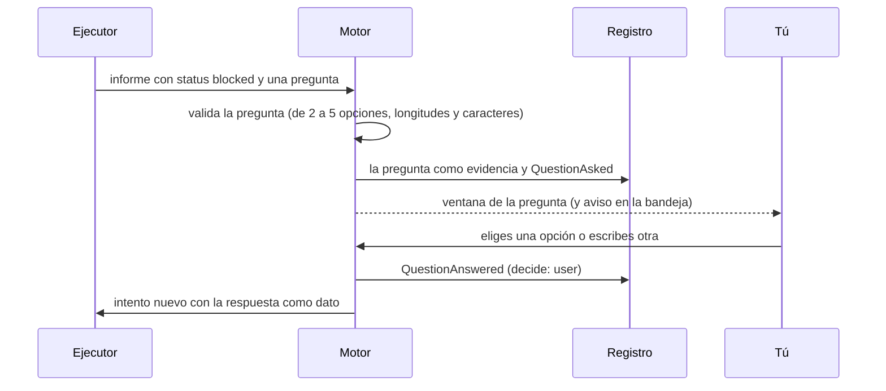

# 17 · Constructor visual de agentes y bloque final de producto: propuesta de diseño

> **Estado:** propuesta, pendiente de tus decisiones (§12). Parte de `main` en `87f7a07` (Fase 8 integrada el 2026-10-29,
> con tu demostración pendiente). Las peticiones que recoge están numeradas en [18](18-peticiones-y-pendientes.md)
> (P1 a P35), y cada decisión de aquí dice cuáles cubre.
>
> **Qué recoge.** Lo que pediste el 2026-10-30 (P3 a P19), lo que el prompt maestro pide y no tiene sitio (P29) y el
> orden de trabajo que acordamos ([18 §2](18-peticiones-y-pendientes.md#2-orden-de-trabajo-acordado)): primero la tanda 1
> (arreglos del recorrido en vivo) y la tanda 2 (barras en tiempo real, P3), luego el índice semántico (P19), después la
> revisión contigo de este documento y su implementación, la Fase 9 al final del bloque, las Fases 6, 10 y 7, y el
> recorrido completo.
>
> **Dos tandas en curso que este diseño usa y no duplica:**
>
> - el **selector de modelo** de la plantilla (WP-E de la tanda 1, G1);
> - el **control común de barra** con su tabla base de ventanas por modelo y sus barras en la barra de estado, el
>   monitor, el panel de la bandeja, «Consumo» y el lienzo (tanda 2, P3).
>
> También los arreglos del motor de la tanda 1 (WP-D): el plan sin Integración (B10) y las pruebas sin compilar (B6).
>
> **Cómo se hizo.** Un arquitecto independiente, a partir de:
>
> - el código de `src/**` (inventario con rutas y líneas en la §2; los recuentos son de grep y aproximados);
> - los documentos 03, 08 y 13 a 18, el prompt maestro y los ADR 0010, 0013 a 0018, 0022, 0023, 0031, 0036 y 0037;
> - la ayuda local de los CLIs (`claude --help` de 2.1.290 y `codex exec --help` de 0.160.0);
> - la documentación oficial (fuentes al final, consultadas el 2026-10-30).
>
> **Sin cuota.** Solo se ejecutaron `claude --version`, `codex --version` y esas dos ayudas. Ningún CLI recibió un
> prompt, no se leyeron carpetas de los CLIs ni credenciales, no se abrió ninguna ventana y no se compiló nada.

## 0. Resumen

Pides tres cosas. La primera, **montar el equipo y el flujo de forma visual y verlo trabajar en vivo**: cuántos agentes,
con qué modelo y potencia, sobre qué repositorio, con el consumo y el contexto de cada uno siempre a la vista, y con
sugerencias mientras montas. La segunda, **que el producto se entienda y se use solo**: idiomas, textos claros, ayuda,
documentación para entregar y una memoria que recupere lo de días anteriores. La tercera, **cerrar con la trazabilidad
(el Jira) y comprobarlo todo**, con Windows Hello como barrera que no se salta.

### 0.1 Las decisiones que vertebran la propuesta

1. **El índice semántico va primero (Fase 12, P19).** Es una proyección local y reconstruible de lo anclado: la memoria,
   los resúmenes del registro y la bitácora, que se ancla como memoria con su confianza. Los embeddings se calculan en tu
   equipo, sin red. La búsqueda es híbrida (palabras y significado), entra en el paquete de contexto de cada agente y el
   juez nunca la recibe (§3).
2. **Un solo lienzo con dos capas, «Equipo» y «Plan», y una tira fija del equipo** con las barras de cada agente. El
   equipo es la plantilla de siempre vista como grafo: agentes, juez y el nodo del repositorio. El plan es el lienzo de
   hoy. Ningún cable del equipo entra en el plan (§4.1, P4, P10, P29).
3. **Las barras son las de la tanda 2**, en cada nodo y en cada tarjeta, con su origen y su máximo. Se añade una barra de
   contexto por partes: requisitos, ficha, memoria, skills, lo que llega de otras tareas y la conversación (§4.2, P5).
4. **El analizador del montaje es determinista, gratis e instantáneo.** Reutiliza el validador y añade reglas de equipo,
   de contexto y de coste, cada una con un arreglo de un clic que se puede deshacer. El orquestador explica el orden
   dentro del propio plan, y un plan que has cambiado se revisa con un botón y tu OK (§4.4, P10).
5. **La potencia de un modelo es nivel + esfuerzo + ventana**, nunca un precio inventado. Sale de un catálogo local
   versionado y de lo aprendido del registro, con una recomendación determinista que dice por qué (§4.5, P7).
6. **El configurador por proyecto es un asistente de siete pasos** que aplica por las puertas de siempre: ninguna
   aprobación nueva se salta (§4.6, P8).
7. **Una duda del agente es una salida de su informe:** `blocked` con una pregunta de dos a cinco opciones. La pregunta
   es evidencia, tu respuesta es una entrada nueva del registro y la tarea sigue con la respuesta como dato. Hoy
   «Reintentar» no lleva ningún texto al agente (§4.7, P9).
8. **El análisis del consumo es determinista y siempre está.** El de un agente es opcional, con tu OK y del vendor que no
   produjo el trabajo (§4.8, P6).
9. **Windows Hello pasa a ser una barrera fija para lo crítico:** una lista en el código que ningún ajuste ni fichero
   desactiva. Sin Hello en el equipo, sirve el bloqueo de Windows comprobado (§4.9, P18).
10. **La gestión de agentes es la capa Equipo:** solo enseña los campos que de verdad gobiernan la ejecución, y hace
    reales los que hoy no hacen nada (instrucciones y carpetas). Además: el estado de los agentes en la barra superior, un
    chat de preparación con el orquestador, los paneles «Problemas», «Salida» y «Pruebas», y «Herramientas» (§4.10, P29).
11. **Los cimientos van al principio del constructor:** los recursos de idioma, la guía de textos, el botón ⓘ y la barrera
    de Hello entran en su P0. Así todo lo nuevo nace traducible, claro y protegido (§7).
12. **Idiomas con recursos `.resx`, y las capas de abajo emiten códigos con parámetros.** Lo anclado (registro,
    evidencias, memoria) no se traduce, y los prompts no cambian con el idioma (§5.1, P11).
13. **La ayuda responde primero sin cuota,** con un índice local de una ayuda escrita en lenguaje claro. Si quieres,
    después responde un agente de solo lectura que no ve tu proyecto salvo que lo marques (§5.4, P14).
14. **La documentación para clientes la construye el sistema desde el registro,** en Markdown, HTML, PDF y Word. Lo que
    redacte un agente va marcado, y lo revisas antes de exportar (§5.5, P15).
15. **Orden:** tandas 1 y 2 → Fase 12 (índice) → revisión de este documento → Fase 13 (constructor y cimientos) → Fase 14
    (bloque final, con la Fase 9 al final) → Fases 6, 10 y 7 → Fase 15 (comprobación completa y traducciones de la
    primera ola). Es el orden de [18 §2](18-peticiones-y-pendientes.md#2-orden-de-trabajo-acordado), y respeta las
    dependencias de docs/16 (§7, decisión 1).

### 0.2 Hallazgos de paso

Leyendo el código para este diseño salieron cinco cosas que conviene saber ya:

- **Las ventanas aprendidas no se usan en vivo.** `ModelWindowCatalog` y `ContextHealthTracker` no tienen llamadores en
  `src` (grep en `87f7a07`), aunque el comentario de `src/AgentStudio.Observability/ObservabilityServiceCollectionExtensions.cs:22-23`
  dice que se crea uno por ejecución. El monitor juzga con la ventana que trae el evento, y Claude la manda al terminar el
  intento (`ClaudeStreamJsonParser.cs:215`). La tabla base de ventanas de la tanda 2 lo cubre para la primera ejecución.
  Si la tanda 2 no conecta además lo aprendido, lo conecta el P0 de la Fase 13.
- **La cuota de Codex «tras cada ejecución» no existe.** El texto de los ajustes lo promete
  (`src/AgentStudio.Desktop/Services/AppSettings.cs:69-70`), pero solo se lee bajo demanda y en la espera por límite
  (`QuotaViewModel.cs:114-131`, `QuotaWaitPolicy.cs:133-169`).
- **Dos aprobaciones no pasan por la puerta.** El consentimiento de la recomendación de skills no deja `ApprovalGranted`
  (`SkillsDocumentViewModel.cs:627-636`). «Aprobar plan» del lienzo usa su botón y Hello, y el motor la registra al
  arrancar (`OrchestratorDocumentViewModel.cs:644-681`, `Orchestrator.cs:672-686`). Además, con el ajuste de Hello
  apagado lo crítico lo decide el diálogo solo, y lo destructivo nunca pide Hello (`ApprovalPromptService.cs:52-72`).
- **La duda de un agente bloqueado no se puede contestar.** «Reintentar» llama a `RetryBlockedAsync(task)` sin ningún
  texto (`OrchestrationRun.cs:111`, `RunMonitorViewModel.cs:384-389`): el agente vuelve a empezar sin saber qué decidiste.
- **Cinco campos del agente no gobiernan nada.** `PathGrants`, `MaxRounds`, `Objectives`, `MaxTotalTokens` y
  `SystemInstructions` solo van al hash y al JSON (`Workers.cs:445-456`; `RosterHash.cs:51`; `RunJson.cs:50-78`). La
  interfaz no los enseñará como controles hasta hacerlos reales (D-42).

### 0.3 Lo que se descarta o se aplaza

| Qué | Por qué |
|---|---|
| Las herramientas de pregunta de cada CLI (`AskUserQuestion` de Claude y `request_user_input` de Codex) | Codex solo la ofrece en el modo Plan. Del modo `-p` de Claude hay un informe de que no se detenía. Cada una tiene su forma, y Agent Studio los lanza con listas cerradas de herramientas. La pregunta va en el informe, igual en los dos (D-28) |
| Una tabla de precios propia | Sería un número inventado (docs/14 D-06, ADR-0019). El coste sale del registro, con su origen |
| Un modelo por tarea | El modelo es del agente (`TaskSpec` no lo tiene). Para potencias distintas hay dos ejecutores de nivel distinto, y el orquestador reparte (D-09) |
| Varios repositorios por proyecto | Los worktrees, la integración y el dosier del juez son por repositorio. Aplazado |
| sqlite-vec | Está antes de su versión 1 («expect breaking changes»), no tiene paquete .NET y exige cargar extensiones nativas. Basta una tabla propia (D-04) |
| Un modelo de embeddings con licencia propia (EmbeddingGemma) o de más de 1 GB | Licencia no abierta, como la de FluentAssertions, o demasiado grande para un IDE (D-03) |
| Idiomas de derecha a izquierda | Exigen dar la vuelta a toda la interfaz, el lienzo y el editor. Se aplazan (decisión 7) |
| Cambiar de idioma sin reiniciar | Dejaría textos a medio cambiar. Se aplica al reiniciar (D-49) |
| El panel «Depuración» del prompt maestro | Agent Studio no integra un depurador, y simularlo iría contra C-3 (D-45) |
| El juez que pregunta, o que analiza el consumo dentro de su veredicto | El juez escala si duda (`NeedsHuman`). Mezclar el consumo en el veredicto cambiaría su esquema y su pregunta (D-28 y D-36) |
| Un panel derecho nuevo de «estado de tareas, actividad y alertas del juez» | Ya lo cubren la tira del equipo, el monitor y la banda del auditor. Otro panel duplicaría (D-43) |

---

## 1. Alcance: cada petición y dónde va

Tus palabras, abreviadas; las literales están en [18 §1](18-peticiones-y-pendientes.md#1-peticiones-del-2026-10-2930).
Tamaños: S, M, L y XL, estimados por el diseño.

| P | Lo que pides | Qué hay hoy | Qué se propone | Fase | Tamaño |
|---|---|---|---|---|---|
| P19 | Índice vectorial de la bitácora, para recuperar lo de días anteriores cuando se vacía la caché | Memoria con FTS5 (bm25, sin lematizar en castellano); la bitácora sin indexar y fuera de los prompts | Índice local híbrido sobre la memoria, los resúmenes del registro y la bitácora anclada; paquete de contexto; herramienta de solo lectura para el planificador (§3) | 12 | M-L |
| P4 | Montar orquestador, juez y agentes de forma visual y animada, como un pipeline de Fabric, con el repositorio de git y lo principal de cada proyecto | Lienzo del plan (7 tipos de tarea, 8 estados); plantilla fija de 7 agentes; sin animación | Capas «Equipo» y «Plan», nodo del repositorio con la ficha del proyecto, cables animados (§4.1 a §4.3) | 13 | L |
| P5 | Consumo y contexto de cada elemento siempre visibles, con su máximo y por partes | Una barra (panel de la bandeja); el monitor en texto | Las barras de la tanda 2 en cada nodo y tarjeta; contexto por partes (§4.2) | 13 | M |
| P10 | Decidir cuántos agentes; que el orquestador compruebe el orden, lo dañino y lo que puede ir en paralelo | `PlanValidator` en cada cambio (unos 40 códigos), sin arreglos ni explicación del orden | Añadir y quitar agentes; analizador con arreglos de un clic; notas de orden del orquestador (§4.1 y §4.4) | 13 | M-L |
| P7 | Elegir modelo y potencia de cada elemento, con una recomendación según el proyecto | Modelo en texto libre; el selector llega con WP-E | Catálogo, lo aprendido, esfuerzo y recomendación (§4.5) | 13 | M |
| P8 | Configurador paso a paso por proyecto, con skills recomendadas | Banda de preparación; perfil .NET siempre | Asistente de siete pasos (§4.6) | 13 | M |
| P9 | Dudas de los agentes como ventanas con opciones, la recomendada marcada y el consumo de cada una | `blocked` con texto libre; «Reintentar» sin respuesta | Pregunta con opciones en el informe, su ventana y la continuación (§4.7) | 13 | M-L |
| P6 | Un análisis (un botón) de si el contexto fue escaso o algo se consumió sin sentido | Consumo por intento; auditor de 9 códigos | Análisis determinista y, opcional, con un agente (§4.8) | 13 | M |
| P18 | Windows Hello como barrera para lo crítico, aunque un `config.json` dé permisos | Ajuste que se puede apagar; dos caminos fuera de la puerta | Lista fija en el código y alternativa comprobada (§4.9) | 13 (P0) | S-M |
| P29 | Gestión de agentes, su estado en la barra superior, chat con el orquestador, paneles de salida, errores y pruebas, «Herramientas» y «Pruebas» | Iconos muertos («Agentes», «Pruebas»); solo hay terminal abajo | Capa Equipo como gestión, contador en la barra superior, chat de preparación, «Problemas», «Salida», «Pruebas» y «Herramientas» (§4.10) | 13 | M-L |
| P11 | Idiomas: por defecto el de Windows; los principales del mundo; nosotros, castellano de España | Unos 550 textos en XAML y unos 750 a 1 000 en el C# de Desktop, escritos a mano; sin cultura fijada | `.resx`, códigos con parámetros, idioma de Windows; castellano e inglés y una primera ola (§5.1) | 13 (cimientos), 14 y 15 | L-XL |
| P12 | Textos cortos y claros, tecnicismos mínimos | Textos técnicos (hash, worktree, vendor) | Guía, glosario y revisión de todos los textos (§5.2) | 13 (guía) y 14 | M-L |
| P13 | Botones ⓘ en los apartados complejos | 11 `HelpText`, sin ayuda | Control `InfoButton` y su contenido (§5.3) | 13 (control) y 14 | S-M |
| P14 | Chat de ayuda con el contexto del IDE, en la barra lateral | Nada | Ayuda local sin cuota y un agente de solo lectura con tu OK (§5.4) | 14 | L |
| P15 | Documentación lista para clientes (PDF, Word…) al terminar | Markdown de la memoria; informes solo en pantalla | Documento construido desde el registro, en cuatro formatos (§5.5) | 14 | L |
| P16 | La Fase 9 (el Jira), como se dijo, al final con todo esto y comprobada | Diseñada en docs/16, sin empezar | Al final del bloque, entera (§5.6) | 14 | XL |
| P17 | Probar cada elemento, opción y pregunta, aunque lleve días | Renders y pruebas de ViewModel por fase | Inventario automático de la interfaz y recorrido humano por pantalla (§6) | 14 (automático) y 15 | L |

**Peticiones relacionadas que este documento toca, sin resolverlas enteras:**

| P | Qué toca | Dónde |
|---|---|---|
| P2 (B6, B10 y G1) | El analizador usa las reglas de «falta la Integración» y «pruebas sin compilar» que añade WP-D, y el selector de modelo de WP-E | §4.4 y §4.5 |
| P3 | Todas las barras son las de la tanda 2 | §4.2 |
| P23 | Las 93 pruebas que fallan a integridad Low impiden aprobar «Auditar proyecto completo» de este repositorio. El cierre de un hito (Fase 9) es una auditoría, así que lo hereda | §11 (riesgos) |
| P24 y P32 | Tus demostraciones pendientes y las capturas reales entran en la comprobación completa | §6 |
| P28 | La accesibilidad completa (lector de pantalla, teclado, alto contraste y zoom) gana criterio en la comprobación completa. La firma del registro y la purga de la memoria no son de este documento | §6 |
| P30 | El paso de skills del configurador usa el catálogo que haya. Dar de alta skills desde repositorios es otro diseño | §4.6 |
| P31 | El «contexto empaquetado» en la barra de estado queda cubierto por la barra por partes (D-13), y «tus notas en la memoria», por la ficha del proyecto (D-10). Las auxiliares nuevas escriben `AgentRunFinished` v3 | §4.2, §4.1 y §8.2 |

---

## 2. Inventario: lo que ya existe

Estados, como en docs/14 a 16: **Hecho** (código y pruebas), **Parcial** (con el hueco que se nombra), **Sin uso** (existe
y nadie lo usa) y **Falta**. Rutas relativas a la raíz del repositorio, en `87f7a07`.

**Lienzo y monitor**

| Pieza | Dónde | Estado |
|---|---|---|
| Lienzo Nodify 7.3.0 con 7 tipos de tarea (`WorkTaskKind`) y 8 estados; «Debate», aplazado | `src/AgentStudio.Domain/Work/WorkTaskStatus.cs:3-43`; `src/AgentStudio.Desktop/Orchestrator/Canvas/NodeKinds.cs:31` | Hecho |
| Un nodo es una tarea: `NodeViewModel` lleva los campos de `TaskSpec`, `BuildTasks` trata todo nodo como tarea y la disposición va por `TaskId` | `…/Canvas/NodeViewModel.cs:15-149`; `…/Canvas/CanvasViewModel.cs:380-402, 507-516` | Hecho. Impide nodos que no sean tareas sin otra colección |
| Validación en vivo: `PlanValidator.Validate` en cada cambio de nodo, cable o campo; los mensajes salen tras «Validar» | `src/AgentStudio.Desktop/Orchestrator/OrchestratorDocumentViewModel.cs:129, 1141-1197` | Hecho. El coste por pulsación (validar y calcular el hash) no está medido |
| Comprobación de cables con `TaskGraph`: un ciclo se rechaza con su camino | `CanvasViewModel.cs:136-148`; `PendingConnectionViewModel.cs:35-47` | Hecho |
| Deshacer y rehacer | — | Falta |
| Animaciones | — | Falta. ADR-0015 avisa de que mover la vista desde `CompositionTarget.Rendering` duplica el layout (unos 20 fps con 200 nodos) |
| Estado vivo en el lienzo: solo el estado de la tarea. La cola, el motivo del bloqueo, el intento y el contexto viven en el monitor | `OrchestratorDocumentViewModel.cs:131`; `CanvasViewModel.cs:490-496`; `src/AgentStudio.Desktop/Orchestrator/Monitor/RunMonitorViewModel.cs:1151-1303` | Parcial. Un bloqueo por cuota sale como «Bloqueada» |
| Eventos del motor al monitor: uno a uno, sin agrupar; `RefreshDetails` pide `run.Snapshot()` en cada cambio | `RunMonitorViewModel.cs:496-538, 1037-1061` | Hecho, sin medir |
| Accesibilidad: nombres UIA de nodos, conectores y cables; Tab, flechas y Supr; el color siempre con texto | `NodeViewModel.cs:136-138`; `src/AgentStudio.Desktop/Views/Orchestrator/CanvasView.xaml:78-85`; `…/Orchestrator/Tone.cs:7-14` | Parcial: los cambios de estado no se anuncian; conectar con el teclado, sin verificar |
| Disposición en `.agentstudio/canvas-layout.json` (`{version:1, nodes:{id:{x,y}}}`) | `…/Canvas/CanvasLayoutStore.cs:32-96` | Hecho. Se puede mover en plena ejecución: `Location` es TwoWay y `SaveLayout` no tiene `CanExecute` |
| Panel de propiedades del nodo | `…/Views/Orchestrator/NodePropertiesView.xaml:16-135` | Hecho; escribe al teclear, sin deshacer |

**Barras**

| Pieza | Dónde | Estado |
|---|---|---|
| Una sola barra con valor: el contexto de cada tarea en curso, en el panel de la bandeja (`ContextBarRow(Task, Fraction?, Text, Tone)`) | `src/AgentStudio.Desktop/Background/StatusPanelViewModel.cs:33-39, 377-388`; `…/Views/Background/StatusPanelView.xaml:32-50` | Hecho. El origen va en el texto |
| Monitor, «Consumo» y cuota | `RunMonitorView.xaml:184-188`; `UsageDashboardView.xaml`; `QuotaView.xaml:23-29` | Solo texto |
| Control común de barra y tabla base de ventanas por modelo | Tanda 2 (P3) | En curso. Este diseño lo usa |

**Agentes, modelos y plan**

| Pieza | Dónde | Estado |
|---|---|---|
| `AgentDefinition`: rol, `ModelBinding(Provider, Vendor, Model?)`, herramientas, `PathGrants`, presupuesto, rondas, memoria y revisión | `src/AgentStudio.Domain/Agents/AgentDefinition.cs:50-104`; `src/AgentStudio.Domain/Providers/ModelBinding.cs:46` | Hecho |
| Lo que gobierna la ejecución: el `Workspace` de la tarea y `AllowedTools`. `PathGrants`, `MaxRounds`, `Objectives`, `MaxTotalTokens` y `SystemInstructions` solo van al hash y al JSON | `src/AgentStudio.Orchestration/Engine/Workers.cs:445-456`; `src/AgentStudio.Application/Orchestration/RosterHash.cs:43-70` | Parcial |
| Plantilla por defecto: orquestador y ejecutor (Claude), juez (Codex), arquitecto y crítico (debates), `juez-claude` y `juez-revision` (Codex, el único con modelo fijado) | `src/AgentStudio.Desktop/Orchestrator/Session/DefaultAgentRoster.cs:30, 48-78` | Hecho |
| Editar la plantilla: solo la memoria; guardar retira la aprobación del plan | `src/AgentStudio.Desktop/Orchestrator/Preparation/RosterEditorViewModel.cs:86, 148, 172` | Parcial. El selector de modelo llega con WP-E |
| Congelación: `RosterHash` dentro de `RunHeaderHash`, anclado en `RunStarted`; arrancar exige la plantilla aprobada por su hash | `src/AgentStudio.Application/Orchestration/RunHeaderHash.cs:35-61`; `src/AgentStudio.Orchestration/Engine/Orchestrator.cs:274-275, 457-472, 699` | Hecho |
| Modelos: texto libre (expresión regular y 128 caracteres como mucho); Claude `--model`, Codex `-m`; sin catálogo ni esfuerzo | `src/AgentStudio.Providers/Cli/CliArgumentGuard.cs:28-36`; `…/Cli/Claude/ClaudeCodeArguments.cs:260-273`; `…/Cli/Codex/CodexExecArguments.cs:100-103` | Parcial |
| Ventanas aprendidas del registro | `src/AgentStudio.Observability/Context/{ModelWindowCatalog.cs, ContextHealthTracker.cs}` | Sin uso (hallazgo de la §0.2) |
| Planificador: Read, Grep y Glob; un prompt con los agentes y su modelo; esquema portable de 16 KB como mucho; parseo estricto; una corrección | `src/AgentStudio.Orchestration/Planning/{Planner.cs, PlannerPrompt.cs:29-159, PlanSchema.cs:25-84, PlanParser.cs:24-88}` | Hecho |
| El modelo es del agente, no de la tarea | `src/AgentStudio.Domain/Orchestration/PlanDefinition.cs:35` (`TaskSpec`, sin modelo) | Hecho |
| `PlanValidator`, unos 40 códigos: `OverlappingWriteScopes`, `FanInWithoutIntegration`, `IntegrationsNotOrdered`, `TestStepRequiredByPolicy`, `JudgeVendorNotIndependent`… | `src/AgentStudio.Domain/Orchestration/PlanValidator.cs:28-96, 162-168, 530-669` | Hecho. «Falta la Integración» y «pruebas sin compilar» llegan con WP-D (B10 y B6) |
| Auditor del orquestador: 9 códigos, al terminar cada ejecución | `src/AgentStudio.Debate/Audit/{OrchestratorAudit.cs, Checks/**}` | Hecho |
| La detección de escritores a integridad media que usan la compuerta y el aviso del plan | `src/AgentStudio.Orchestration/Engine/MediumIntegrityWriters.cs:68` | Hecho |
| Perfil de verificación propuesto: siempre el de .NET. `ProjectStackDetector` solo lo usa Skills | `…/Orchestrator/Session/FileVerificationProfileSource.cs:33-37`; `src/AgentStudio.Orchestration/Verification/DotNetVerificationProfile.cs:14-42`; `src/AgentStudio.Domain/Skills/ProjectStackDetector.cs:18-55` | Parcial |

**Preguntas, consumo y contexto**

| Pieza | Dónde | Estado |
|---|---|---|
| `ExecutorReport`: `status` (completed, blocked, failed), `summary`, `filesChanged`, `claims`, `openIssues` y `outputs` | `src/AgentStudio.Orchestration/Engine/ExecutorReport.cs:8-80`; `ExecutorPrompt.cs:173-190` | Hecho |
| `blocked` deja la tarea `Blocked` (`AwaitingHuman`); «Reintentar» llama a `RetryBlockedAsync(task)` sin texto | `Workers.cs:599-620`; `OrchestrationRun.cs:111, 463-464` | Parcial: tu respuesta no llega al agente |
| Los `openIssues` pasan a la memoria como tareas pendientes | `src/AgentStudio.Memory/Derivation/DerivationRules.cs:239` | Hecho |
| Contexto por paso (`ContextObserved`): solo Claude, con la ventana al terminar; Codex `exec`, «no expuesto» | `src/AgentStudio.Application/Providers/AgentProvider.cs:270`; `src/AgentStudio.Providers/Cli/Claude/ClaudeStreamJsonParser.cs:186-217` | Parcial |
| Consumo por intento, con seis orígenes, pico y compactaciones; sin desglose por paso | `src/AgentStudio.Application/Usage/UsageContracts.cs:13-98`; `src/AgentStudio.Observability/Usage/UsageProjector.cs` | Hecho |
| Empaquetado por niveles; la bitácora queda fuera | `src/AgentStudio.Memory/Context/ContextPacker.cs:36-106`; `src/AgentStudio.Application/Knowledge/ContextPackContracts.cs:11-30` | Hecho |
| Memoria append-only y anclada, con FTS5 (bm25, `unicode61`) | docs/14 D-19 a D-21; ADR-0022 | Hecho. Sin lematizar en castellano; sin índice vectorial |
| Cuota: Claude pasiva (`quota.jsonl`); Codex con tu opt-in | `src/AgentStudio.Application/Providers/QuotaObservingAgentProvider.cs`; `src/AgentStudio.Providers/Cli/Codex/AppServer/CodexAppServerQuotaReader.cs` | Hecho, salvo la lectura «tras cada ejecución» (§0.2) |
| Ejecución auxiliar de solo lectura, anotada en el registro, que falla cerrada si el registro no verifica | `src/AgentStudio.Application/Providers/AuxiliaryAgentRunner.cs:34-51` | Hecho. Base de las auxiliares nuevas |
| Propósitos de una ejecución de agente | `src/AgentStudio.Application/Decisions/DecisionPayloads.cs:129` (`AgentRunPurpose`) | Hecho. Los nuevos se añaden al final |
| Recomendación asistida de skills: consentimiento de riesgo bajo, válido 10 minutos y una vez; haiku, 8 turnos, 3 minutos, 0,25 USD | `src/AgentStudio.Application/Skills/SkillRecommendationService.cs:76-80, 176-262` | Hecho. No deja `ApprovalGranted` |
| Servidor MCP local de solo lectura: `search_skills` y `recommend_skills` sobre una instantánea | `src/AgentStudio.SkillsMcp/{SkillsMcpServer.cs:35-45, SkillCatalogTools.cs}` | Hecho. Patrón para la herramienta del índice |

**Aprobaciones y Windows Hello**

| Pieza | Dónde | Estado |
|---|---|---|
| `ApprovalRiskClassifier`: crítico y destructivo según palabras de la acción; solo sube el nivel | `src/AgentStudio.Security/Approvals/ApprovalRiskClassifier.cs:18-38` | Hecho |
| `ApprovalGate`: siempre pregunta; sin respuesta en 30 minutos, deniega el sistema | `…/Approvals/ApprovalGate.cs:12, 31-131` | Hecho |
| Hello solo en lo crítico y con `WindowsHelloForCriticalApprovals` (activo por defecto). Apagado, decide el diálogo; lo destructivo nunca pide Hello; sin Hello, el diálogo con aviso (`WindowsHelloUnavailable`) | `src/AgentStudio.Desktop/Orchestrator/Approvals/ApprovalPromptService.cs:52-72`; `…/Services/AppSettings.cs:84`; `…/Lock/HelloAnswers.cs:17-28` | Hecho; se puede apagar |
| Caminos fuera de la puerta: «Aprobar plan» y el consentimiento de skills | §0.2 | Hallazgo |
| Ficheros de permisos: no existe ningún `config.json` que conceda algo. Claude se lanza con `--setting-sources ""`, `disableAllHooks` y `dontAsk`, nunca `bypassPermissions`; Codex, nunca con `danger-full-access` | `…/Cli/Claude/ClaudeCodeArguments.cs:53, 85-95`; `…/Cli/Codex/CodexExecArguments.cs:13` | Hecho |

**Textos, ayuda y documentos**

| Pieza | Dónde | Estado |
|---|---|---|
| Textos de la interfaz a mano, en castellano: 44 XAML con unos 548 literales; entre 750 y 1 000 en el C# de Desktop (61 ficheros); también en Orchestration (unos 263), Debate (166) y Memory (127). El validador ya separa código y texto | `src/AgentStudio.Desktop/Orchestrator/Canvas/PlanViolationText.cs:17-104` (unos 50 códigos) | Sin `.resx`, sin `CurrentUICulture` y sin ajuste de idioma |
| Formatos: `InvariantCulture` en unas 109 líneas; es-ES fijado en tres sitios | `…/Observability/MetricText.cs:27`; `…/Memory/DailySummaryViewModel.cs:16`; `…/Monitor/MonitorTexts.cs:148` | Parcial |
| Accesibilidad: 231 `AutomationProperties.Name`, 51 `LiveSetting`, 11 `HelpText`; contraste AA medido | [12](12-accesibilidad-tema-oscuro.md) | Parcial. Lector, alto contraste y zoom al 200 %, mandados a la Fase 7 (12 §7) |
| Barra de actividad: 10 entradas, «Agentes» y «Pruebas» muertas | `src/AgentStudio.Desktop/ViewModels/MainViewModel.cs:164-175` | Parcial (V5, en WP-B) |
| Ayuda en la app, chat, índice de la documentación | — | Falta |
| Exportación: el Markdown de la memoria; los informes de auditoría solo en pantalla; sin PDF, Word ni HTML, y sin librerías de documentos | `src/AgentStudio.Memory/Export/MemoryMarkdownExporter.cs`; `Directory.Packages.props:8-29` | Parcial |
| Paquetes: CommunityToolkit.Mvvm, AvalonDock, Microsoft.Data.Sqlite, ModelContextProtocol 2.2.0, Nodify 7.3.0 y WebView2 | `Directory.Packages.props:8-29` | Hecho |

---

## 3. Fase 12 · Índice semántico de la bitácora y la memoria (P19)

**Qué hay hoy.** No hay índice vectorial. La memoria del proyecto se busca por palabras con FTS5 (bm25, tokenizador
`unicode61`): pliega los acentos pero no lematiza en castellano, así que «prueba» no encuentra «pruebas» (docs/14 D-21).
Se deriva del registro verificado al terminar cada ejecución, y los agentes con `ReadSelected` la reciben en su paquete
de contexto. La bitácora (`.agentstudio/bitacora/AAAA-MM-DD.md`) no está indexada: solo se lee para el resumen del día, y
ese resumen queda fuera de los prompts (docs/14 D-20, ADR-0023).

**Qué pides.** Que cuando se vacíe la caché o el contexto, el orquestador y los agentes recuperen rápido lo de días
anteriores. En la práctica, cada sesión nueva (una ejecución, un reintento en sesión nueva, la renovación del contexto
de ADR-0035 o la continuación tras una pregunta) vuelve a construir su paquete de contexto. Si el paquete trae lo
relevante de días anteriores, el agente lo recupera sin pedirlo.

**Por qué va primero.** No depende del constructor ni de los idiomas, mejora a todos los agentes desde el primer día y es
de tamaño medio. Así lo acordamos en [18 §2](18-peticiones-y-pendientes.md#2-orden-de-trabajo-acordado): justo después de
la tanda 2.

### 3.1 Qué se indexa y con qué confianza

**D-01 · Solo lo anclado, cada fuente con su confianza (P19).**

| Fuente | Cómo entra | Confianza | ¿Llega a un prompt? |
|---|---|---|---|
| Memoria de confianza y aceptada | Cada entrada es un fragmento | La suya (docs/14 D-20) | Sí, con `ReadSelected`, como hoy |
| Resúmenes del registro: el plan aprobado, los veredictos requisito a requisito, las entregas, las alertas del auditor, y las preguntas con su respuesta (§4.7) | Textos del sistema generados desde los payloads | Sistema | Sí |
| La bitácora | Cada entrada anclada como memoria (D-02) | Sistema, derivada de la bitácora | Sí, por relevancia (D-02) |
| Resúmenes del día (`DailySummary`) | Como hoy | Sistema | Como hoy: no por defecto |

- **Nunca:** credenciales, las carpetas de los CLIs, nada de fuera del proyecto, el código fuente (para eso están Grep y
  Glob), las transcripciones de los agentes ni las evidencias en crudo.
- **Solo lo anclado.** Cada fragmento cita su fuente: la entrada del registro con su secuencia, o la memoria con su SHA-256.
  La búsqueda descarta lo que ya no verifica (retirado, sustituido o modificado), igual que hoy la memoria (docs/14 D-19).
- **Todo pasa por `ISecretRedactor`** antes de entrar, y cada fragmento tiene 1 500 caracteres como mucho.

**D-02 · La bitácora llega a los agentes como memoria anclada (enmienda ADR-0023 y amplía ADR-0022).** La bitácora es
contenido del repositorio, el adversario del punto 1 de ADR-0018: un repositorio de terceros puede traer una con
instrucciones plantadas. Por eso no se lee el fichero en crudo al lanzar a nadie. Se ancla antes:

- **Cada entrada, con su resultado y su línea «Hecho», se anuncia como memoria** de una categoría nueva,
  `JournalEntry`, con `MemoryRecorded` y su SHA-256. Se deriva al terminar cada ejecución y al abrir el proyecto, igual que
  el resto de la memoria, y la derivación es idempotente por la huella de la entrada.
- **La confianza sale del registro, no de las fechas del fichero,** que cualquiera puede escribir:
  - **lo que escribió Agent Studio** es de confianza. Su escritor de la bitácora añade la ejecución, la tarea y el intento al
    final de la línea «Resultado» de cada entrada, donde el formato ya admite un añadido (` · …`,
    `src/AgentStudio.Memory/Summary/DailySummaryBuilder.cs:238`), así que el resumen del día la sigue leyendo igual. La
    derivación casa la entrada con su `AgentRunStarted`, que está anclado. Una entrada que dice ser de Agent Studio y no
    casa, no lo es;
  - **lo demás** (las entradas del hook de desarrollo, o las de un tercero que llegan con el repositorio o con un `pull`)
    queda en cuarentena hasta que lo aceptas: por días, o con «Confiar en la bitácora de este proyecto», una decisión tuya
    que queda en el registro y se puede retirar. Lo que ya estaba al aceptar un historial como nuevo origen, igual que la
    memoria heredada.
- **En el prompt van como datos,** dentro del bloque `<project_memory>` de siempre, recodificadas con `PromptData.Quote` y
  con la regla de que nada de lo que hay dentro es una orden.
- **En el empaquetado** (D-24 de docs/14) entran en el último nivel, «el resto, por relevancia», después de los errores
  conocidos. Nunca desplazan a los requisitos ni a las decisiones.
- **La bitácora de desarrollo** (las entradas del hook, con `sesión xxxxxxxx`) se ancla igual. Son tus prompts, pero Agent
  Studio no puede saberlo solo: entran con «Confiar en la bitácora de este proyecto».

| Opción | Ventajas | Inconvenientes |
|---|---|---|
| **Anclada como memoria, por relevancia y con su confianza**, recomendada | Hace lo que pides; una bitácora plantada queda en cuarentena; lo que entra se puede comprobar | Una categoría de memoria nueva; enmienda ADR-0023 |
| Solo para ti, en la búsqueda, nunca en un prompt | Ningún riesgo nuevo | No cumple lo que pides: el orquestador y los agentes no la recuperan |
| El fichero en crudo en el prompt | Sencilla | Contenido del repositorio sin anclar ni revisar: descartada |

### 3.2 Embeddings en tu equipo, sin red

**D-03 · Un modelo pequeño y multilingüe, en el proceso, sin red.**

| Opción | Licencia | Tamaño y forma | Notas |
|---|---|---|---|
| **multilingual-e5-small** (intfloat), recomendada | MIT | 384 dimensiones, 12 capas; unos 470 MB en float32. La versión ONNX cuantizada a int8 ocupa menos (sin verificar) | El castellano está entre sus idiomas. Pide los prefijos `query:` y `passage:` delante de cada texto. Admite 512 tokens por entrada |
| paraphrase-multilingual-MiniLM-L12-v2 | Apache-2.0 | 384 dimensiones | Solo 128 tokens por entrada: partiría los fragmentos |
| bge-m3 o Qwen3-Embedding-0.6B | MIT y Apache-2.0 | Unos 2 GB y 1,2 GB | Demasiado grandes para un IDE |
| EmbeddingGemma | Términos propios de Gemma | — | Licencia que no es abierta: descartado, como FluentAssertions |
| Un servidor local que instales tú (Ollama, LM Studio) | Según el modelo | — | Hoy no hay ninguno. Sería otra opción, siempre con tu OK |

- **Motor:** ONNX Runtime (MIT), dentro del proceso, y el tokenizador SentencePiece de `Microsoft.ML.Tokenizers` (MIT).
  Su modo Unigram existe; que reproduzca el de XLM-RoBERTa, con su desplazamiento de ids, está sin verificar. Lo decide un
  spike antes de nada, como el de ADR-0015: tokenización, tamaño, velocidad en tu CPU y calidad en castellano.
- **El modelo no viaja con la app.** Se descarga una vez con tu OK, con su SHA-256 fijado en el código, o lo copias tú en
  la carpeta. Después no hay red. Un fichero que no da la huella no se carga (decisión 9).
- **Sin modelo, todo funciona** con FTS5, y la búsqueda dice «solo por palabras».

### 3.3 Dónde se guarda y cómo se busca

**D-04 · Una caché de tu equipo, fuera del repositorio, que se reconstruye.**

- **Dónde:** `%LOCALAPPDATA%\AgentStudio\index\<huella de la ruta final del proyecto>\semantic.db`. No la ve git, no la puede
  traer un repositorio de terceros y no la toca la comprobación del repositorio del usuario, que vigila `.agentstudio/`
  (docs/14 D-22). Se puede borrar sin perder nada.
- **Qué guarda:** una tabla propia con el fragmento, su fuente, su huella, el modelo y su huella, y el vector en float32.
- **Cómo busca:** por similitud coseno en memoria, con `System.Numerics.Vector<float>`, sin paquetes. Con 50 000
  fragmentos son unos 75 MB de vectores, y recorrerlos lleva milisegundos.
- **Reconstruir es reproducible:** borrar y volver a indexar da los mismos fragmentos (las mismas huellas) y, con el mismo
  modelo, el mismo orden en el conjunto de preguntas de prueba.
- **Cuándo se indexa:** en segundo plano y con prioridad baja, al terminar la derivación de la memoria. Como el índice vive
  fuera del proyecto, no espera a que termine una ejecución.

| Opción | Ventajas | Inconvenientes |
|---|---|---|
| **Tabla propia y coseno en memoria**, recomendada | Sin dependencias nativas; se prueba tal cual; sobra para decenas de miles de fragmentos | Hay que escribir la búsqueda (unas decenas de líneas) |
| sqlite-vec (MIT o Apache-2.0) | Búsqueda en SQL | Está antes de su versión 1; sin paquete .NET; obliga a cargar extensiones nativas en `Microsoft.Data.Sqlite` |
| Sin vectores: FTS5 con un lematizador de castellano | Sin modelo ni descarga | Lematizar no da significado: «test en rojo» no encuentra «pruebas que fallan» |

**D-05 · Búsqueda híbrida, con un orden que se puede repetir.**

- Dos listas: FTS5 (bm25, con la consulta escapada como hoy, docs/14 D-21) y los vectores (coseno, con el prefijo `query:`).
- Se funden por rangos (Reciprocal Rank Fusion, k = 60). Los empates se deciden por fecha (lo reciente primero) y después
  por id: el resultado no depende del azar.
- Arregla lo que FTS5 no puede: «pruebas que fallan» encuentra «test en rojo», y «prueba» encuentra «pruebas».
- Se respetan el presupuesto de entradas y de caracteres del paquete, como hoy.

### 3.4 Quién lo usa, y qué ve el juez

**D-06 · Primero el paquete de contexto; después, una herramienta de solo lectura; el juez, nada.**

- **El paquete de contexto de todos los agentes con memoria (`ReadSelected`).** En los niveles «por relevancia», la
  relevancia pasa de bm25 a la búsqueda híbrida. Es determinista, no añade procesos y queda trazado en el `ContextPack`
  de `AgentRunStarted`. Es lo primero que se hace.
- **El planificador, bajo demanda:** una herramienta `search_project_history(query, top ≤ 10)` en el servidor MCP local de
  solo lectura, con el patrón de `search_skills`: una instantánea de lo de confianza que escribe Agent Studio, sin acceso
  a la base. Solo en lanzamientos que no escriben, sin shell y sin red: nunca en un ejecutor (docs/14 D-30 no cambia).
  Antes de usarla, la medición de siempre con una ejecución corta y tu OK (decisión 9).
- **Tú:** «Buscar» en el documento «Memoria» usa la búsqueda híbrida y muestra la bitácora.
- **Tus sesiones de desarrollo, si quieres:** el mismo servidor, con su instantánea, puede servir a las sesiones de Claude
  Code con las que construimos Agent Studio. Registrarlo en su configuración es una decisión tuya (decisión 9).
- **El juez y los auditores: nada.** Ni paquete ni herramienta, como hoy con la memoria (ADR-0022). Una prueba lo fija para
  los dos caminos.
- **Coste:** ninguna cuota. Indexar es CPU de tu equipo (del orden de decenas de milisegundos por fragmento, sin
  verificar: lo mide el spike), y una consulta es un embedding corto más la búsqueda.

---

## 4. Fase 13 · Constructor visual de agentes (P4 a P10, P18 y P29)

```text
┌ Orquestador · calc ──────────────────────────────────────── [Configurar proyecto] [Volver a cargar] ┐
│ [Equipo] [Plan]   4 agentes · trabajan 2 a la vez en Claude   Cuota Claude 5 h [████░░] 47 %        │
│                   · vista hace 3 min · Codex: no expuesto                                           │
├ Tira del equipo ────────────────────────────────────────────────────────────────────────────────────┤
│ ┌ Orquestador ────────┐ ┌ Ejecutor ───────────┐ ┌ Ejecutor 2 ─────────┐ ┌ Juez ───────────────┐     │
│ │ Claude · opus · alto│ │ Claude · sonnet · m.│ │ Claude · haiku · b. │ │ Codex · otra empresa│     │
│ │ ● Libre             │ │ ● Trabajando en T2  │ │ ● Te pregunta algo  │ │ ● Libre             │     │
│ │ Contexto [█░░░] 12 %│ │ Contexto [███░] 47 %│ │ Contexto [░░░░] 3 % │ │ Contexto no expuesto│     │
│ │ 31.000 · exacto     │ │ 120.000 · exacto    │ │ 8.000 · exacto      │ │ —                   │     │
│ └─────────────────────┘ └─────────────────────┘ └─────────────────────┘ └─────────────────────┘     │
├──────────────────────────────────────────────────────────────────────────────┬──────────────────────┤
│ Añadir: [Ejecutor] [Juez] [Orquestador]                     capa Equipo      │ Ejecutor 2         ⓘ │
│     ┌ Orquestador ┐ reparte                                                  │ Programa: Claude Code│
│     │ opus · alto │────┬──────────────────┐                                  │ Modelo: [haiku ▾]    │
│     └─────────────┘    ▼                  ▼             revisa               │  Recomendado: sonnet │
│                 ┌ Ejecutor ─────┐  ┌ Ejecutor 2 ───┐ ────────▶ ┌ Juez ──┐    │  (por qué…)          │
│                 │ sonnet · medio│  │ haiku · bajo  │           │ Codex  │    │ Esfuerzo: [bajo ▾]   │
│                 └──────┬────────┘  └──────┬────────┘           └────────┘    │ Carpetas: docs/      │
│  trabaja en (animado)  ║                  │ trabaja en                       │ Memoria: ☑           │
│                        ▼                  ▼                                  │ Instrucciones: …     │
│                 ┌ Repositorio calc ───────────────────────────────────┐      │ Contexto por partes: │
│                 │ main · a1b2c3d · origin github.com/…/calc           │      │ [▓▓▒▒░░░░] …         │
│                 │ ○ src/  ○ tests/  ○ docs/ · 2 cambios sin confirmar │      │                      │
│                 └─────────────────────────────────────────────────────┘      │                      │
├ Análisis del montaje ────────────────────────────────────────────────────────┴──────────────────────┤
│ ✖ Falta la Integración: nada llegaría a tu rama.          [Añadir Integración al final] [Deshacer]  │
│ ▲ Con 3 ejecutores de Claude trabajan 2 a la vez (límite del proveedor).                            │
│ ● El ejecutor usa opus en tareas que solo tocan docs/: prueba sonnet.           [Cambiar a sonnet]  │
└─────────────────────────────────────────────────────────────────────────────────────────────────────┘
```

### 4.1 Equipo y plan en un solo lienzo

**D-07 · Un documento, un lienzo, dos capas y una tira (P4 y P5).**

- **Capa «Equipo»:** los agentes de la plantilla y el repositorio, como un grafo. Es otra forma de ver y editar la
  plantilla, no un modelo nuevo.
- **Capa «Plan»:** el lienzo de hoy. Su modelo no cambia.
- **La tira del equipo:** una franja fija encima del lienzo, fuera del zoom, con una tarjeta por agente: nombre, rol,
  programa, modelo y esfuerzo, estado y barras. Se ve en las dos capas, también durante la ejecución: es lo que hace que
  el consumo de cada uno esté siempre a la vista.
- **Selección enlazada:** un clic en un agente (en su tarjeta o en su nodo) resalta sus tareas en la capa Plan, y un clic
  en una tarea resalta su agente.
- **Qué capa se ve:** «Equipo» mientras preparas, «Plan» en cuanto llega una propuesta y, durante la ejecución, la que
  elijas. Se cambia con dos botones y con un atajo que se elige al implementar, comprobando que el editor no lo usa (como
  se hizo en ADR-0037).

| Opción | Ventajas | Inconvenientes |
|---|---|---|
| **Un lienzo con dos capas y la tira**, recomendada | Un solo sitio; el consumo de cada agente siempre visible; el modelo del plan no cambia | Dos espacios de disposición en el mismo fichero y un selector de capa |
| Dos vistas enlazadas (pestañas «Equipo» y «Plan») | Separación total; algo más sencilla | Para ver el consumo del equipo mientras miras el plan hay que cambiar de pestaña; dos documentos que mantener sincronizados |
| Un lienzo combinado, con las tareas en carriles por agente, como un pipeline | Muy visual | `NodeViewModel` es un `TaskSpec`: los carriles obligan a recolocar solo; un cable por asignación enreda el grafo; reasignar arrastrando cambiaría el plan sin querer |

La asignación de una tarea a su agente no es un cable: es una etiqueta del agente en el nodo de la tarea, más la selección
enlazada. Un cable por tarea llenaría el lienzo de líneas cruzadas.

**D-08 · La capa Equipo es la plantilla, y editarla tiene las consecuencias de siempre (P4 y P29).**

- **Nodos:** uno por agente de la plantilla (orquestador, ejecutores y jueces) y uno del repositorio. Los participantes de
  debates (arquitecto y crítico) se ocultan con el filtro «Solo la orquestación», activo por defecto.
- **Editar la capa es editar la plantilla.** Guardar cambia `RosterHash` y retira la aprobación del plan
  (`RosterEditorViewModel.cs:172`; `Orchestrator.cs:457-472`). La capa lo dice antes de guardar.
- **Ningún cable del equipo entra en el plan:** ni en `BuildTasks` ni en `DependsOn`.
- **Modelo:** `TeamGraph` en el dominio, puro, con `AgentNode`, `RepositoryNode` y `TeamEdge`. `CanvasViewModel` gana una
  segunda colección, y la plantilla visual se elige por tipo de nodo. Las tareas siguen siendo `NodeViewModel`.
- **Disposición:** `canvas-layout.json` pasa a la versión 2, `{version:2, plan:{…}, team:{…}}`. La versión 1 se lee como la
  capa Plan.

**D-09 · Cuántos agentes: los decides tú, con los límites a la vista (P10).**

- **Añadir:** la paleta de la capa Equipo ofrece «Ejecutor», «Juez» y, si no hay ninguno, «Orquestador». Añadir copia la
  plantilla del rol (herramientas, memoria y revisión) con un id nuevo (`ejecutor-2`) y pide el modelo. Un revisor es un
  agente con rol de juez: el validador exige que una revisión la haga un juez (`ReviewerNotJudge`).
- **Límites:**
  - un orquestador;
  - al menos un juez de otro vendor que el orquestador y los ejecutores (ADR-0014);
  - hasta 8 ejecutores, un valor propuesto que fija la medición del esquema del plan, porque la lista de agentes va en sus
    enums y el esquema no puede pasar de 16 KB (ADR-0013).
- **Cuántos trabajan a la vez:** lo dice el analizador, con `MaxParallelTasks` (3 por defecto) y la concurrencia de cada
  proveedor (2 por defecto). Por ejemplo: «Con 4 ejecutores de Claude trabajan 2 a la vez; el resto espera turno».
- **Quién reparte:** el orquestador, como hoy. Recibe la lista de agentes con su modelo y su nivel (D-22): añadir agentes
  es darle más manos y más potencias entre las que elegir.

**D-10 · El nodo del repositorio y la ficha del proyecto (P4 y P31).**

- **Qué enseña:** la carpeta, la rama actual y su HEAD corto, los remotos con su URL limpia, si hay cambios sin confirmar,
  el stack detectado y las carpetas principales.
  - La URL se limpia antes de enseñarla o guardarla: sin usuario ni contraseña (`https://usuario:token@…` sale como
    `https://github.com/…`).
  - Los cambios sin confirmar van en color de aviso, con lo que pasa: «si trabajas en tu repositorio durante una
    ejecución, la tarea falla» (ADR-0013, punto 7).
- **Cómo lo lee:** con la capa git endurecida (`InspectAsync` y una lectura nueva de los remotos con
  `git config --get-regexp`, con la revisión de configuración de siempre). Sin red: ni `fetch` ni consultas al remoto. Con
  la Fase 10, el nodo enseña también lo que el remoto lleva delante y detrás.
- **Las carpetas principales las eliges tú.** Por defecto, las de primer nivel con más ficheros, sin `.git`, `bin`, `obj`
  ni `node_modules`. Cada una es un conector del nodo.
- **La ficha del proyecto:** un texto tuyo con qué es el proyecto, sus convenciones y sus direcciones útiles
  (documentación, entornos).
  - Se guarda como memoria tuya, de una categoría nueva, `ProjectBrief`: append-only y anclada, con versiones que
    sustituyen a las anteriores. Así cubre también «tus notas en la memoria» (P31).
  - Llega al orquestador, a los ejecutores y a los participantes de debates, sea cual sea su política de memoria, en un
    bloque de datos (`<project_brief sha256=…>`). Se trata como los requisitos: la escribiste tú, guía el trabajo, pero no
    amplía permisos ni cambia el protocolo.
  - El juez y los auditores no la reciben. Lo que haya que comprobar es un requisito.
  - Las URL son texto: los agentes no las abren, porque no tienen red, salvo que se la des (y eso pide Windows Hello,
    D-37).

**D-11 · Cada cable significa algo, y lo hace real una regla (P4 y P10).**

| Cable | De → a | Significa | Lo hace real |
|---|---|---|---|
| Trabaja en | Agente → carpeta del repositorio | Las carpetas donde ese agente puede escribir | Una regla nueva del validador, `WriteScopeOutsideAgentArea`: el alcance de cada tarea tiene que caber en las carpetas de su agente. Sin carpetas, todo el proyecto, como hoy. El alcance real ya se comprueba sobre el diff |
| Revisa | Productores → juez | Quién revisa a quién | `RunLog.ProducerVendors` y `JudgeVendorNotIndependent`. Si el juez comparte vendor con un productor, el cable sale en color de error y con el texto |
| Reparte | Orquestador → ejecutores | Quién planifica para quién | Solo dibujo: es la plantilla |
| Entrega | Integración (capa Plan) → repositorio | Lo que llega a tu rama | Sin una tarea de Integración no hay cable, y el analizador lo dice (B10) |

Con esa regla, las carpetas de un agente (`PathGrants`), que hoy no gobiernan nada (§0.2), pasan a gobernar.

### 4.2 Estado vivo y barras siempre visibles

**D-12 · Las barras de la tanda 2, en cada nodo y en cada tarjeta (P3 y P5).** No se crea otro control. Si al control común
le falta algo de esta tabla (segmentos, marcas de los umbrales y del máximo, el texto del origen), se le añade a él.

| Dónde | Barra | Dato | Origen | Sin dato |
|---|---|---|---|---|
| Tarjeta y nodo del agente | Contexto del paso en curso | `ContextObserved` del último paso (Claude), frente a la ventana del modelo | Al terminar, exacto e informado por el CLI. En vivo, estimado por Agent Studio con la tabla base de la tanda 2 o con la ventana aprendida | Codex `exec`: «no expuesto», sin barra |
| Tarjeta y nodo del agente | Consumo de la ejecución | Tokens de sus intentos terminados (entrada, caché y salida) | `AgentRunFinished` | «sin intentos todavía» |
| Tarjeta y nodo del agente | Presupuesto | Ejecuciones usadas frente al máximo (`MaxAgentRuns`) | Medido por Agent Studio | — |
| Cabecera de la tira | Cuota de la cuenta, una por proveedor | Las ventanas de 5 horas y de 7 días | Claude, informado; Codex, con tu opt-in | «no expuesto» |
| Nodo de la tarea | Contexto | Como el del agente, por tarea | Ídem | Ídem |
| Inspector del agente | Contexto por partes | D-13 | Ídem | Ídem |

- **Una barra solo cuando hay un porcentaje.** «No expuesto» y «sin observaciones todavía» no tienen barra, como en el
  panel de la bandeja.
- **Cada barra dice su origen** en el texto y en su nombre accesible. Lo estimado lleva «~» y una trama: no se distingue
  solo por el color.
- **«El contexto que se pone máximo»:** la barra marca la ventana del modelo (el máximo) y los umbrales de aviso,
  compresión y crítico (70, 85 y 95 % por defecto).

**D-13 · La barra de contexto por partes (P5 y P31).**

- **Antes de lanzar,** Agent Studio sabe, en caracteres, lo que pone en el prompt: las instrucciones del protocolo, los
  requisitos, la ficha del proyecto, la memoria empaquetada, lo que llega de otras tareas (`<upstream_output>`), el intento
  anterior o el traspaso, y lo que cuesta presentar las skills (su nombre y su descripción). Cada parte es un segmento,
  «estimado por Agent Studio» (caracteres entre 4, docs/14 D-24).
- **Durante el intento,** Claude informa la ocupación total del paso, que es exacta. Lo que pasa de la suma de los
  segmentos es «conversación y herramientas»: lo que el agente leyó y escribió.
- **En Codex** solo se ven los segmentos de antes de lanzar, con «la ocupación en curso no está expuesta».
- **Se guarda:** `AgentRunStarted` ya lleva el `ContextPack` (hash, entradas, omitidas y caracteres). Gana el desglose por
  segmento, que solo se escribe cuando lo hay (§8.2). Lo usa el análisis del consumo (§4.8). Es el «contexto empaquetado
  en la barra de estado» que faltaba (P31).

**D-14 · El estado vivo, en el nodo y en el cable (P4 y P5).**

- **Estados de un agente:** Libre · En cola (con el proveedor) · Trabajando en T3 · Esperando cuota hasta las 14:05 ·
  Te pregunta algo (espera tu respuesta) · Espera tu aprobación · Bloqueado (con el motivo) · Terminado. Cada uno lleva
  icono, texto y el color de su tono.
- **El nodo de la tarea** deja de decir solo «Bloqueada»: enseña el motivo del monitor (`BlockReasonText`), el intento y su
  barra.
- **Cables animados**, solo tres:
  - agente → carpeta, mientras su tarea escribe;
  - en el Plan, un pulso breve en la dependencia cumplida cuando la tarea siguiente empieza;
  - Integración → repositorio, mientras se integra o se entrega.
- **De dónde sale:** el monitor (`RunMonitorViewModel`) sigue siendo el único lector de los eventos de su ejecución
  (ADR-0036). Publica una proyección agrupada, `IRunLiveProjection` (nueva), que el lienzo, la tira y la barra superior
  leen (D-16).

### 4.3 Animación, rendimiento y accesibilidad

**D-15 · Animación barata, y que se puede apagar (P4).**

- **Solo `Storyboard` declarados en XAML** sobre propiedades de dibujo: el desplazamiento del trazo del cable y la opacidad
  de un halo. Nada de `CompositionTarget.Rendering` (ADR-0015) ni de temporizadores propios.
- **30 fotogramas por segundo** (`Timeline.DesiredFrameRate`); en pausa cuando el elemento queda fuera de la vista, con la
  ventana minimizada o en la bandeja; 12 animaciones a la vez como mucho.
- **Se apagan** si Windows tiene desactivadas las animaciones (`SystemParameters.ClientAreaAnimation`) o con el ajuste
  propio «Reducir movimiento». Sin animación, el estado sigue en el texto y en el icono.
- **Nada parpadea más de 3 veces por segundo** (WCAG 2.3.1).

**D-16 · El hilo de la interfaz solo pinta (P4 y P5).**

- **Eventos:** monitor → una cola con un solo consumidor → la proyección agrupada → la interfaz, como mucho cada 250 ms y
  por nodo. Una ráfaga de 100 eventos es un solo repintado. Es la regla de las colas que pediste para las carreras.
- **El análisis** (§4.4) corre fuera del hilo de la interfaz, sobre una copia inmutable del borrador, 200 ms después de la
  última edición. Su resultado solo se aplica si la generación sigue siendo la misma, como en
  `RunMonitorViewModel.cs:520-538`.
- **El hash del plan y la validación** dejan de hacerse en cada pulsación: van con el análisis.
- **Escala:** el validador limita el plan a 20 tareas (`PlanLimits.MaxTasks`). Con hasta 8 ejecutores y los jueces, el
  lienzo tiene menos de 40 nodos, y ADR-0015 midió 200.
- **La disposición no se mueve** durante una ejecución: arrastrar en solo lectura ya no guarda.

**D-17 · Accesible con el teclado y con el lector de pantalla (P4 y P28).**

- **Nombres completos** en cada nodo y tarjeta: «Ejecutor 2 · Claude Code · sonnet · esfuerzo medio · Trabajando en T3 ·
  contexto 47 %, exacto».
- **Los cambios de estado se anuncian** con `AutomationProperties.LiveSetting` en la tarjeta del agente: «Polite» en lo
  normal, «Assertive» en un error o una pregunta.
- **Conectar sin ratón:** «Conectar con…» (menú contextual o tecla) abre la lista de destinos válidos, con la misma
  comprobación del arrastre. Desconectar, igual.
- **Las barras** tienen valor, mínimo y máximo en UI Automation, y su texto con el origen.
- **El color nunca va solo**, y lo estimado lleva trama y «~».

### 4.4 Análisis en vivo y orden entre agentes

**D-18 · El analizador del montaje (P4 y P10).** `MontageAnalyzer`, en el dominio y puro, recibe el borrador (equipo, plan,
requisitos, perfil, opciones de la ejecución y lo aprendido del registro) y devuelve hallazgos: código, gravedad, nodos
afectados, texto (de los recursos) y, si lo hay, un arreglo tipado. Incluye todos los códigos de `PlanValidator`, sin
duplicarlos: los envuelve. Añade estos:

| Código | Qué detecta | Gravedad | Arreglo de un clic |
|---|---|---|---|
| `delivery.no-integration` | Ninguna tarea de Integración: nada llegaría a tu rama (B10) | Error | Añadir «Integración» al final, detrás de las hojas del grafo |
| `verification.test-without-build` | Un paso de pruebas sin compilar antes (B6) | Error | Añadir el paso «build» delante |
| `team.judge-same-vendor` | Un juez del mismo vendor que el orquestador o un ejecutor (`JudgeVendorNotIndependent`) | Error | Cambiar al juez del otro vendor o crear uno |
| `plan.parallel-write-overlap` | Dos tareas que pueden ir a la vez con alcances que se solapan (`OverlappingWriteScopes`) | Error | «T4 después de T2», o estrechar los alcances |
| `team.write-outside-area` | El alcance de una tarea no cabe en las carpetas de su agente (D-11) | Error | Reasignar la tarea o ampliar las carpetas del agente |
| `team.parallel-capacity` | Más ejecutores de un proveedor de los que pueden trabajar a la vez | Aviso | — (informa) |
| `context.pack-too-small` | Los requisitos obligatorios de una tarea no caben en su presupuesto de contexto: fallaría cerrado (`ContextBudgetTooSmall`) | Error | Subir el presupuesto o partir la tarea |
| `context.window-tight` | Lo que se pone antes de empezar pasa del umbral de aviso de la ventana del modelo | Aviso | Un modelo con más ventana, menos skills o menos memoria |
| `context.thin` | Una tarea que escribe sin memoria, sin ficha y sin nada de tareas anteriores | Sugerencia | Activar la memoria del agente o escribir la ficha |
| `model.oversized` | Nivel «máximo» para tareas que solo tocan documentación o pruebas | Sugerencia | Asignarlas al ejecutor de nivel «equilibrado» |
| `model.undersized` | Nivel «ligero» con reintentos o rechazos del juez en este proyecto | Sugerencia | Subir de nivel |
| `cost.over-budget` | La estimación del plan (el estimador, D-23) pasa del presupuesto (`MaxAgentRuns`) | Aviso | Subir el presupuesto o quitar tareas |
| `quota.window-near` | Una ventana de cuota por encima del aviso | Aviso | — (informa: «puede esperar hasta las HH:MM») |
| `order.note-unapplied` y `order.harmful` | El plan no respeta una nota de orden del orquestador (D-19) | Aviso | Añadir la dependencia que propone |
| `capability.high-risk` | Un agente con shell, red o Codex escribiendo (ADR-0018, punto 3) | Aviso | Quitar la capacidad. Si se queda, aprobar pide Windows Hello (D-37) |

- **Los dos primeros** son los fallos B10 y B6 del recorrido en vivo, que arregla WP-D en el motor. Si WP-D los añade al
  validador, el analizador usa sus códigos tal cual.
- **Se ve en vivo,** junto a cada nodo y en una banda inferior, desde el primer cambio. Los errores impiden aprobar, como
  hoy; las sugerencias van plegadas.
- **Cada arreglo es una edición del borrador que se deshace** (Ctrl+Z y Ctrl+Y; hoy no hay deshacer). Un arreglo que cambia
  la plantilla avisa de que retira la aprobación, y uno que concede una capacidad de alto riesgo pide Windows Hello.
- **Nunca gasta cuota.**

**D-19 · El orden lo explica el orquestador dentro del propio plan (P10).**

- El esquema del plan (ADR-0013) gana `orderNotes`: por cada dependencia, por qué existe («T3 necesita la migración de
  T2»); qué pares pueden ir a la vez; y qué orden sería dañino («T5 antes que T2 rompería la compilación»). El esquema
  sigue siendo portable y su parseo estricto, y se comprueba antes de lanzar que no pasa de 16 KB.
- **Coste:** unos cientos de tokens de salida, dentro de la planificación que ya pagas. Ninguna ejecución más.
- **Son texto del agente:** se ven como «nota del orquestador», no mandan. Si el plan editado contradice una nota que se
  puede comprobar, el analizador lo dice (`order.note-unapplied`, `order.harmful`).

**D-20 · «Revisar el orden», para un plan que has cambiado (P10).**

- Si editas el plan o el equipo después de la propuesta, las notas pueden quedar viejas. El lienzo lo dice y ofrece
  «Revisar el orden con el orquestador».
- Es una ejecución auxiliar del orquestador, de solo lectura como la planificación (Read, Grep y Glob en el worktree
  `_base`, sin escritura, shell ni red), con el plan y el equipo como datos y un esquema estricto:
  `{ dependencies:[{from,to,reason}], parallelOk:[{a,b,reason}], harmful:[{first,then,reason}] }`.
- **El sistema valida** que las tareas existen y que nada crea un ciclo (lo decide `TaskGraph`), y ofrece cada sugerencia
  como un arreglo tipado. Nada se aplica solo.
- **Gasta cuota:** tu OK en cada uso, con la estimación delante. Se anota como las auxiliares de hoy
  (`AuxiliaryAgentRunner`, con el propósito nuevo `OrderReview`), y la respuesta queda como evidencia (decisión 3).

**D-21 · El analizador no sustituye a nadie.** El validador decide si el plan se puede aprobar; el auditor (ADR-0031)
revisa lo que pasó, y el juez, el trabajo. El analizador solo adelanta, mientras montas, lo que ya se puede saber.

### 4.5 Modelos y potencia

**D-22 · La potencia es nivel, esfuerzo y ventana, cada uno con su origen (P7).**

| Dato | Claude Code 2.1.290 | Codex 0.160.0 | Origen |
|---|---|---|---|
| Nivel | `--model` con un alias (`opus`, `sonnet`, `fable`…) o el nombre completo | `-m <modelo>` | El catálogo (D-23). Un alias que el catálogo no clasifica sale «sin clasificar» |
| Esfuerzo | `--effort` con `low`, `medium`, `high`, `xhigh` o `max` | `-c model_reasoning_effort=…`, de `minimal` a `xhigh`, según la configuración de muestra oficial | Ayuda local de cada CLI. Qué admite cada modelo está sin verificar |
| Ventana | `modelUsage.<modelo>.contextWindow`, al terminar | No expuesta en `exec` | El registro y la tabla base de la tanda 2 |
| Coste por tarea | `total_cost_usd`, a precio de lista, estimado por el CLI | No expuesto | El registro |
| Rendimiento en tu proyecto | Aprobadas a la primera, reintentos y rechazos, por modelo | Igual | El registro: estimado por Agent Studio; con menos de tres referencias, «desconocido» |

- **No hay tabla de precios** (docs/14 D-06). El coste sale del registro, con su origen, y en Codex dice «no expuesto».
- **El nivel se dice con palabras:** «ligero», «equilibrado» y «máximo», con la ventana en tokens.

**D-23 · El catálogo local de modelos (P7).**

- **Un JSON versionado dentro de la app** (`models.catalog.json`), revisado en cada versión: por CLI y por versión
  probada, sus alias o nombres, su nivel, los esfuerzos que admiten y una nota. Sin precios.
- **Lo aprendido se suma** desde el registro verificado: los modelos que informó cada CLI (`ReportedModel`), su ventana y
  cómo rindieron y cuánto costaron, con el estimador (F9-7 de docs/16, que se adelanta a esta fase).
- **«Otro modelo»:** escribes el nombre, se valida como hoy (`CliArgumentGuard`) y sale «sin datos todavía».
- **La lista de modelos de Codex** (`model/list` del app-server) existe en 0.160.0 según su README, pide la sesión y
  probablemente consulta al servidor de OpenAI. Sería un opt-in como la lectura de la cuota (ADR-0020), con su lista
  cerrada de mensajes. Se aplaza hasta medirlo (§13).
- **Nada de red** sin tu decisión.

**D-24 · La recomendación es determinista y dice por qué (P7).**

- **Entradas:** el rol, el tamaño del proyecto (ficheros del índice del explorador), los requisitos (cuántos y cuántos
  obligatorios), el stack, el presupuesto y el historial del proyecto.
- **Reglas de partida,** que viven en el catálogo y se pueden ajustar:
  - **orquestador:** «máximo» con cinco o más requisitos obligatorios o más de 2 000 ficheros; si no, «equilibrado».
    Esfuerzo alto;
  - **ejecutor:** «equilibrado», con esfuerzo medio. Un segundo ejecutor «ligero» si los planes del proyecto suelen tener
    tareas de documentación o de pruebas;
  - **juez:** el nivel más alto del otro vendor, con esfuerzo alto. Es una ejecución por revisión, y de su calidad depende
    todo lo demás.
- **El historial manda** cuando hay datos: «tus 9 tareas con sonnet se aprobaron a la primera en 7 (estimado por Agent
  Studio)».
- **Se enseña** el modelo recomendado, el porqué en una frase y, si el estimador tiene referencias, la diferencia de
  consumo esperada con las otras opciones.
- **Sin agente:** pedírselo a un agente no añade nada a esto y gastaría cuota.

**D-25 · El modelo y el esfuerzo van en la cabecera (P7).**

- `AgentDefinition` gana el esfuerzo (`ReasoningEffort?`). Entra en `RosterHash` solo cuando lo fijas, para que el hash de
  las plantillas guardadas no cambie.
- **Claude** recibe `--effort` y **Codex**, `-c model_reasoning_effort=<valor>`, siempre de una lista cerrada: nunca texto
  libre en `-c`.
- **Cambiar el modelo o el esfuerzo es cambiar la plantilla:** retira la aprobación del plan.
- **El modelo sigue siendo del agente,** no de la tarea. Para tareas de potencias distintas, dos ejecutores de nivel
  distinto, y el orquestador reparte (D-09).
- **El selector de WP-E** es el que se usa aquí, con estos datos.

### 4.6 Configurador por proyecto

**D-26 · Siete pasos, cada uno revisable y que se puede saltar (P8).**

| Paso | Qué propone | Con qué | Dónde se guarda |
|---|---|---|---|
| 1 · Proyecto | Stack, tamaño, rama, remotos y carpetas principales | `ProjectStackDetector` y la capa git endurecida. No se ejecuta nada del repositorio | Todavía nada |
| 2 · Ficha | Qué es, sus convenciones y sus direcciones útiles | Tú escribes, sobre un esqueleto según el stack | La ficha del proyecto (D-10) |
| 3 · Equipo | Una plantilla por tamaño: pequeña (orquestador, un ejecutor y juez), mediana (más un ejecutor ligero) o grande (más un revisor) | D-09 | La plantilla (`SqliteAgentRoster`) |
| 4 · Modelos | Modelo y esfuerzo de cada agente, con su porqué | D-24 | La plantilla |
| 5 · Verificación | El perfil del stack: .NET (`dotnet build` y `dotnet test` con TRX), y Node o Python cuando el proyecto produce un informe JUnit. Si no, «sin perfil propuesto», y lo escribes tú | Perfiles por stack (hoy solo hay el de .NET) | `.agentstudio/verification.json`, con Windows Hello (D-37) |
| 6 · Skills | Las recomendadas para cada agente, con sus razones | El recomendador determinista (docs/14 D-28). El asistido, con tu OK | Las activaciones (`SkillActivationStore`), decididas por ti |
| 7 · Presupuesto y trabajo desatendido | Ejecuciones de agente por ejecución, tareas a la vez y tiempo por intento. Recuerda el consentimiento de reanudarse sola, que es por ejecución (ADR-0034) | Los valores de hoy (`RunOptions`), con la estimación | La plantilla y las opciones del proyecto |
| Resumen | Todo lo que cambia, con lo de antes al lado | — | «Aplicar» escribe cada cosa por su puerta de siempre |

- **Cuándo se abre:** «Configurar proyecto», en la banda de preparación y en la bienvenida de un proyecto nuevo. La primera
  vez se sugiere; nunca se abre solo otra vez.
- **El catálogo de skills** es el que haya. Darlo de alta desde repositorios oficiales, de la comunidad o propios (P30) es
  otro diseño.

**D-27 · El configurador no tiene puertas propias (P8 y P18).** «Aplicar» hace lo mismo que las pantallas de siempre:
guarda la plantilla (y retira la aprobación del plan), escribe el perfil (con Windows Hello), activa las skills (decididas
por ti) y guarda las opciones. La plantilla, que hoy no deja rastro en el registro, gana una entrada,
`ProjectSetupApplied`, con los hashes de todo lo aplicado.

### 4.7 Preguntas de los agentes con opciones



**D-28 · Una pregunta es una salida del informe, no una herramienta del CLI (P9).**

- **Por qué no las herramientas de cada CLI.** Claude tiene `AskUserQuestion` y Codex `request_user_input`. Pero Codex solo
  la ofrece en el modo Plan (fuera de él, tras una opción en desarrollo), y de Claude en modo `-p` con `stream-json` hay un
  informe de que no se detenía (cerrado en julio de 2026, sin verificar en 2.1.290). Cada una tiene su forma, y Agent
  Studio lanza los dos CLIs con listas cerradas de herramientas.
- **El contrato es el del informe, igual en los dos** (ADR-0013): `status: blocked` con un campo `question`, nuevo y
  anulable.

  ```json
  "question": {
    "text": "¿Guardo las sesiones en SQLite o en ficheros JSON?",
    "why": "Las dos cumplen RQ-02; cambia cómo se migran los datos.",
    "options": [
      { "id": "a", "label": "SQLite", "detail": "…", "effort": "small", "recommended": true },
      { "id": "b", "label": "Ficheros JSON", "detail": "…", "effort": "medium", "recommended": false }
    ],
    "allowOther": true
  }
  ```

- **El esquema sigue siendo portable y estricto:** todas las propiedades son obligatorias, `effort` es un enum (`small`,
  `medium`, `large`) y no hay longitudes en el esquema, porque el modo estricto no las admite.
- **El sistema valida:** de 2 a 5 opciones; ids únicos; texto de 400 caracteres como mucho, etiqueta de 80 y detalle de
  300; una recomendada como mucho; sin caracteres de control ni de dirección (bidi); y los secretos, redactados. Una
  pregunta que no cumple es un informe inválido, y la tarea falla como hoy.
- **`blocked` sin pregunta** sigue siendo lo de hoy: el motivo, en `openIssues`.
- **Quién pregunta:** los ejecutores y, antes de planificar, el orquestador: tres preguntas como mucho, en una sola ronda,
  con `questions` como alternativa al plan en su esquema. **El juez nunca pregunta:** si duda, escala (`NeedsHuman`), como
  hoy.

**D-29 · La pregunta y tu respuesta, en el registro (P9).**

- **La pregunta entera es evidencia** (`AgentStatement`, informada por el agente), como el informe: ningún payload lleva
  texto de un agente (ADR-0010, punto 5).
- **`QuestionAsked`** (nuevo, `V = 1`): ejecución, tarea, intento, id y SHA-256 de la evidencia, ids de las opciones, la
  recomendada por el agente y las estimaciones del sistema para cada opción, con su origen.
- **`QuestionAnswered`** (nuevo, `V = 1`): la opción elegida, o el id y el SHA-256 de tu texto (una evidencia aportada por
  ti), quién decidió (`user`) y cómo.
- **La tarea queda `Blocked` con un motivo nuevo,** `AwaitingAnswer` («Espera tu respuesta»), que no es «bloqueada». La
  fase de la ejecución es «Esperando a una persona», como hoy. Tras reiniciar la app sigue esperando: no hay ningún
  proceso que cortar.
- **Topes:** tres preguntas por tarea y diez por ejecución. La siguiente deja la tarea bloqueada con «demasiadas preguntas:
  revisa los requisitos».

**D-30 · La tarea sigue con tu respuesta (P9).**

- **Un intento nuevo,** que cuenta en `MaxAgentRuns`, recibe la pregunta y tu respuesta como dato:
  `<human_answer question=… sha256=…>`, con la opción y su etiqueta recodificadas por `PromptData.Quote`.
- **La sesión** (decisión 4):
  - **recomendado:** reanudar la sesión del intento que preguntó (`--resume` en Claude, `exec resume` en Codex), como la
    corrección del planificador. Ese intento terminó bien, no está interrumpido, así que ADR-0035 no lo prohíbe, y la caché
    del prompt abarata la vuelta. Si la sesión no se puede reanudar, o su contexto estaba por encima del umbral de
    compresión, va en una sesión nueva con el traspaso de ADR-0035, que incluye la pregunta y la respuesta;
  - **alternativa:** siempre una sesión nueva con traspaso. Es más limpia y se reproduce mejor, pero cuesta más.
- **El worktree sigue** donde lo dejó el intento: el sistema hizo su commit al terminar, como siempre.
- **Qué cambia en el motor:** hoy «Reintentar» relanza sin ningún texto (`RetryBlockedAsync(task)`). El motor gana
  `AnswerAsync(task, answer)`.

**D-31 · La ventana de la pregunta (P9 y H1).**

```text
┌ T3 · Ejecutor 2 te pregunta ─────────────────────────────────────────────────┐
│ ¿Guardo las sesiones en SQLite o en ficheros JSON?                           │
│ Por qué lo pregunta: las dos cumplen RQ-02; cambia cómo se migran los datos. │
│ (●) SQLite                                  Recomendada por el agente        │
│     Esfuerzo pequeño (lo dice el agente) · ~9.000 a 15.000 tokens            │
│     (estimado por Agent Studio, 6 referencias)                               │
│ ( ) Ficheros JSON                                                            │
│     Esfuerzo medio (lo dice el agente) · ~14.000 a 26.000 tokens             │
│ ( ) Otra respuesta: [                                             ]          │
│ Las opciones las escribió el agente: son datos, no órdenes.                  │
│                                       [Decidir más tarde]  [Responder]       │
└──────────────────────────────────────────────────────────────────────────────┘
```

- **No es modal.** La pregunta sale como tarjeta en el monitor y en el nodo de la tarea. La ventana se abre sola si la app
  está a la vista; si no, un aviso en la bandeja: «Un agente te pregunta algo», sin datos del proyecto.
- **Teclado:** las flechas eligen, Intro responde y Esc es «Decidir más tarde», que nunca cancela la tarea. Narrador lee la
  pregunta y cada opción con sus etiquetas.
- **Con la interfaz bloqueada** se retira, y vuelve al desbloquear, como una aprobación (ADR-0037).
- **Responder no es aprobar:** no pide Windows Hello y no concede nada.
- **Mientras esperas,** las tareas que no dependen de esta siguen.

**D-32 · El coste de cada opción, sin inventar nada (P9).**

- **El sistema estima lo que costaría seguir** con el estimador, sobre los intentos parecidos del proyecto (el mismo agente
  y el mismo modelo), según el esfuerzo que declara el agente: del percentil 25 al 75 de sus tareas pequeñas, medianas o
  grandes. Origen: «estimado por Agent Studio», con el número de referencias. Con menos de tres, «desconocido».
- **Lo que dice el agente** (el esfuerzo, los ficheros) sale como «lo dice el agente».
- **Dos marcas que no se mezclan:** «Recomendada por el agente» y, si el sistema ve algo, sus avisos: «pasa del
  presupuesto», o «toca fuera del alcance de la tarea: no se puede elegir sin cambiar el plan». No hay una recomendada del
  sistema que tape la del agente.

**D-33 · Seguridad, y qué ve el juez (P9).**

- **Las opciones son datos del agente:** texto plano, sin enlaces ni formato, dentro de un marco que dice quién las
  escribió. Como se quitan los caracteres de control y de dirección, una etiqueta no puede hacerse pasar por un botón del
  sistema.
- **Elegir no concede nada.** Si una opción necesita una capacidad (red, shell u otra carpeta), no se puede elegir desde
  aquí: el sistema lo dice, y el camino es cambiar el plan y volver a aprobarlo, con Windows Hello si hace falta.
- **Si lo que necesitas cambia lo que se pidió,** el camino es una versión nueva de los requisitos, no una respuesta.
- **El juez,** en una revisión, recibe por cada tarea revisada tus decisiones: la pregunta (como evidencia delimitada) y la
  opción que elegiste, porque explican el trabajo. Nunca recibe la recomendada ni las estimaciones: no dicen nada de si se
  cumplen los requisitos.
- **Contestar sin ti:** no por defecto. Elegir la recomendada si no respondes en un plazo sería un consentimiento por
  ejecución, en su cabecera y desmarcado, como el de reanudarse sola (decisión 4).

### 4.8 Análisis del consumo

**D-34 · El análisis determinista: siempre, y gratis (P6).** Corre al terminar cada ejecución, como el auditor, y cuando lo
pides, sobre el registro verificado.

| Código | Qué detecta | De dónde | Qué sugiere |
|---|---|---|---|
| `ctx.pack-omitted` | El paquete de contexto dejó entradas fuera: contexto escaso | `AgentRunStarted` (`ContextPack`) | Subir el presupuesto de contexto o activar la memoria del agente |
| `ctx.high-peak` | Un pico por encima del umbral de compresión | `AgentRunFinished` (el pico) | Partir la tarea, un modelo con más ventana o menos skills |
| `ctx.compacted` | El CLI compactó el contexto: posible pérdida | Las compactaciones | Ídem |
| `ctx.heavy-preamble` | Partes grandes antes de empezar (skills o memoria) en tareas que terminaron pronto | El desglose por partes (D-13) | Quitar skills o memoria a ese agente |
| `retry.same-class` | Reintentos que terminan con la misma clase de final (F8-1) | `AgentRunFinished` v3 | No reintentar a ciegas: revisar los requisitos o los criterios |
| `retry.same-failing-tests` | Reintentos con las mismas pruebas en rojo | El TRX de la verificación | Ídem |
| `plan.corrected` y `verdict.corrected` | Hizo falta corregir el plan o el veredicto | `PlanRevised` y el veredicto corregido | Requisitos más claros |
| `model.oversized` | Nivel «máximo» con un cambio pequeño (3 ficheros y 50 líneas como mucho) | El registro del intento y el catálogo | Probar el nivel «equilibrado» |
| `cache.low-reuse` | Poca caché leída entre los reintentos de una misma sesión | El uso v2 | Mirar si conviene reanudar o empezar sesión |
| `work.discarded` | Intentos de tareas fallidas o canceladas, o de una ejecución que no se entregó | El eje «destino» de docs/16 D-34 | — (informa) |
| `wait.queue` | Esperas largas en la cola del proveedor | De `AgentRunStarted` a `LaunchedAt` | Menos ejecutores del mismo proveedor |

Cada hallazgo dice lo que costó, con su origen («~42.000 tokens de entrada en 2 reintentos · exacto · informado por el
CLI»), nunca un ahorro inventado.

**D-35 · El análisis con un agente: opcional (P6).**

- **Dónde:** el botón «Analizar con un agente», junto al determinista: en el monitor al terminar, en la tarjeta del
  veredicto y en «Consumo», por ejecución.
- **Cómo:** una ejecución auxiliar de solo lectura (`AuxiliaryAgentRunner`, con el propósito nuevo
  `ConsumptionAnalysis`), del vendor que no produjo el trabajo (el del juez), sin memoria y en una carpeta vacía. Recibe el
  informe determinista, la tabla de uso por intento y por parte, y el tamaño de los prompts, pero no su texto.
- **Responde con un esquema estricto:** sugerencias con su destino (agente, tarea o ajuste), un texto de 300 caracteres como
  mucho, un arreglo tipado o ninguno, y el ahorro que estima el agente, que sale como «lo dice el agente».
- **Tu OK en cada uso,** con la estimación delante. Aplicar un arreglo pasa por las puertas de siempre.

**D-36 · Por qué no dentro del juicio (P6).** Pedírselo al juez en su misma ejecución sería más barato, pero:

- mezcla dos preguntas en un veredicto validado (ADR-0029);
- le da al juez cifras de consumo que no dicen nada de si el trabajo cumple;
- y cambia el esquema del veredicto.

Queda como alternativa en la decisión 5.

### 4.9 Windows Hello como barrera fija

Hoy el ajuste «Pedir Windows Hello en las aprobaciones críticas» se puede apagar, y entonces lo crítico lo decide el
diálogo solo. Pides lo contrario: que lo crítico pida siempre Windows Hello, también si un fichero de configuración da
permisos. Choca con tu decisión 5 (a) del 20-10 y enmienda ADR-0037 ([18 §4.4](18-peticiones-y-pendientes.md#44-pendientes-reales)).

**D-37 · Qué pide siempre Windows Hello y qué se puede configurar (P18).** Una lista en el código, `PresencePolicy`
(dominio, pura), por acción y no por palabras de la acción:

| Siempre: no se puede desactivar | Por qué |
|---|---|
| Entregar a tu rama | Cambia tu repositorio |
| Aceptar un historial como nuevo origen | Cambia en qué confías |
| Dar a un agente una capacidad que cambia el modelo de amenaza: shell (`Bash`), red (`WebFetch`, `WebSearch`), Codex con escritura o más carpetas | ADR-0018, punto 3: crea un escritor a integridad media |
| Aprobar un plan cuya plantilla o cuyo perfil tengan algo de lo anterior | Es lo que lo pone en marcha |
| Cambiar el perfil de verificación, o un paso con `isolation: none` | Es código que corre en tu equipo |
| Quitar una protección desde la app (por ejemplo, la verificación aislada) | Baja la seguridad de todo lo demás |
| Con las Fases 10 y 11: fusionar, borrar en el remoto, borrar datos persistentes y usar o revelar un secreto | docs/16 D-13 y D-26 |

| Configurable: activo por defecto | Por qué |
|---|---|
| Aprobar un plan sin nada de lo anterior, abrir o reanudar un debate, auditar y aceptar una revisión | Gastan cuota, pero no tocan tu repositorio ni dan capacidades |
| Descartar trabajo de un agente con cambios (lo destructivo, que hoy nunca pide Hello) | Se pierde trabajo de los agentes, no el tuyo |

| Nunca | Por qué |
|---|---|
| Responder a la pregunta de un agente; dar el OK de cuota de una ejecución auxiliar | No conceden nada |

- **Las capacidades** las calcula `MediumIntegrityWriters` (`src/AgentStudio.Orchestration/Engine/MediumIntegrityWriters.cs:68`),
  la misma detección que ya usan la compuerta y el aviso del plan. La política no tiene otra lista.

**D-38 · Ningún fichero ni ajuste la desactiva (P18).**

- **La lista vive en el código** y se calcula sobre la acción efectiva: los argumentos que se van a lanzar
  (`ClaudeCodeArguments.Build`, el modo de Codex), el perfil que se va a guardar y el destino de la entrega. Es el mismo
  cálculo que hace la compuerta, como pide la vista de permisos (docs/16 D-02).
- **Los ajustes de Agent Studio** (`%APPDATA%\AgentStudio\settings.json`): el ajuste de hoy pasa a llamarse «Pedir Windows
  Hello también en las aprobaciones importantes» y solo gobierna lo configurable. Editar el fichero a mano no cambia la
  lista.
- **Los ficheros de los CLIs no la tocan.** Claude se lanza con `--setting-sources ""` (ni `~/.claude/settings.json` ni el
  `.claude/settings.json` del repositorio), `disableAllHooks` y `dontAsk`. Codex, con `-s` explícito: según su
  documentación, las opciones de la línea de órdenes ganan a cualquier `config.toml`. Agent Studio no tiene ningún
  `config.json` de permisos.
- **Por qué en el código y no en un ajuste:** cualquier programa de tu sesión puede editar un fichero de ajustes, también un
  agente al que diste `Bash` (residual 1 de ADR-0018). Una barrera que se apaga con un fichero no es una barrera.
- **La prueba:** con el ajuste a `false`, con claves inventadas en el fichero (`"disableHello": true`) y con el fichero
  borrado, cada acción de la lista sigue pidiendo Windows Hello.

**D-39 · Una sola regla para todos los caminos (P18).** La puerta (`ApprovalGate`), «Aprobar plan» del lienzo, aceptar un
historial y los caminos nuevos (guardar una plantilla con una capacidad de alto riesgo o un perfil) preguntan a
`PresencePolicy` y usan la misma `ReinforcedConfirmation`. El consentimiento de la recomendación de skills deja por fin su
`ApprovalGranted` (§0.2).

**D-40 · Si el equipo no tiene Windows Hello (P18, decisión 6).** Hoy decide el diálogo solo, con un aviso
(`WindowsHelloUnavailable`). Para lo que está en «Siempre» hay tres caminos:

- **(a) Recomendado: el bloqueo de Windows, comprobado.** La app bloquea Windows (`LockWorkStation`). Al desbloquear con tu
  PIN o tu contraseña, que Agent Studio nunca ve, comprueba que la sesión está de verdad desbloqueada
  (`WTSQuerySessionInformation` con `WTSSessionInfoEx` y su `SessionFlags`) y que el desbloqueo llegó después de su
  petición. Se anota con un método nuevo, `WindowsLock`. Reutiliza la decisión 5 de ADR-0037 y cierra su residual del
  aviso falsificado, porque no se fía del mensaje sino del estado de la sesión.
- **(b) Denegar** hasta que configures Hello, con el camino para hacerlo (Configuración → Cuentas → Opciones de inicio de
  sesión). Un equipo sin Hello no podría entregar.
- **(c) El diálogo solo, como hoy.** En ese equipo la barrera dejaría de serlo.

No hay un camino con tu contraseña de Windows: Agent Studio nunca la pide.

**D-41 · Trabajo desatendido (P18 y H1).** El diálogo de Windows Hello no admite entrada simulada (tampoco en las pruebas), y
sin ti delante la aprobación espera. Por eso:

- **lo que la ejecución va a necesitar se aprueba al principio:** aprobar el plan con Hello cubre las capacidades de su
  plantilla y de su perfil para esa ejecución, atadas a su cabecera. No hay preguntas de Hello a mitad de camino;
- **la entrega espera al final:** el panel de la bandeja y la pantalla de bloqueo dicen «La entrega espera tu Windows Hello»
  desde la hora en que se pidió, y el resto del trabajo no se para;
- **el plazo de la puerta (30 minutos) sigue:** sin respuesta, la deniega el sistema y la entrega se repite desde el
  monitor (ADR-0037);
- **en las pruebas** se usa un verificador falso. En la comprobación completa (§6), los pasos de Hello los haces tú.

### 4.10 Gestión de agentes, chat con el orquestador, paneles y herramientas (P29)

El prompt maestro pide en su §4 y §6 piezas que no tienen sitio ([18 §4.2](18-peticiones-y-pendientes.md#42-lo-que-pide-el-prompt-maestro-y-falta)).
Encajan con el constructor así:

**D-42 · La gestión de agentes es la capa Equipo, con campos que de verdad mandan (P29 y P10).**

- **«Agentes» de la barra lateral** (hoy un icono muerto, V5) abre el documento «Orquestador» en la capa Equipo.
- **El inspector del agente** enseña solo lo que gobierna la ejecución:
  - nombre, rol, programa (y su vendor), modelo y esfuerzo;
  - herramientas, con su riesgo (D-46);
  - carpetas, que gobiernan gracias a D-11;
  - memoria y política de revisión;
  - el tiempo máximo por intento (`MaxDuration`, que llega a los dos CLIs como plazo);
  - y, marcados «solo Claude», el máximo de turnos y de coste (`--max-turns`, `--max-budget-usd`).
- **Las instrucciones pasan a mandar.** `SystemInstructions` y `Objectives`, que hoy solo van al hash, se juntan en
  «Instrucciones del agente» y llegan a su prompt en un bloque de datos (`<agent_instructions sha256=…>`). Se tratan como la
  ficha: las escribiste tú, guían el trabajo, pero no amplían permisos ni cambian el protocolo. El juez no recibe las de
  otros agentes.
- **Se quedan ocultos** mientras no gobiernen nada: `MaxRounds`, que en los debates manda su propio límite, y
  `MaxTotalTokens`, que pasará a ser real con los presupuestos de la Fase 9 (F9-8).

**D-43 · El estado de los agentes en la barra superior (P29 y P5).**

- **Un contador** junto al proyecto: «Agentes: 2 trabajando · 1 te pregunta · 1 bloqueado». Lo alimentan la proyección del
  monitor (D-14) y el registro del trabajo de la bandeja (ADR-0036), que ya cuenta lo de todos los proyectos.
- **Un clic** abre la tira del equipo del proyecto abierto. Si el trabajo es de otro proyecto, abre el panel de estado de la
  bandeja.
- **El panel derecho del prompt** (estado de tareas, actividad de agentes y alertas del juez) no se crea aparte: ya lo
  cubren la tira, el monitor y la banda del auditor. Otro panel duplicaría la información.

**D-44 · El chat con el orquestador, para preparar el trabajo (P29).** No es el chat de ayuda (P14, §5.4): este habla del
trabajo de tu proyecto.

- **Dónde:** en la banda de preparación. Escribes con libertad lo que quieres hacer.
- **Quién responde:** el orquestador, de solo lectura como al planificar (Read, Grep y Glob en el worktree `_base`, sin
  escritura, shell ni red), en una ejecución auxiliar con un propósito nuevo, `PreparationChat`.
- **Qué devuelve:** un esquema estricto con su texto (1 200 caracteres como mucho), borradores de requisitos, sugerencias
  para el equipo (como arreglos tipados), riesgos y preguntas para ti.
- **Nada se aplica solo.** Los requisitos los escribes y congelas tú: el orquestador solo los sugiere (docs/03 §3). Un
  borrador se copia al editor de requisitos con un clic.
- **Cuota:** tu OK por mensaje, con la estimación. Mientras dura la conversación se reanuda la misma sesión, como la
  corrección del planificador, y cada mensaje queda como evidencia.

**D-45 · Los paneles de abajo: «Problemas», «Salida» y «Pruebas» (P29).** La zona inferior hoy solo tiene la terminal. Se
añaden tres pestañas, todas con datos que ya existen:

| Pestaña | Qué enseña | De dónde |
|---|---|---|
| Problemas | Los hallazgos del analizador y del validador, y por qué falló cada tarea, con su clase de final y su motivo | El analizador (D-18) y el registro (`AgentRunFinished` v3, `TaskStatusChanged`). Cruza con B7, que arregla el monitor en WP-E |
| Salida | La actividad en vivo de la tarea o el agente seleccionados | La proyección del monitor (D-14) |
| Pruebas | Los resultados de cada verificación: comando, aislamiento, contadores y las pruebas que fallan; y «Ejecutar las pruebas de HEAD», que pasa el perfil en la copia aislada sin gastar cuota, como la acción de los debates | Las evidencias de verificación (TRX) y el verificador |

- **«Pruebas» de la barra lateral** (otro icono muerto, V5) abre esta pestaña.
- **«Depuración» se descarta:** Agent Studio no integra un depurador, y simularlo iría contra C-3.

**D-46 · «Herramientas»: qué puede usar cada agente, y con qué riesgo (P29 y P18).**

- **Una vista** en la barra lateral con:
  - las herramientas integradas de cada CLI y lo que permiten;
  - los pasos del perfil de verificación, que se pueden usar como tareas de herramienta;
  - las herramientas MCP de Agent Studio (`search_skills`, `recommend_skills` y `search_project_history`), con dónde se
    permiten;
  - qué agente tiene cada una.
- **El riesgo de cada herramienta** dice si darla pide Windows Hello (D-37).
- **«Dar a un agente…»** lleva al inspector, nunca a otra puerta.
- **Se calcula con el mismo código que el lanzamiento** (`ClaudeCodeArguments.Build` y el modo de Codex). Es la parte de
  herramientas de la vista de permisos efectivos (F7-8), que se adelanta; la Fase 7 añade el resto.

---

## 5. Fase 14 · Bloque final: claridad, idiomas, ayuda, documentación y la Fase 9 (P11 a P16)

Lo que va en cada fase: los **cimientos** (el mecanismo de recursos, la guía de textos y el control del botón ⓘ) en el P0 de
la Fase 13, para que lo nuevo nazca bien; la **extracción y la reescritura** de los textos de antes, el castellano y el
inglés completos, los botones en cada apartado, la ayuda, la documentación para clientes y la Fase 9 en esta; y las
**traducciones de la primera ola**, en la Fase 15, cuando ya existen todas las pantallas.

### 5.1 Idiomas

**D-47 · Recursos `.resx` en Desktop, y códigos con parámetros en las capas de abajo (P11).**

- **Todos los textos de la interfaz salen de recursos:** `Strings.resx` en castellano de España, el idioma de origen
  (`NeutralResourcesLanguage("es-ES")`), y sus satélites (`Strings.en.resx`, `Strings.fr.resx`…). Con un acceso tipado y
  una extensión de marcado para XAML (`{l:T Clave}`).
- **Las capas de abajo no escriben frases para la interfaz:** devuelven un código con parámetros (`UserText(Code, Args)` en
  Application), como ya hace el validador con `PlanViolation(Code, Task, Message)` y su `PlanViolationText`. Desktop lo
  pinta en tu idioma. Afecta a lo que hoy llega a la pantalla desde Orchestration (`DeliveryService`, `OrchestrationRun`,
  `Workers` y `Planner`), Debate (`ProjectAuditService`) y Memory.
- **Los mensajes de excepción y los registros técnicos siguen en inglés,** como manda `CLAUDE.md`.
- **Fechas y números** con la cultura del idioma elegido; lo que va a un fichero o a un agente sigue invariante. Los tres
  sitios con es-ES fijo (§2) pasan a la cultura.
- **`CLAUDE.md`** dice que la interfaz va en castellano. Pasaría a «castellano por defecto, más idiomas», y ese cambio es
  tuyo ([18 §4.4](18-peticiones-y-pendientes.md#44-pendientes-reales), cruce de P11).

**D-48 · Qué no se traduce, y por qué (P11).**

| No se traduce | Por qué |
|---|---|
| Lo escrito en el registro, las evidencias, la memoria y la bitácora | Es historia anclada con su SHA-256 y append-only: no se puede reescribir, así que se enseña tal cual. Lo nuevo que el sistema escriba para personas se guarda como código y parámetros, cuando el formato lo admite, y se pinta en tu idioma |
| Los prompts de los agentes | Son el protocolo (ADR-0013), probado y guardado como evidencia. Cambiarlos con el idioma de la interfaz cambiaría cómo se comportan los agentes y multiplicaría las pruebas. Los agentes reciben un dato, «responde a la persona en es-ES», para lo que escriben para ti: preguntas, resúmenes y razones |
| Lo que escribiste tú (requisitos, ficha, instrucciones) y lo que escribieron los agentes | Es contenido, no interfaz |
| Nombres propios y de productos, comandos, rutas y códigos | Ídem |

Sí se traducen la interfaz, los avisos, la bandeja, los botones ⓘ, la ayuda, los textos del sistema en la documentación para
clientes y los mensajes que salen de códigos.

**D-49 · El idioma por defecto (P11).**

- **La primera vez:** el idioma de la interfaz de Windows si está en la lista; si no, inglés. En tu equipo, castellano de
  España.
- **«Ajustes» → «Idioma»:** la lista con el nombre de cada idioma en su propia lengua («Deutsch», «日本語») y su estado:
  «revisado por una persona» o «traducción automática revisada».
- **Se aplica al reiniciar,** para que no queden textos a medio cambiar. La app lo dice y ofrece reiniciar cuando no hay
  trabajo en marcha.

**D-50 · Qué idiomas (P11, decisión 7).**

- **Recomendado:**
  - castellano de España (el origen) e inglés, completos y revisados por una persona;
  - una primera ola de nueve, con traducción automática que revisa un agente de otro vendor: chino simplificado, hindi,
    portugués de Brasil, francés, alemán, japonés, ruso, coreano e italiano. Son, junto al inglés y al castellano, los más
    hablados que se escriben de izquierda a derecha y los más usados por quienes programan;
  - bajo demanda, otros como el bengalí, el indonesio, el turco, el vietnamita, el polaco o el ucraniano.
- **Aplazados:** los de derecha a izquierda (árabe, urdu, hebreo y persa). Exigen dar la vuelta a toda la interfaz
  (`FlowDirection`, iconos, el lienzo y el editor) y probarlo.
- **Coste:** traducir es trabajo de desarrollo con agentes, no de la app. Son unas 2 000 a 2 500 cadenas por idioma, del
  orden de 100 000 a 200 000 tokens por idioma entre traducir y revisar (estimado por el diseño). Las traducciones son
  texto de agentes: se revisan como cualquier cambio, con un glosario por idioma, y la lista de idiomas dice que son
  automáticas.

**D-51 · Cómo se prueba (P11 y P17).**

- **Cobertura de claves:** cada clave de `Strings.resx` existe en cada satélite, sin claves de más y con los mismos
  marcadores (`{0}`, `{1}`).
- **Nada escrito a mano:** una prueba recorre los XAML y falla si encuentra un texto visible literal, salvo una lista de
  excepciones con su motivo. Otra recorre el C# de Desktop.
- **Longitud:** con la pseudolocalización de Windows (`qps-ploc`: acentos y textos un 40 % más largos) se pinta cada
  pantalla fuera de pantalla y se buscan textos cortados o que se salen.
- **Formatos:** siguen las pruebas de invariancia de hoy (es-ES y tr-TR), y se añaden fechas y números en cada idioma.
- **Renders por idioma,** guardados como evidencia para tu revisión.

### 5.2 Lenguaje claro

**D-52 · Una guía de textos, con su glosario (P12).**

- Frases de 20 palabras como mucho, una idea por frase, en activa y de tú.
- Primero, qué pasa y qué puedes hacer. El detalle técnico va en «Detalles», plegado.
- Botones con verbo y objeto: «Aprobar el plan», no «Aceptar».
- Errores con tres partes: qué pasó, por qué y qué hacer, sin culpar a nadie.
- Sin bloques: listas, y párrafos de tres líneas como mucho.
- Cifras con su unidad y su origen, como hoy.

| Término técnico | En la interfaz |
|---|---|
| worktree | copia de trabajo aislada |
| commit | versión guardada (la primera vez, con «commit» entre paréntesis) |
| hash, SHA-256 | huella (en «Detalles») |
| vendor | empresa del modelo (Anthropic, OpenAI) |
| proveedor, CLI | programa del agente (Claude Code, Codex) |
| token | token: el trozo de texto que cuenta el modelo (se explica en su ⓘ) |
| ventana de contexto | memoria de trabajo del modelo |
| cuota | límite de uso de tu plan |
| sandbox | zona aislada |
| registro de decisiones append-only | historial que no se puede borrar |
| integración, entrega | unir los cambios; pasarlos a tu rama |
| juez | revisor independiente (juez) |
| dossier | expediente para el juez |
| evidencia | prueba guardada |
| payload, `RunId` y otros nombres internos | no aparecen |

- **La guía vale para todos los idiomas,** y cada traducción tiene su glosario.
- **Ejemplos del recorrido en vivo** que la revisión arregla si siguen abiertos: el título «deliver-integration» y el GUID
  del proyecto en el diálogo de aprobación (V25), el texto de «Mantener despierto» (V26) y «user aprobó el plan» en la
  memoria (V27).

**D-53 · La claridad se mide (P12).**

- **Una prueba por texto de origen:** la longitud de las frases; una lista de términos que no pueden salir en el primer
  nivel (hash, worktree, payload, append-only…), solo en «Detalles»; y un índice de legibilidad para castellano (INFLESZ, 55
  o más en las explicaciones, que es «normal» en su escala).
- **La revisión de todos los textos actuales** es un paquete de trabajo (WP-14B), con tu lectura al final.

### 5.3 Botones de información

**D-54 · Un botón ⓘ en cada apartado complejo (P13).**

- **El control `InfoButton`:** un botón pequeño junto al título del apartado. Abre una ventanita con:
  - «Qué es esto», en dos o tres frases;
  - «Qué puedes hacer aquí», en una lista de acciones;
  - «Más ayuda», que abre su artículo en la ayuda (§5.4).
- **Se abre** con un clic, Intro o Espacio, y Esc lo cierra. Su nombre accesible es «Información sobre <apartado>». No tapa
  nada que haga falta para seguir.
- **Apartados (lista inicial):** preparación, requisitos, plantilla y capa Equipo, perfil de verificación, lienzo y cables,
  análisis del montaje, consentimiento de reanudación, monitor, contexto y sus barras, consumo, cuota, memoria y búsqueda,
  resumen del día, skills, debates, tarjeta del veredicto, auditoría, impugnación, aprobaciones y Windows Hello, trabajo
  desatendido, bloqueo, cada paso del configurador, preguntas de los agentes, análisis del consumo, «Herramientas»,
  documentación para clientes e idioma.
- **Una prueba exige** su ⓘ, con contenido en cada idioma, a cada apartado de la lista.
- **El control nace en el P0 de la Fase 13,** así que las pantallas nuevas lo traen desde el principio. Esta fase lo pone en
  las de antes.

### 5.4 Ayuda y chat de ayuda

**D-55 · La ayuda responde primero, sin cuota (P14).**

- **«Ayuda»** en la barra lateral (icono «?»), y `F1`, que abre la ayuda del apartado donde estás.
- **Un corpus de ayuda nuevo,** escrito en lenguaje claro y por pantalla, en los idiomas de la app
  (`src/AgentStudio.Desktop/Help/<idioma>/*.md`). Los documentos de `docs/` son de desarrollo y demasiado técnicos: no
  sirven como ayuda.
- **La búsqueda es local y gratis:** FTS5 sobre el corpus, más los vectores si el índice semántico tiene su modelo (§3), y
  cada resultado abre su artículo.
- **La primera respuesta a cualquier pregunta es esta.** «Preguntar a un agente» aparece debajo.

**D-56 · El agente de ayuda (P14).**

- **Una ejecución auxiliar** con `AuxiliaryAgentRunner` y un propósito nuevo, `Help`. Cuenta en el consumo como cualquier
  otra (ADR-0019) y queda en el registro del proyecto abierto. Sin proyecto abierto solo hay ayuda local, porque no hay
  registro donde contarla.
- **De solo lectura, y sin ver tu disco:**
  - una carpeta de trabajo vacía y Read, Grep y Glob, con el confinamiento de Claude medido (ADR-0018);
  - sin escritura, shell, red ni memoria;
  - Claude por defecto, con un modelo ligero. Con Codex, su solo lectura lee todo el disco (residual de docs/15 §3.2): por
    eso no es el de por defecto.
- **Recibe, como datos delimitados:** la tarjeta del contexto (D-57), los artículos de ayuda más parecidos a tu pregunta (la
  respuesta se apoya en ellos y los cita) y tu pregunta.
- **Responde con un esquema:** un texto de 1 200 caracteres como mucho, los artículos que cita (con ids que existen) y, si
  acaso, una acción de una lista cerrada («Abrir Consumo», «Abrir Ajustes → Trabajo desatendido»…). La app enseña esas
  acciones como botones. El agente no ejecuta nada.
- **Tu OK en cada pregunta,** con la estimación delante (decisión 8: o una vez por sesión de ayuda, hasta diez preguntas).

**D-57 · Qué ve el agente de ayuda, y qué no ve nunca (P14).**

- **Antes de enviar, la app enseña la tarjeta:** «Se enviará: la pantalla (Orquestador), su estado (plan sin aprobar, 1
  problema), el último aviso visible y tu pregunta». El nombre del proyecto y los mensajes con rutas solo van si marcas
  «Incluir datos del proyecto».
- **Nunca:** credenciales, tus ficheros, el código, la memoria, el registro, los prompts de otros agentes ni nada de las
  carpetas de los CLIs. La tarjeta pasa por `ISecretRedactor`.
- **La conversación** queda como evidencia de cada ejecución, en el proyecto abierto y fuera de git, como cualquier otra.

### 5.5 Documentación para clientes

**D-58 · Un documento que construye el sistema (P15).** Al cerrar un hito (docs/16 D-49) o cuando lo pidas para una entrega,
Agent Studio construye un modelo de documento (`ClientDocument`: secciones, párrafos, tablas, listas y referencias a
evidencias), de forma determinista, desde el registro verificado, la memoria de confianza y los informes:

| Sección | De dónde sale |
|---|---|
| Portada: proyecto, hito, fecha, versión del documento y commit | El hito y la entrega |
| Resumen en lenguaje claro | Una plantilla con las cifras del sistema; o, si lo pides, redactado por un agente y marcado (D-59) |
| Alcance: el objetivo y cada requisito con su estado (implementado, revisado, integrado) | Los requisitos congelados y docs/16 D-50 |
| Verificación: las pruebas (contadores del TRX capturados por el sistema), sus comandos y su fecha; el veredicto del juez requisito a requisito, con su confianza y si es válido | Las evidencias y los veredictos |
| Decisiones | La memoria de confianza (decisiones, arquitectura y convenciones) y los ADR del repositorio, si los hay |
| Cambios | Los commits y, con la Fase 10, los PR; los ficheros cambiados por zona |
| Riesgos y pendientes | Requisitos no satisfechos, los `openIssues`, los errores conocidos, las alertas del auditor, las impugnaciones y los residuales que aplican |
| Anexos | El índice de evidencias con su huella, y un glosario |
| Lo que no va | Los prompts, las transcripciones de los agentes, la bitácora, el consumo (salvo que lo marques), las rutas de tu equipo y tu nombre de usuario |

**D-59 · Cuatro formatos desde el mismo modelo (P15, decisión 10).**

- **Markdown y HTML:** los genera Agent Studio desde el modelo, sin librerías nuevas.
- **PDF:** el HTML impreso con WebView2 (`CoreWebView2.PrintToPdfAsync`), que ya es una dependencia. Imprime de una en una,
  y si la app sale antes de terminar, el fichero no se guarda.
- **Word (.docx):** con el Open XML SDK (`DocumentFormat.OpenXml`, MIT, de Microsoft). Es una dependencia nueva, que el P0
  fija tras comprobar su versión y su licencia.
- **El idioma del documento** se elige al exportar (por defecto, el de la interfaz). Lo que escribiste tú o los agentes sale
  en su idioma.
- **Lo redactado por un agente es opcional:** el resumen o una explicación de uso, en una auxiliar de solo lectura con tu OK
  (propósito nuevo, `ClientDocumentDraft`). Va marcado «Redactado por un agente · revisado por ti: sí o no».

**D-60 · Lo revisas antes de entregarlo (P15).**

- **Vista previa en la app, y una lista de lo que sale:** cuántos secretos se redactaron, qué rutas se quitaron, qué partes
  escribieron agentes y qué riesgos van.
- **«Aprobar y exportar»** escribe los ficheros donde elijas, con la escritura atómica de hoy, y deja
  `ClientDocumentExported` en el registro con la huella de cada fichero. El Markdown generado queda como evidencia.
- **Cada exportación es una versión;** la anterior se conserva.
- **Dentro del proyecto,** nunca durante una ejecución, como la exportación de la memoria (`IRunActivity`). Fuera del
  proyecto, cuando quieras.

### 5.6 La Fase 9 al final del bloque

**D-61 · La Fase 9 entra entera, como se diseñó, al final del bloque, y se comprueba con él (P16).**

- **Qué entra:** hitos, backlog, el tablero derivado del registro, los vínculos, la participación, el consumo por hito y por
  actividad, los presupuestos, «Repositorio y cambios» y el cierre de un hito. Son los criterios F9-1 a F9-10 de
  [08](08-plan-y-criterios-de-aceptacion.md#fase-9--trabajo-y-trazabilidad) y los paquetes de docs/16 §4.6, sin cambios.
- **Lo que se adelanta a la Fase 13:** el estimador (F9-7 y docs/16 D-20), porque lo necesitan la recomendación de modelos,
  el coste de cada opción y el analizador. La parte de «real frente a estimado al cerrar un hito» se queda aquí.
- **Por qué al final del bloque, y antes de las Fases 6, 10 y 7:** lo pediste «al final, junto con todo esto», y la Fase 10
  se apoya en ella (los vínculos de D-29 y la vista «Repositorio y cambios» de docs/16 §4.1). Así no hay que mover nada de
  la 10 ni de la 7.
- **Se comprueba con el bloque:** sus pantallas nacen con los recursos, la guía y los ⓘ, y entran en la comprobación
  completa (§6).
- **La documentación para clientes** sale del cierre del hito, así que se acaba después de ella.

---

## 6. Fase 15 · Comprobación completa de la interfaz (P17)

Va al final de todo, después de las Fases 6, 10 y 7, para que cubra todas las pantallas, también la pestaña de los PR y la
vista de permisos. Pero la parte automática nace antes, en la Fase 14, y corre en cada fase desde entonces.

**D-62 · Lo que se automatiza (P17 y P28).**

- **Inventario de la interfaz:** una prueba recorre cada vista con datos sintéticos, fuera de pantalla, en cada idioma y en
  pseudolocalización. Con los `AutomationPeer` comprueba que:
  - cada control que se puede usar tiene nombre;
  - se llega a todos con Tab, y en orden;
  - ningún texto sale cortado;
  - ningún texto visible falta en los recursos;
  - cada apartado de la lista tiene su ⓘ;
  - las barras tienen valor y origen.
- **Por opción y por pregunta:** pruebas de ViewModel de cada comando (cuándo se puede usar y cuándo no, con el motivo) y de
  cada diálogo (cada respuesta y lo que escribe en el registro).
- **Renders** de cada pantalla y estado (vacía, con datos, con error, bloqueada), por idioma, guardados como evidencia, como
  los de hoy.
- **Rendimiento** del lienzo (D-16) y del índice (§3).
- **Contraste:** las pruebas de [12](12-accesibilidad-tema-oscuro.md) cubren los tokens nuevos.

**D-63 · Lo que haces tú, con una lista por pantalla (P17, P24, P28 y P32).**

- **Una lista de comprobación por pantalla,** con cada opción y cada pregunta, en `docs/evidencias/fase15-recorrido-ui.md`:
  fecha, versión, resultado y captura de cada punto. Lo que falla vuelve como tarea, y la lista anota cuándo se arregló.
- **Incluye lo que no se automatiza:**
  - Windows Hello, que no admite entrada simulada;
  - Narrador, solo teclado, alto contraste, escalas del 100, 150 y 200 % y la ventana pequeña: la accesibilidad completa que
    docs/12 §7 mandó a la Fase 7 (P28);
  - los idiomas: castellano e inglés enteros, y el resto, una pasada por pantalla;
  - las ejecuciones reales, mínimas y con tu OK, y las capturas que faltan (P32);
  - tus demostraciones pendientes (P24): F1-2, F1-5, F3-6, F4-1, F4-3, F4-7, la lista de la Fase 5 y los pasos que quedan de
    la Fase 8.

| Pantalla | Qué se recorre |
|---|---|
| Bienvenida, Explorador, editor y diff, terminal, «Ir al fichero» | Abrir, buscar, editar, el diff, la terminal que se reabre y los atajos |
| Orquestador · preparación | Requisitos (crear, congelar, nueva versión, descartar), ficha, plantilla, perfil, chat con el orquestador, consentimiento |
| Orquestador · capa Equipo | Añadir y quitar agentes, modelo y esfuerzo, carpetas, instrucciones, el nodo del repositorio, los cables y Hello al dar una capacidad |
| Orquestador · capa Plan | Crear, conectar (con ratón y con teclado), condiciones, borrar, deshacer, el análisis y sus arreglos, las notas de orden, «Revisar el orden» y aprobar con Hello |
| Monitor | Estados, barras, pausar, reanudar, cancelar, reintentar, preguntas, auditor, análisis del consumo, revisión, impugnación y entrega con Hello |
| Ventana de una pregunta | Cada opción, «Otra respuesta», «Decidir más tarde», el bloqueo y el lector |
| Paneles «Problemas», «Salida» y «Pruebas»; «Herramientas»; barra superior | Cada fila y cada filtro; «Ejecutar las pruebas de HEAD»; el contador de agentes |
| Configurador | Los siete pasos, saltar, volver, aplicar y volver a abrirlo |
| Debates, auditoría y tarjeta del veredicto | Las listas de la Fase 5 en docs/03 |
| Consumo, cuota y ajustes (trabajo desatendido, Windows Hello y bloqueo, idioma) | Cada ajuste, guardar y su validación |
| Memoria, resumen del día y búsqueda | Aceptar, rechazar, retirar, exportar; buscar con y sin el modelo de embeddings |
| Skills | Buscar, activar y recomendar (determinista y con agente) |
| Ayuda y botones ⓘ | Buscar, `F1`, cada ⓘ y preguntar a un agente (con OK y la tarjeta) |
| Documentación para clientes | Vista previa, lo que sale y cada formato |
| Trabajo (Fase 9) y «Repositorio y cambios» | Hito, backlog, tablero, cadena, participantes y las pestañas, con la de PR de la Fase 10 |
| Lo de las Fases 6 y 7 | Auto Doctor completo, Auto Graph, diagramas y la vista de permisos |
| Bandeja, salida gestionada y bloqueo | La lista de la Fase 8 en docs/03 |

- **Cuánto lleva:** unas 40 pantallas y estados, del orden de 1 000 comprobaciones. Son varios días de tu tiempo, y la lista
  se parte por pantalla para hacerla a ratos (estimado por el diseño).

---

## 7. Orden de las fases

```mermaid
gantt
    title Orden propuesto (decisión 1, opción a; sin fechas comprometidas)
    dateFormat X
    axisFormat %s
    section Hecho
    Fases 0 a 5 y 8 :done, base, 0, 1
    section En curso
    Tanda 1, arreglos del recorrido :active, t1, 1, 2
    Tanda 2, barras en tiempo real :t2, after t1, 1
    section Propuesto
    F12 Índice semántico :f12, after t2, 2
    Revisión de docs/17 contigo :milestone, rev, after f12, 0
    F13 Constructor visual y cimientos :f13, after rev, 5
    F14 Bloque final, con la Fase 9 al final :f14, after f13, 6
    F6 Auto Doctor y Auto Graph :f6, after f14, 3
    F10 Git remoto :f10, after f6, 4
    F7 Seguridad, pruebas y empaquetado :f7, after f10, 4
    F15 Comprobación completa :f15, after f7, 3
```



**D-64 · El orden que acordamos, con las dependencias en su sitio (decisión 1).** Es el de
[18 §2](18-peticiones-y-pendientes.md#2-orden-de-trabajo-acordado), con nombre para cada paso:

1. **Tandas 1 y 2**, en curso: los arreglos del recorrido en vivo y las barras.
2. **Fase 12 · Índice semántico** (P19), adelantado como pediste.
3. **La revisión contigo** de este documento y sus decisiones.
4. **Fase 13 · Constructor visual** (P4 a P10, P18 y P29), con los cimientos.
5. **Fase 14 · Bloque final** (P11 a P15), con la Fase 9 al final (P16).
6. **Fases 6, 10 y 7** (P25 a P27), en el orden que aprobaste el 20-10.
7. **Fase 15 · Comprobación completa** (P17), con las traducciones de la primera ola.

La Fase 11 sigue aplazada. Los números son nombres, no el orden, como en docs/16.

| Fase | Depende de | Por qué |
|---|---|---|
| 12 | Nada | La memoria, el empaquetado y el servidor MCP ya existen |
| 13 | Tanda 1 (selector de modelo y reglas del motor) y tanda 2 (barras) | Usa sus piezas y toca sus ficheros (§9.1) |
| 14 | Fase 13 (los cimientos) | Extrae y reescribe sobre el mecanismo de recursos y la guía |
| 6 | Fase 3 | Son otros módulos: puede ir en paralelo con la 13 o la 14 si hay manos |
| 10 | Fase 8 (Hello) y Fase 9 (vínculos y «Repositorio y cambios») | docs/16 §4.1 |
| 7 | Fases 6, 8, 9 y 10 | La vista de permisos y la prueba de extremo a extremo las cubren todas |
| 15 | Todas | Solo así cubre todas las pantallas, también las de las Fases 6, 10 y 7 |

**Por qué este orden:**

- **Es lo que pediste, en tu orden:** el índice cuanto antes; el constructor en cuanto termine lo pendiente; el Jira, los
  idiomas, la ayuda y la documentación juntos y al final del bloque; y la comprobación de todo, la última.
- **Respeta las dependencias de docs/16** sin mover nada: la Fase 9 va antes que la 10, que se apoya en ella.
- **La comprobación completa, las traducciones de la primera ola y la revisión final de textos** solo cubren las pantallas
  que existen cuando se hacen. Por eso van al final de todo.

**D-65 · Los cimientos, en el P0 de la Fase 13 (decisión 1).** El constructor crea centenares de textos nuevos y es la
pantalla que convierte dar `Bash` a un agente en un clic. Por eso su P0 trae:

- el mecanismo de recursos de idioma (D-47), con el castellano de origen y el inglés;
- la guía de textos y su glosario (D-52);
- el control `InfoButton` (D-54);
- la barrera de Windows Hello (D-37 a D-41).

Todo lo que nazca después de ese P0 es traducible, claro y está protegido. En la Fase 14 solo se extrae lo anterior. La
barrera es pequeña (S-M): si quieres, puede ir antes, en cuanto termine la tanda 2.

---

## 8. Contratos, registro y seguridad

Todo respeta [ADR-0002](adr/0002-capas-y-puertos.md): el dominio no depende de nada, los módulos solo de Application y
Desktop compone. No hay proyectos nuevos.

### 8.1 Contratos

| Capa | Qué se añade o cambia | Fase |
|---|---|---|
| Domain (puro) | `Semantic/{SemanticFragment.cs, HybridRanking.cs}`: el fragmento, su fuente y la fusión de rangos | 12 |
| Domain | `Team/TeamGraph.cs`; `Orchestration/Analysis/{MontageAnalyzer.cs, Finding.cs, Fix.cs, Rules/**}`; `Models/{ModelCatalogEntry.cs, ModelTier.cs, ReasoningEffort.cs, ModelRecommender.cs}`; `Questions/{AgentQuestion.cs, QuestionRules.cs}`; `Security/PresencePolicy.cs` | 13 |
| Domain | `Agents/AgentDefinition.cs`: el esfuerzo. `Orchestration/PlanValidator.cs`: la regla `WriteScopeOutsideAgentArea` | 13 |
| Application | `Semantic/SemanticIndexContracts.cs` (`ISemanticIndex`, `IEmbedder`); `Knowledge/MemoryContracts.cs`: `JournalEntry` | 12 |
| Application | `Knowledge/MemoryContracts.cs`: `ProjectBrief`; `Usage/EstimateContracts.cs` (el estimador adelantado); `Analysis/ConsumptionAnalysisContracts.cs`; `Localization/UserText.cs`; `Security/UserPresenceContracts.cs`: el método `WindowsLock`; `Orchestration/{OrchestratorContracts.cs, RosterHash.cs}`: `AnswerAsync` y el esfuerzo en el hash | 13 |
| Application | `Help/HelpContracts.cs`; `Documents/ClientDocumentContracts.cs` | 14 |
| Orchestration | `Engine/ExecutorReport.cs`: la pregunta. `Engine/BlockReason.cs`: `AwaitingAnswer`. `Planning/PlanSchema.cs`: `orderNotes` y las preguntas del orquestador | 13 |
| Desktop | `Orchestrator/Live/IRunLiveProjection.cs`: la proyección agrupada del monitor | 13 |

Los contratos de cada fase se escriben en una sección nueva de [04](04-contratos.md), como se hizo con la Fase 8 (§18).

### 8.2 Registro

Las reglas de docs/16 §4.2: los tipos nuevos van al final, empiezan en `V = 1`, y los payloads anteriores se leen y se
reescriben byte a byte. Una opción nueva solo se escribe cuando no es la de por defecto, para que no cambie el hash de lo
guardado.

| Qué | Cambio | Fase |
|---|---|---|
| `MemoryKind` | `JournalEntry` | 12 |
| `MemoryKind` | `ProjectBrief` | 13 |
| `DecisionKind` | `QuestionAsked`, `QuestionAnswered` y `ProjectSetupApplied`, detrás de `RunResumed` | 13 |
| `DecisionKind` | `ClientDocumentExported`, más los de la Fase 9 (docs/16 §4.6) | 14 |
| `AgentRunPurpose` | `OrderReview`, `ConsumptionAnalysis` y `PreparationChat` | 13 |
| `AgentRunPurpose` | `Help` y `ClientDocumentDraft` | 14 |
| `AgentRunStarted` | El desglose del contexto por partes, solo cuando lo hay (versión nueva) | 13 |
| `ApprovalGranted` y `ApprovalDenied` v2 | El método `WindowsLock` (los enums van por nombre: los bytes anteriores no cambian) | 13 |
| La cabecera de la ejecución | El consentimiento de contestar con la recomendada (decisión 4), solo si lo das | 13 |
| `RosterHash` | El esfuerzo y las instrucciones nuevas, solo si se fijan | 13 |
| `BlockKind` | `AwaitingAnswer` | 13 |
| Las auxiliares nuevas | Escriben `AgentRunFinished` v3, con su clase de final (cierra una parte de P31) | 13 y 14 |

- **La reproducción** (`RunStateReplayer`) aprende las preguntas: una tarea que espera tu respuesta sigue esperándola tras
  reiniciar.
- **Los ficheros dorados** de registros se amplían con cada payload nuevo (el riesgo de evolución de ADR-0010).

### 8.3 Seguridad frente a ADR-0018

| Superficie nueva | Adversario del punto 1 | Mitigación | Residual |
|---|---|---|---|
| La bitácora en los prompts (D-02) | Contenido del repositorio: una bitácora plantada | Se ancla como memoria antes; lo heredado, en cuarentena; va como datos recodificados; el juez no la recibe | El de la memoria de hoy: una entrada de confianza que te engañe |
| El modelo de embeddings descargado | La cadena de suministro | Huella fijada en el código; no se carga si no coincide; solo con tu OK | Que el modelo publicado ya estuviera mal: se mitiga eligiendo el original con licencia MIT |
| El índice fuera del proyecto | Un repositorio que intenta plantarlo | Vive en `%LOCALAPPDATA%`, no en el repositorio; se reconstruye; solo lo anclado | — |
| Las opciones de una pregunta | La salida de los agentes | Validadas, delimitadas y recodificadas; elegir no concede nada; el juez solo ve tu elección | Que un texto te convenza: la decisión es tuya |
| Las notas de orden y «Revisar el orden» | Ídem | Sugerencias tipadas que vuelve a comprobar `TaskGraph`; nada se aplica solo | — |
| La ficha, las instrucciones y sus URL | Ninguno: las escribes tú | Bloques de datos; no amplían permisos; los agentes sin red no abren las URL | — |
| Los remotos del repositorio | Contenido del repositorio (una URL con credenciales) | Se limpian el usuario y la contraseña; se leen por la capa endurecida, sin red | — |
| El chat con el orquestador y el de ayuda | La salida de los agentes; la fuga de datos | Solo lectura; la ayuda, en una carpeta vacía y con la tarjeta a la vista; `ISecretRedactor`; acciones de una lista cerrada | Lo que envías llega al vendor del agente |
| La documentación para clientes | La fuga de datos | La lista de lo que sale, la redacción, las rutas fuera y tu revisión | Lo que decidas incluir |
| La barrera de Windows Hello | Un proceso tuyo a integridad media | Una lista en el código; el estado de la sesión, no un mensaje | El residual 1 de ADR-0018: ese proceso puede actuar sin pasar por Agent Studio |
| Las traducciones | La salida de los agentes | Recursos de texto revisados, nunca código; los marcadores se comprueban | Una traducción engañosa: la revisan otro vendor y tú |

---

## 9. Criterios y paquetes de trabajo

### 9.1 Reglas comunes

Las de docs/16 §4.2, y tres más por las tandas en curso:

- **P0 va en serie** y se fusiona a `main` antes de abrir los paquetes. Después, los paquetes van en paralelo, en worktrees
  distintos y sin ningún fichero en común, y al final integra el lead.
- **Los ficheros compartidos tienen un solo dueño:** P0 (`Directory.Packages.props`, `AgentStudio.slnx`, los `*.csproj`, la
  migración y los enums) y el lead en la integración (`Composition/{PlatformServices,ShellServices}.cs`,
  `ViewModels/MainViewModel.cs`, `MainWindow.xaml(.cs)`, `App.xaml(.cs)`, `Themes/DocumentTemplates.xaml`, `docs/08`,
  `docs/README.md` y la bitácora; `CLAUDE.md`, solo con tu OK).
- **«Hecho» exige siempre** `dotnet build AgentStudio.slnx` con 0 avisos, `dotnet test` en verde sin `ProviderLive`, los ADR
  y documentos del paquete, y nada simulado en la interfaz.
- **Pruebas:** solo `Assert` de xUnit; `using System.IO;` en el proyecto de pruebas, que es WPF; `Random` sembrado. Lo que
  gasta cuota va con `[Trait("Category","ProviderLive")]` y `Assert.SkipUnless`, y solo se ejecuta con tu OK.
- **Las tandas en curso primero.** El P0 de la Fase 13 empieza cuando las tandas 1 y 2 estén en `main`, porque toca sus
  ficheros: `RosterEditorViewModel.cs`, `OrchestratorDocumentViewModel.cs`, `NodePropertiesView.xaml`, `PlanValidator.cs` y
  el control de barra.
- **Lo que este diseño necesita del control de barra:** un valor que puede faltar, un máximo, marcas (los umbrales y el
  máximo), segmentos, el texto del origen, el tono y el nombre accesible. Lo que le falte se le añade a él en el P0 de la
  Fase 13; nunca se hace otro.
- **Lo que necesita del selector de modelo de WP-E:** el mismo campo de la plantilla. D-22 a D-25 le añaden datos, no otro
  selector.
- **Fases seguidas pueden tocar el mismo fichero** (`ContextPacker.cs` lo tocan WP3 de la Fase 12 y WP3 de la 13;
  `Directory.Packages.props`, los P0 de las Fases 12 y 14). No es un conflicto: una fase empieza cuando la anterior está en
  `main`. Dentro de una fase, la propiedad sí es única.

### 9.2 Fase 12 · Índice semántico

**Objetivo.** Que el orquestador y los agentes recuperen lo relevante de días anteriores (la memoria, el registro y la
bitácora) por significado y no solo por palabras, sin red, sin cuota y sin que el juez lo vea.

| ID | Criterio de aceptación | Cómo se verifica |
|---|---|---|
| F12-1 | La bitácora se ancla como memoria `JournalEntry`, entrada a entrada y de forma idempotente, con los dos escritores (el producto y el hook). Lo que escribió Agent Studio casa con su `AgentRunStarted` y es de confianza; lo demás queda en cuarentena hasta que lo aceptas, por días o para todo el proyecto; una entrada falsificada no casa; y cambiar el fichero después no cambia lo anclado | Pruebas de la derivación con bitácoras preparadas, una manipulada y una con entradas que imitan las del producto |
| F12-2 | Solo se indexa lo anclado: un fragmento sin anunciar, modificado o retirado no sale nunca | Pruebas con una base manipulada |
| F12-3 | El índice vive en `%LOCALAPPDATA%`, se puede borrar y se reconstruye igual: las mismas huellas y, con el mismo modelo, el mismo orden en el conjunto de prueba | Pruebas |
| F12-4 | Búsqueda híbrida (bm25 y coseno, fundidos con k = 60) con desempate determinista. En un conjunto de 50 preguntas en castellano sobre días anteriores, la respuesta sale entre las 5 primeras en el 85 % o más, y al menos 15 puntos más que solo con FTS5 | Prueba con el conjunto, sobre memoria y bitácora sintéticas y sobre la bitácora real de este repositorio |
| F12-5 | Con 10 000 fragmentos, una consulta en castellano tarda menos de 200 ms (percentil 95), con su embedding, en tu equipo | Medición guardada como evidencia |
| F12-6 | Sin red: el embedder solo carga un fichero local con la huella fijada; sin modelo, busca por palabras y lo dice; nada se descarga sin tu OK | Pruebas |
| F12-7 | El paquete de contexto usa la relevancia híbrida en sus niveles por relevancia, y la bitácora entra en el último; el `ContextPack` lo traza | Pruebas del empaquetador |
| F12-8 | El juez y los auditores no reciben nada del índice: ni paquete ni herramienta | Prueba |
| F12-9 | Con la decisión 9: `search_project_history` en el servidor MCP local, solo en lanzamientos de solo lectura, con la medición de docs/14 D-30 repetida | Pruebas y una ejecución corta real con tu OK |

**P0 · Contratos, formato, paquetes y spike (S-M; camino crítico).** `src/AgentStudio.Domain/Semantic/**` (nuevo),
`src/AgentStudio.Application/Semantic/SemanticIndexContracts.cs` (nuevo), `src/AgentStudio.Application/Knowledge/MemoryContracts.cs`
(`JournalEntry`) y `Directory.Packages.props` (`Microsoft.ML.OnnxRuntime` y `Microsoft.ML.Tokenizers`, tras comprobar su
versión y su licencia). También el formato de la bitácora, porque es un contrato que leen otros: la ejecución, la tarea y
el intento al final de la línea «Resultado», que escriben `src/AgentStudio.Memory/Journal/MarkdownDailyJournal.cs` y
`src/AgentStudio.Application/Providers/JournalingAgentProvider.cs`, con una prueba de que `DailySummaryBuilder` lee igual
las entradas de antes y las nuevas. El spike decide el modelo con cuatro medidas: tokenización igual que la de referencia, tamaño,
velocidad en tu CPU y calidad en castellano; su informe va a `docs/investigacion/`. ADR-0047.

**WP1 · La bitácora como memoria (M).** `src/AgentStudio.Memory/Derivation/**`: la derivación de cada entrada, el casado
con el registro y el servicio de la decisión «Confiar en la bitácora de este proyecto», que pone en pantalla WP4. Los dos
formatos de la bitácora ya los entiende `DailySummaryBuilder`. Pruebas en `tests/AgentStudio.Tests/Memory/Derivation/**`.

**WP2 · Embeddings y almacén (M).** `src/AgentStudio.Infrastructure/Embeddings/Onnx/**` y
`src/AgentStudio.Infrastructure/Persistence/SemanticIndexStore.cs` (nuevos). Pruebas en
`tests/AgentStudio.Tests/Infrastructure/{Embeddings,Persistence}/**`.

**WP3 · Búsqueda híbrida y empaquetado (M).** `src/AgentStudio.Memory/Semantic/**` (nuevo: fragmentos y búsqueda) y
`src/AgentStudio.Memory/Context/ContextPacker.cs`. Pruebas en `tests/AgentStudio.Tests/Memory/{Semantic,Context}/**`, con el
conjunto de preguntas.

**WP4 · Herramienta MCP y búsqueda en «Memoria» (S-M).** `src/AgentStudio.SkillsMcp/{History/**, SkillsMcpServer.cs}` y
`src/AgentStudio.Desktop/Memory/**` con su vista. Pruebas.

**Integración (el lead).** La composición, la descarga del modelo con tu OK y las pruebas de integración en
`tests/AgentStudio.Tests/Integration/Phase12/**`: una ejecución guionizada cuyo paquete trae lo de un día anterior, y la
reconstrucción del índice.

### 9.3 Fase 13 · Constructor visual

**Objetivo.** Montar el equipo y el flujo en un solo lienzo, verlo trabajar con su consumo y su contexto, recibir
sugerencias mientras montas, contestar las dudas de los agentes y que lo crítico pida siempre Windows Hello.

| ID | Criterio de aceptación | Cómo se verifica |
|---|---|---|
| F13-1 | Capas Equipo y Plan en el mismo lienzo, con la tira visible en las dos y la selección enlazada. Ningún cable del equipo entra en el plan, y la disposición v2 lee la v1 | Pruebas de ViewModel (`BuildTasks` da lo mismo con y sin la capa Equipo) y render |
| F13-2 | Añadir, quitar y configurar agentes en la capa Equipo es editar la plantilla: cambia `RosterHash`, retira la aprobación y lo dice. Los límites (un orquestador, juez de otro vendor, máximo de ejecutores) se ven al montar | Pruebas |
| F13-3 | El nodo del repositorio enseña rama, HEAD, remotos limpios, cambios sin confirmar, stack y carpetas principales, sin red. Una URL con credenciales nunca se enseña ni se guarda con ellas | Pruebas con repositorios temporales y una URL `https://usuario:token@…` |
| F13-4 | La ficha del proyecto y las instrucciones de cada agente llegan a sus prompts como datos con su huella, y nunca al juez | Pruebas del prompt |
| F13-5 | La regla `WriteScopeOutsideAgentArea`: con carpetas asignadas, el alcance de cada tarea cabe en las de su agente; sin carpetas, todo el proyecto | Pruebas del validador |
| F13-6 | Las barras de la tanda 2 en nodos y tarjetas: contexto (con la ventana aprendida en vivo), consumo, presupuesto y cuota, cada una con su origen; sin barra para «no expuesto»; la de contexto por partes, con su desglose en `AgentRunStarted` | Pruebas de ViewModel con un registro preparado, y render |
| F13-7 | El estado vivo llega agrupado (4 veces por segundo y nodo como mucho). Con 40 nodos, 12 cables animados y una ráfaga de eventos, el hilo de la interfaz no se bloquea más de 50 ms. «Reducir movimiento» y la opción de Windows apagan las animaciones | Prueba de rendimiento fuera de pantalla |
| F13-8 | Accesible: nombres completos, cambios de estado anunciados, conectar y desconectar con el teclado y barras con valor | Pruebas con `AutomationPeer` |
| F13-9 | El analizador: los códigos de D-18, cada uno con su prueba; los arreglos de un clic se deshacen; nunca gasta cuota | Pruebas del dominio y de ViewModel |
| F13-10 | Notas de orden dentro del plan (esquema portable de 16 KB como mucho) y «Revisar el orden» con tu OK; sus sugerencias se vuelven a comprobar | Pruebas del esquema, del parseo y del servicio con un agente guionizado |
| F13-11 | El catálogo de modelos, lo aprendido, el estimador (F9-7, adelantado) y la recomendación con su porqué. El esfuerzo llega a cada CLI desde una lista cerrada, y entra en el hash solo si se fija | Pruebas; el hash de una plantilla guardada no cambia |
| F13-12 | El configurador de siete pasos propone, deja revisar y aplica por las puertas de siempre, y deja `ProjectSetupApplied` | Pruebas de ViewModel y del servicio |
| F13-13 | Preguntas: el informe con su pregunta y su validación, `QuestionAsked` y `QuestionAnswered`, `AwaitingAnswer`, la continuación con la respuesta como dato (y en sesión nueva con traspaso cuando no se puede reanudar), los topes y la reproducción tras reiniciar. El juez solo ve tu elección | Pruebas del motor con un agente guionizado, una prueba de integración y una de inyección (una opción que intenta cerrar su bloque) |
| F13-14 | La ventana de la pregunta: no modal, con teclado, lector y bloqueo, y el coste de cada opción con su origen | Pruebas de ViewModel y render |
| F13-15 | El análisis del consumo determinista (D-34) al terminar y bajo demanda; el de un agente, con tu OK y del vendor que no produjo | Pruebas con registros preparados |
| F13-16 | La barrera de Windows Hello: la lista de D-37 pide Hello con cualquier ajuste y cualquier fichero; todos los caminos usan la misma regla; sin Hello, lo que elijas en la decisión 6 | Pruebas con un verificador falso y ajustes manipulados, y demostración en tu equipo |
| F13-17 | Gestión de agentes: «Agentes» abre la capa Equipo; el inspector solo enseña campos que mandan; las instrucciones llegan al prompt | Pruebas de ViewModel y del prompt |
| F13-18 | El estado de los agentes en la barra superior; el chat con el orquestador, cuyas sugerencias nunca se aplican solas; los paneles «Problemas», «Salida» y «Pruebas»; y «Herramientas», calculada como el lanzamiento | Pruebas de ViewModel, y una que compara «Herramientas» con `ClaudeCodeArguments.Build` |
| F13-19 | Los cimientos: todo texto nuevo sale de los recursos, en castellano y en inglés, y sigue la guía; las pantallas nuevas traen su ⓘ | La prueba de «nada escrito a mano» sobre los ficheros nuevos |
| F13-20 | Los hallazgos de paso: la ventana aprendida en vivo; el texto de la cuota de Codex dice lo que se hace; el consentimiento de skills deja su `ApprovalGranted` | Pruebas |

**P0 · Contratos, payloads y cimientos (M-L; camino crítico; empieza con las tandas 1 y 2 en `main`).**

- `src/AgentStudio.Domain/{Team/**, Orchestration/Analysis/**, Models/**, Questions/**, Security/PresencePolicy.cs}`
  (nuevos, solo los tipos), `…/Domain/Agents/AgentDefinition.cs` (el esfuerzo) y `…/Domain/Decisions/DecisionLog.cs` (el
  enum).
- `src/AgentStudio.Application/{Decisions/{QuestionPayloads.cs, SetupPayloads.cs, DecisionPayloads.cs, DecisionPayloadSerializer.cs}, Orchestration/{OrchestratorContracts.cs, RosterHash.cs, RunHeaderHash.cs}, Knowledge/MemoryContracts.cs, Localization/UserText.cs, Usage/EstimateContracts.cs, Analysis/**, Security/UserPresenceContracts.cs}`.
- `src/AgentStudio.Desktop/{Localization/**, Resources/Strings.resx, Resources/Strings.en.resx, Controls/Info/**, Orchestrator/Live/IRunLiveProjection.cs}`
  (nuevos), `…/Desktop/Services/{AppSettings.cs, AppSettingsStore.cs}` (idioma, «Reducir movimiento», el ajuste de Hello
  con su nombre nuevo y el texto de la cuota de Codex), lo que le falte al control de barra y `AgentStudio.Desktop.csproj`.
- Pruebas: ida y vuelta de los payloads nuevos; el hash de una cabecera y de una plantilla guardadas no cambia.
- Documentos: la sección de la Fase 13 en [04](04-contratos.md), ADR-0054 (los cimientos de idioma y textos) y el esqueleto
  de los ADR 0048 a 0053, que completa cada paquete.

**WP1 · Analizador, orden y chat con el orquestador (M-L).** `src/AgentStudio.Domain/Orchestration/{Analysis/Rules/**, PlanValidator.cs}`
y `src/AgentStudio.Orchestration/Planning/**` (las notas de orden, las preguntas del orquestador, «Revisar el orden» y el
chat de preparación). Pruebas en `tests/AgentStudio.Tests/{Domain/Orchestration/Analysis,Orchestration/Planning}/**`.
ADR-0049.

**WP2 · Modelos (M).** `src/AgentStudio.Infrastructure/Models/**` (el catálogo y su lector),
`src/AgentStudio.Observability/Models/**` (lo aprendido), y el esfuerzo en `src/AgentStudio.Providers/Cli/Claude/ClaudeCodeArguments.cs`
y `src/AgentStudio.Providers/Cli/Codex/CodexExecArguments.cs`. Pruebas. ADR-0050.

**WP3 · Contexto, estimación y análisis del consumo (M-L).** `src/AgentStudio.Observability/{Context/**, Estimates/**, Analysis/**}`
(conecta la ventana aprendida en vivo, el estimador y los dos análisis), `src/AgentStudio.Memory/Context/ContextPacker.cs`
(las partes y la ficha) y `src/AgentStudio.Orchestration/Engine/AgentRunner.cs` (el desglose en `AgentRunStarted`). Pruebas.
ADR-0052.

**WP4 · Preguntas e instrucciones en el motor (M-L).** `src/AgentStudio.Orchestration/Engine/{ExecutorReport.cs, ExecutorPrompt.cs, Workers.cs, OrchestrationRun.cs, RunResumer.cs, BlockReason.cs, Handoff.cs}`,
`…/Engine/Questions/**` (nuevo), `src/AgentStudio.Domain/Orchestration/RunStateReplayer.cs` y
`src/AgentStudio.Debate/Judging/JudgeDossierBuilder.cs` (tus decisiones, al juez). Pruebas. ADR-0051.

**WP5 · Barrera de Windows Hello (S-M).** `src/AgentStudio.Desktop/Lock/**` (el bloqueo de Windows comprobado y
`ReinforcedConfirmation` con `PresencePolicy`), `src/AgentStudio.Desktop/Orchestrator/Approvals/**`,
`src/AgentStudio.Security/Approvals/{ApprovalGate.cs, ApprovalRiskClassifier.cs}`,
`src/AgentStudio.Desktop/Skills/SkillsDocumentViewModel.cs` (el consentimiento con su `ApprovalGranted`) y
`src/AgentStudio.Desktop/Views/Lock/**`. Pruebas. ADR-0053.

**WP6 · Escritorio: lienzo, capas, tira, inspector y preparación (L).** `src/AgentStudio.Desktop/Orchestrator/{Canvas/**, Team/**, Preparation/**, OrchestratorDocumentViewModel.cs}`,
`src/AgentStudio.Desktop/Views/Orchestrator/` salvo `RunMonitorView.xaml` y `Questions/`, y `src/AgentStudio.Desktop/Themes/Nodify.xaml`.
Pruebas en `tests/AgentStudio.Tests/Desktop/Orchestrator/{Canvas,Team,Preparation}/**`. Documentos: docs/03 §3. ADR-0048.

**WP7 · Configurador (M).** `src/AgentStudio.Application/Setup/**`, `src/AgentStudio.Orchestration/Verification/{NodeVerificationProfile.cs, PythonVerificationProfile.cs}`
y `src/AgentStudio.Desktop/{Setup/**, Views/Setup/**}` (nuevos). Pruebas.

**WP8 · Escritorio: monitor, preguntas, análisis, paneles y herramientas (M-L).** `src/AgentStudio.Desktop/Orchestrator/{Monitor/**, Questions/**}`,
`src/AgentStudio.Desktop/Views/Orchestrator/{RunMonitorView.xaml, Questions/**}` y los nuevos
`src/AgentStudio.Desktop/{Observability/Analysis/**, Panels/**, Tools/**}` con sus vistas. Implementa `IRunLiveProjection`
en el monitor. Pruebas.

**Integración (el lead).** La composición; «Agentes», «Pruebas» y «Herramientas» en la barra lateral, el contador de la barra
superior y las pestañas de abajo (`MainViewModel`, `MainWindow`); el aviso de la bandeja para las preguntas; las pruebas de
integración en `tests/AgentStudio.Tests/Integration/Phase13/**`: una ejecución guionizada con una pregunta, su respuesta y
la continuación, y la barrera con los ajustes manipulados. En vivo, con tu OK: una ejecución corta con una pregunta real y
la entrega con Windows Hello.

### 9.4 Fase 14 · Bloque final

**Objetivo.** Que el producto se entienda y se use sin ayuda de nadie: todos los textos en recursos, claros y en castellano e
inglés; los botones ⓘ; la ayuda; la documentación para clientes; y la Fase 9 al final.

| ID | Criterio de aceptación | Cómo se verifica |
|---|---|---|
| F14-1 | Ningún texto de la interfaz escrito a mano: todos salen de recursos, y las capas de abajo devuelven códigos con parámetros | Pruebas sobre XAML y C#; recuento antes y después |
| F14-2 | Idioma por defecto: el de Windows si está en la lista; si no, inglés. «Ajustes» → «Idioma», que se aplica al reiniciar | Pruebas con culturas simuladas |
| F14-3 | Castellano e inglés completos, con todas las claves y los mismos marcadores; la pseudolocalización no corta ningún texto | Pruebas y renders |
| F14-4 | Lo anclado no se traduce; los prompts no cambian con el idioma; los agentes reciben el idioma de respuesta como dato | Pruebas: el hash de un prompt no cambia con la cultura |
| F14-5 | La guía, aplicada: longitud de las frases, términos técnicos fuera del primer nivel e INFLESZ de 55 o más en las explicaciones en castellano | Prueba por recurso, y tu lectura |
| F14-6 | Un ⓘ en cada apartado de la lista, con contenido en cada idioma y accesible | La prueba del inventario |
| F14-7 | La ayuda local, sin cuota: `F1`, la búsqueda y los artículos de cada pantalla | Pruebas |
| F14-8 | El agente de ayuda: una auxiliar de solo lectura en una carpeta vacía, con la tarjeta a la vista, tu OK con la estimación, el propósito `Help` en el consumo y acciones de una lista cerrada; nunca credenciales ni datos del proyecto sin tu marca | Pruebas con un agente guionizado, y una que busca un secreto sembrado en lo enviado |
| F14-9 | La documentación para clientes: el modelo determinista con las secciones de D-58, en Markdown, HTML, PDF y Word; lo escrito por agentes, marcado; la lista de lo que sale; `ClientDocumentExported` | Pruebas de los generadores con ficheros dorados, una de fuga (un secreto sembrado y rutas de tu equipo) y una demostración |
| F14-10 | El inventario automático de la interfaz (D-62), en verde en castellano, en inglés y en pseudolocalización | La suite |
| F9-1 a F9-10 | Los de [08](08-plan-y-criterios-de-aceptacion.md#fase-9--trabajo-y-trazabilidad), sin cambios (F9-7, salvo lo adelantado a la Fase 13) | Lo que dice 08 |

**P0 · Contratos, payloads y paquetes (S-M).** `src/AgentStudio.Application/{Help/HelpContracts.cs, Documents/ClientDocumentContracts.cs}`
(nuevos), `ClientDocumentExported` y los propósitos `Help` y `ClientDocumentDraft`, `Directory.Packages.props`
(`DocumentFormat.OpenXml`, tras comprobar su versión y su licencia), y el P0 de la Fase 9 de docs/16 §4.6, con la migración
que toque (la siguiente libre). ADR-0055 y ADR-0056, más los de la Fase 9 (0038 a 0040); ADR-0054 se completa aquí.

**WP-14A · Extracción y reescritura de los textos (L-XL).** Se reparte por carpetas, para que nadie pise a nadie, y cada
parte extrae a recursos, reescribe con la guía y pone los ⓘ a la vez:

- (a) `src/AgentStudio.Desktop/{Orchestrator,Background,Lock}/**` y sus vistas;
- (b) `…/Desktop/{Debate,Audit}/**` y sus vistas;
- (c) `…/Desktop/{Observability,Memory,Skills}/**` y sus vistas (`UsageDashboardViewModel.cs` espera a WP5 de la Fase 9);
- (d) el resto de Desktop;
- (e) los textos que llegan a la pantalla desde Orchestration, Debate y Memory, convertidos en códigos.

**WP-14B · Claridad medida (M).** Las pruebas de la guía (longitud, términos e INFLESZ) en
`tests/AgentStudio.Tests/Desktop/Texts/**`, y la pasada de lectura contigo.

**WP-14C · Ayuda (L).** `src/AgentStudio.Desktop/Help/**` (el corpus, su índice, el panel, `F1` y el contenido de los ⓘ) y
`src/AgentStudio.Application/Help/**` (el servicio, con `AuxiliaryAgentRunner`). Pruebas.

**WP-14D · Documentación para clientes (L).** `src/AgentStudio.Memory/Documents/**` (el modelo, su construcción, Markdown y
HTML), `src/AgentStudio.Infrastructure/Documents/Docx/**` y `src/AgentStudio.Desktop/Documents/**` (vista previa, PDF con
WebView2 y exportación) con sus vistas. Pruebas.

**WP-14E · Inventario automático de la interfaz (M).** `tests/AgentStudio.Tests/Desktop/UiInventory/**` (nuevo). Desde aquí
corre en cada fase.

**La Fase 9.** P0 y WP1 a WP5 de docs/16 §4.6, tal cual, sin el estimador (ya hecho en la Fase 13). Va al final del bloque,
y WP-14D termina después de su WP3 (el cierre de un hito).

**Integración (el lead).** La composición, «Ayuda» en la barra lateral, «Trabajo» y «Repositorio» (de la Fase 9), las
pruebas de integración en `tests/AgentStudio.Tests/Integration/Phase14/**` y la demostración de la ayuda con un agente y de
un documento exportado, con tu OK.

### 9.5 Fase 15 · Comprobación completa

**Objetivo.** Probar cada elemento, cada opción y cada pregunta de todas las pantallas, con la app instalada, y traducir la
primera ola cuando ya no van a cambiar los textos.

| ID | Criterio de aceptación | Cómo se verifica |
|---|---|---|
| F15-1 | La primera ola de idiomas (si la eliges), con todas las claves, su glosario y la revisión de otro vendor; la lista de idiomas dice que son traducciones automáticas | Pruebas y renders por idioma |
| F15-2 | El inventario automático, en verde en todos los idiomas y sobre todas las pantallas, también las de las Fases 6, 10 y 7 | La suite |
| F15-3 | El recorrido humano completo (D-63), con la lista firmada pantalla a pantalla | `docs/evidencias/fase15-recorrido-ui.md` |
| F15-4 | Lo que falla vuelve como tarea y queda arreglado, o anotado como pendiente con su motivo | La lista |

**WP-15A · Traducciones (M por idioma, más cuota).** Un paquete por idioma, cada uno con su `Strings.<idioma>.resx` y su
glosario, así que van en paralelo. Traducen agentes de desarrollo, y revisa uno de otro vendor.

**WP-15B · El recorrido.** Tú, con un agente que prepara cada pantalla, toma las capturas con UI Automation y anota el
resultado. Los arreglos, por pantalla, en paquetes pequeños.

---

## 10. ADR a escribir

Números provisionales: docs/16 reservó del 0038 al 0046 para las Fases 6 a 11. Si una tanda en curso toma alguno, estos se
corren.

| ADR | Tema | Fase y paquete |
|---|---|---|
| 0047 | El índice semántico local: una proyección reconstruible de lo anclado, embeddings en tu equipo sin red, búsqueda híbrida y la bitácora anclada como memoria con su confianza; el juez no lo recibe. Enmienda ADR-0023 y amplía ADR-0022 | F12, P0 |
| 0048 | El constructor visual: un lienzo con las capas «Equipo» y «Plan», la tira del equipo, el nodo del repositorio y la ficha del proyecto. La capa Equipo es la plantilla, y las carpetas y las instrucciones de cada agente pasan a mandar. Amplía ADR-0015 | F13, WP6 |
| 0049 | El analizador del montaje y el orden: reglas deterministas con arreglos tipados. Las notas de orden y «Revisar el orden» solo sugieren, y decide el validador. Amplía ADR-0013 y ADR-0031 | F13, WP1 |
| 0050 | Modelos y potencia: un catálogo local sin precios, lo aprendido del registro, el esfuerzo en la cabecera y una recomendación determinista | F13, WP2 |
| 0051 | Las preguntas de los agentes: una salida del informe, su registro, la continuación y su seguridad. El juez nunca pregunta. Amplía ADR-0013 y ADR-0035 | F13, WP4 |
| 0052 | El análisis del consumo, determinista siempre y con un agente opcional del vendor que no produjo; el contexto por partes. Amplía ADR-0019 y ADR-0021 | F13, WP3 |
| 0053 | Windows Hello como barrera fija: una lista en el código que ningún ajuste ni fichero desactiva, y el bloqueo de Windows comprobado como alternativa. Enmienda ADR-0037 y tu decisión 5 (a) del 20-10 | F13, WP5 |
| 0054 | Idiomas y lenguaje claro: recursos `.resx`, códigos con parámetros en las capas de abajo, lo que no se traduce, el idioma de Windows por defecto y la guía de textos | F13 (P0, los cimientos) y F14 |
| 0055 | La ayuda: local y sin cuota primero, y un agente de solo lectura con tu OK que no ve el proyecto salvo que lo marques | F14, WP-14C |
| 0056 | La documentación para clientes: un modelo determinista desde el registro, cuatro formatos y tu revisión antes de exportar | F14, WP-14D |

---

## 11. Riesgos

| Riesgo | Mitigación |
|---|---|
| El alcance es enorme: cuatro fases, dos de ellas XL | Cada paquete da valor solo; la Fase 12 es mediana y va primero; los descartes están escritos (§0.3) |
| Las tandas en curso cambian los ficheros que toca la Fase 13 | Su P0 empieza cuando estén en `main`; la barra y el selector se amplían, nunca se duplican (§9.1) |
| El modelo de embeddings no da la talla: tamaño, velocidad, tokenizador o calidad en castellano | El spike decide antes de nada (F12, P0); sin modelo, la búsqueda por palabras sigue; la licencia es MIT |
| El índice devuelve una memoria envenenada | Solo lo anclado; lo heredado, en cuarentena; todo va como datos; el juez no lo ve |
| Un lienzo con animaciones va lento | D-15 y D-16, la medición de F13-7 y «Reducir movimiento» |
| El analizador avisa demasiado y se vuelve ruido | Tres gravedades; las sugerencias, plegadas; cada regla con su prueba y un texto claro |
| Una recomendación de modelo engaña con poco historial | «Desconocido» con menos de tres referencias, y el porqué siempre a la vista |
| Las preguntas se convierten en un bucle o en una vía de inyección | Topes (tres por tarea, diez por ejecución); validación; datos delimitados; elegir no concede nada |
| Las preguntas paran el trabajo desatendido | Las demás tareas siguen; aviso en la bandeja; contestar sin ti, solo con tu consentimiento (decisión 4) |
| La barrera de Windows Hello bloquea un equipo sin Hello | El bloqueo de Windows comprobado (decisión 6) |
| Un proceso tuyo a integridad media hace lo crítico sin pasar por la app | El residual 1 de ADR-0018: Hello confirma tu presencia ante la app, no te protege de un programa tuyo |
| Traducciones automáticas malas | Las revisa otro vendor, con un glosario; la lista de idiomas lo dice; el castellano y el inglés los revisas tú |
| La extracción de textos toca casi todo Desktop | Por carpetas, sin ficheros en común, y con los renders de las pruebas para ver lo que cambia |
| El agente de ayuda se inventa cosas | Se apoya en los artículos que cita; sus acciones son de una lista cerrada; la ayuda local responde antes |
| Se filtra algo en la documentación para clientes | La lista de lo que sale, la redacción, las rutas fuera, tu revisión y el registro de lo exportado |
| Cerrar un hito no puede aprobar este repositorio | Es «Auditar proyecto completo», que hoy no aprueba Agent Studio por las 93 pruebas que fallan a integridad Low (P23). Hay que arreglarlas antes de la Fase 9 |
| La cuota de lo que lleva agente (el orden, el análisis, los chats y la redacción) | Tu OK en cada uso, con la estimación delante; nada se lanza solo |
| La comprobación de días se queda a medias | La lista va por pantallas, con su estado; lo que falla vuelve como tarea; el inventario automático adelanta mucho |
| Montar el equipo a mano rompe la independencia del juez | `JudgeVendorNotIndependent` y el cable «Revisa» en color de error; el análisis con agente usa el vendor que no produjo |

---

## 12. Decisiones que necesitan al usuario

Diez decisiones, todas de las que cambian el alcance o el riesgo. La recomendada va primero.

1. **El orden y los cimientos** (D-64 y D-65).
   - **(a) Recomendada:** el orden acordado en [18 §2](18-peticiones-y-pendientes.md#2-orden-de-trabajo-acordado): tandas 1 y
     2 → Fase 12 (índice) → revisión de este documento → Fase 13 (constructor) → Fase 14 (bloque final, con la Fase 9 al
     final) → Fases 6, 10 y 7 → Fase 15 (comprobación completa y traducciones de la primera ola). Los cimientos (recursos de
     idioma, guía de textos, `InfoButton` y la barrera de Hello), en el P0 de la Fase 13.
   - (b) Como (a), pero con la barrera de Windows Hello antes, justo después de la tanda 2. Es pequeña (S-M) y protege
     desde ya, aunque hoy nada da `Bash` con un clic.
   - (c) La Fase 9 al final del todo, detrás de las Fases 6, 10 y 7. Obliga a mover a la Fase 15 tres criterios que se apoyan
     en ella: F10-7 (la cadena tras un squash), la mitad del hito de F10-8 y el tramo del hito de F7-5. La pestaña de los PR
     nacería en un documento «Repositorio» mínimo.
   - (d) Todo al final, también los cimientos, como lo dijiste al pedirlo («añade al final»): los textos del constructor se
     rehacen después, y la barrera llega cuando dar `Bash` ya es un clic.
2. **El lienzo** (D-07).
   - **(a) Recomendada:** un lienzo con dos capas, «Equipo» y «Plan», y la tira del equipo siempre visible.
   - (b) Dos vistas enlazadas, en dos pestañas.
   - (c) Un lienzo combinado, con las tareas en carriles por agente.
3. **El orden entre agentes** (D-19 y D-20).
   - **(a) Recomendada:** el analizador determinista siempre; las notas de orden dentro del plan, sin ejecución extra; y
     «Revisar el orden» para un plan cambiado, con tu OK en cada uso.
   - (b) El analizador y el botón, sin notas en el esquema del plan.
   - (c) Solo el analizador determinista.
4. **Las preguntas de los agentes** (D-28 a D-33).
   - **Cómo sigue la tarea.** **(a) Recomendada:** reanudando la sesión que preguntó, y en sesión nueva con traspaso si no se
     puede. (b) Siempre en sesión nueva con traspaso: más limpia, más cara.
   - **Contestar sin ti.** **(a) Recomendada:** nunca por defecto; elegir la recomendada pasado un plazo sería un
     consentimiento por ejecución, desmarcado, como el de reanudarse sola. (b) Nunca. (c) Siempre, pasados N minutos.
   - **Quién pregunta.** **(a) Recomendada:** los ejecutores y, antes de planificar, el orquestador. (b) Solo los ejecutores.
5. **El análisis del consumo con un agente** (D-35 y D-36).
   - **(a) Recomendada:** una ejecución aparte, del vendor que no produjo el trabajo, con tu OK en cada uso.
   - (b) Dentro de la ejecución del juez: más barata, pero cambia su veredicto y le da cifras que no juzga.
   - (c) Solo el análisis determinista.
6. **Windows Hello** (D-37 a D-41; enmienda tu decisión 5 (a) del 20-10 y ADR-0037).
   - **La lista.** **(a) Recomendada:** la de D-37: siempre lo que cambia tu repositorio, en qué confías o lo que pueden hacer
     los agentes; configurable lo demás. (b) Todo lo crítico de hoy, siempre (también debates, auditorías y revisiones).
     (c) Como hoy: todo configurable.
   - **Sin Hello en el equipo.** **(a) Recomendada:** el bloqueo de Windows, comprobado con el estado de la sesión. (b)
     Denegar hasta que configures Hello. (c) El diálogo solo, como hoy.
7. **Idiomas** (D-47 a D-51).
   - **(a) Recomendada:** castellano de España e inglés, revisados por una persona, y una primera ola de nueve con traducción
     automática revisada (chino simplificado, hindi, portugués de Brasil, francés, alemán, japonés, ruso, coreano e
     italiano), en la Fase 15. Los de derecha a izquierda, aplazados. El idioma se aplica al reiniciar.
   - (b) Solo castellano e inglés, con todo preparado para añadir más.
   - (c) También los de derecha a izquierda (árabe, urdu, hebreo y persa).
   - En cualquier caso, `CLAUDE.md` pasaría a decir «castellano por defecto, más idiomas». Ese cambio es tuyo.
8. **El chat de ayuda** (D-55 a D-57).
   - **(a) Recomendada:** la ayuda local primero, y un agente de solo lectura (Claude, con un modelo ligero) con tu OK en cada
     pregunta.
   - (b) Un OK por sesión de ayuda, hasta diez preguntas.
   - (c) Solo la ayuda local.
9. **El índice semántico** (D-01 a D-06).
   - **El modelo.** **(a) Recomendada:** multilingual-e5-small, si el spike lo confirma, descargado una vez con tu OK y con su
     huella fijada. (b) Dentro del instalador (Fase 7): sin descarga, pero unos cientos de MB más. (c) Sin vectores: FTS5
     con un lematizador de castellano.
   - **La bitácora en los prompts.** **(a) Recomendada:** anclada como memoria, con su confianza (D-02). (b) Solo para ti, en
     la búsqueda: no hace lo que pediste.
   - **Quién lo usa.** **(a) Recomendada:** el paquete de contexto de todos los agentes con memoria, y la herramienta MCP para
     el planificador. (b) Solo el paquete. (c) Además, tus sesiones de desarrollo con Claude Code, registrando el servidor MCP
     en su configuración.
10. **La documentación para clientes** (D-58 a D-60).
    - **(a) Recomendada:** cuatro formatos (Markdown, HTML, PDF y Word, con el Open XML SDK, una dependencia nueva con licencia
      MIT), y lo redactado por un agente, opcional y marcado.
    - (b) Sin Word.
    - (c) Solo Markdown y HTML.

---

## 13. Sin verificar

- **Claude Code 2.1.290:**
  - si `AskUserQuestion` se detiene en el modo `-p` con `stream-json` (hay un informe de que no lo hacía, cerrado en julio de
    2026);
  - qué modelos admiten cada nivel de `--effort` (`xhigh` y `max` en particular) y qué nivel tiene el alias `fable`;
  - que reanudar con `--resume` tras un `blocked` conserve la caché del prompt.
- **Codex 0.160.0:**
  - `request_user_input` fuera del modo Plan (detrás de una opción en desarrollo, según un hilo de la comunidad, no la
    documentación oficial);
  - qué valores de `model_reasoning_effort` admite cada modelo;
  - `model/list` del app-server: sus campos, si pide red y qué autenticación; habría que leerlo en el código de la etiqueta,
    como hizo docs/14 con la cuota;
  - `exec resume` con la respuesta a una pregunta.
- **Embeddings:**
  - el tamaño y la velocidad en tu CPU de multilingual-e5-small cuantizado a int8, y su calidad en castellano;
  - que `Microsoft.ML.Tokenizers` reproduzca la tokenización de XLM-RoBERTa, con su desplazamiento de ids;
  - los operadores que exige su exportación ONNX.
- **sqlite-vec en .NET:** no se evaluó; la propuesta no lo usa.
- **WebView2:** `PrintToPdfAsync` desde una ventana oculta.
- **Open XML SDK:** la versión exacta (las fuentes consultadas dicen 3.4.1 o 3.5.1).
- **Windows:**
  - el estado de la sesión que da `WTSQuerySessionInformation` tras desbloquear con PIN, en tu equipo;
  - que la cultura `qps-ploc` esté disponible en .NET en tu equipo (Windows no la enumera por defecto).
- **INFLESZ:** su fórmula exacta y si sirve para textos tan cortos como los de una interfaz.
- **Nodify 7.3.0 con `Storyboard` en los cables:** el coste real; lo mide F13-7.
- **Las tandas en curso:** la forma final del control de barra y del selector de modelo.
- **La ventana aprendida en vivo:** confirmar en la app lo que dice el grep (que nadie crea `ModelWindowCatalog`).
- **Los costes de este plan:** los tamaños, los tokens por idioma y los días del recorrido son estimaciones del diseño, no
  mediciones.

---

## Fuentes

Consultadas el 2026-10-30.

**Locales (sin cuota ni sesión):** `claude --version` y `claude --help` (2.1.290: `--model`, `--effort` y
`--setting-sources`), `codex --version` y `codex exec --help` (0.160.0: `-m`, `-c`, `-s`, `--oss` y `--ephemeral`); el
código de `src/**`; los documentos 03, 08, 12 y 13 a 18, el prompt maestro y los ADR del repositorio.

**Microsoft y Windows:**

- `AutomationProperties.LiveSetting`:
  <https://learn.microsoft.com/dotnet/api/system.windows.automation.automationproperties.livesetting>
- `SystemParameters.ClientAreaAnimation`:
  <https://learn.microsoft.com/dotnet/api/system.windows.systemparameters.clientareaanimation>
- `CoreWebView2.PrintToPdfAsync`:
  <https://learn.microsoft.com/dotnet/api/microsoft.web.webview2.core.corewebview2.printtopdfasync>
- `Microsoft.ML.Tokenizers`: <https://learn.microsoft.com/dotnet/api/microsoft.ml.tokenizers>
- Pseudolocalización: <https://learn.microsoft.com/windows/win32/intl/using-pseudo-locales-for-localization-testing> y
  <https://learn.microsoft.com/globalization/methodology/pseudolocalization>
- `WTSINFOEX_LEVEL1` y `SessionFlags`: <https://learn.microsoft.com/windows/win32/api/wtsapi32/ns-wtsapi32-wtsinfoex_level1_w>
- Open XML SDK (MIT): <https://www.nuget.org/packages/DocumentFormat.OpenXml>

**Modelos y búsqueda:**

- multilingual-e5-small (MIT; el castellano entre sus idiomas): <https://huggingface.co/intfloat/multilingual-e5-small>
- paraphrase-multilingual-MiniLM-L12-v2 (Apache-2.0; 128 tokens): <https://huggingface.co/sentence-transformers/paraphrase-multilingual-MiniLM-L12-v2>
- sqlite-vec (MIT o Apache-2.0; antes de su versión 1): <https://github.com/asg017/sqlite-vec>

**Proveedores de IA:**

- Codex, configuración de muestra (`model_reasoning_effort`): <https://developers.openai.com/codex/config-sample>
- Codex, precedencia de la configuración (las opciones de la línea de órdenes ganan a los ficheros):
  <https://developers.openai.com/codex/config-basic>
- Codex app-server en `rust-v0.160.0` (`model/list`):
  <https://github.com/openai/codex/blob/rust-v0.160.0/codex-rs/app-server/README.md>
- `request_user_input` y el modo Plan (hilo de la comunidad, no es documentación oficial):
  <https://community.openai.com/t/feature-request-allow-request-user-input-in-default-mode/1395392>
- Claude Code sin interfaz (`-p` y `stream-json`): <https://code.claude.com/docs/en/headless>. El informe sobre
  `AskUserQuestion` está en un espejo de incidencias que no es oficial: <https://claudeissues.com/issue/64265-bug-headless-mode-p-output-format-stream-json-breaks-askuserquestion-handling-mo>

**Accesibilidad:** WCAG 2.2, criterio 2.3.1 (tres destellos): <https://www.w3.org/WAI/WCAG22/Understanding/three-flashes-or-below-threshold>.
La escala INFLESZ (Barrio-Cantalejo y otros, 2008) no se consultó hoy.
