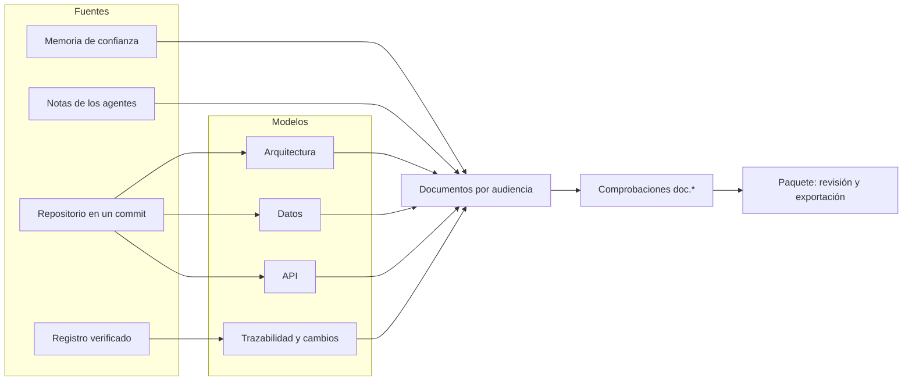

# 19 · Documentación viva del proyecto: propuesta de diseño

> **Estado:** propuesta, pendiente de tus decisiones (§14). Parte de la rama `fase14-integracion` en `8a579fe5` (la Fase 14 y
> la Fase 9 integrándose, sin publicar). Recoge tu petición del 2026-11-12. Su número P de
> [18](18-peticiones-y-pendientes.md) lo pone el lead al anotarla.
>
> **Tu petición, literal:** «Añade a la cola todo un sistema que exporte diagramas, documentación funcional y ejecutiva, todo
> lo que cualquier proyecto serio requiera de documentación, que se construya con los agentes durante su trabajo en el
> proyecto, y cuando le demos a exportar que esté todo bien documentado: diagramas, diccionarios, todo.»
>
> **Qué amplía, sin duplicarlo:**
>
> - la **documentación para clientes** de la Fase 14 ([17 §5.5](17-constructor-visual-de-agentes.md#55-documentación-para-clientes),
>   D-58 a D-60; [ADR-0057](adr/0057-documentacion-para-clientes.md); WP-14D), ya implementada;
> - los **diagramas y la documentación automáticos** de docs/16 ([16 §2.9](16-ampliacion-plataforma-de-proyectos.md#29-diagramas-y-documentación-automáticos-sección-9),
>   D-21 a D-23; criterios F6-10 y F6-11; paquete WP-D de la Fase 6; ADR-0045 reservado), diseñados y sin código;
> - el **trabajo y la trazabilidad** de la Fase 9 (docs/16 §4.6; [ADR-0038](adr/0038-hito-backlog-y-tablero.md),
>   [ADR-0039](adr/0039-vinculos-de-trazabilidad-y-participacion.md); [04 §23](04-contratos.md#23-fase-9-trabajo-y-trazabilidad)).
>
> **Cómo se hizo.** Un arquitecto independiente, a partir de:
>
> - el código de `src/**` en `8a579fe5` (inventario con rutas en la §2);
> - los documentos 04, 08, 16, 17 y 18; los ADR 0022, 0050, 0054 y 0057; y lo que esos documentos recogen de los ADR 0010,
>   0013, 0017, 0018, 0029, 0031, 0038 y 0039;
> - la documentación pública de C4, arc42, Diátaxis, docs-as-code, Keep a Changelog, Mermaid, PlantUML y WebView2 (fuentes al
>   final, consultadas el 2026-11-12).
>
> **Sin cuota.** Ningún CLI de proveedor recibió un prompt. No se leyeron carpetas de los CLIs ni credenciales, no se compiló
> nada y no se tocó código.

## 0. Resumen

Pides que el proyecto salga **documentado de verdad** al exportar: para quien decide, para quien usa el producto y para quien
lo mantiene, con diagramas y diccionarios. Y que eso se construya **mientras los agentes trabajan**, no en un sprint final.

La respuesta tiene tres piezas. Primero, **el sistema genera solo y gratis** todo lo que se puede sacar de hechos: el registro,
el repositorio en un commit y la memoria de confianza. Segundo, **los agentes aportan lo que el código no dice** (para qué
sirve algo, por qué se hizo así, qué significa un campo), como datos anclados a un elemento, marcados y con su vigencia.
Tercero, **un paquete de documentación** junta todo por audiencia, lo comprueba y lo exporta con las reglas de WP-14D.

### 0.1 Las decisiones que vertebran la propuesta

1. **Cinco audiencias y un catálogo cerrado** de documentos: ejecutiva, funcional, técnica, calidad y cambios. Cada documento
   es obligatorio, recomendado u opcional según el tipo de proyecto. Lo que no tiene fuente sale «no consta», nunca relleno
   (§3).
2. **Tres orígenes, siempre a la vista:** «generado por Agent Studio» (determinista), «escrito en el repositorio» (por una
   persona o como cambio revisado) y «redactado por un agente» (con su agente, su modelo, si lo revisaste y si está al día)
   (§4.1).
3. **Lo determinista va primero y no gasta cuota:** arquitectura C4 de contenedores y componentes, modelo de datos y
   diccionario, referencia de API, decisiones, cronología, matriz de trazabilidad, pruebas, cambios y coste. Todo se lee del
   commit y del registro, **sin ejecutar nada del repositorio y sin red** (§4.2 a §4.4).
4. **Los agentes aportan notas de documentación en su informe**, un campo nuevo que solo existe si activas la opción en el
   proyecto. Cada nota va anclada a un elemento real (un fichero, un tipo, una tabla, una operación, un requisito) y se
   valida. Pasa a la memoria como **propuesta** hasta que la revisas, y el juez nunca la ve (§4.5).
5. **El documentador es un agente de la plantilla, no un rol nuevo:** un ejecutor con instrucciones de documentación que el
   orquestador planifica cuando hay trabajo de documentación, o que lanzas con «Actualizar la documentación» (§4.6).
6. **El desfase se detecta sin IA:** cada nota guarda la huella de lo que describe. Si eso cambia, la nota sale «puede estar
   desfasada»; si desaparece, «huérfana». El siguiente ejecutor que toca ese fichero la recibe para ponerla al día (§4.7).
7. **Diagramas en Mermaid, dibujados en tu equipo:** el texto es la fuente. Un motor local (mermaid.js fijado por huella,
   dentro de WebView2 y sin red) los valida y los dibuja. En HTML y en PDF van en SVG; en Word, como imagen PNG. Siempre con
   texto alternativo (§5).
8. **El paquete amplía el modelo de ADR-0057 sin cambiar su huella:** documentos nuevos con bloques nuevos (diagrama,
   definiciones, referencia cruzada, aviso y código), los mismos cuatro escritores y la misma exportación (§6).
9. **Cada exportación es una versión atada a un commit y a la cabeza del registro:** el mismo corte da el mismo paquete. Se
   revisa con la lista de lo que sale y se aprueba, y deja `DocumentationPackExported` sin texto ni rutas (§6).
10. **Las comprobaciones son deterministas y tienen código** (`doc.*`): enlaces rotos, diagramas que no compilan, elementos
    que no existen, requisitos sin documentar, referencias a código que ya no está y documentos obligatorios que faltan
    (§7).
11. **El juez no cambia su veredicto ni su esquema.** Revisa la documentación cuando es parte de un cambio, como ya decía
    docs/16 D-22, y puede apoyarse en el informe de comprobaciones como evidencia del sistema. Una revisión con agente es
    opcional y aparte (§7.3).
12. **Una Fase 16** después de la 6 (necesita Auto Graph) y antes de la 7 y la 15, en paralelo con la 10 si hay manos. Se
    lleva el paquete WP-D de la Fase 6 (diagramas y discrepancias), que es su base (§11, decisión 1).

### 0.2 Hallazgos de paso

Leyendo el código para este diseño salieron siete cosas que conviene saber ya:

- **Los diagramas de docs/16 no tienen código.** D-21 a D-23, F6-10, F6-11, WP-D y ADR-0045 están diseñados, pero no existen
  `src/AgentStudio.Memory/{Diagrams,Consistency}` y ningún fichero de `src` nombra Mermaid (grep en `8a579fe5`). Tampoco hay
  Roslyn en `Directory.Packages.props`: Auto Graph (F6-3) está por hacer.
- **El documento para clientes no lee el consumo.** La adenda de ADR-0057 dice que `IncludesConsumption` es siempre falso
  porque el constructor no lo lee. La audiencia ejecutiva lo necesita (§3.2): este diseño lo amplía.
- **El borrador con un agente sigue sin implementar.** `IClientDocumentDrafter` es un contrato sin servicio
  (`src/AgentStudio.Application/Documents/ClientDocumentContracts.cs:1031`). Este diseño lo usa y no crea otro puerto (D-15).
- **`IMilestoneCloseListener` existe sin oyentes** (`src/AgentStudio.Application/Work/MilestoneContracts.cs:179`). Es el punto
  de enganche del paquete de un hito, como lo era del documento para clientes.
- **Ya hay un canal de texto de agente hacia la memoria:** los `openIssues` del informe pasan a `PendingTask` como cita de un
  agente (`AgentQuote` con `QuotedText.OpenIssues`, `src/AgentStudio.Memory/Derivation/DerivationRules.cs:234-239`). Las notas
  de documentación siguen ese patrón, aunque ADR-0022 (punto 6) rechazó `ReadAndPropose` para la memoria en general.
- **El juez ya no ve los informes de los ejecutores:** `JudgeDossierBuilder` retira sus prompts e informes ([18](18-peticiones-y-pendientes.md)
  P54). Las notas viajan en ese informe, así que no llegan al expediente.
- **`TraceNodeKind.Document`** (`path@commit`, `src/AgentStudio.Domain/Tracing/TraceRef.cs:26-27`) ya existe. Es la base para
  enlazar un documento del repositorio con un requisito y para fechar su vigencia.

### 0.3 Lo que se descarta o se aplaza

| Qué | Por qué |
|---|---|
| Un agente que escribe todo el paquete | No sería determinista ni se podría comprobar contra el registro, y presentaría texto de agente como verdad (docs/16 §2.9, «cambio de perspectiva»). Los agentes escriben partes ancladas y marcadas |
| PlantUML como motor por defecto | Necesita Java 11 en tu equipo (lo dice su web). Un servidor de PlantUML exigiría red. Queda como alternativa en la decisión 2 |
| Structurizr, D2, Graphviz o `mermaid-cli` | Otro runtime (Java, Go o Node con un Chromium descargado) o un binario nativo más. WebView2 ya está en la app |
| Ejecutar el proyecto para sacar su OpenAPI, sus capturas o su `--help` | Sería ejecutar código del repositorio fuera de la verificación aislada (ADR-0017 y ADR-0018). Si lo quieres, va como un paso de tu perfil de verificación, aislado, y su salida es una evidencia (D-08) |
| Diagramas de clases de todo el código (el nivel «código» de C4) | Es ruido y cambia con cada commit. El propio C4 lo trata como opcional. El IDE ya navega el código |
| Publicar en una wiki o en GitHub Pages | Abre la red. Si llega, va con la Fase 10 y su modelo de amenaza |
| Editar lo generado | Regenerar borraría lo editado (docs/16 D-21). Para un documento propio, se copia a un fichero tuyo que el sistema no toca |
| Traducir lo anclado o lo escrito por agentes y personas | ADR-0054, punto 5 (docs/17 D-48). Solo se pinta en tu idioma el texto del sistema |
| Un coste imputado de la suscripción | Es una equivalencia que no existe (docs/16 D-35, ADR-0019) |
| Que el juez valore «está documentado» en su veredicto | Cambia su esquema y mezcla preguntas, como el análisis del consumo (docs/17 D-36, ADR-0029). Queda en la decisión 5 |

---

## 1. Alcance: cada parte de tu petición y dónde va

| Lo que pides | Qué hay hoy | Qué se propone | Dónde |
|---|---|---|---|
| «Todo lo que cualquier proyecto serio requiera» | Un documento para clientes con siete secciones | Un catálogo por audiencia y tipo de proyecto, con lo obligatorio, lo recomendado y lo opcional | §3 |
| Documentación ejecutiva | El resumen del documento para clientes, sin consumo | Resumen, estado e hitos, riesgos, coste y consumo, cronología | §3.2 |
| Documentación funcional | Requisitos con su estado en el documento para clientes | Requisitos, historias o casos de uso, reglas de negocio, flujos y manual de usuario | §3.2 |
| Diagramas | Mermaid escritos a mano en `docs/`; D-21 diseñado | C4 de contexto, contenedores y componentes; datos; secuencias; flujos; hitos; dibujados sin red | §5 |
| Diccionarios | Nada | Diccionario de datos desde migraciones o modelos, glosario y diccionario de la API | §4.4 y §4.3 |
| «Que se construya con los agentes durante su trabajo» | Los agentes no aportan documentación; solo `openIssues` llega a la memoria | Notas de documentación en el informe, ancladas y marcadas; el documentador; el desfase | §4.5 a §4.7 |
| «Cuando le demos a exportar» | «Aprobar y exportar» un documento en cuatro formatos | Un paquete por audiencia, hito o completo, con índice, enlaces, diagramas y versión | §6 |
| «Que esté todo bien documentado» | Nada lo comprueba | Comprobaciones deterministas con código, cifras de cobertura y frescura, y el juez donde toca | §7 |

**Peticiones y pendientes que este documento toca, sin resolverlos enteros:**

| P | Qué toca | Dónde |
|---|---|---|
| P15 (documentación para clientes) | Se queda como está y pasa a ser un documento del paquete | §6.1 |
| P16 (la Fase 9) | El paquete de un hito sale de su cierre; la matriz de trazabilidad, de sus vínculos | §4.2 y §6.2 |
| P23 (pruebas que fallan a integridad baja) | Cerrar un hito es auditarlo: el paquete de un hito hereda ese bloqueo. El de proyecto completo no | §12 |
| P54 (el juez ve la pregunta del orquestador) | Las notas no pasan por ahí: viajan en el informe del ejecutor, que el expediente ya retira | §4.5 |

---

## 2. Inventario: lo que ya existe

Estados, como en docs/14 a 17: **Hecho** (código y pruebas), **Parcial** (con el hueco que se nombra), **Diseñado** (en un
documento, sin código) y **Falta**. Rutas relativas a la raíz, en `8a579fe5`.

**Documentos y exportación**

| Pieza | Dónde | Estado |
|---|---|---|
| El modelo sin idioma del documento para clientes: portada, siete secciones fijas, bloques (párrafo, lista, tabla, referencias a evidencias), `ClientText` con su origen y su marca, y su huella canónica `agent-studio/client-document/1` | `src/AgentStudio.Application/Documents/ClientDocumentContracts.cs:23-413` | Hecho |
| El constructor, los escritores de Markdown y HTML, y el exportador (versión, nunca sobrescribe, Markdown como evidencia, `ClientDocumentExported`) | `src/AgentStudio.Memory/Documents/**` | Hecho |
| El escritor de Word (`DocumentFormat.OpenXml` 3.5.1, determinista) | `src/AgentStudio.Infrastructure/Documents/Docx/WordDocumentWriter.cs` | Hecho |
| El PDF con WebView2 (`IHtmlPdfPrinter`), los textos del sistema en tu idioma (`IUserTextRenderer`) y la pantalla | `src/AgentStudio.Desktop/Documents/**` | Hecho. El PDF no se ha probado sin ventana (adenda de ADR-0057) |
| La limpieza de cada cadena: caracteres ocultos, secretos y rutas de tu equipo | `src/AgentStudio.Memory/Documents/DocumentTextCleaner.cs`; `src/AgentStudio.Application/Security/{LocalPaths.cs, PlainText.cs}` | Hecho |
| El borrador con un agente (`IClientDocumentDrafter`, propósito `ClientDocumentDraft`) | `ClientDocumentContracts.cs:1010-1037` | Falta: contrato sin servicio |
| El consumo en el documento | `ClientDocumentDisclosure.IncludesConsumption` | Falta: siempre falso |
| Diagramas en el modelo | — | Falta: no hay bloque de diagrama |

**Diagramas y discrepancias (docs/16)**

| Pieza | Dónde | Estado |
|---|---|---|
| Diagramas generados de artefactos reales con su versión, Mermaid, «desactualizado» (D-21); documentación como trabajo revisado (D-22); discrepancias deterministas (D-23) | [16 §2.9](16-ampliacion-plataforma-de-proyectos.md#29-diagramas-y-documentación-automáticos-sección-9); F6-10 y F6-11 en [08](08-plan-y-criterios-de-aceptacion.md#fase-6--auto-doctor-y-auto-graph) | Diseñado |
| WP-D de la Fase 6: `Memory/{Diagrams,Consistency}` y la vista `Desktop/Docs`; ADR-0045 reservado | docs/16 §4.3 | Diseñado |
| Auto Graph de C# con Roslyn (F6-3) | docs/08, Fase 6 | Falta |
| Los diagramas Mermaid de `docs/02`, `03`, `05`, `06`, `07` y `08` | `docs/**` | Hecho, a mano |

**Trabajo, trazabilidad y registro (Fase 9, en `fase14-integracion`)**

| Pieza | Dónde | Estado |
|---|---|---|
| Hitos, backlog, tablero y vínculos (`TraceRef` con `Document` = `path@commit`) | `src/AgentStudio.Domain/{Work,Tracing}/**`; `src/AgentStudio.Orchestration/Work/**` | Hecho (WP1) |
| El cierre de un hito y su informe determinista (`MilestoneReport`, `agent-studio/milestone-report/1`) | `src/AgentStudio.Debate/Audit/{MilestoneCloser.cs, MilestoneReport.cs}` | Hecho (WP3) |
| `IMilestoneCloseListener` | `src/AgentStudio.Application/Work/MilestoneContracts.cs:179` | Hecho, sin oyentes |
| La cadena navegable (`ITraceChainReader`) y la participación | docs/04 §23.6 | Parcial: no estaban en WP1 |
| El consumo por hito y por actividad (D-34), la estimación (`IUsageEstimator`) | `src/AgentStudio.Application/Usage/**`; ADR-0040 y ADR-0050 | El estimador, hecho (Fase 13); lo de la Fase 9, según su integración |

**Agentes, memoria y juez**

| Pieza | Dónde | Estado |
|---|---|---|
| El informe del ejecutor: esquema estricto y portátil, sin propiedades opcionales; `question` es obligatoria y anulable | `src/AgentStudio.Orchestration/Engine/ExecutorReport.cs:14-62` | Hecho. Sin campo de documentación |
| El protocolo del ejecutor (reglas, datos delimitados, informe final) | `src/AgentStudio.Orchestration/Engine/ExecutorPrompt.cs:222-366` | Hecho |
| La memoria anclada y de solo añadir, con confianza por origen y revisión (`MemoryRecorded`, `MemoryReviewed`) | ADR-0022; `src/AgentStudio.Application/Knowledge/MemoryContracts.cs` | Hecho |
| La cita de un agente en la memoria (`AgentQuote`) | `src/AgentStudio.Memory/Derivation/DerivationRules.cs:234-239` | Hecho (solo `openIssues`) |
| El índice semántico de lo anclado | ADR-0047 | Hecho (Fase 12) |
| El expediente del juez sin prompts ni informes de ejecutores | `src/AgentStudio.Debate/Judging/JudgeDossierBuilder.cs` | Hecho |
| Las auxiliares de solo lectura en una carpeta vacía, con tu OK y la estimación | `src/AgentStudio.Application/Providers/AuxiliaryAgentRunner.cs`; `QuotaConsentLedger.cs` | Hecho |
| La plantilla por tamaño del configurador (paso 3) | `src/AgentStudio.Application/Setup/SetupProposer.cs:180-214` | Hecho |
| El stack del proyecto por nombres de fichero | `src/AgentStudio.Domain/Skills/ProjectStackDetector.cs` | Hecho. Solo lee nombres, nunca contenido |

**Seguridad**

| Pieza | Dónde | Estado |
|---|---|---|
| La barrera de Windows Hello: exportar documentos no está en la lista | `src/AgentStudio.Domain/Security/PresencePolicy.cs` | Hecho |
| El modelo de amenaza: el contenido del repositorio y la salida de los agentes son adversarios | ADR-0018, punto 1 | Hecho |

**Paquetes:** WebView2 1.0.4258.31 y `DocumentFormat.OpenXml` 3.5.1 ya están. No hay YAML, OpenAPI ni Roslyn
(`Directory.Packages.props`).

---

## 3. Qué documentación necesita un proyecto serio

### 3.1 Cuatro ideas de fuera, y cómo se usan aquí

- **C4** (Simon Brown): la arquitectura se dibuja por niveles de zoom. Contexto (el sistema, quién lo usa y con qué otros
  sistemas habla), contenedores (las aplicaciones y los almacenes de datos que se despliegan), componentes (las piezas de cada
  contenedor) y código. Añade diagramas de despliegue y dinámicos. Aquí: los tres primeros niveles y el despliegue.
- **arc42**: una plantilla de doce apartados para documentar una arquitectura (objetivos, restricciones, contexto,
  estrategia, bloques, ejecución, despliegue, conceptos transversales, decisiones, calidad, riesgos y glosario). Aquí: el
  índice del documento de arquitectura, recortado.
- **Diátaxis** (Daniele Procida): cuatro clases de documentación de uso que no se mezclan. Tutoriales (aprender), guías
  (conseguir algo), referencia (consultar datos) y explicación (entender). Aquí: la estructura del manual de usuario.
- **Docs-as-code** (Write the Docs): la documentación vive en texto plano, en el control de versiones, se revisa como el
  código y tiene comprobaciones automáticas. Aquí: Markdown y Mermaid como fuente, el corte por commit y las comprobaciones.
- **Keep a Changelog**: un registro de cambios para personas, por versión y con fecha, agrupado en añadido, cambiado,
  obsoleto, eliminado, corregido y seguridad. Aquí: el registro de cambios por hito.

### 3.2 El catálogo, por audiencia

**D-01 · Cinco audiencias y un catálogo cerrado.** Cada documento tiene una audiencia y una clase (`DocumentKind`). La lista es
cerrada: un documento nuevo es un cambio de diseño, como una sección nueva del documento para clientes.

Origen: **S**, generado por el sistema; **R**, escrito en el repositorio; **A**, redactado por un agente (marcado).
Obligatoriedad: **Siempre**; **Si hay** (cuando existe la fuente); **Tipo** (según §3.3); **Opcional**.

| Audiencia | Documento | Qué lleva | Origen | Obligatorio |
|---|---|---|---|---|
| Ejecutiva | Resumen ejecutivo | Qué es, qué se hizo, en qué estado está, los tres riesgos principales y el coste, en una página | S (plantilla con cifras); A opcional | Siempre |
| Ejecutiva | Estado e hitos | Hitos abiertos y cerrados, requisitos por columna del tablero, cronología y diagrama de hitos | S | Si hay hitos |
| Ejecutiva | Riesgos y pendientes | Requisitos no satisfechos, `openIssues`, errores conocidos, alertas del auditor, impugnaciones, notas de riesgo | S; A marcado | Siempre |
| Ejecutiva | Coste y consumo | Tokens con su origen, coste a precio de lista solo cuando el CLI lo informa, por hito y actividad, real frente a estimado | S | Opcional. Para un cliente, solo si lo marcas (docs/17 D-58) |
| Funcional | Requisitos y criterios | Cada requisito con su prioridad, sus criterios, su método de verificación y su estado (implementado, revisado, integrado) | S | Siempre |
| Funcional | Historias o casos de uso | Los requisitos escritos como historia («como…, quiero…, para…») se agrupan solos; si no, notas de uso de los agentes | S; A marcado | Opcional |
| Funcional | Reglas de negocio | Cada regla con su requisito y dónde se aplica en el código | A marcado; R | Recomendado |
| Funcional | Flujos | Diagramas de flujo y de secuencia del producto | A marcado (validados) | Recomendado |
| Funcional | Manual de usuario | Primeros pasos, guías, referencia y conceptos (Diátaxis) | R; A marcado | Tipo |
| Técnica | Arquitectura | Objetivos y restricciones, C4 de contexto, contenedores y componentes, conceptos transversales, calidad (arc42 recortado) | S; R; A marcado | Siempre |
| Técnica | Secuencias técnicas | Las secuencias principales entre componentes | A marcado | Opcional |
| Técnica | Modelo de datos y diccionario | Diagrama entidad-relación, tablas, columnas, tipos, nulos, claves, índices y relaciones, con su descripción | S; R (comentarios); A marcado | Si hay esquema |
| Técnica | Referencia de API | Operaciones, parámetros, respuestas y esquemas; o los tipos públicos de una biblioteca | S; R (comentarios) | Tipo |
| Técnica | Decisiones | Los ADR del repositorio, las decisiones de la memoria de confianza y los debates con veredicto | R; S | Siempre (puede decir «no consta») |
| Técnica | Glosario | Los términos del proyecto y los de Agent Studio que salen en el paquete | R (ficha); S; A marcado | Siempre |
| Técnica | Despliegue y operación | Entorno declarado, contenedores, servicios, CI y guías de operación | S (parcial); R; A marcado | Tipo |
| Técnica | Seguridad | Dependencias, cómo se guardan los secretos (solo nombres), modelo de amenaza, autenticación | S (parcial); R; A marcado | Siempre |
| Calidad | Plan de pruebas | El perfil de verificación y los criterios por método | S | Siempre |
| Calidad | Resultados de pruebas | Contadores del TRX capturados por el sistema, por commit, con su orden y su fecha | S | Siempre |
| Calidad | Matriz de trazabilidad | Requisito → tarea → commit → prueba → veredicto → entrega | S | Siempre (con la Fase 9) |
| Calidad | Revisiones y cómo se construyó | Veredictos, auditorías, impugnaciones, los seis papeles de docs/16 D-32 y la secuencia de agentes de una ejecución | S | Siempre en lo interno; opcional para un cliente |
| Cambios | Registro de cambios | Por hito o entrega, con fecha, en las clases de Keep a Changelog | S | Siempre |
| Cambios | Notas de versión | Lo que cambia para quien usa el producto, en lenguaje claro | S (plantilla); A opcional | Opcional |
| Anexos | Evidencias y estado de la documentación | Índice de evidencias con su huella, cifras de cobertura y frescura, comprobaciones y «lo que no va» | S | Siempre |

- **El documento para clientes de hoy** (ADR-0057) entra como un documento más del paquete: «Informe de entrega». No cambia.
- **«Lo que no va»** es la regla de docs/17 D-58: ni prompts, ni transcripciones, ni la bitácora, ni rutas de tu equipo, ni
  tu nombre de usuario.

**D-02 · Nada de relleno.** Un documento obligatorio sin fuente sale con un aviso del sistema: «No consta: este proyecto no
tiene esquema de datos que leer» o «Falta el modelo de amenaza: escríbelo o pide al documentador un borrador». La comprobación
`doc.mandatory-missing` lo cuenta (§7.1). Nunca se rellena con texto genérico.

### 3.3 El tipo de proyecto

**D-03 · El tipo de proyecto decide qué es obligatorio.** Un proyecto puede tener varios tipos. El sistema propone, tú
confirmas en el configurador (D-32) y la elección queda en las opciones del proyecto.

| Tipo | Cómo se propone | Qué añade como obligatorio | Qué deja opcional |
|---|---|---|---|
| Escritorio | `OutputType` `WinExe`, `UseWPF` o `UseWindowsForms` en un `.csproj` | Manual de usuario; instalación y actualización | Referencia de API |
| Servicio o API | `Sdk="Microsoft.NET.Sdk.Web"`; un fichero OpenAPI; en `package.json` o `pyproject.toml`, un framework web conocido | Referencia de API; despliegue y operación; autenticación en seguridad; secuencias de las operaciones principales (recomendado) | Manual de usuario |
| Web | Un framework de interfaz conocido en `package.json` | Manual de usuario; despliegue | Referencia de API |
| Biblioteca | `OutputType` `Library` con `PackageId` o `IsPackable`; `[project]` sin `scripts` | Referencia de la API pública; primeros pasos; registro de cambios con compatibilidad | Manual de usuario |
| Herramienta de línea de órdenes | `bin` en `package.json`; `[project.scripts]` | Referencia de órdenes (de la documentación escrita o de notas, nunca ejecutando la herramienta) | Referencia de API |
| Producto de datos | `dbt_project.yml`, cuadernos, `*.pbip` o `*.tmdl`, carpetas de migraciones SQL | Diccionario de datos; linaje (parcial); operación de las cargas | Manual de usuario |

- **Leer contenido es nuevo.** `ProjectStackDetector` solo lee nombres de fichero. Para proponer el tipo hay que leer unos pocos
  manifiestos pequeños (`.csproj`, `package.json`, `pyproject.toml`), con tope de tamaño y sin ejecutar nada. Es una superficie
  nueva frente a ADR-0018 (§10.3).
- **Sin tipo confirmado**, vale el conjunto común: lo marcado «Siempre» en §3.2.

---

## 4. Cómo se construye durante el trabajo



### 4.1 Tres orígenes, cada uno con su marca

**D-04 · Cada texto y cada diagrama dice de dónde sale.** Se ve en la pantalla y en los cuatro formatos.

| Origen | Qué es | Su marca | Su confianza |
|---|---|---|---|
| Generado por Agent Studio | Hechos del registro verificado, del repositorio en el commit del corte y de la memoria de confianza, sin IA | «Generado por Agent Studio · commit `abc1234`» | La del registro: si no verifica, no se genera nada |
| Escrito en el repositorio | Ficheros de documentación, comentarios de documentación del código, comentarios de SQL, descripciones de un OpenAPI. Los escribió una persona o un agente en un cambio revisado (docs/16 D-22) | «Escrito en el repositorio · `docs/x.md@abc1234`» y, si vino de una ejecución con veredicto aprobado, «revisado por el juez» | La de tu repositorio |
| Redactado por un agente | Notas de documentación (D-09) y borradores al exportar (D-15) | «Redactado por un agente (agente, modelo) · revisado por ti: sí o no», más «puede estar desfasado» o «huérfano» cuando toca | Una propuesta hasta que la revisas |

- **La marca no se puede quitar:** el texto de un agente solo se construye con `ClientText.ByAgent`, como en ADR-0057.
- **Los diagramas de agentes** se dibujan con otro estilo (línea discontinua) y una leyenda, como pedía docs/16 D-21 para lo
  inferido.

### 4.2 Lo que genera el sistema, sin cuota

**D-05 · Generadores deterministas, que leen el commit y el registro y no ejecutan nada.**

- **Leen el commit, no la carpeta de trabajo.** Por la capa git endurecida (`git ls-tree` y `git show <commit>:<ruta>` con la
  revisión de configuración de siempre). Así el resultado no depende de cambios sin guardar, y el corte se puede repetir. Si
  tu carpeta tiene cambios, el paquete lo dice: «hay cambios sin guardar que no salen».
- **Ningún proceso del repositorio, ninguna red.** Ni `dotnet`, ni `npm`, ni `python`, ni MSBuild. Un `$ref` remoto de un
  OpenAPI no se sigue.
- **Cada generador declara su cobertura.** Lo que no sabe interpretar sale listado como «no interpretado», y su documento,
  «parcial».

| Qué | De dónde | Cuándo |
|---|---|---|
| Requisitos, estados, tablero e hitos | El registro: conjuntos congelados, `MilestoneReport`, el tablero (docs/16 D-19 y D-50) | Siempre |
| Matriz de trazabilidad | Los vínculos y la cadena de la Fase 9 (`TraceLinkRecorded`, `ITraceChainReader`) | Con la Fase 9 |
| Pruebas y resultados | El perfil de verificación, los criterios y las evidencias `TestRun` capturadas por el sistema | Siempre |
| Revisiones y cómo se construyó | Veredictos, auditorías, impugnaciones, aprobaciones con `DecidedBy`, participación (docs/16 D-32) | Siempre |
| Cronología | `MilestoneOpened`, `MilestoneClosed`, entregas, veredictos | Siempre |
| Coste y consumo | El proyector de consumo, por hito y actividad (docs/16 D-34), y real frente a estimado (D-20) | Opcional |
| Registro de cambios | Hitos cerrados y entregas; asuntos de commit; las clases de Keep a Changelog cuando los commits siguen una convención conocida (`feat:`, `fix:`); si no, «Cambios» sin clasificar | Siempre |
| Arquitectura | El modelo de arquitectura (D-06) | Siempre |
| Datos | El modelo de datos (D-07) | Si hay esquema |
| API, decisiones, despliegue, dependencias, glosario | D-08 | Según la fuente |
| Riesgos | Lo de hoy en el documento para clientes, más las notas de riesgo | Siempre |

### 4.3 El modelo de arquitectura

**D-06 · Un modelo de arquitectura con origen por elemento, y los diagramas C4 como vistas suyas.** Es la idea de «modelo
como código» de C4: primero los elementos y sus relaciones; los diagramas salen de ahí.

| Nivel C4 | Qué sale del código, sin IA | Qué no sale y de dónde viene |
|---|---|---|
| Contexto | El sistema y las dependencias externas que declaran los manifiestos (paquetes de bases de datos o de clientes HTTP conocidos), marcado «parcial» | Quién lo usa y con qué sistemas habla: la ficha del proyecto (docs/17 D-10), en un apartado «Contexto» con líneas `Actor: descripción` y `Sistema externo: descripción`, y las notas de los agentes |
| Contenedores | Lo que se despliega: proyectos ejecutables (`OutputType`, `Sdk.Web`), servicios de `compose.yaml`, `Dockerfile`, `bin` de `package.json`; los almacenes de datos de compose y de las cadenas de conexión con nombre (solo el nombre) | La tecnología y la descripción de cada uno: notas de los agentes |
| Componentes | Los proyectos y sus referencias, y los espacios de nombres de cada proyecto (Auto Graph, F6-3) para .NET; los paquetes del espacio de trabajo para Node; marcado «parcial» fuera de .NET | Qué hace cada componente: notas `component` |
| Despliegue | Entorno declarado (docs/16 F6-7), compose, CI | Dónde corre en producción: lo escrito en el repositorio o notas `operation` |

- **Cada elemento y cada relación tiene origen:** extraído, declarado en la ficha o propuesto por un agente. Lo propuesto se
  dibuja aparte (D-04).
- **Sin la Fase 6**, el nivel de componentes de .NET se queda en los proyectos y sus referencias (leídos del XML de cada
  `.csproj`), marcado «parcial».

### 4.4 El modelo de datos y el diccionario

**D-07 · El diccionario de datos sale del esquema, y su significado, de comentarios y notas.**

| Fuente | Qué se lee | Cobertura |
|---|---|---|
| Migraciones SQL (SQLite, SQL Server, PostgreSQL) | `CREATE TABLE`, columnas, tipos, `NOT NULL`, `DEFAULT`, claves, `REFERENCES`, `CREATE INDEX`, `CREATE VIEW` y `CREATE TRIGGER` (solo el nombre y la tabla), aplicadas en orden; `ALTER TABLE ADD COLUMN` y `RENAME` | Un subconjunto. Lo demás sale «no interpretado», con su fichero y su línea |
| Instantánea de EF Core (`*ModelSnapshot.cs`) | Entidades, propiedades, tipos, requeridos, claves, índices y relaciones, leídos por sintaxis (Roslyn, sin compilar) | Parcial |
| `schema.prisma` | Modelos, campos, atributos y relaciones | Parcial |
| `*.tmdl` (modelo semántico de Power BI) | Tablas, columnas, medidas (nombre y expresión como texto) y relaciones | Parcial |
| Descripciones | Comentarios `--` junto a una columna o tabla, `HasComment`, comentarios `///` de la propiedad, `description` de TMDL: «escrito en el repositorio» | — |
| Significado que el código no dice | Notas `data` de los agentes, ancladas a una tabla o columna | — |

- **Salida:** un diagrama entidad-relación (Mermaid `erDiagram`), una tabla por entidad y un CSV del diccionario.
- **Agent Studio se prueba a sí mismo:** sus seis migraciones (`src/AgentStudio.Infrastructure/Persistence/Schema/0001…0006`)
  dan su diccionario, que se compara con [05](05-modelo-de-datos.md) (F16-5).

**D-08 · Lo demás que se lee del repositorio.**

- **Referencia de API.** Un OpenAPI 2 o 3 del repositorio (`openapi.json`, `openapi.yaml`, `swagger.json`): operaciones,
  parámetros, respuestas y esquemas, con sus `description`. Para una biblioteca de C#: los tipos y miembros públicos y sus
  comentarios `///`, por sintaxis. Si el OpenAPI solo existe al ejecutar el proyecto, añades a tu perfil de verificación un paso
  que lo escribe. Corre aislado como los demás (ADR-0017) y su salida es una evidencia que el extractor lee.
- **Decisiones.** Los ficheros de `docs/adr/` (o la carpeta que digas): título, estado y fecha, con las convenciones de Nygard y
  MADR; lo demás, «parcial». Más las decisiones de la memoria de confianza y los debates con veredicto.
- **Despliegue y operación.** `Dockerfile` (imagen base y puertos), `compose.yaml` (servicios, puertos y volúmenes), flujos de CI
  (`.github/workflows/*.yml`, `azure-pipelines.yml`: trabajos y disparadores) y el entorno declarado.
- **Dependencias.** Manifiestos y ficheros de bloqueo: nombre y versión. La licencia, solo si el fichero la declara; si no, «no
  consta». Nunca se consulta la red.
- **Glosario.** Un apartado «Glosario» de la ficha (`Término: definición`), las notas `term` y los términos de Agent Studio que
  salen en el paquete (el glosario de ADR-0054, como texto del sistema).
- **Lo que nunca se lee:** `.env` y sus variantes (salvo `.env.example`), certificados y claves (`*.pfx`, `*.key`, `*.pem`),
  `secrets.json` y nada de las carpetas de los CLIs. De una configuración solo se leen los nombres de las claves, nunca sus
  valores.

### 4.5 Las notas de documentación de los agentes

**D-09 · Un campo del informe del ejecutor, solo con la opción del proyecto.**

- **La opción** «Notas de documentación de los agentes» es del proyecto, apagada por defecto, y se ofrece en el configurador
  con su estimación (decisión 3). Se congela en la cabecera de cada ejecución (`RunOptions` y `RunHeaderHash`). Solo se escribe
  cuando está activa, para que el hash de las cabeceras guardadas no cambie (docs/16 §4.2).
- **Sin la opción, nada cambia:** el prompt y el esquema del informe son los de hoy, byte a byte. Así no hay coste, y las
  referencias del estimador siguen siendo comparables.
- **Con la opción,** el esquema gana `documentation`, obligatorio y anulable como `question` (el modo estricto no admite
  opcionales). Un informe guardado antes no lo tiene y se lee como siempre.
- **Por qué un campo propio y no `outputs` con claves `doc.*`:** las salidas van a las condiciones y a los prompts de las tareas
  siguientes como datos, y no tienen reglas. Un campo propio tiene su esquema, sus topes y su validación.
- **El protocolo gana una regla:** «Si tu trabajo explica algo que el código no dice (para qué sirve, por qué se hizo así, qué
  significa un dato), anótalo en `documentation`. Solo sobre lo que has tocado o leído. Si no hay nada, déjalo en null.»

```text
documentation: null | {
  notes: [ { kind, anchor: { type, ref }, title, text, diagram | null, replaces | null } ],   // 5 como mucho
  stillValid: [ id ]                                                                          // 10 como mucho
}
```

**D-10 · Qué puede anotar un agente, y a qué lo ancla.**

| `kind` | Qué es | Anclas que admite | Va a |
|---|---|---|---|
| `component` | Qué hace un componente o un módulo | `path`, `symbol` | Arquitectura |
| `decision` | Por qué se hizo así (candidata a ADR) | `path`, `symbol`, `requirement` | Decisiones |
| `rule` | Una regla de negocio y dónde se aplica | `requirement` y, en el texto, el `symbol` | Reglas de negocio |
| `data` | Qué significa una tabla o una columna | `table`, `column` | Diccionario |
| `endpoint` | Qué hace una operación de la API | `endpoint` | Referencia de API |
| `flow` | Un flujo o una secuencia, con diagrama | `requirement`, `path` | Flujos o secuencias técnicas |
| `usage` | Cómo se usa algo, para el manual | `requirement`, `path` | Manual de usuario |
| `operation` | Cómo se despliega, se opera o se recupera | `path` | Despliegue y operación |
| `term` | Un término y su definición | `term` | Glosario |
| `risk` | Un riesgo o una deuda técnica | `path`, `symbol`, `requirement` | Riesgos |

- **Topes:** título de 80 caracteres, texto de 1 200 (texto plano, saltos de línea y listas con «- », sin enlaces ni formato),
  diagrama de 4 000 (solo en `component`, `flow` y `data`) y 8 000 en total.
- **Reglas (`DocNoteRules.Check`, puras):**
  - el tipo y el ancla son de la lista, y el ancla admite ese tipo;
  - el ancla existe en el commit del intento: la ruta está en el árbol; el tipo, en el índice de símbolos; la tabla o la columna,
    en el modelo de datos; la operación, en el modelo de la API; el requisito, en el conjunto congelado de la ejecución;
  - `replaces` y `stillValid` solo nombran notas que se le enseñaron (D-14);
  - sin caracteres ocultos; los secretos se redactan (se cuentan); una nota que nombra una ruta de tu equipo se descarta entera,
    como un borrador en ADR-0057;
  - el diagrama cumple la política de D-19.
- **Una nota que incumple se descarta con su código** (`doc-note.anchor-missing`, `doc-note.kind-anchor`…) y el informe sigue
  valiendo. Al revés que una pregunta: una nota mala no debe hacer fallar una tarea buena. Lo descartado queda en una evidencia
  del sistema junto al informe, solo con los códigos.
- **Una tarea de solo lectura también puede anotar.** Las notas son datos, nunca ficheros.

**D-11 · Dónde se guardan: memoria `DocNote`, como propuesta.**

- **Una categoría nueva de memoria, `DocNote`**, al final de `MemoryKind`. Se deriva del informe final de una tarea completada,
  con el patrón de los `openIssues` (`AgentQuote`): origen `Agent`, anclada con `MemoryRecorded` y de solo añadir.
- **Su contenido es un JSON canónico** (`agent-studio/doc-note/1`): el tipo, el ancla, la huella del ancla y su commit, el
  título, el texto, el diagrama y su autor (agente, modelo, ejecución, tarea e intento). La huella del ancla queda así dentro
  del SHA-256 anclado.
- **El tema es el ancla** (`doc:<kind>:<type>:<ref>`): una nota nueva sobre el mismo ancla y tipo sustituye a la anterior, que
  queda en la historia.
- **Es una propuesta hasta que la revisas** (ADR-0022, punto 5). La aceptas o la rechazas en «Documentación» o en «Memoria»,
  con `MemoryReviewed`. Aceptada, dice «revisada por ti».
- **Qué ve quién:**
  - aceptada, entra en el paquete de contexto de los agentes con memoria, por relevancia, como cualquier memoria aceptada; la
    propuesta, no;
  - el índice semántico la indexa, así que se encuentra en «Memoria»;
  - no se exporta al Markdown de la memoria (`MemoryKinds.IsExported`, como la bitácora): su exportación es el paquete;
  - **el juez nunca la ve:** ni en su expediente (va en el informe del ejecutor, que se retira) ni como memoria (ADR-0022,
    punto 7).
- **Es una adenda de ADR-0022, no un cambio de su punto 6.** `ReadAndPropose` sigue rechazado para la memoria en general. Este es
  un canal estrecho: una categoría, un campo con esquema, reglas y anclas comprobadas.

### 4.6 El documentador

**D-12 · Un agente de la plantilla, no un rol nuevo.**

- **Es un ejecutor** con instrucciones de documentación (las instrucciones de la plantilla mandan desde la Fase 13, docs/17
  D-42), un modelo ligero o equilibrado y las herramientas de siempre. No hay rol, prompt ni protocolo nuevos.
- **Se ofrece,** no viene por defecto: en el paso «Equipo» del configurador cuando activas la documentación viva, y en «Añadir
  agente» de la capa Equipo. La plantilla por defecto no cambia, ni su hash.
- **Hace dos clases de trabajo:**
  - **escribir documentación del repositorio** (`docs/**`, un manual, una guía de operación): una tarea con alcance de
    escritura, verificada y revisada por el juez como cualquier cambio (docs/16 D-22). Sale «escrito en el repositorio»;
  - **anotar** (solo lectura): repasar un área y devolver notas en su informe. Sale «redactado por un agente».
- **Cuándo actúa:** cuando el orquestador lo planifica (un requisito pide documentación, o el plan lo necesita) o cuando pulsas
  «Actualizar la documentación» (D-14). Nunca se lanza solo.

### 4.7 El desfase

**D-13 · Cada nota guarda la huella de lo que describe, y el desfase se calcula sin IA.**

| Ancla | Su huella |
|---|---|
| `path` | El id del blob de git del fichero en el commit |
| `symbol` | El SHA-256 de la sintaxis normalizada de la declaración (C#, con Roslyn). En otros lenguajes, el blob del fichero |
| `table`, `column` | El SHA-256 de su definición canónica en el modelo de datos |
| `endpoint` | El SHA-256 del objeto canónico de la operación en el OpenAPI |
| `requirement` | El SHA-256 del requisito en el conjunto vigente del hito |
| `term` | Ninguna: no caduca con el código |

- **Tres estados, frente al commit del corte:** «al día» (la misma huella), «puede estar desfasada: lo que describe cambió
  después de `abc1234`» y «huérfana: lo que describe ya no existe».
- **Es la vigencia de docs/16 D-21 llevada a cada nota.** Un documento del repositorio se fecha con su `TraceRef`
  `Document` (`path@commit`).

**D-14 · Cómo se pone al día.**

- **Al trabajar, sin coste extra de lanzamiento.** Con la opción activa, una tarea que va a tocar ficheros con notas recibe esas
  notas como datos (`<doc_note id=… anchor=… state=…>`, recodificadas y delimitadas como el resto de datos de ADR-0013): cuatro
  como mucho y 3 000 caracteres. La regla dice: «Si tu cambio deja una de estas notas desfasada, devuélvela corregida con
  `replaces`. Si sigue siendo cierta, pon su id en `stillValid`». Confirmar renueva su huella con el commit del intento.
- **Cuando lo pides:** «Actualizar la documentación» arma un plan de una tarea de solo lectura del documentador por área
  desfasada, con su estimación. Lo apruebas como cualquier plan (con Windows Hello si la plantilla lo exige). No hay un camino
  nuevo en el motor: es un plan normal.
- **Nada se corrige solo:** una nota nueva sigue siendo una propuesta.

### 4.8 Lo redactado al exportar

**D-15 · Un solo puerto de borradores: `IClientDocumentDrafter`, ampliado.**

- **Se implementa por fin** (hoy es un contrato sin servicio) y gana clases en `ClientDraftKind`: el resumen ejecutivo, las
  notas de versión y la introducción del manual, además del resumen y la explicación de uso de hoy.
- **La petición acepta también un documento del paquete,** no solo el documento para clientes.
- **Las reglas de ADR-0057 no cambian:** una auxiliar de solo lectura en una carpeta vacía, con tu OK en cada uso y la
  estimación delante; recibe solo el modelo determinista, ya limpio; `ClientDraftRules.Check` decide qué se queda; sale
  marcado.
- **Para qué sirve y para qué no:** sirve para narrar hechos (el resumen, las notas de versión). No sirve para explicar el código,
  porque no lo ve: eso es de las notas y del documentador.

---

## 5. Diagramas

### 5.1 La fuente

**D-16 · Mermaid como formato fuente, como ya decidió docs/16 D-21.**

- **Por qué Mermaid:**
  - es texto y se revisa en un diff;
  - GitHub lo pinta en Markdown;
  - los documentos de este repositorio ya lo usan;
  - un solo motor cubre C4, flujo, secuencia, entidad-relación, estados, Gantt y cronología;
  - su licencia es MIT, y su versión 12.3.0 publica un fichero único ya empaquetado (`dist/mermaid.min.js`, 5,54 MB).
- **Por qué no PlantUML:** necesita Java 11 en tu equipo, o un servidor, que es red. Su C4 es más maduro: queda en la decisión 2.
- **Lo que no tiene el C4 de Mermaid,** según su documentación: iconos (sprites), etiquetas, enlaces y leyendas. La leyenda va
  como una tabla junto al diagrama. El spike del P0 decide si las vistas C4 usan la sintaxis C4 de Mermaid o un `flowchart`
  con la notación C4 (tipo, tecnología y descripción en cada caja), según cómo coloque cada una.

### 5.2 Qué diagramas y de dónde

**D-17 · Los diagramas generados salen de un modelo; los de agentes, de una nota.**

| Diagrama | Sintaxis | De dónde |
|---|---|---|
| C4 de contexto, contenedores y componentes | C4 o `flowchart` (spike) | El modelo de arquitectura (D-06) |
| Despliegue | `flowchart` | Compose, `Dockerfile` y el entorno declarado |
| Entidad-relación | `erDiagram` | El modelo de datos (D-07) |
| Plan de una ejecución | `flowchart` | `PlanDefinition` (docs/16 D-21) |
| Secuencia de agentes, orquestador y juez | `sequenceDiagram` | El registro de una ejecución o un debate (docs/16 D-21) |
| Hitos y cronología | `gantt` o `timeline` | Los hitos del registro |
| Matriz de trazabilidad (vista) | `flowchart` | Los vínculos de un requisito |
| Flujos y secuencias del producto | `flowchart`, `sequenceDiagram`, `stateDiagram-v2` | Notas `flow` y `component` de los agentes, validadas (D-19) |

- **Los generadores solo escriben un subconjunto de la gramática** que controlan, probado con ficheros dorados. Por eso un
  diagrama generado compila siempre.

### 5.3 Dibujar sin red

**D-18 · Un motor local de diagramas: mermaid.js fijado por huella, en WebView2, sin red.**

- **Un puerto en Application** (`IDiagramRenderer`): `ValidateAsync(fuente)` (si compila y de qué tipo es),
  `RenderSvgAsync(fuente)` y `RasterizeAsync(svg, escala)`. Lo implementa Desktop, como el PDF (`IHtmlPdfPrinter`).
- **La página es local:** una página propia con `mermaid.min.js` 12.3.0 como recurso incrustado. Su SHA-256 va fijado en el
  código y se comprueba antes de cargarlo. Si no coincide, no se dibuja nada (falla cerrado).
- **Sin red:** un filtro `AddWebResourceRequestedFilter("*", …)` contesta con un error a toda petición que no sea de la página
  local. El documento de Mermaid avisa de que sus ejemplos cargan el script y las fuentes de un CDN: aquí no se carga nada de
  fuera.
- **La configuración, fija:**
  - `startOnLoad: false`;
  - `securityLevel: 'strict'` (codifica el HTML de las etiquetas y apaga los clics);
  - `deterministicIds: true` con `deterministicIDSeed` igual al principio del SHA-256 de la fuente, para que el mismo texto dé
    los mismos ids;
  - `htmlLabels: false`, para que el SVG no lleve `foreignObject` y se pueda pasar a imagen;
  - `maxTextSize` y `maxEdges` como topes;
  - un tema neutro y la fuente de Windows (Segoe UI).
- **Una cola con un solo consumidor:** se dibuja de uno en uno, con un tiempo máximo por diagrama (5 s). Lo que pasa de ahí
  falla con su código.
- **El SVG se sanea en C#** antes de guardarlo: sin `script`, sin `foreignObject`, sin atributos `on*` y sin enlaces externos.
  Si no pasa, no se usa.
- **Una caché de tu equipo** (`%LOCALAPPDATA%\AgentStudio\diagrams\<clave>\`), por huella de la fuente y versión del motor, que se
  puede borrar y se reconstruye.
- **Sin el runtime de WebView2,** cada diagrama sale como su fuente y su texto alternativo, con un aviso. Las comprobaciones de
  C# siguen; la de «compila», no («no se pudo comprobar»).

### 5.4 Validar

**D-19 · Que compile, que sea seguro y que sus elementos existan.**

- **Que compile:** `mermaid.parse` con `suppressErrors` devuelve el tipo o falso, sin dibujar. Necesita el motor de D-18.
- **Que sea seguro** (solo los diagramas de agentes, `DiagramPolicy`, pura):
  - tipos permitidos: `flowchart`, `sequenceDiagram`, `erDiagram`, `stateDiagram-v2` y los de C4;
  - se quitan las directivas de configuración (`%%{init: …}%%` y la cabecera `---` con `config`), `click`, `link`, `links`,
    `href`, las llamadas y cualquier URL. La nota dice que se quitaron;
  - topes: 4 000 caracteres, 60 nodos y 100 relaciones.
- **Que sus elementos existan:** un lector propio del subconjunto (participantes de una secuencia, nodos de un flujo, entidades
  de un entidad-relación, estados) compara cada nombre con el modelo de arquitectura, el modelo de datos, el índice de símbolos
  y los requisitos. Lo que no existe da `doc.diagram-unknown-element`, un aviso, y el diagrama sale con esos elementos
  señalados. Es una comprobación de C#, no de Mermaid.

### 5.5 Exportar

**D-20 · Cada formato lleva el diagrama como mejor lo pinta, y siempre con su texto alternativo.**

| Formato | El diagrama | La fuente |
|---|---|---|
| HTML | SVG dentro de la página, sin JavaScript, con `role="img"`, título y descripción | En un `<details>` plegado |
| PDF | El del HTML, impreso | — |
| Word | PNG a doble resolución, con el texto alternativo en su descripción | En el anexo de diagramas |
| Markdown | Enlace a `diagramas/<id>.svg` | El fichero `diagramas/<id>.mmd` al lado y un bloque plegado con la fuente |

- **El texto alternativo lo genera el sistema** desde el modelo: «Diagrama de contenedores. Cinco contenedores: … La app de
  escritorio usa la base SQLite…». En HTML y Markdown sale también como tabla plegada. Sirve al lector de pantalla y a quien lee
  el documento impreso en blanco y negro.
- **SVG dentro de Word, con un PNG de reserva,** queda sin verificar (§13): el PNG solo es seguro.

---

## 6. El paquete de documentación y su exportación

### 6.1 El modelo

**D-21 · Un modelo de documento nuevo que reutiliza el de ADR-0057, sin cambiar la huella de un documento para clientes.**

- **`ProjectDocument(Kind, Audience, Cover, Sections)`**, sin idioma, con su forma canónica propia
  (`agent-studio/project-document/1`). Las secciones son códigos (`doc.section.architecture.context`…), con un ancla estable.
- **Reutiliza** `ClientText` (sistema, escrito, agente) y los cuatro bloques de hoy. Añade cinco bloques:

| Bloque | Para qué |
|---|---|
| `ClientDiagram` | Un diagrama: su id, su tipo, la huella de su fuente, su título y su texto alternativo, su origen y el resultado de su validación |
| `ClientDefinitions` | Pares término y definición: glosario, diccionario de datos y parámetros de una API |
| `ClientCrossReference` | Un enlace a otro documento o ancla del paquete, con su texto |
| `ClientNotice` | Un aviso del sistema: «no consta», «parcial», «desfasado», «no interpretado» |
| `ClientCode` | Un texto literal de una línea o pocas: una firma, una orden de despliegue. Pasa por la misma limpieza |

- **`ClientAgentMark` gana campos opcionales al final:** la nota de memoria, el agente y su modelo, y la vigencia. Solo entran
  en la forma canónica cuando existen. Una prueba fija que un documento para clientes de hoy da la misma huella y los mismos
  ficheros dorados.
- **`ClientDocument` no cambia:** sus siete secciones y su versión canónica siguen. En el paquete es el documento «Informe de
  entrega». Su consumo (`IncludesConsumption`) se puede activar cuando exista la sección de coste del paquete, que es la que
  sabe leerlo.
- **Los escritores se amplían, no se duplican:** Markdown, HTML, Word y PDF aprenden los bloques nuevos por la lectura común
  (`ClientDocumentReading`). El paquete añade el índice y el manifiesto.

### 6.2 Alcance y corte

**D-22 · Un paquete es de un alcance y de un corte, y el mismo corte da el mismo paquete.**

| Alcance | Su commit | Sus datos |
|---|---|---|
| Proyecto completo | El que elijas; por defecto, la cabeza de tu rama | Todo el registro hasta su cabeza |
| Un hito | El commit integrado de su cierre (docs/16 D-49) | El `MilestoneReport` y lo vinculado al hito |
| Una entrega | El commit de la entrega de una ejecución | Esa ejecución y sus seguimientos |

- **El corte** es el commit, la cabeza del registro verificado (que ya cubre la memoria, porque cada nota se anuncia con
  `MemoryRecorded`) y la versión de los generadores. Con el mismo corte, el mismo modelo y la misma huella. Los borradores que
  aceptas al exportar van en la petición, como en ADR-0057.
- **Con un registro que no verifica no se genera nada** (`DecisionLogIntegrityException`), como la memoria.
- **El paquete de un hito se prepara solo al cerrarlo,** por `IMilestoneCloseListener`: queda listo para revisar, sin exportar.
  Exportar siempre lo decides tú.

### 6.3 Estructura, índice y enlaces

**D-23 · Una carpeta por versión, con un índice y enlaces relativos que se comprueban.**

```text
mi-tienda-documentacion-hito-1-v2/
  index.html                  índice navegable: portada, documentos por audiencia, estado y marcas
  LEEME.md                    el mismo índice en Markdown
  ejecutiva/                  resumen, estado-e-hitos, riesgos, coste
  funcional/                  requisitos, historias, reglas, flujos, manual
  tecnica/                    arquitectura, datos, api, decisiones, glosario, operacion, seguridad
  calidad/                    plan-de-pruebas, resultados, trazabilidad, revisiones
  cambios/                    registro-de-cambios, notas-de-version
  entrega/                    el informe de entrega (el documento para clientes)
  diagramas/                  <id>.mmd, <id>.svg, <id>.png
  datos/                      diccionario.csv, trazabilidad.csv
  manifiesto.json             corte, huellas de cada fichero, orígenes y cuentas
```

- **El índice dice, por documento:** su estado (completo, parcial, «no consta»), la mezcla de orígenes (generado, escrito, de
  agentes), las notas desfasadas y las comprobaciones. Explica cómo leer las marcas.
- **Anclas estables y deterministas:** `#req-r3`, `#tabla-pedidos`, `#col-pedidos-total`, `#adr-0012`, a partir de los ids.
- **Los enlaces se comprueban antes de escribir** (D-27). En Word, marcadores y enlaces internos. En el PDF, los enlaces
  internos quedan sin verificar (§13).
- **Los enlaces externos** solo salen en el texto escrito en el repositorio. En el texto de un agente, una URL es texto.

### 6.4 Formatos

**D-24 · Los cuatro de ADR-0057, más CSV para las tablas grandes.**

- **Markdown:** para guardarlo junto al código (docs-as-code).
- **HTML:** un sitio que se abre sin servidor y sin red: estilos dentro, SVG dentro, sin JavaScript, con estilos de impresión.
- **PDF:** uno por documento o un libro por audiencia con índice, impreso con WebView2 de uno en uno.
- **Word:** uno por documento o uno por audiencia, con tabla de contenido, marcadores y enlaces internos.
- **CSV:** el diccionario de datos y la matriz de trazabilidad, para abrirlos en una hoja de cálculo.
- **Eliges** las audiencias, los formatos, «uno por documento» o «uno por audiencia», y el idioma del texto del sistema (por
  defecto, el de la interfaz).

### 6.5 Revisión y aprobación

**D-25 · «Aprobar y exportar», con las reglas de WP-14D y una lista de lo que sale más larga.**

- **La vista previa** enseña el paquete como saldrá, y **la lista de lo que sale** dice:
  - cuántos secretos se redactaron y qué rutas se quitaron (la lista de rutas es para ti, no se registra);
  - cuántas partes escribieron agentes, cuántas revisaste y cuántas no;
  - cuántas notas desfasadas o huérfanas van;
  - qué diagramas se quedan fuera porque no compilan o no se pudieron dibujar;
  - qué documentos obligatorios faltan;
  - si va el coste y el consumo;
  - qué audiencias y formatos.
- **Bloquea la exportación:** un texto sin redactar (`document.not-redacted`), una ruta de tu equipo o un modelo mal formado, como
  hoy. **Avisa sin bloquear:** lo demás.
- **Escribe** con la escritura atómica de hoy, nunca sobrescribe (`ClientDocumentFiles.WithCollisionSuffix`) y, dentro de la
  carpeta del proyecto, nunca durante una ejecución (`IRunActivity`). El Markdown queda como evidencia.
- **Deja `DocumentationPackExported`** al final, fuera de toda ejecución y en `V = 1`. Lleva la versión, el alcance (y el hito o
  la ejecución), el commit, la cabeza del registro, el idioma, las audiencias y los formatos, la evidencia del manifiesto y su
  huella, el número de ficheros y de bytes, las cuentas de la lista (secretos, rutas, partes de agentes revisadas y sin revisar,
  notas desfasadas, diagramas fuera, comprobaciones por gravedad) y quién lo aprobó. **No lleva texto ni rutas.** Los ficheros
  y sus huellas van en el manifiesto, que es una evidencia.
- **Sin Windows Hello,** como el documento para clientes: no cambia tu repositorio ni concede nada a los agentes
  (`PresencePolicy`). Si un día se publica fuera (una wiki, con la Fase 10), pasará a `RemoteOrSecretOperation`.

**D-26 · En el repositorio, solo si lo pides.**

- **Lo generado vive en una caché de tu equipo** que se reconstruye (D-18). Al repositorio solo va lo que exportas allí.
- **Exportar al repositorio** (docs-as-code) escribe el Markdown y los diagramas en la carpeta que elijas (por defecto
  `docs/generado/`), con la cabecera de docs/16 D-21: «Generado por Agent Studio · describe `abc1234` · no lo edites: se
  regenera». Versionarlo es tu elección (decisión 8).
- **Nunca se lee de vuelta:** el lector de documentos del repositorio salta los ficheros con esa cabecera y esa carpeta. Así un
  paquete no se cita a sí mismo como «escrito en el repositorio».

---

## 7. Calidad y verificación

### 7.1 Comprobaciones deterministas

**D-27 · Comprobaciones con código, de la familia del auditor (ADR-0031): sin IA, con hallazgos y gravedad.** Amplían las
discrepancias de docs/16 D-23. Corren al construir el paquete, en la pantalla «Documentación» y, con la documentación viva
activa, al final de cada ejecución sobre lo que cambió.

| Código | Qué detecta | Gravedad |
|---|---|---|
| `doc.link-broken` | Un enlace a un documento, un ancla o una ruta que no existe en el commit | Error en el paquete; aviso en el repositorio |
| `doc.code-reference-missing` | Un documento del repositorio o una nota nombra una ruta, un tipo, una tabla o una operación que ya no existe | Aviso |
| `doc.adr-cites-missing` | Un ADR cita un fichero o un tipo borrado (docs/16 D-23) | Aviso |
| `doc.diagram-invalid` | Un diagrama no compila: queda fuera del paquete | Error de ese diagrama |
| `doc.diagram-unknown-element` | Un diagrama nombra un elemento que no está en ningún modelo | Aviso |
| `doc.diagram-directive-removed` | Se quitó una directiva, un clic o una URL de un diagrama de agente | Información |
| `doc.diagram-stale` | Un diagrama generado describe otro commit (docs/16 D-21) | Aviso |
| `doc.requirement-undocumented` | Un requisito del hito no tiene nada funcional más allá de su fila (ni historia, ni regla, ni flujo, ni guía) | Aviso |
| `doc.component-undescribed`, `doc.table-undescribed`, `doc.column-undescribed`, `doc.endpoint-undescribed` | Un elemento sin descripción escrita ni nota | Información (cuenta para la cobertura) |
| `doc.note-stale`, `doc.note-orphan` | D-13 | Aviso |
| `doc.mandatory-missing` | Falta un documento obligatorio para el tipo de proyecto | Aviso |
| `doc.contradicts-model` | Una nota contradice un hecho del modelo: dice «opcional» de una columna `NOT NULL`, o nombra un método HTTP que la operación no tiene | Aviso |
| `doc.unparsed-source` | Un fichero que un extractor no supo interpretar | Información |
| `doc.readability-low` | Un texto del sistema en castellano por debajo de INFLESZ 55 (docs/17 D-53) | Aviso, solo para el texto del sistema |

- **Cada hallazgo dice qué hacer:** abrir el fichero, aceptar o rechazar la nota, pedir al documentador o regenerar.
- **«Contradicción con el código» solo es lo que se puede comprobar:** un hecho del modelo frente a lo que dice un texto. Lo que
  no se puede comprobar así es de la revisión con agente (D-29).

### 7.2 Cifras que se miden

**D-28 · La calidad de la documentación son cifras deterministas, con su fórmula.** Salen en el anexo «Estado de la
documentación» y en la pantalla.

| Cifra | Fórmula |
|---|---|
| Cobertura funcional | Requisitos con algo funcional ÷ requisitos del alcance |
| Cobertura técnica, por clase | Componentes, tablas, columnas y operaciones con descripción escrita o nota ÷ total de cada clase |
| Frescura | Notas al día ÷ notas incluidas |
| Revisión | Partes de agentes revisadas por ti ÷ partes de agentes incluidas |
| Diagramas | Diagramas que compilan ÷ diagramas; y cuántos con elementos sin respaldo |
| Enlaces | Enlaces rotos (0 para exportar sin errores) |
| Obligatorios | Documentos obligatorios presentes ÷ obligatorios según el tipo |

- **No hay metas fijas por defecto.** Si quieres, pones umbrales por proyecto y la pantalla avisa al bajar de ellos.

### 7.3 El juez

**D-29 · El juez no cambia: revisa la documentación cuando es parte de un cambio, y puede apoyarse en el informe de
comprobaciones.**

- **Su veredicto y su esquema no cambian** (ADR-0029). Mezclar «está documentado» en el veredicto le daría una pregunta que no
  es la suya, como pasaba con el consumo (docs/17 D-36).
- **La documentación del repositorio que entra en un diff** la revisa como cualquier cambio (docs/16 D-22), frente a los
  requisitos que la piden.
- **El informe de comprobaciones como evidencia del sistema.** Con la documentación viva activa, al final de una ejecución el
  sistema registra un informe `doc.*` del commit final, restringido a lo que cambió, como evidencia capturada por el sistema.
  El juez lo recibe como recibe un `TestRun`. Así, un requisito como «la API pública está documentada» se juzga con hechos.
- **Las notas de los agentes nunca le llegan** (D-11).
- **La revisión con agente es opcional y aparte:** una auxiliar de solo lectura (propósito `DocumentationReview`), del vendor
  que no produjo el trabajo, con tu OK y la estimación. Recibe los hechos de los modelos y los textos de agentes como datos.
  Devuelve hallazgos tipados (contradicción, poco claro, posiblemente desfasado) sobre ids que existen. Salen como «lo dice el
  revisor» y no bloquean nada.

---

## 8. Coste y cuota

**D-30 · Lo determinista no gasta nada.** Generar, comprobar, dibujar y exportar no lanza ningún agente. Una prueba cuenta los
lanzamientos y exige cero (F16-13). Cuesta tiempo de tu equipo, que se mide (F16-15).

**D-31 · Lo que gasta es opcional, va con estimación y se cuenta con su propósito.** Sigue el estimador de ADR-0050, el coste de
cada opción sin inventar nada (docs/17 D-32) y el OK por uso de las auxiliares (docs/17 D-35).

| Qué | Gasta | Cuándo | Cómo se pide | Cómo se cuenta |
|---|---|---|---|---|
| Las notas en el informe | Salida de cada tarea, y la regla y el esquema en la entrada | Con la opción del proyecto | El ajuste, con su estimación en el configurador | En el intento del ejecutor |
| Las notas desfasadas en el prompt | Entrada (tope de 3 000 caracteres) | Cuando la tarea toca ficheros con notas | Con la opción | Ídem |
| El documentador | Tareas normales | Si el orquestador lo planifica o pides «Actualizar la documentación» | La aprobación del plan, con su estimación | Actividad «documentación» si su diff solo toca documentación (docs/16 D-34) |
| Los borradores al exportar | Una auxiliar por borrador | Si los pides | Tu OK por uso, con la estimación | `ClientDocumentDraft` |
| La revisión con agente | Una auxiliar | Si la pides | Tu OK por uso, con la estimación | `DocumentationReview` (nuevo) |

- **La estimación del plan incluye las notas.** El estimador separa los intentos con notas de los que no las tienen. Con menos de
  tres referencias con notas, el sobrecoste es «desconocido», y el supuesto del diseño (unas centenas de tokens de salida por
  tarea) sale como supuesto, nunca como medida.
- **Los presupuestos del proyecto y del hito** (F9-8) y las esperas por cuota (ADR-0034) valen igual.

---

## 9. La pantalla «Documentación»

**D-32 · Una pantalla nueva, que nace con los cimientos de la Fase 13.**

- **«Documentación»** en la barra de actividad. Arriba, el alcance (proyecto, hito o entrega) y el commit.
- **A la izquierda,** los documentos por audiencia, cada uno con su estado (completo, parcial, «no consta») y sus avisos.
- **En el centro,** la vista previa (HTML en WebView2, como la del documento para clientes).
- **Abajo, tres pestañas:**
  - «Comprobaciones», con cada hallazgo y su acción;
  - «Notas de los agentes», con las propuestas para aceptar o rechazar, su ancla, su autor y su vigencia;
  - «Cifras», con las de D-28.
- **Botones con verbo y objeto:** «Generar la documentación» (gratis), «Actualizar la documentación…» (con agentes, con la
  estimación), «Revisar con un agente…» y «Exportar el paquete…».
- **El documento para clientes** se convierte en un modo de esta pantalla («Entrega a un cliente»), con su código de siempre.
- **El configurador gana un paso, «Documentación»,** antes del resumen: el tipo de proyecto, las audiencias por defecto, las
  notas de los agentes (con la estimación), el documentador y la carpeta del repositorio. «Aplicar» lo guarda por las puertas
  de siempre y `ProjectSetupApplied` lleva su hash (docs/17 D-27).
- **Nace con recursos de idioma, la guía de textos y un ⓘ en cada apartado** (docs/17 D-47, D-52 y D-54), y entra en el
  inventario automático (docs/17 D-62).

---

## 10. Contratos, registro y seguridad

Todo respeta [ADR-0002](adr/0002-capas-y-puertos.md): el dominio no depende de nada, los módulos solo de Application y Desktop
compone. No hay proyectos nuevos.

### 10.1 Contratos

| Capa | Qué se añade o cambia |
|---|---|
| Application, `Documentation/` (nuevo) | `DocumentationContracts.cs` (el paquete, `DocumentKind`, `DocumentAudience`, `ProjectType`, el alcance, el corte, el manifiesto y `IDocumentationPackBuilder`); `DocNoteContracts.cs` (la nota, `DocNoteKind`, `DocAnchor`, `DocNoteRules`, los topes, la vigencia); `DiagramContracts.cs` (`IDiagramRenderer`, `DiagramPolicy`, el lector de elementos); `ArchitectureModelContracts.cs`, `DataModelContracts.cs` y `ApiModelContracts.cs` (los modelos con origen por elemento y `IDocumentationExtractor`); `DocumentationCheckContracts.cs` (los códigos `doc.*` y las cifras); `IDocumentationPackExporter` |
| Application, `Documents/ClientDocumentContracts.cs` | Los cinco bloques nuevos; los campos opcionales de `ClientAgentMark`; las clases nuevas de `ClientDraftKind`; la petición de borrador que acepta un documento del paquete |
| Application, `Knowledge/MemoryContracts.cs` | `DocNote` al final de `MemoryKind`; no se exporta al Markdown de la memoria |
| Application, `Setup/SetupContracts.cs` | El paso «Documentación» al final de `SetupStep` |
| Application, `Orchestration` | La opción `DocumentationNotes` en las opciones de la ejecución y en `RunHeaderHash`, solo cuando está activa |
| Orchestration, `Engine/ExecutorReport.cs` | El campo `documentation` y el esquema con la opción |
| Domain | `Evidence/EvidenceRecord.cs`: `DocumentationReport` al final de `EvidenceKind` (el informe `doc.*` como evidencia del sistema) |

Los contratos se escriben en una sección nueva de [04](04-contratos.md), la 24.

### 10.2 Registro

Las reglas de docs/16 §4.2: los tipos nuevos van al final y empiezan en `V = 1`; los payloads anteriores se leen y se
reescriben byte a byte; una opción nueva solo se escribe cuando no es la de por defecto.

| Qué | Cambio |
|---|---|
| `DecisionKind` | `DocumentationPackExported`, detrás de los últimos que haya cuando empiece la fase (los de la Fase 9 y, si va antes, la 10) |
| `MemoryKind` | `DocNote` |
| `EvidenceKind` | `DocumentationReport` |
| `AgentRunPurpose` | `DocumentationReview` (los borradores siguen con `ClientDocumentDraft`) |
| La cabecera de la ejecución | `DocumentationNotes`, solo si está activa |
| `ProjectSetupApplied` | El hash de los ajustes de documentación, solo si los hay |
| `ExecutorReport` | `documentation`, solo con la opción; un informe guardado sin él se lee como siempre |

- **Ningún payload lleva texto de un documento, de una nota ni de un agente, ni una ruta de tu equipo.** Las notas se anclan con
  `MemoryRecorded`, que lleva su SHA-256 y no su texto (ADR-0022, punto 2).
- **Los ficheros dorados** de registros se amplían con cada payload nuevo.

### 10.3 Seguridad frente a ADR-0018

| Superficie nueva | Adversario del punto 1 | Mitigación | Residual |
|---|---|---|---|
| Los extractores leen contenido del repositorio (manifiestos, migraciones, OpenAPI, ADR, YAML) | El contenido del repositorio: un esquema enorme, un YAML con anclas que se multiplican, un `$ref` remoto | Leen del commit con topes de tamaño, profundidad y tiempo; nunca ejecutan ni siguen referencias remotas; una lista cerrada de ficheros; nunca `.env`, claves ni certificados; todo pasa por la limpieza | Un texto engañoso del propio repositorio: sale como «escrito en el repositorio», no como del sistema |
| Las notas de los agentes | La salida de los agentes | Esquema, topes, anclas comprobadas, limpieza; memoria como propuesta; marcadas siempre; el juez no las ve; aceptadas, van como datos delimitados | Que una nota aceptada te engañe: la marca dice quién la escribió, no que sea cierta |
| Las notas en el prompt de otra tarea | Ídem | Datos recodificados y delimitados, con la regla de que no son instrucciones (ADR-0013) | El de la memoria de hoy |
| Un diagrama de agente en el motor (JavaScript en WebView2) | Ídem | `securityLevel: 'strict'`, directivas y URL quitadas, sin red por el filtro, página local, script con huella fijada, SVG saneado en C# | Un fallo de Mermaid o de WebView2 que salte el modo estricto: el SVG saneado sigue siendo la barrera de lo que se guarda |
| `mermaid.min.js` | La cadena de suministro | Versión y SHA-256 fijados en el código; licencia MIT; actualizarlo es un cambio revisado | Que la versión publicada ya estuviera mal |
| El paquete exportado | La fuga de datos | Las reglas de WP-14D sobre cada texto, también etiquetas de diagramas, bloques de código y CSV; la lista de lo que sale; tu aprobación; el payload sin texto | Lo que decides incluir |
| Lo generado dentro del repositorio | Un bucle: el paquete leído como fuente | Cabecera y carpeta excluidas del lector | — |

---

## 11. Encaje en el plan: la Fase 16

### 11.1 Dónde va y por qué

**D-33 · Una Fase 16 después de la 6 y antes de la 7 y la 15, en paralelo con la 10 si hay manos (decisión 1).**

```mermaid
gantt
    title Orden propuesto (decisión 1, opción a; sin fechas comprometidas)
    dateFormat X
    axisFormat %s
    section Hecho o en curso
    Fases 12 y 13 :done, a, 0, 1
    Fase 14 con la Fase 9 :active, f14, 1, 2
    section Propuesto
    F6 Auto Doctor y Auto Graph :f6, after f14, 3
    F16 Documentación viva :f16, after f6, 4
    F10 Git remoto :f10, after f6, 4
    F7 Seguridad, pruebas y empaquetado :f7, after f16, 4
    F15 Comprobación completa :f15, after f7, 3
```



| Depende de | Por qué |
|---|---|
| Fase 14 (WP-14D) | El modelo, los escritores, el PDF y la exportación que se amplían |
| Fase 9 | Hitos, cierre e informe, vínculos y consumo por hito |
| Fase 6 (F6-3) | El índice de símbolos y los componentes de .NET con Roslyn. Sin ella, la arquitectura de .NET se queda en proyectos y referencias |

- **Antes de la 7,** porque su prueba de extremo a extremo y su vista de permisos cubren todo lo anterior.
- **Antes de la 15,** porque F15-2 recorre el inventario de todas las pantallas. Una fase con pantallas nuevas después de la 15
  rompería ese criterio.
- **En paralelo con la 10:** son otros módulos (la 10 es Git remoto), como la 6 y la 9 en docs/16.
- **Se lleva WP-D de la Fase 6** (diagramas y discrepancias, F6-10, F6-11 y ADR-0045), que es su base. La Fase 6 se queda con
  Auto Doctor, Auto Graph y el entorno. Si prefieres no moverlo, la 16 construye encima (decisión 1 (b)).
- **Los números son nombres, no el orden,** como en docs/16 y docs/17.

### 11.2 Reglas comunes

Las de [17 §9.1](17-constructor-visual-de-agentes.md#91-reglas-comunes): P0 en serie y fusionado antes de abrir los paquetes;
paquetes en paralelo en worktrees, sin ningún fichero en común; integra el lead. Dueños únicos: el P0
(`Directory.Packages.props`, `AgentStudio.slnx`, los `*.csproj`, los enums y los contratos compartidos) y el lead en la
integración (`Composition/**`, `MainViewModel.cs`, `MainWindow.xaml(.cs)`, `App.xaml(.cs)`, `docs/08`, `docs/README.md` y la
bitácora). «Hecho» exige `dotnet build AgentStudio.slnx` con 0 avisos, `dotnet test` en verde sin `ProviderLive`, los ADR y
documentos del paquete, y nada simulado en la interfaz.

### 11.3 Criterios de aceptación

**Objetivo.** Que el paquete de documentación de un proyecto salga completo para su tipo, comprobado, con cada parte marcada por
su origen y al día con el código, y que los agentes lo alimenten mientras trabajan solo si lo activas.

| ID | Criterio de aceptación | Cómo se verifica |
|---|---|---|
| F16-1 | El catálogo de §3.2 por tipo de proyecto (§3.3): lo obligatorio sin fuente sale «no consta» con su motivo, nunca relleno | Pruebas con un repositorio de ejemplo por tipo (escritorio, API, biblioteca, línea de órdenes y datos) |
| F16-2 | El mismo corte (commit, cabeza del registro y versión de los generadores) da el mismo modelo y la misma huella; Markdown y HTML iguales byte a byte; Word normalizado como en WP-14D | Ficheros dorados en dos culturas; dos construcciones seguidas |
| F16-3 | Nada se ejecuta del repositorio y no hay red: los extractores leen el commit por la capa git endurecida; el motor de diagramas rechaza toda petición que no sea local | Una prueba con un `Directory.Build.props`, un `package.json` con scripts y un `conftest.py` plantados comprueba que no arranca ningún proceso; una prueba del motor con una fuente que pide una URL |
| F16-4 | Arquitectura: contenedores y componentes desde los manifiestos y Auto Graph; el contexto desde la ficha; lo parcial y lo propuesto, marcados | Pruebas sobre la propia solución y repositorios de ejemplo |
| F16-5 | Diccionario de datos desde migraciones SQL (SQLite, SQL Server, PostgreSQL), instantánea de EF Core, Prisma y TMDL; lo no interpretado se lista con fichero y línea | Pruebas por fuente, y las seis migraciones de Agent Studio comparadas con [05](05-modelo-de-datos.md) |
| F16-6 | API (OpenAPI y tipos públicos de C#), decisiones, despliegue, dependencias y glosario, sin leer nunca `.env`, claves ni certificados ni valores de configuración | Pruebas, y una que siembra un secreto en un `.env` y en un `appsettings.json` y lo busca en el paquete |
| F16-7 | Con la opción, el informe admite `documentation` con sus topes; lo que incumple se descarta con su código sin invalidar el informe; lo válido pasa a memoria `DocNote` como propuesta, anclada y con la huella de su ancla. Sin la opción, el prompt y el esquema son los de hoy | Pruebas del lector del informe, de `DocNoteRules`, de la derivación; el hash del prompt sin la opción no cambia |
| F16-8 | El desfase (al día, desfasada, huérfana) frente al commit del corte; la tarea que toca un fichero con notas las recibe con su tope; `replaces` y `stillValid` actualizan y confirman | Pruebas con repositorios temporales y un ejecutor guionizado |
| F16-9 | Los diagramas generados compilan y tienen texto alternativo; los de agentes pasan la política (directivas, clics y URL fuera; topes) y la comprobación de elementos; el SVG se sanea | Ficheros dorados de las fuentes; fuentes maliciosas; pruebas del motor con el runtime de WebView2 (se omiten sin él) y la medición del spike |
| F16-10 | Cada texto y cada diagrama sale con su origen en los cuatro formatos; el texto de un agente no se puede construir sin marca; un documento para clientes de hoy da la misma huella y los mismos dorados | Pruebas de los escritores; los dorados de WP-14D sin cambios |
| F16-11 | Las comprobaciones `doc.*` de D-27 y las cifras de D-28 | Un repositorio preparado con un fallo de cada clase |
| F16-12 | El paquete: carpetas, índice, enlaces relativos que funcionan, manifiesto con el corte, lista de lo que sale, aprobación, `DocumentationPackExported` sin texto ni rutas; nunca sobrescribe; dentro del proyecto, nunca durante una ejecución; lo generado en el repositorio no se lee de vuelta | Pruebas del exportador, una de fuga (secreto sembrado y rutas de tu equipo) y una demostración |
| F16-13 | Lo determinista lanza cero agentes; cada uso con agente pide OK con la estimación y cuenta con su propósito; la estimación del plan incluye las notas o dice «desconocida» | Pruebas con un proveedor guionizado que cuenta lanzamientos |
| F16-14 | El juez: su esquema no cambia; las notas no llegan a su expediente; el informe `doc.*` sí, como evidencia del sistema | Pruebas del expediente con una ejecución con notas |
| F16-15 | Construir el paquete de este repositorio sin dibujar tarda menos de 10 s, y dibujar un diagrama de 50 nodos, menos de 1 s (percentil 95), en tu equipo. Son objetivos del diseño: el spike los confirma o los corrige | Medición guardada como evidencia, fuera del CI |
| F16-16 | La pantalla y el paso del configurador, con recursos, guía, ⓘ y accesibles; cada diagrama con texto alternativo | El inventario automático (docs/17 D-62) y pruebas de ViewModel |
| F6-10 y F6-11 | Los de [08](08-plan-y-criterios-de-aceptacion.md#fase-6--auto-doctor-y-auto-graph), sin cambios, si la decisión 1 es (a) | Lo que dice 08 |

### 11.4 Paquetes de trabajo

**P0 · Contratos, payloads y spike del motor (M; camino crítico).**

- `src/AgentStudio.Application/Documentation/**` (nuevo), con los contratos de §10.1.
- `src/AgentStudio.Application/Documents/ClientDocumentContracts.cs` (bloques, marca y borradores),
  `…/Knowledge/MemoryContracts.cs` (`DocNote`), `…/Setup/SetupContracts.cs` (el paso), `…/Decisions/{DecisionPayloads.cs,
  DocumentationPayloads.cs}` (el segundo, nuevo), la opción de la ejecución y `RunHeaderHash`.
- `src/AgentStudio.Domain/Decisions/DecisionLog.cs` y `src/AgentStudio.Domain/Evidence/EvidenceRecord.cs` (solo los enums).
- `src/AgentStudio.Orchestration/Engine/ExecutorReport.cs` (el campo y su esquema).
- `Directory.Packages.props`: la librería de YAML y la de OpenAPI de la decisión 9, tras comprobar versión, licencia y avisos;
  Roslyn, si la Fase 6 no lo trajo. `mermaid.min.js` 12.3.0 como recurso incrustado de Desktop, con su licencia en los avisos
  de terceros y su SHA-256 en el código.
- **El spike** (`spikes/mermaid-webview2/` y `docs/investigacion/2026-11-xx-spike-diagramas.md`): Mermaid sin red en un
  WebView2 oculto; `parse`, `render` con `deterministicIds` y `htmlLabels: false` en cada tipo de diagrama; la sintaxis C4
  frente a `flowchart`; el PNG; la carga de 5,54 MB; los tiempos; si el SVG es igual en dos dibujos seguidos.
- Pruebas: `tests/AgentStudio.Tests/Application/Documentation/**`, `Phase16PayloadTests`, `DecisionKindCompatibilityTests` y los
  dorados de WP-14D sin cambios.
- Documentos: [04](04-contratos.md) §24, ADR-0058 y, con la decisión 1 (a), ADR-0045.

**WP-16A · Documentos, paquete, escritores y exportación (L).** `src/AgentStudio.Memory/Documentation/{Pack,Documents,Export}/**`
(nuevos: el constructor de cada documento desde los modelos, el registro y la memoria; el índice; el manifiesto; el
exportador), `src/AgentStudio.Memory/Documents/{MarkdownDocumentWriter.cs, HtmlDocumentWriter.cs}` y
`src/AgentStudio.Infrastructure/Documents/Docx/**` (los bloques nuevos), y `src/AgentStudio.Desktop/Documents/PdfDocumentWriter.cs`
(el libro por audiencia). Pruebas en `tests/AgentStudio.Tests/Memory/Documentation/{Pack,Documents,Export}/**` con dorados.

**WP-16B · Diagramas (M-L).** `src/AgentStudio.Memory/Documentation/Diagrams/**` (los generadores Mermaid desde los modelos, el
texto alternativo, `DiagramPolicy` y el lector de elementos) y `src/AgentStudio.Desktop/Documentation/Diagrams/**` (el motor:
la página local, el filtro de red, la cola, validar, dibujar, rasterizar, sanear y la caché). Es lo que era WP-D de la Fase 6,
ampliado. Pruebas en `tests/AgentStudio.Tests/{Memory,Desktop}/Documentation/Diagrams/**`.

**WP-16C · Extractores (L).** `src/AgentStudio.Infrastructure/Documentation/Extractors/**` (nuevos): lectura del commit por la
capa git endurecida; tipo de proyecto; arquitectura (manifiestos y el puerto de Auto Graph); DDL de SQL; EF Core por sintaxis;
Prisma; TMDL; OpenAPI; tipos públicos de C#; ADR; despliegue y CI; dependencias; glosario de la ficha. Pruebas en
`tests/AgentStudio.Tests/Infrastructure/Documentation/Extractors/**` con repositorios de ejemplo y la de «ningún proceso
arranca».

**WP-16D · Notas de los agentes y desfase (M-L).** `src/AgentStudio.Orchestration/Engine/{ExecutorPrompt.cs, Workers.cs}` (la
regla, las notas desfasadas en el prompt, la comprobación y la evidencia de lo descartado),
`src/AgentStudio.Memory/Derivation/{DerivationRules.cs, DerivationTexts.cs}` (la derivación a `DocNote`) y
`src/AgentStudio.Memory/Documentation/Notes/**` (anclas, huellas y vigencia). Pruebas en
`tests/AgentStudio.Tests/{Orchestration/Engine,Memory/Derivation,Memory/Documentation/Notes}/**`. ADR-0059.

**WP-16E · Comprobaciones, borradores y revisión (M).** `src/AgentStudio.Memory/Documentation/Checks/**` (los códigos `doc.*`,
las cifras y el informe como evidencia), `src/AgentStudio.Application/Documents/DocumentDrafter.cs` (nuevo: el servicio de
`IClientDocumentDrafter`) y `src/AgentStudio.Application/Documentation/DocumentationReviewService.cs` (nuevo), los dos sobre
`AuxiliaryAgentRunner`. Pruebas con un agente guionizado. ADR-0060.

**WP-16F · Escritorio y configurador (L).** `src/AgentStudio.Desktop/Documentation/**` (salvo `Diagrams/`, de WP-16B),
`…/Views/Documentation/**`, `…/Resources/DocumentationStrings*.resx`, `src/AgentStudio.Desktop/Setup/**` y
`src/AgentStudio.Application/Setup/{SetupProposer.cs, ProjectSetupService.cs}` (el paso «Documentación» y el documentador en el
paso «Equipo»), y `src/AgentStudio.Desktop/Orchestrator/Team/TeamEditorViewModel.cs` («Añadir agente → Documentador»). Pruebas de
ViewModel y renders.

**Integración (el lead).** La composición (`Composition/DocumentationServices.cs`), «Documentación» en la barra de actividad, el
oyente de `IMilestoneCloseListener`, el modo «Entrega a un cliente», las pruebas de `tests/AgentStudio.Tests/Integration/Phase16/**`
(un hito con dos ejecuciones con notas, una que deja una nota desfasada y la siguiente que la corrige, y el paquete exportado) y
la demostración con tu OK: el paquete de Agent Studio sobre sí mismo.

| Paquete | Depende de | Tamaño |
|---|---|---|
| P0 | Fases 14, 9 y 6 en `main` | M |
| WP-16A | P0 | L |
| WP-16B | P0 (y el spike) | M-L |
| WP-16C | P0 | L |
| WP-16D | P0 | M-L |
| WP-16E | P0 | M |
| WP-16F | P0 | L |
| Integración | Todos | M |

La fase entera es XL. Los tamaños son estimaciones del diseño.

### 11.5 ADR a escribir

Números provisionales: 0041 a 0046 los reservó docs/16 para las Fases 6 a 11, y el último escrito es el 0057. Si otra tanda toma
alguno, estos se corren.

| ADR | Tema | Paquete |
|---|---|---|
| 0045 (reservado por docs/16) | Diagramas generados de artefactos reales con su versión y su vigencia: Mermaid como fuente, el motor local con huella fijada y sin red, la validación y la exportación. Solo con la decisión 1 (a); si no, lo escribe WP-D de la Fase 6 | P0 y WP-16B |
| 0058 | El paquete de documentación: el catálogo por audiencia y tipo, el modelo `ProjectDocument` que amplía ADR-0057 sin cambiar su huella, el corte, la estructura, los formatos y `DocumentationPackExported` | P0 y WP-16A |
| 0059 | Las notas de documentación de los agentes: el campo con la opción, las anclas con huella, la memoria `DocNote` como propuesta (adenda de ADR-0022), el desfase, el documentador y lo que ve el juez | P0 y WP-16D |
| 0060 | Los extractores y las comprobaciones: leer el commit sin ejecutar nada, los modelos con su cobertura, los códigos `doc.*`, las cifras y el informe como evidencia del sistema | WP-16C y WP-16E |

---

## 12. Riesgos

| Riesgo | Mitigación |
|---|---|
| El alcance es enorme | Lo determinista da valor sin agentes y va primero; los paquetes son independientes; los descartes están escritos (§0.3) |
| Mermaid en un WebView2 oculto no va, va lento o no repite el SVG | El spike del P0 decide antes; sin motor, fuente y texto alternativo; caché; la huella que manda es la de la fuente |
| El SVG cambia de un equipo a otro (fuentes y medidas) | Se fija la fuente de Windows y la versión del motor; lo que se prueba con dorados es la fuente y el texto alternativo; residual, como el PDF de ADR-0057 |
| Las notas de los agentes son ruido o se inventan cosas | Anclas comprobadas, topes, propuestas hasta tu revisión, marcas, desfase y la comprobación `doc.contradicts-model` |
| Las notas encarecen cada tarea | Opcional por proyecto, apagada por defecto, con estimación y topes |
| Un extractor se atraganta con un fichero hostil | Topes de tamaño, profundidad y tiempo; nada se ejecuta; lo que no se entiende se lista |
| Se filtra algo en el paquete | La limpieza de WP-14D sobre cada texto, también diagramas, código y CSV; la lista; tu aprobación; payload sin texto |
| El paquete se lee a sí mismo como fuente | Cabecera y carpeta excluidas (D-26) |
| Demasiados avisos | Tres gravedades, agrupados por documento, con su acción y en lenguaje claro |
| Sin la Fase 6, la arquitectura de .NET se queda corta | Proyectos y referencias del XML, marcados «parcial»; por eso la 16 va después de la 6 |
| El documento para clientes cambia sin querer | Sus dorados y su huella, fijados por prueba (F16-10) |
| El paquete de un hito no sale en este repositorio | Cerrar un hito es auditarlo, y hoy no aprueba por P23 (las pruebas que fallan a integridad baja). El paquete de proyecto completo no lo necesita |
| El documentador gasta sin que lo notes | Nunca se lanza solo; es un plan con su estimación y tu aprobación |

---

## 13. Sin verificar

- **Mermaid 12.3.0 en WebView2 1.0.4258.31, sin red:** que carguen los 5,54 MB desde un recurso; `parse` y `render` en todos los
  tipos; que `deterministicIds` dé el mismo SVG en dos dibujos seguidos; `htmlLabels: false` en C4 y en `erDiagram`; los
  tiempos.
- **La sintaxis C4 de Mermaid** frente a un `flowchart` con notación C4: cómo coloca cada una los elementos.
- **El PNG:** `CapturePreviewAsync` captura lo que se ve, así que hay que ajustar la página al SVG y a los puntos por pulgada.
  La alternativa es dibujar el SVG en un `canvas` (posible sin `foreignObject`).
- **El PDF desde una ventana oculta** (ya era un residual de ADR-0057) y si sus enlaces internos funcionan.
- **SVG dentro de Word** con un PNG de reserva, con el Open XML SDK 3.5.1.
- **Las librerías de la decisión 9:** versión, licencia, avisos y si su lector de OpenAPI sigue referencias externas por
  defecto.
- **Roslyn:** la versión que traiga la Fase 6, y cuánto cubre leer una instantánea de EF Core solo por sintaxis.
- **TMDL:** que su formato sea estable entre versiones de Power BI Desktop.
- **El coste de las notas:** tokens por tarea con la opción. Es una estimación del diseño, no una medida.
- **Los tiempos de F16-15:** son objetivos del diseño.
- **INFLESZ** para textos cortos (ya estaba sin verificar en docs/17).
- **Los dos diagramas Mermaid de este documento** (§4 y §11.1) no se han dibujado ni validado con un motor: aquí no lo había.

---

## 14. Decisiones que necesitan a la persona

Nueve decisiones, todas de las que cambian el alcance, el coste o el riesgo. La recomendada va primero, marcada.

1. **Dónde va en el plan** (D-33).
   - **(a) Recomendada:** una Fase 16 después de la 6 y antes de la 7 y la 15, en paralelo con la 10 si hay manos. Se lleva WP-D
     de la Fase 6 (diagramas y discrepancias, F6-10, F6-11 y ADR-0045), que la Fase 6 deja de tener.
   - (b) Igual, pero WP-D se queda en la Fase 6 y la 16 construye encima. Dos dueños para los diagramas.
   - (c) Dentro de la Fase 6, que pasa a XL y retrasa Auto Doctor.
   - (d) Al final, después de la 15. Rompe F15-2 (el inventario de todas las pantallas) y pide un recorrido propio.
2. **El formato de los diagramas** (D-16 a D-18).
   - **(a) Recomendada:** Mermaid, con mermaid.js fijado por huella dentro de WebView2 y sin red. Ya lo eligió docs/16 D-21.
   - (b) PlantUML: su C4 es más maduro, pero necesita Java 11 en tu equipo (o un servidor, que es red).
   - (c) Mermaid solo como texto, sin dibujar en la app: GitHub lo pinta, pero el PDF y el Word quedarían sin diagramas.
3. **Las notas de documentación de los agentes** (D-09 a D-11).
   - **(a) Recomendada:** una opción por proyecto, apagada por defecto, que el configurador ofrece con su estimación.
   - (b) Encendida por defecto en los proyectos nuevos.
   - (c) Sin notas: solo lo determinista, el documentador y los borradores.
4. **El documentador** (D-12).
   - **(a) Recomendada:** un ejecutor con instrucciones de documentación que se ofrece en la plantilla, más «Actualizar la
     documentación» como un plan normal con tu OK.
   - (b) Un rol nuevo en el dominio, con su propio prompt y su protocolo.
   - (c) Sin documentador.
5. **El juez y la documentación** (D-29).
   - **(a) Recomendada:** como hoy, revisa la documentación que entra en un cambio. Además recibe el informe `doc.*` como
     evidencia del sistema. La revisión con un agente del otro vendor es opcional y aparte.
   - (b) Un criterio «documentado» por requisito dentro del veredicto. Cambia su esquema (ADR-0029).
   - (c) Ni informe ni revisión: el juez como hoy.
6. **Las audiencias por defecto al exportar** (D-01 y D-24).
   - **(a) Recomendada:** para ti, todas; para un cliente, la ejecutiva, la funcional, la calidad resumida y los cambios. Lo
     técnico, si lo marcas.
   - (b) Siempre todas.
   - (c) Ninguna marcada: eliges cada vez.
7. **Las notas sin revisar al exportar** (D-04 y D-25).
   - **(a) Recomendada:** en lo que es para ti, salen marcadas «sin revisar»; para un cliente, solo las que revisaste.
   - (b) Solo las revisadas, siempre.
   - (c) Todas, marcadas, siempre.
8. **Dónde vive lo generado** (D-26).
   - **(a) Recomendada:** en una caché de tu equipo, y fuera del repositorio donde elijas al exportar. En el repositorio
     (`docs/generado/`), solo si lo pides, con la cabecera «generado».
   - (b) Siempre en el repositorio, versionado con el código (docs-as-code puro). Cada exportación cambia tu árbol.
   - (c) Nunca en el repositorio.
9. **Las librerías para leer YAML y OpenAPI** (D-08).
   - **(a) Recomendada:** una de YAML con licencia MIT (YamlDotNet) y el lector oficial de OpenAPI de Microsoft
     (`Microsoft.OpenApi`, MIT), fijadas en el P0 tras comprobar versión, licencia y avisos, con las referencias externas
     apagadas.
   - (b) Solo la de YAML, y un lector propio de OpenAPI: una dependencia menos, más código propio.
   - (c) Ninguna: solo OpenAPI en JSON. Compose, flujos de CI y OpenAPI en YAML saldrían «no interpretados».

---

## Fuentes

Consultadas el 2026-11-12.

**Locales (sin cuota ni sesión):** el código de `src/**` en `8a579fe5` (rama `fase14-integracion`); los documentos 04, 08, 16,
17 y 18; los ADR 0022, 0050, 0054 y 0057, leídos enteros o en su decisión.

**Prácticas de documentación:**

- C4 (Simon Brown; el sitio, con licencia CC BY 4.0): <https://c4model.com/>
- arc42, los doce apartados (CC BY-SA 4.0): <https://arc42.org/overview>
- Diátaxis: <https://diataxis.fr/> y <https://diataxis.fr/start-here/>; su autor, Daniele Procida: <https://diataxis.fr/colophon/>
- Docs-as-code (Write the Docs): <https://www.writethedocs.org/guide/docs-as-code/>
- Keep a Changelog 1.1.0: <https://keepachangelog.com/en/1.1.0/>

**Diagramas:**

- Mermaid, diagramas C4 (cinco tipos; sin iconos, etiquetas, enlaces ni leyendas): <https://mermaid.js.org/syntax/c4.html>
- Mermaid, uso (`render`, `parse` con `suppressErrors`, `securityLevel`, ejemplos con CDN): <https://mermaid.js.org/config/usage.html>
- Mermaid, configuración (`deterministicIds`, `deterministicIDSeed`, `htmlLabels`, `maxTextSize`, `maxEdges`): <https://mermaid.js.org/config/schema-docs/config.html>
- Mermaid en npm (12.3.0, MIT, `shasum` `e860165e0a19778ebef98038c0436bbee6783ba9`): <https://registry.npmjs.org/mermaid/latest>
- Los ficheros de `dist` de Mermaid 12.3.0 (`mermaid.min.js`, 5,54 MB): <https://app.unpkg.com/mermaid@12.3.0/files/dist>
- PlantUML necesita Java 11 (Graphviz incluido en Windows): <https://plantuml.com/starting>

**WebView2:**

- `CoreWebView2.CapturePreviewAsync`: <https://learn.microsoft.com/dotnet/api/microsoft.web.webview2.core.corewebview2.capturepreviewasync>
- `CoreWebView2.AddWebResourceRequestedFilter`: <https://learn.microsoft.com/dotnet/api/microsoft.web.webview2.core.corewebview2.addwebresourcerequestedfilter>
- `CoreWebView2.PrintToPdfAsync` (ya citado en docs/17): <https://learn.microsoft.com/dotnet/api/microsoft.web.webview2.core.corewebview2.printtopdfasync>
