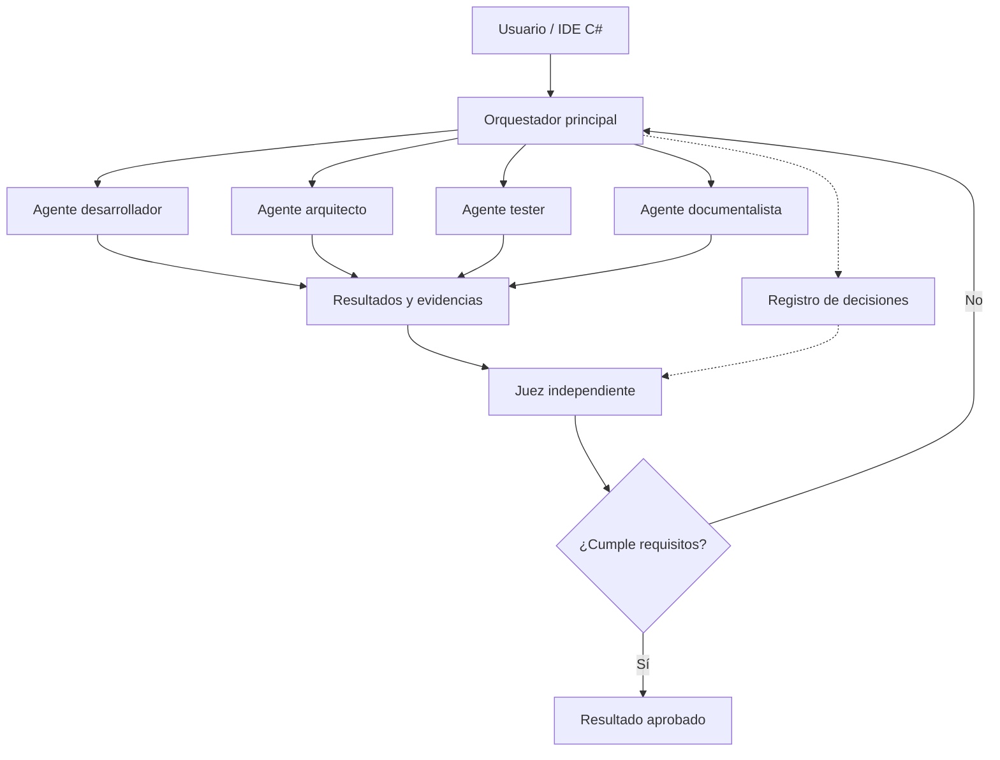

# Agent Studio — Prompt maestro de desarrollo

> Especificación funcional original del proyecto, tal como la entregó el usuario el 2026-10-15.
> Referencias visuales en esta misma carpeta:
> - `dashboard-oscuro-referencia.png`: dashboard oscuro de referencia (árbol de agentes, panel de chat, dependencias).
> - `flujo-nucleo-mermaid.png`: render del diagrama del núcleo (sección 1).
>
> Este documento no se edita: los cambios de alcance se registran como ADR en `docs/adr/`.

---

Plantearía el proyecto como un IDE de escritorio profesional, desarrollado principalmente en C# y .NET, especializado en orquestación multiagente, desarrollo de software, supervisión cruzada y auditoría de decisiones mediante IA.

La nueva funcionalidad que propones es especialmente interesante: no limitarse a que varios agentes colaboren, sino permitir que discrepen, se contradigan, aporten pruebas y sometan sus decisiones a un agente juez independiente, incluso de otro proveedor.

Y añadiría algo más: que el juez pueda auditar al propio orquestador. Es decir, comprobar si está siguiendo las instrucciones, omitiendo pruebas, ignorando requisitos o declarando terminadas tareas que realmente no lo están.

## 1. Diseño conceptual

Referencia visual del estilo de interfaz: paneles oscuros, agentes conectados, editor y métricas.

El núcleo del sistema sería el siguiente:

El juez no debería limitarse a dar una opinión. Tendría acceso a los requisitos originales, cambios de código, resultados de pruebas y decisiones del orquestador, y podría emitir un veredicto verificable.

## 2. Sistema de debate entre agentes

**Sala de debate — Revisión de arquitectura** · *En deliberación*

| Rol | Proveedor |
|---|---|
| Arquitecto | Claude |
| Crítico | Codex |
| Juez | Gemini |

- **Arquitecto — Propuesta:** Utilizar una arquitectura modular con procesos aislados para cada agente.
- **Crítico — Objeción:** Falta especificar cómo evitar escrituras simultáneas sobre los mismos archivos.
- **Juez — Resolución:** Propuesta incompleta. Exigir Git worktrees y una política de integración antes de aprobar.

*Ejemplo ficticio de una deliberación auditable.*

El debate debería poder configurarse con un número máximo de rondas, criterios de evaluación, evidencias obligatorias y un mecanismo para declarar desacuerdo no resuelto. El juez tampoco debe ser infalible: sus decisiones deben poder ser cuestionadas y escaladas al usuario.

## 3. Prompt maestro listo para utilizar

Este prompt está pensado para introducirlo en Claude Code o Codex como instrucción inicial de un repositorio nuevo. Define la arquitectura, el diseño, los módulos, los límites y la metodología de construcción.

---

# AGENT STUDIO — MASTER DEVELOPMENT PROMPT

*IDE de escritorio multiagente con supervisión adversarial, auditoría y control de contexto*

### 1. Rol y misión

Actúa como un equipo de ingeniería de software compuesto por arquitecto principal .NET, desarrollador senior C#, especialista en interfaces de escritorio, ingeniero de sistemas de agentes IA, especialista en seguridad y responsable de calidad.

Tu misión es diseñar e implementar Agent Studio, una aplicación de escritorio para Windows, basada principalmente en C# y .NET, que funcione como un entorno integrado de desarrollo y orquestación de agentes de inteligencia artificial.

No queremos construir simplemente un chat con varios modelos. Queremos un IDE capaz de desarrollar proyectos reales, coordinar agentes especializados, controlar sus tareas, auditar decisiones, ejecutar pruebas, mantener memoria persistente y permitir debates entre modelos de distintos proveedores.

La aplicación debe ser modular, extensible, mantenible y preparada para evolucionar hacia un producto profesional.

Referencias visuales: utilizar como inspiración las dos imágenes facilitadas: el boceto manuscrito original y el dashboard oscuro de Agent Studio. Respetar su distribución funcional y mejorar la experiencia de usuario.

### 2. Principios fundamentales

- C# será el lenguaje principal de la aplicación.
- Utilizar .NET moderno en una versión estable y soportada.
- Priorizar Windows como plataforma inicial.
- Utilizar WPF con MVVM y componentes adecuados, salvo justificación técnica documentada de una alternativa superior.
- El editor de código podrá integrar Monaco mediante WebView2.
- La terminal deberá ejecutar procesos reales del sistema.
- Separar estrictamente interfaz, dominio, persistencia, orquestación e integraciones.
- No introducir dependencias comerciales innecesarias.
- Priorizar funcionamiento local y privacidad.
- Permitir extensiones futuras sin reescribir el núcleo.
- Implementar pruebas automatizadas desde las primeras fases.
- Nunca declarar una funcionalidad completa sin demostrarla mediante pruebas o evidencias.
- No simular funcionalidades que deberían ser reales.
- Documentar decisiones de arquitectura y sus alternativas.

### 3. Autenticación y proveedores IA

La aplicación debe permitir trabajar prioritariamente mediante suscripciones existentes, cuando los proveedores y sus herramientas oficiales lo permitan.

Diseñar una arquitectura de adaptadores para:

- Claude Code CLI.
- OpenAI Codex CLI.
- Gemini CLI.
- Futuras herramientas compatibles.
- API directa como alternativa opcional, nunca como requisito general.

Cada adaptador deberá:

- Detectar la instalación de su herramienta.
- Verificar autenticación mediante mecanismos oficiales.
- Detectar capacidades y versiones.
- Ejecutar tareas.
- Recibir respuestas y eventos.
- Gestionar cancelaciones.
- Registrar errores.
- Gestionar límites de concurrencia.
- Informar de las métricas que realmente estén disponibles.

No utilizar cookies extraídas, tokens de sesión interceptados, endpoints privados ni mecanismos destinados a eludir restricciones de proveedores.

No asumir que las suscripciones ofrecen cuotas ilimitadas o que permiten cualquier modalidad de integración.

### 4. Interfaz principal

Construir una interfaz oscura, profesional y personalizable, inspirada en VS Code y en las referencias visuales proporcionadas.

Distribución principal:

**Barra superior**
- Selector de proyecto.
- Selector de proveedor y modelo.
- Estado de autenticación.
- Estado de agentes.
- Acceso a configuración global.

**Barra lateral izquierda**
- Explorador de archivos.
- Git.
- Agentes.
- Auto Doctor.
- Auto Graph.
- Pruebas.
- Herramientas.
- Historial y memoria.

**Zona central superior**
- Editor de código.
- Orquestador visual.
- Grafo de dependencias.
- Gestión de agentes.
- Sala de debate.
- Monitor de tareas.

**Zona central inferior**
- Terminal integrada.
- Salida de procesos.
- Errores.
- Depuración.
- Resultados de pruebas.

**Panel derecho**
- Chat con el orquestador.
- Estado de tareas.
- Salud del contexto.
- Consumo por modelo.
- Actividad de agentes.
- Alertas del juez.

Permitir redimensionar, ocultar y reorganizar paneles, así como guardar diseños por proyecto.

### 5. Editor y terminal

Implementar un editor de código real con:

- Resaltado de sintaxis.
- Pestañas.
- Búsqueda y sustitución.
- Autocompletado cuando esté disponible.
- Diferencias entre versiones.
- Visualización de cambios propuestos por agentes.
- Navegación entre archivos.
- Integración Git.
- Soporte inicial para C#, Python, SQL, JSON, YAML y Markdown.

Integrar terminales independientes y persistentes para ejecutar PowerShell, CMD y otras shells disponibles.

Los procesos deben poder detenerse, supervisarse y registrar su código de salida.

### 6. Orquestador multiagente

Implementar un motor de orquestación visual que permita crear flujos de trabajo mediante nodos conectados.

Cada nodo podrá representar:

- Un agente.
- Una tarea.
- Una condición.
- Una herramienta.
- Una revisión.
- Un debate.
- Una aprobación humana.
- Una operación de integración.

Cada agente tendrá configuración independiente:

- Identificador.
- Nombre.
- Rol.
- Proveedor.
- Modelo o herramienta.
- Instrucciones de sistema.
- Objetivos.
- Herramientas autorizadas.
- Permisos sobre archivos.
- Presupuesto de ejecución.
- Tiempo máximo.
- Límite de rondas.
- Dependencias.
- Política de memoria.
- Política de revisión.

El orquestador debe admitir tareas secuenciales, paralelas, condicionales y dependientes.

Debe gestionar estados como pendiente, ejecutando, bloqueado, esperando aprobación, completado, fallido y cancelado.

Incluir detección de ciclos, bloqueos, tareas abandonadas y reintentos excesivos.

### 7. Sistema de debate y deliberación

Implementar un módulo llamado Debate Arena.

Su objetivo es permitir que dos o más agentes discutan una decisión técnica y que un juez independiente evalúe los argumentos y las evidencias.

Modos requeridos:

- **Debate libre.** Varios agentes proponen soluciones y contrastan alternativas.
- **Debate adversarial.** Un agente defiende una solución y otro intenta identificar errores, contradicciones, riesgos y requisitos incumplidos.
- **Revisión de arquitectura.** Los agentes comparan diseños considerando mantenibilidad, seguridad, rendimiento, coste y complejidad.
- **Auditoría de implementación.** Un agente cuestiona si el código entregado realmente satisface los requisitos.
- **Revisión del orquestador.** Un agente independiente analiza si el orquestador ha seguido las instrucciones originales y ha ejecutado las comprobaciones obligatorias.
- **Tribunal multiagente.** Varios agentes emiten evaluaciones independientes y un juez sintetiza las conclusiones.

La configuración deberá permitir seleccionar participantes de proveedores distintos.

**Protocolo de debate**

1. Definir una cuestión concreta.
2. Establecer criterios de aceptación.
3. Congelar los requisitos relevantes.
4. Recoger propuestas independientes.
5. Registrar argumentos y evidencias.
6. Permitir objeciones y réplicas.
7. Ejecutar pruebas cuando sea posible.
8. Solicitar evaluación del juez.
9. Emitir resolución fundamentada.
10. Aprobar, solicitar correcciones o escalar al usuario.

El juez deberá emitir una resolución estructurada que contenga:

- Decisión.
- Requisitos satisfechos.
- Requisitos incumplidos.
- Evidencias examinadas.
- Objeciones pendientes.
- Riesgos identificados.
- Nivel de confianza justificado.
- Acciones correctivas.
- Necesidad de intervención humana.

Evitar debates infinitos mediante límites de rondas, tiempo y consumo.

No permitir que una mayoría de agentes sustituya las pruebas técnicas.

Un desacuerdo legítimo podrá finalizar como no resuelto.

### 8. Agente juez independiente

Implementar un rol especializado denominado Independent Judge.

Debe poder asignarse a un proveedor diferente del utilizado por el orquestador y los agentes ejecutores.

El juez debe disponer de acceso de solo lectura a:

- Solicitud original del usuario.
- Requisitos y criterios de aceptación.
- Plan del orquestador.
- Registro de decisiones.
- Tareas asignadas.
- Cambios de código.
- Resultados de pruebas.
- Errores.
- Documentación generada.
- Evidencias de finalización.

Debe detectar:

- Requisitos ignorados.
- Tareas omitidas.
- Resultados inventados.
- Pruebas no ejecutadas.
- Decisiones contradictorias.
- Modificaciones fuera de alcance.
- Errores de integración.
- Problemas de seguridad.
- Finalizaciones prematuras.
- Incumplimiento de instrucciones.

El juez podrá bloquear la aprobación del resultado cuando encuentre incumplimientos verificables.

No podrá modificar código directamente sin una autorización explícita.

Sus veredictos deberán quedar registrados y ser revisables por el usuario.

### 9. Supervisión del propio orquestador

El orquestador no debe ser considerado una autoridad infalible.

Implementar un registro de decisiones estructurado y un auditor externo que compruebe:

- Si las tareas se asignaron correctamente.
- Si se respetaron las dependencias.
- Si los agentes recibieron instrucciones completas.
- Si se omitieron revisiones obligatorias.
- Si se respetaron los permisos.
- Si se solicitaron las aprobaciones necesarias.
- Si los resultados se integraron correctamente.

El auditor podrá generar una alerta y solicitar una nueva planificación.

Nunca permitir que una decisión del orquestador borre o altere evidencias anteriores sin trazabilidad.

### 10. Salud del contexto

Crear un módulo de observabilidad que registre, cuando sea técnicamente posible:

- Tokens de entrada.
- Tokens de salida.
- Tokens acumulados.
- Límite de contexto del modelo.
- Uso aproximado del contexto.
- Compresiones realizadas.
- Resúmenes generados.
- Información recuperada desde memoria.
- Posibles pérdidas de información relevante.

Distinguir siempre métricas exactas, estimaciones y datos no disponibles.

Permitir umbrales configurables de advertencia y compresión.

La optimización del contexto debe conservar requisitos críticos, decisiones arquitectónicas y tareas pendientes.

No presentar como medición exacta la comprensión real del modelo.

### 11. Consumo de suscripciones

Crear un panel por proveedor, modelo, sesión, proyecto y periodo.

Mostrar únicamente información verificable:

- Número de ejecuciones.
- Duración.
- Tokens cuando estén disponibles.
- Errores por límites.
- Cuotas expuestas oficialmente.
- Estimaciones claramente identificadas.
- Costes de API cuando corresponda.

No inventar porcentajes de consumo de suscripciones.

Admitir exportación a CSV y JSON.

### 12. Auto Doctor

Implementar un sistema de diagnóstico capaz de verificar:

- Instalaciones CLI.
- Versiones.
- Autenticación.
- Dependencias.
- Configuración del proyecto.
- Herramientas externas.
- Permisos.
- Errores frecuentes.
- Disponibilidad de runtimes.
- Configuración Git.

Las correcciones automáticas deberán ser reversibles o requerir aprobación cuando puedan afectar al sistema.

### 13. Auto Graph

Generar automáticamente una representación visual de:

- Estructura de proyecto.
- Dependencias entre módulos.
- Relaciones entre archivos.
- Flujos de ejecución.
- Tareas.
- Agentes.
- Herramientas.
- Decisiones.

Distinguir dependencias detectadas mediante análisis estático de relaciones inferidas por IA.

Permitir navegar desde un nodo hasta el archivo o tarea correspondiente.

### 14. Memoria persistente

Crear una memoria por proyecto que incluya:

- Arquitectura.
- Convenciones.
- Decisiones.
- Errores conocidos.
- Soluciones.
- Tareas pendientes.
- Cambios realizados.
- Historial de debates.
- Veredictos.
- Resúmenes diarios.

Utilizar SQLite para persistencia estructurada y Markdown para documentación legible.

Mantener un registro cronológico y otro temático.

Permitir recuperar información selectivamente para evitar saturar el contexto.

### 15. Seguridad y aislamiento

Los agentes no deben tener acceso ilimitado al sistema por defecto.

Implementar:

- Permisos por herramienta.
- Restricciones de directorios.
- Confirmación de acciones destructivas.
- Gestión segura de credenciales.
- Separación de entornos.
- Git worktrees para tareas paralelas cuando proceda.
- Control de conflictos.
- Auditoría de operaciones.
- Política de acceso a red.
- Protección frente a instrucciones maliciosas contenidas en archivos y respuestas externas.

No almacenar contraseñas ni credenciales en texto plano.

Las operaciones críticas deberán exigir autorización humana.

### 16. Especialización Azure y Microsoft Fabric

Diseñar un paquete opcional de herramientas para:

- Microsoft Fabric.
- Notebooks PySpark.
- Lakehouses.
- Pipelines.
- SQL.
- Power BI.
- Azure Storage.
- Git y CI/CD.

Permitir agentes especializados en revisión de pipelines, optimización Spark, calidad de datos, validación SQL y documentación de arquitecturas.

Las integraciones Azure deberán usar mecanismos de autenticación oficiales y permisos mínimos.

### 17. Arquitectura técnica

Proponer una solución .NET modular, con proyectos separados para:

- AgentStudio.Desktop
- AgentStudio.Application
- AgentStudio.Domain
- AgentStudio.Infrastructure
- AgentStudio.Orchestration
- AgentStudio.Providers
- AgentStudio.Observability
- AgentStudio.Memory
- AgentStudio.Debate
- AgentStudio.Security
- AgentStudio.Tests

Justificar las dependencias entre proyectos.

Usar interfaces para desacoplar proveedores, almacenamiento, ejecución y herramientas.

Implementar cancelación, logging estructurado, recuperación de errores y pruebas de integración.

### 18. Plan de desarrollo

Dividir la implementación en fases:

- **Fase 0 — Arquitectura y prototipo.** Analizar requisitos, definir contratos, riesgos, dependencias y diseño visual.
- **Fase 1 — IDE mínimo.** Ventana principal, explorador, editor, terminal y gestión de proyectos.
- **Fase 2 — Proveedores.** Integración inicial de herramientas CLI oficiales.
- **Fase 3 — Orquestación.** Agentes, tareas, dependencias, ejecución y monitorización.
- **Fase 4 — Observabilidad y memoria.** Métricas, contexto, persistencia y documentación.
- **Fase 5 — Debate Arena.** Debates, juez independiente, revisión adversarial y auditoría del orquestador.
- **Fase 6 — Auto Doctor y Auto Graph.** Diagnósticos y representación de dependencias.
- **Fase 7 — Seguridad, pruebas y distribución.** Aislamiento, pruebas de extremo a extremo, empaquetado y actualizaciones.

Cada fase deberá producir software ejecutable, documentación y pruebas.

### 19. Instrucciones de ejecución inicial

No intentes implementar todo el producto de una sola vez.

Primero entrega:

1. Análisis de viabilidad técnica.
2. Identificación de riesgos y limitaciones.
3. Arquitectura recomendada y alternativas.
4. Diagramas Mermaid.
5. Diseño de pantallas y navegación.
6. Estructura de solución .NET.
7. Contratos de los componentes principales.
8. Modelo de datos inicial.
9. Estrategia de integración de proveedores.
10. Diseño detallado del sistema de debates.
11. Plan de desarrollo incremental.
12. Criterios de aceptación verificables por fase.

Después comienza únicamente la Fase 0.

No introduzcas componentes ficticios como si estuvieran implementados.

No asegures compatibilidad con proveedores sin verificar sus interfaces oficiales y condiciones vigentes.

No inventes resultados de pruebas.

Ante decisiones arquitectónicas importantes, presenta alternativas, ventajas, inconvenientes y una recomendación razonada.

**Objetivo final:** desarrollar un IDE multiagente profesional en el que el usuario controle el trabajo, los agentes colaboren o discrepen, el orquestador coordine y un sistema independiente compruebe que los resultados cumplen realmente los requisitos.

---

## 4. Tres decisiones arquitectónicas que tomaría desde el principio

1. **C# para todo el núcleo, no solo para la interfaz.** Utilizaría WPF + .NET, con WebView2 exclusivamente para componentes donde la tecnología web aporta una ventaja clara, como Monaco o los grafos interactivos. Así evitas depender de Electron y mantienes integración nativa con Windows.
2. **El juez debe tener independencia operativa.** No basta con cambiar de Claude a Gemini. Necesita recibir los requisitos originales directamente, tener acceso a evidencias inalteradas y poder contradecir al orquestador sin que este filtre sus conclusiones. Y, para comprobar comportamientos objetivos, combinaría sus opiniones con pruebas automatizadas.
3. **La ejecución y la auditoría deben estar separadas.** Los agentes pueden proponer y modificar código, pero la validación final debe poder ejecutarse en un entorno aislado. El sistema debería permitir bloquear un merge o una entrega si no se cumplen criterios obligatorios.

## 5. Cómo arrancaría el proyecto

No empezaría implementando cinco agentes. Construiría primero un prototipo funcional con un orquestador, un ejecutor y un juez de distinto proveedor. Una vez comprobado que pueden comunicarse, ejecutar tareas, discutir resultados y registrar evidencias, ampliaría a más agentes.

Para comenzar, adjunta al proyecto tu dibujo original y la imagen del dashboard generado junto con el prompt maestro. Las imágenes serán la referencia de diseño; el documento, la especificación funcional.

Y hay una característica que considero esencial: un botón «Auditar proyecto completo». Al pulsarlo, un juez independiente recorrería requisitos, código, pruebas, documentación y decisiones del orquestador para entregar un informe de conformidad, con evidencias y problemas pendientes. Esa funcionalidad puede convertirse en uno de los elementos más diferenciadores de Agent Studio.
